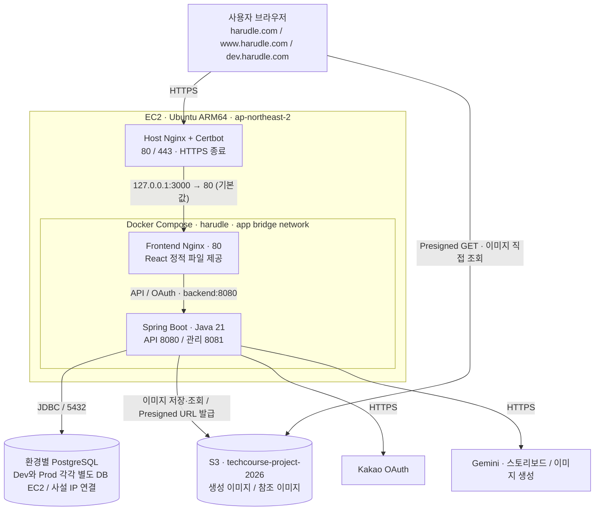
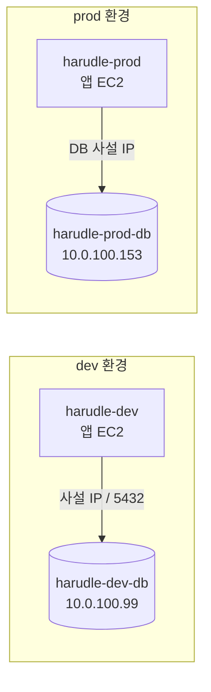

# 하루들 작업 컨텍스트

코드 작업에 필요한 런타임과 배포 구성을 정리한다. 아래 구성은 저장소의 배포 설정과
팀이 제공한 운영 설명을 기준으로 한다. 실제 AWS 리소스의 적용 상태가 필요하면
관련 운영 기록을 확인한다. 이 문서의 경로는 저장소 루트를 기준으로 한다.

2026-10-23에 Dev 앱을 새 `harudle-dev`로 옮기고, DB 연결을 별도 EC2인
`harudle-dev-db`의 PostgreSQL로 전환했다. 같은 날 팀 확인에 따라 Prod도 RDS에서
별도 EC2의 PostgreSQL로 전환했고, 앱 `.env`의 DB 주소를 해당 DB 사설 IP로 변경했다.
새 Dev 앱 서버는 구축 중 `harudle-dev2`라고 불렀으며, 현재 AWS Name 태그는 `harudle-dev`다.
ADR의 목표 구성과 실제 적용 상태를 구분한다.

## 런타임 구성



- Frontend Nginx는 `/api/**`, `/oauth2/**`, `/login/oauth2/**`를
  `backend:8080`으로 전달한다. `/scalar`, `/v3/api-docs`도 프록시 경로에 포함되며,
  API 문서의 활성화 여부는 백엔드 설정으로 결정한다.
- TLS는 호스트에서 종료된다. 인증·리다이렉트 변경 시 두 Nginx와 백엔드의
  전달 헤더 설정을 함께 확인한다.
- 백엔드는 DB에 저장한 S3 Object Key로 Presigned GET URL을 발급하고,
  브라우저가 S3에서 직접 이미지를 가져온다. 기본 URL 유효 시간은 `15m`이며
  `S3_ACCESS_URL_TTL`로 설정한다. 브라우저의 이미지 fetch에는 S3 CORS 설정이 필요하다.

## 실행 자원과 설정 위치

| 구성 | 연결·설정 | 자원·역할 |
| --- | --- | --- |
| Frontend | `127.0.0.1:${APP_PORT:-3000} → 80` | Nginx + React, 메모리 `192m` |
| Backend API | Docker `app` 네트워크의 `backend:8080` | Spring Boot, 메모리 `1200m` |
| Backend 관리 포트 | `127.0.0.1:19091 → 8081` | `/actuator/prometheus` 수집 |
| Backend 임시 파일 | `/tmp` tmpfs | 메모리 기반 `128m` |
| 서버 환경 변수 | EC2 `/opt/harudle/.env` | 배포 간 유지, Backend `env_file` |
| S3 인증 | EC2 IAM Role `ec2-project` | 임시 자격 증명 사용 |
| GCP WIF 설정 파일 | 호스트 `/etc/harudle/gcp/gcp-wif.json` → 컨테이너 `/var/run/harudle/gcp-wif.json` | 읽기 전용 마운트 |

두 컨테이너의 재시작 정책은 `unless-stopped`다. 이미지 처리·동시 실행 수·
임시 파일 사용량을 바꿀 때는 위 메모리 제한을 함께 고려한다.

이미지 비동기 작업 처리기는 같은 백엔드 앱 안에서 앱 시작 시 항상 등록된다.
`GENERATION_WORKER_CONCURRENCY`로 백엔드 한 대의 동시 실행 수를 정한다.
아직 끝나지 않은 `PENDING`과 `PROCESSING` 작업의 합도 이 수로 제한한다.
새 요청이 상한에 도달하면 `503 GENERATION_CAPACITY_EXCEEDED`로 거절한다.
거절된 요청은 사용량과 게스트 체험 횟수를 차감하지 않는다. 같은 요청의 재전송은 기존 작업을 반환한다.
접수 후 `GENERATION_PENDING_TIMEOUT` 이상 기다린 `PENDING` 작업은 자동 만료 대상이다. 기본값은 `120s`다.
`GENERATION_PENDING_CLEANUP_INTERVAL`마다 만료 대상 ID를 최대 100개 조회한다. 기본 간격은 `5s`다.
각 작업은 행 잠금 후 상태와 저장 시각을 다시 확인하고, `GENERATION_PENDING_TIMEOUT` 오류와 일기 숨김,
원래 사용 날짜의 회원 생성 횟수 복구를 함께 저장한다. 이미 선점되거나 종료된 작업은 건너뛰며, 횟수를 두 번 복구하지 않는다.
처리기는 기한이 지나지 않은 작업만 조회하고 잠금 후에도 기한을 다시 확인한다. 기한이 지난 작업은 실행하지 않고 정리에 맡긴다.
실제 실패 저장 시점은 확인 간격과 DB 처리 시간에 따라 늦어질 수 있다. `PROCESSING`에는 기존 처리 제한 시간을 적용한다.
선점 후 AI 호출에 필요한 정보를 읽다가 일시적인 DB 오류가 나면 한 번 즉시 다시 조회한다.
이 재조회는 AI를 호출하기 전까지만 적용한다. 다시 실패하면 기존 실패 저장 절차를 따른다.
선점 저장이 성공하면 작업 저장부터 선점까지의 대기 시간을 기록한다. 대기와 처리 중 작업 수는 지표 수집 때 DB에서 조회한다.
접수 상한에 따른 거절 횟수도 별도로 기록한다. 수집 설정과 확인 방법은 `deploy/monitoring/README.md`를 따른다.
기본 동시 실행 수는 `1`, `GENERATION_WORKER_POLL_INTERVAL`의
기본 확인 간격은 `5s`다. 환경 변수를 바꾸면 로컬 백엔드는 재시작하고, 배포 컨테이너는
재생성해야 한다.
Codex 이미지 대체 생성을 켜면 별도의 HTTP worker가 일반 생성과 관리자 복구의 Codex 요청을 함께 처리한다.
Worker 한 대의 동시 생성 수는 `CODEX_IMAGE_CONCURRENCY`, 대기 수는 `CODEX_IMAGE_QUEUE_CAPACITY`로 정하며 기본값은 각각 1이다.
입력 수신 중인 요청도 접수 한도에 포함하고, 한도가 차면 503을 반환한다. 기존 300초 제한은 입력 수신과 대기, 생성을 합쳐 적용한다.
백엔드의 일기 작업 동시 실행 수와 별도로 설정한다. 실행과 취소, 로그 확인 방법은 `backend/codex-image-worker/README.md`를 따른다.
앱 종료가 시작되면 새 선점을 멈추고, 생성 처리기의 종료 단계에서 진행 중인 작업을 최대 6분 기다린다.
이 단계는 HTTP 종료 단계 뒤에 두고 다른 실행기와 DB 연결을 닫기 전에 진행한다. 작업이 먼저 끝나면 다음 종료 절차로 넘어간다.
로컬과 배포 Compose의 백엔드 종료 유예는 7분, CodeDeploy의 `ApplicationStart` 훅 제한은 600초다.
갑작스러운 강제 종료나 종료 기한 초과로 남은 `PROCESSING` 작업은 기존 처리 시간 초과 정리를 따른다.
회원과 게스트, 부하 테스트 생성 API는 새 일기와 대기 작업을 저장한 뒤 `202 Accepted`로 생성 상태를 반환한다.
같은 요청의 기존 상태와 결과는 `200 OK`로 반환한다.
회원은 `/api/v1/diary-generations/{generationId}`, 게스트는 `/api/v1/guest/diary-generations/{generationId}`로
본인의 생성 상태를 조회한다. 성공 시 일기 ID, 실패 시 오류 코드를 반환한다. 실패로 숨겨진 일기의 작업 상태도 조회할 수 있다.
AI 설정이 준비되지 않으면 신규 접수를 거절한다. 부하 테스트도 같은 대기열과 처리기를 사용한다.
부하 테스트 API가 접수한 생성 ID는 메모리에 등록하며, 처리기가 이 ID에 dev 전용 가짜 AI 실행기를 사용한다.
대기 중 만료된 테스트 작업은 만료 저장이 커밋된 뒤 메모리 연결을 지운다. 저장이 취소되면 연결을 유지한다.
이 연결은 현재 백엔드 프로세스에서만 유지된다.
dev 부하 테스트 중 백엔드가 중단되면 k6와 백엔드를 멈추고, `cleanup_stopped.py`로 미완료 테스트 작업을 지운 뒤 다시 켠다.
정리 명령은 중단된 컨테이너와 기존 테스트 준비 파일의 dev DB 설정을 확인한다. 컨테이너는 삭제하지 않는다.
지정한 실행의 미완료 테스트 작업과 연결된 일기를 지우고 사용 날짜별 생성 횟수를 돌려준다.
앱 시작과 배포 훅에는 자동 정리를 넣지 않는다. 실행 순서와 완료 확인은 `backend/load-test/README.md`를 따른다.

## dev / prod 구성

Dev는 앱 EC2와 DB EC2를 따로 사용한다. 2026-10-23에 새 앱 서버에서
DB 사설 IP로 접속하고, 백엔드와 프론트엔드가 모두 `healthy`인 것을 확인했다.
Prod도 앱 EC2와 DB EC2를 따로 사용하며, 앱 `.env`에는 DB 사설 IP를 설정했다.
Prod 전환은 같은 날 팀이 알려준 내용이며, 두 환경의 DB 주소와 서버 사양은 AWS EC2 API로 확인했다.
Prod 앱과 DB 컨테이너의 `healthy` 상태는 확인했다.
Prod 앱에서 DB 계정으로 직접 접속하는 별도 시험은 수행하지 않았다.



| 항목 | dev | prod |
| --- | --- | --- |
| CodeDeploy 배포 그룹 | `harudle-dev` | `harudle-prod` |
| `DEPLOY_ENV` | `dev` | `prod` |
| Spring 활성 프로필 | `prod` | `prod` |
| Compose | `compose.prod.yaml` + `compose.dev.yaml` | `compose.prod.yaml` |
| 앱 EC2 | `harudle-dev` / `t4g.small` / 사설 IP `10.0.0.234` | `harudle-prod` / `t4g.small` / 사설 IP `10.0.0.183` |
| DB EC2 | `harudle-dev-db` / `t4g.small` / PostgreSQL | `harudle-prod-db` / `t4g.small` / PostgreSQL |
| DB 공인 IP | `54.116.226.98` | `43.202.26.248` |
| DB 사설 IP | `10.0.100.99` | `10.0.100.153` |
| DB 연결 대상 | `.env`의 `DB_HOST=10.0.100.99`, 포트 `5432` | `.env`의 `DB_HOST=10.0.100.153`로 변경했다는 팀 확인 |
| S3 버킷 | `techcourse-project-2026` | `techcourse-project-2026` |
| 생성 이미지 prefix | `harudle/generated/diary-images/dev` | `harudle/generated/diary-images/prod` |
| 참조 이미지 prefix | `harudle/references/generation/dev` | `harudle/references/generation/prod` |
| 앱 로그 그룹 | `/harudle/dev/backend`, `/harudle/dev/frontend-nginx` | `/harudle/prod/backend`, `/harudle/prod/frontend-nginx` |

Compose 파일은 `deploy/`에 있고 서버에는 `/opt/harudle/`에 설치된다.
환경은 Spring 프로필만으로 판단하지 않고 `DEPLOY_ENV`와 배포 그룹으로 구분한다.
배포 훅은 서버 `.env`와 Compose가 해석한 최종 이미지 설정을 검사한다.
DB 연결 대상은 `DEPLOY_ENV`와 별도로 각 서버 `.env`의 `DB_HOST`, `DB_PORT`,
`DB_NAME`, `DB_USERNAME`, `DB_PASSWORD`로 설정한다. DB 마이그레이션·데이터 작업·
부하 시험·모니터링에서는 해당 환경의 실제 DB를 대상으로 한다.
S3 prefix 변경은 기존 DB의 이미지·참조 이미지 Object Key를 자동으로 바꾸지 않는다.
개인 프로필 이미지는 같은 S3 연결을 사용하며 `harudle/profile-images/{DEPLOY_ENV}/{회원ID}/{UUID}.webp`에 저장한다.
프로필 경로는 `DEPLOY_ENV`에서 자동 구성하고 조회 주소는 기존 `S3_ACCESS_URL_TTL`을 따른다.
프로필 교체 후 삭제할 파일은 `profile_image_cleanup_tasks`에 남기고 커밋 후 정리한다.
정기 실행 없이 이미지 변경 시 해당 회원의 삭제 대기 작업만 처리하며, 현재 사용 중인 파일은 삭제하지 않는다.
실패한 작업은 해당 회원의 다음 이미지 변경에서 재시도한다.

위 IP는 2026-10-23 AWS EC2 조회 기준이다. 앱의 DB 연결에는 사설 IP를 사용한다.
공인 IP 기록은 DB의 외부 직접 접속을 허용한다는 뜻이 아니다. 관리자 접속은 SSH 터널을 사용한다.
인스턴스를 중지하거나 다시 만들면 주소가 달라질 수 있으므로 접속 전 현재 주소를 확인한다.

### 새 Dev 서버에서 확인한 설정

- `dev.harudle.com`은 새 앱 서버의 공인 IP `15.164.84.71`로 변경했다.
  공인 IP는 바뀔 수 있으므로 서버 작업 전 현재 연결 대상을 확인한다.
  기존 Dev 앱 서버 `54.117.6.110`은 AWS Name 태그가 `harudle-delete-me`로 변경돼 남아 있다.
  기존 RDS의 삭제 여부는 확인하지 않았다.
- 앱 서버는 Ubuntu 26.04 ARM64이고, `/swapfile`에 Swap 2GiB를 적용했다.
  파일 권한은 `600`이며 `/etc/fstab`에 등록했다. 재부팅 시험은 하지 않았다.
- Docker와 Compose, Host Nginx와 Certbot을 설치했다. 호스트 Java는 Corretto 21,
  Node.js는 24, pnpm은 11.20.0이다. 실제 앱은 배포 이미지 안의 런타임을 사용한다.
  현재 프론트엔드는 React 정적 파일을 제공하는 Nginx이며 Node.js SSR 전환은 적용하지 않았다.
- `/opt/harudle/.env`는 기존 Dev 값을 복사한 뒤 DB 주소를 사설 IP로 변경했다.
  소유자는 `root:root`, 권한은 `600`이다. `HARUDLE_PUSH_FCM_ENABLED=false`와
  `FIREBASE_PROJECT_ID=harudle-2ef80`도 설정했다. 환경 변수 변경은 컨테이너 재생성 후 적용된다.
- WIF 파일은 기존 Dev에서 `/etc/harudle/gcp/gcp-wif.json`으로 복사했다.
  소유자는 `root:10001`, 권한은 `640`이다. 백엔드 사용자 `10001:10001`이 읽을 수 있고,
  컨테이너의 `/var/run/harudle/gcp-wif.json`에 읽기 전용으로 마운트된다.
  파일이 없으면 컨테이너 생성이 실패한다. 파일 내용과 비밀번호, 개인키는 저장소나 로그에 남기지 않는다.
- Host Nginx의 `/etc/nginx/sites-available/harudle-dev`를 활성화했다.
  HTTP는 HTTPS로 전환하고, HTTPS 요청은 `127.0.0.1:3000`으로 전달한다.
  업로드 제한은 `25m`, 연결 제한은 10초, 송수신 제한은 기존 Dev와 같은 300초다.
  Host와 사용자 IP, 원래 HTTPS 여부를 전달한다. 저장소 예시의 240초와 실제 호스트 설정을 구분한다.
- Certbot 인증서 발급과 갱신 시험에 성공했고 자동 갱신 타이머를 활성화했다.
  화면 HTTPS `200`, 관리 포트의 Prometheus 응답 `200`, 두 컨테이너의 `healthy`를 확인했다.
  로그인과 일기 생성은 별도로 시험하지 않았다.
- 앱은 DB 사설 IP `10.0.100.99:5432`에 직접 연결한다. 이 주소에서 기존 DB 계정의
  `SELECT 1`이 성공했다. 공인 IP `54.116.226.98:5432` 접속은 시간 초과됐다.
  관리자 SSH 터널 성공과 앱의 직접 접속 성공은 별도로 확인한다.
  이 접속 시험으로 DB TLS 검증이나 백업, 복원, EBS 암호화 적용까지 확인한 것은 아니다.

## 배포 구성

팀이 제공한 운영 배포 흐름은 다음과 같다.

```text
GitHub main
  → CodePipeline Source
  → CodeBuild: linux/arm64 Backend / Frontend Docker 이미지 빌드
  → 배포 Artifact: 이미지 tar.gz + SHA-256 + Compose + appspec + 스크립트·설정
  → CodeDeploy → EC2 CodeDeploy Agent
      BeforeInstall    : ARM64 / Docker / Compose / jq / 서버 .env 확인
      AfterInstall     : 이미지 체크섬 검증 → docker load
      ApplicationStart : 배포 환경 검사 → Compose 컨테이너 교체 (--no-build)
      ValidateService  : 컨테이너 health + Frontend /health + 관리 포트 지표 확인
```

CodeBuild가 이미지를 `docker save`로 묶어 전달하고 EC2가 로드한다.
EC2에서는 Gradle·Node 빌드를 수행하지 않는다. 네이티브 의존성과 베이스 이미지를
바꿀 때는 최종 이미지의 `linux/arm64` 호환성을 확인한다.

현재 작업 트리에는 PR 검증용 `.github/workflows/test.yml`과 배포 확인 후 수동으로
실행하는 `.github/workflows/frontend-release.yml`이 정의되어 있다.
PR 백엔드 CI는 `gradle/actions/setup-gradle`로 실행 파일, 의존성과 컴파일 결과를 저장한다.
`--build-cache test --rerun`으로 컴파일 결과를 재사용하고 테스트는 매번 실행한다.
캐시는 PR 실행에서도 저장한다. `develop-backend`의 백엔드 컴파일 입력 또는 CI 설정이
바뀌면 같은 Job에서 `classes testClasses --build-cache`로 후속 PR용 공통 캐시를 만든다.
이 push 실행은 컴파일과 캐시 저장만 수행하며, PR 검증과 실행 그룹을 나눠 서로 취소하지 않는다.
AWS 배포 파이프라인과 GitHub 워크플로의 역할을 구분해 확인한다.
프론트엔드 PR CI는 타입 검사, 린트, 형식 검사, 테스트와 배포용 빌드를 실행한다.
CodeBuild는 프론트엔드 입력이 같으면 이전 이미지를 재사용하고, 다르면 새 이미지를
빌드한다. 배포 브랜치에 PR 없이 직접 변경을 넣으면 PR 검사를 거치지 않는다.

## 로그와 지표 수집

- 배포 Compose의 Backend·Frontend 로그는 Docker `awslogs` 드라이버로
  환경별 CloudWatch Logs 그룹에 전송한다. 루트 `compose.yaml`의 `json-file`과 구분한다.
- 앱용 설정을 적용한 호스트 CloudWatch Agent는 `127.0.0.1:19091/actuator/prometheus`를
  수집해 환경별 EMF 로그로 보낸다. Agent 설정은 배포 아티팩트 전달 후 호스트에 별도 적용한다.
- 새 Dev 앱 서버에는 Agent를 설치하고 `cloudwatch-agent.host.json`을 적용했다.
  메모리 사용률과 여유 비율, Swap 사용률, 루트 디스크 사용률을 1분마다 수집한다.
  Dev Java와 API 지표 수집 설정은 적용 완료다. `cloudwatch-agent.dev.json`으로
  새 서버의 Java RSS와 Prometheus 앱 지표를 수집하며, CloudWatch 지표 도착도 확인했다.
  이전 Dev 서버에서는 앱용 Agent 설정만 제거하고 호스트 자원 수집은 유지했다.
- Dev DB EC2에도 Agent를 설치하고 `cloudwatch-agent.db.json`을 적용했다.
  메모리와 Swap, 루트 및 `/srv/harudle/db-data`의 사용률과 남은 용량을 1분마다 수집한다.
  새 앱 서버와 DB 서버의 메모리, Swap 및 DB 디스크 여유 공간이 CloudWatch에 도착한 것을 확인했다.
- `DASHBOARD-harudle-dev`의 앱 대상은 `i-08ff5dddb7ac94f5c`, DB 대상은
  `i-04fca55979b3240d6`이다. RDS 그래프는 EC2와 데이터 EBS 지표로 교체했다.
  데이터 EBS는 `vol-00886d19a64c23e1f`다. 앱과 DB를 함께 덮어쓰던 공통 InstanceId 선택기는 제거했다.
  DB 전체 연결 수는 별도 수집이 필요하며 앱의 HikariPool 지표와 구분한다.
  대시보드 변경이 개별 경보의 대상도 바꾸는 것은 아니다.
- Prod DB EC2 `i-01baa5c11a6224cd7`에도 `cloudwatch-agent.db.json`을 적용하고
  Agent 자동 시작과 `running`을 확인했다. 데이터 디스크는 Dev와 같은 `/srv/harudle/db-data`다.
  CloudWatch에서 메모리 여유 비율, Swap 사용률, 두 디스크 여유 공간의 실제 데이터 도착을 확인했다.
  `DASHBOARD-harudle-prod`의 RDS 그래프를 이 DB EC2와 데이터 EBS
  `vol-048d203fac554e776`의 지표로 교체했다. 기존 Prod 앱 그래프는 유지했다.
- Frontend `/health`는 Nginx의 응답 여부를 확인한다. DB와 S3, Gemini의 실제 기능은
  각각의 기능 검증과 로그로 확인한다.

- API 완료 로그에 요청별 S3와 R2 확인 횟수, URL 서명 시간, 피드 데이터 조회 시간을 기록한다.
  프론트엔드 Nginx는 응답 추적 ID와 프록시 시간을 JSON으로 남긴다. 호스트 Nginx 예시에도
  같은 형식이 있지만 실제 HTTPS 설정에는 별도로 적용해야 한다. 필드 뜻과 CloudWatch 필터
  적용 순서는 [요청 지연 확인 절차](deploy/monitoring/request-latency.md)를 따른다.

## 작업별 확인 위치

변경하는 구성에 해당하는 문서와 실제 설정을 함께 읽는다.

| 작업 | 확인 위치 |
| --- | --- |
| 프론트엔드 코드 | [frontend/AGENTS.md](frontend/AGENTS.md) |
| 배포·환경 변수 | [deploy/README.md](deploy/README.md), [.env.docker.example](.env.docker.example), [배포 환경 검사](deploy/scripts/compose_environment.sh) |
| 컨테이너·자원·포트 | [운영 Compose](deploy/compose.prod.yaml), [dev override](deploy/compose.dev.yaml) |
| 프록시·HTTPS·OAuth 경로 | [Host Nginx 예시](deploy/nginx/harudle.conf.example), [Frontend Nginx](frontend/nginx/default.conf) |
| 이미지 빌드·배포 훅 | [buildspec.yml](buildspec.yml), [appspec.yml](appspec.yml), `deploy/scripts/` |
| 이미지 저장·조회·삭제 | [이미지 저장소 분리 절차](docs/image-storage-isolation.md) |
| DB 연결·데이터 작업 | [DB 연결 설정](backend/src/main/resources/application.yml), [배포 환경 안내](deploy/README.md) |
| 로그·지표·알람 | [모니터링 운영 안내](deploy/monitoring/README.md) |

운영 기록에 과거 구성이 남아 있으면 현재 설정과 비교한다. 특히 로그 수집 방식,
S3 prefix, GitHub 워크플로 유무는 위에 연결한 실제 설정을 확인한다.
구성을 변경하면 해당 설정과 이 요약·관련 문서를 함께 갱신한다.
