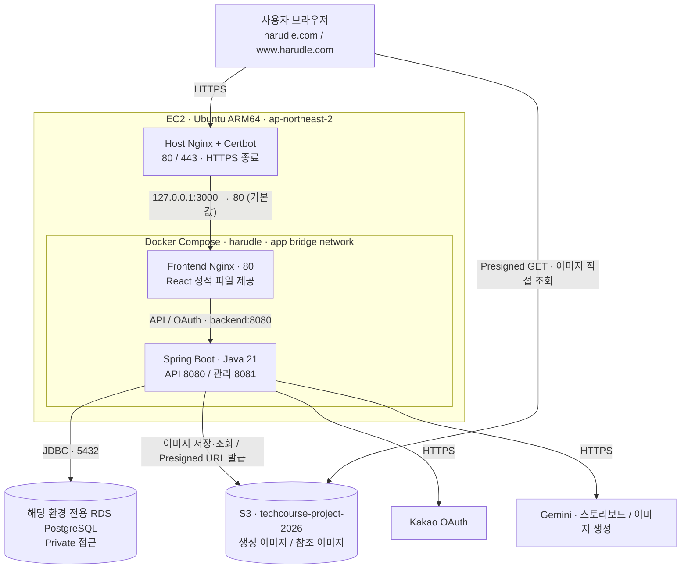
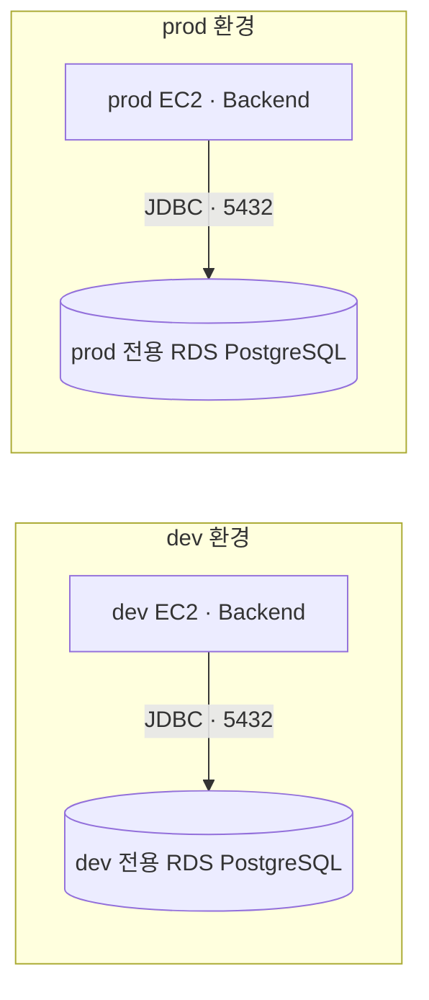

# 하루들 작업 컨텍스트

코드 작업에 필요한 런타임과 배포 구성을 정리한다. 아래 구성은 저장소의 배포 설정과
팀이 제공한 운영 설명을 기준으로 한다. 실제 AWS 리소스의 적용 상태가 필요하면
관련 운영 기록을 확인한다. 이 문서의 경로는 저장소 루트를 기준으로 한다.

## 런타임 구성



- Frontend Nginx는 `/api/**`, `/oauth2/**`, `/login/oauth2/**`를
  `backend:8080`으로 전달한다. `/scalar`, `/v3/api-docs`도 프록시 경로에 포함되며,
  API 문서의 활성화 여부는 백엔드 설정으로 결정한다.
- TLS는 호스트에서 종료된다. 인증·리다이렉트 변경 시 두 Nginx와 백엔드의
  전달 헤더 설정을 함께 확인한다.
- 백엔드는 DB에 저장한 S3 Object Key로 Presigned GET URL을 발급하고,
  브라우저가 S3에서 직접 이미지를 가져온다. 기본 URL 유효 시간은 `15m`이며
  `S3_ACCESS_URL_TTL`로 설정한다. 브라우저의 이미지 fetch에는 S3 CORS 설정이 필요하다.

## 실행 자원과 설정 위치

| 구성 | 연결·설정 | 자원·역할 |
| --- | --- | --- |
| Frontend | `127.0.0.1:${APP_PORT:-3000} → 80` | Nginx + React, 메모리 `192m` |
| Backend API | Docker `app` 네트워크의 `backend:8080` | Spring Boot, 메모리 `1200m` |
| Backend 관리 포트 | `127.0.0.1:19091 → 8081` | `/actuator/prometheus` 수집 |
| Backend 임시 파일 | `/tmp` tmpfs | 메모리 기반 `128m` |
| 서버 환경 변수 | EC2 `/opt/harudle/.env` | 배포 간 유지, Backend `env_file` |
| S3 인증 | EC2 IAM Role `ec2-project` | 임시 자격 증명 사용 |
| GCP WIF 설정 파일 | 호스트 `/etc/harudle/gcp/gcp-wif.json` → 컨테이너 `/var/run/harudle/gcp-wif.json` | 읽기 전용 마운트 |

두 컨테이너의 재시작 정책은 `unless-stopped`다. 이미지 처리·동시 실행 수·
임시 파일 사용량을 바꿀 때는 위 메모리 제한을 함께 고려한다.

이미지 비동기 작업 처리기는 같은 백엔드 앱 안에서 실행하며 기본으로 꺼져 있다.
`GENERATION_WORKER_ENABLED`로 켜고, `GENERATION_WORKER_CONCURRENCY`로 백엔드 한 대의
동시 실행 수를 정한다. 기본 동시 실행 수는 `1`, `GENERATION_WORKER_POLL_INTERVAL`의
기본 확인 간격은 `5s`다. 환경 변수를 바꾸면 로컬 백엔드는 재시작하고, 배포 컨테이너는
재생성해야 한다. 회원과 게스트, 부하 테스트 생성 API는 새 일기와 대기 작업을 저장한 뒤 `202 Accepted`로 생성 상태를 반환한다.
같은 요청의 기존 상태와 결과는 `200 OK`로 반환한다.
회원은 `/api/v1/diary-generations/{generationId}`, 게스트는 `/api/v1/guest/diary-generations/{generationId}`로
본인의 생성 상태를 조회한다. 성공 시 일기 ID, 실패 시 오류 코드를 반환한다. 실패로 숨겨진 일기의 작업 상태도 조회할 수 있다.
이미지 생성을 실행하려면 작업 처리기를 켜야 한다. 부하 테스트도 같은 대기열과 처리기를 사용한다.
부하 테스트 API가 접수한 생성 ID는 메모리에 등록하며, 처리기가 이 ID에 dev 전용 가짜 AI 실행기를 사용한다.
이 연결은 현재 백엔드 프로세스에서만 유지된다.

## dev / prod 구성

dev와 prod는 각각 별도 EC2와 별도 RDS 인스턴스를 사용한다.
RDS 인스턴스 분리는 2026-10-15 팀 확인 기준이다.



| 항목 | dev | prod |
| --- | --- | --- |
| CodeDeploy 배포 그룹 | `harudle-dev` | `harudle-prod` |
| `DEPLOY_ENV` | `dev` | `prod` |
| Spring 활성 프로필 | `prod` | `prod` |
| Compose | `compose.prod.yaml` + `compose.dev.yaml` | `compose.prod.yaml` |
| RDS | dev 전용 PostgreSQL 인스턴스 | prod 전용 PostgreSQL 인스턴스 |
| DB 연결 대상 | dev 서버 `.env`의 dev RDS `DB_HOST` | prod 서버 `.env`의 prod RDS `DB_HOST` |
| S3 버킷 | `techcourse-project-2026` | `techcourse-project-2026` |
| 생성 이미지 prefix | `harudle/generated/diary-images/dev` | `harudle/generated/diary-images/prod` |
| 참조 이미지 prefix | `harudle/references/generation/dev` | `harudle/references/generation/prod` |
| 앱 로그 그룹 | `/harudle/dev/backend`, `/harudle/dev/frontend-nginx` | `/harudle/prod/backend`, `/harudle/prod/frontend-nginx` |

Compose 파일은 `deploy/`에 있고 서버에는 `/opt/harudle/`에 설치된다.
환경은 Spring 프로필만으로 판단하지 않고 `DEPLOY_ENV`와 배포 그룹으로 구분한다.
배포 훅은 서버 `.env`와 Compose가 해석한 최종 이미지 설정을 검사한다.
RDS 연결 대상은 `DEPLOY_ENV`와 별도로 각 서버 `.env`의 `DB_HOST`, `DB_PORT`,
`DB_NAME`, `DB_USERNAME`, `DB_PASSWORD`로 설정한다. DB 마이그레이션·데이터 작업·
부하 시험·모니터링에서는 해당 환경의 RDS 인스턴스를 대상으로 한다.
S3 prefix 변경은 기존 DB의 이미지·참조 이미지 Object Key를 자동으로 바꾸지 않는다.

## 배포 구성

팀이 제공한 운영 배포 흐름은 다음과 같다.

```text
GitHub main
  → CodePipeline Source
  → CodeBuild: linux/arm64 Backend / Frontend Docker 이미지 빌드
  → 배포 Artifact: 이미지 tar.gz + SHA-256 + Compose + appspec + 스크립트·설정
  → CodeDeploy → EC2 CodeDeploy Agent
      BeforeInstall    : ARM64 / Docker / Compose / jq / 서버 .env 확인
      AfterInstall     : 이미지 체크섬 검증 → docker load
      ApplicationStart : 배포 환경 검사 → Compose 컨테이너 교체 (--no-build)
      ValidateService  : 컨테이너 health + Frontend /health + 관리 포트 지표 확인
```

CodeBuild가 이미지를 `docker save`로 묶어 전달하고 EC2가 로드한다.
EC2에서는 Gradle·Node 빌드를 수행하지 않는다. 네이티브 의존성과 베이스 이미지를
바꿀 때는 최종 이미지의 `linux/arm64` 호환성을 확인한다.

현재 작업 트리에는 PR 검증용 `.github/workflows/test.yml`과 배포 확인 후 수동으로
실행하는 `.github/workflows/frontend-release.yml`이 정의되어 있다.
PR 백엔드 CI는 `gradle/actions/setup-gradle`로 실행 파일, 의존성과 컴파일 결과를 저장한다.
`--build-cache test --rerun`으로 컴파일 결과를 재사용하고 테스트는 매번 실행한다.
캐시는 PR 실행에서도 저장한다. `develop-backend`의 백엔드 컴파일 입력 또는 CI 설정이
바뀌면 같은 Job에서 `classes testClasses --build-cache`로 후속 PR용 공통 캐시를 만든다.
이 push 실행은 컴파일과 캐시 저장만 수행하며, PR 검증과 실행 그룹을 나눠 서로 취소하지 않는다.
AWS 배포 파이프라인과 GitHub 워크플로의 역할을 구분해 확인한다.

## 로그와 지표 수집

- 배포 Compose의 Backend·Frontend 로그는 Docker `awslogs` 드라이버로
  환경별 CloudWatch Logs 그룹에 전송한다. 루트 `compose.yaml`의 `json-file`과 구분한다.
- 호스트 CloudWatch Agent는 `127.0.0.1:19091/actuator/prometheus`를 수집해
  환경별 EMF 로그로 보낸다. Agent 설정은 배포 아티팩트 전달 후 호스트에 별도 적용한다.
- Frontend `/health`는 Nginx의 응답 여부를 확인한다. RDS·S3·Gemini의 실제 기능은
  각각의 기능 검증과 로그로 확인한다.

## 작업별 확인 위치

변경하는 구성에 해당하는 문서와 실제 설정을 함께 읽는다.

| 작업 | 확인 위치 |
| --- | --- |
| 프론트엔드 코드 | [frontend/AGENTS.md](frontend/AGENTS.md) |
| 배포·환경 변수 | [deploy/README.md](deploy/README.md), [.env.docker.example](.env.docker.example), [배포 환경 검사](deploy/scripts/compose_environment.sh) |
| 컨테이너·자원·포트 | [운영 Compose](deploy/compose.prod.yaml), [dev override](deploy/compose.dev.yaml) |
| 프록시·HTTPS·OAuth 경로 | [Host Nginx 예시](deploy/nginx/harudle.conf.example), [Frontend Nginx](frontend/nginx/default.conf) |
| 이미지 빌드·배포 훅 | [buildspec.yml](buildspec.yml), [appspec.yml](appspec.yml), `deploy/scripts/` |
| 이미지 저장·조회·삭제 | [이미지 저장소 분리 절차](docs/image-storage-isolation.md) |
| RDS 연결·데이터 작업 | [DB 연결 설정](backend/src/main/resources/application.yml), [배포 환경 안내](deploy/README.md) |
| 로그·지표·알람 | [모니터링 운영 안내](deploy/monitoring/README.md) |

운영 기록에 과거 구성이 남아 있으면 현재 설정과 비교한다. 특히 로그 수집 방식,
S3 prefix, GitHub 워크플로 유무는 위에 연결한 실제 설정을 확인한다.
구성을 변경하면 해당 설정과 이 요약·관련 문서를 함께 갱신한다.
