<h1 align="center">
  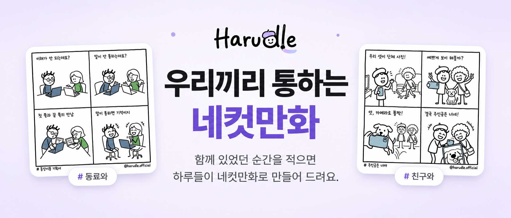
</h1>

  <a href="https://www.harudle.com/">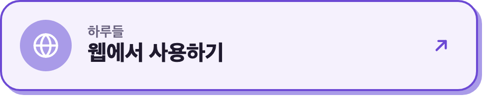</a>
  <a href="https://apps.apple.com/kr/app/%ED%95%98%EB%A3%A8%EB%93%A4/id6827633489">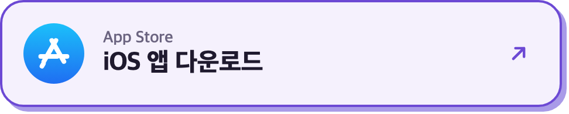</a>

  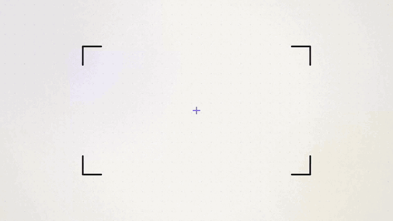

## 하루들을 만든 이유

  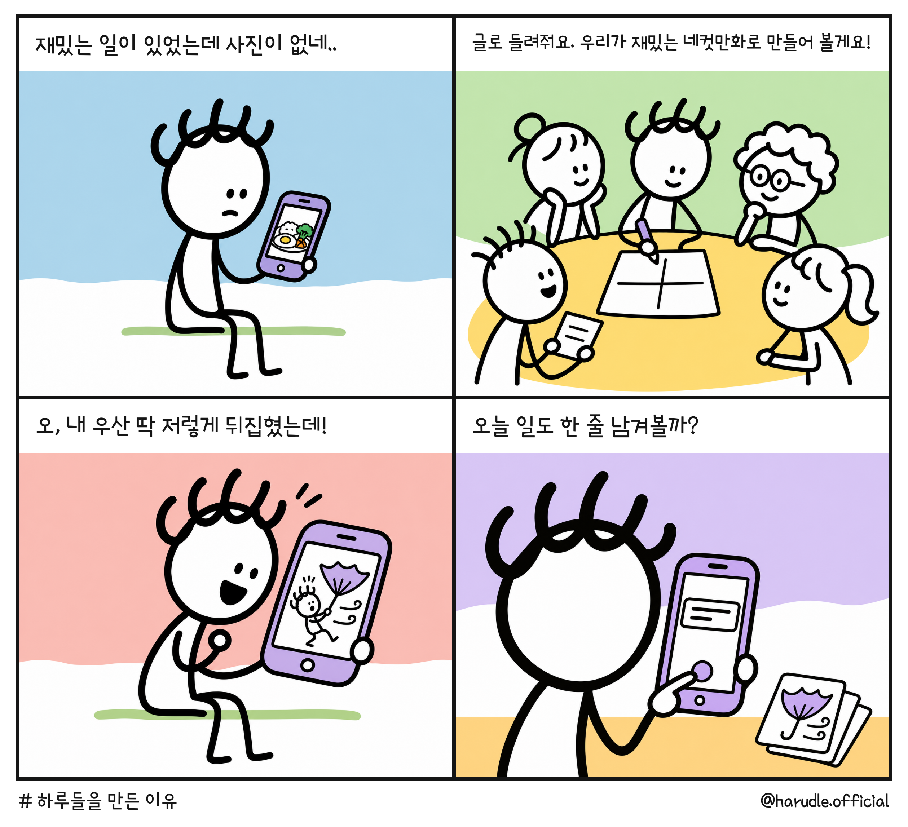

하루들은 짧은 글을 네컷만화로 만들어주는 서비스예요. 이름에는 하루하루를 낙서(doodle)처럼 쌓아 간다는 뜻을 담았어요.

## 하루들 변천사

  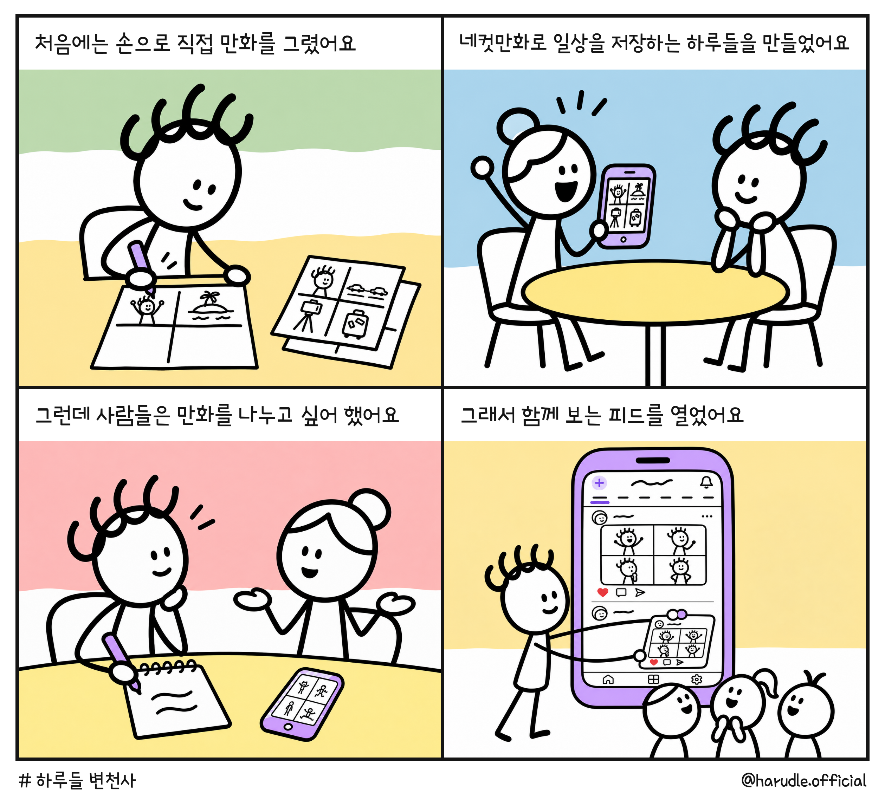

손으로 그려 준 16명 중 14명은 또 만들고 싶대요. 
프로토타입을 써 본 12명 중 11명은 다시 쓰고 싶대요. 
이 반응을 믿고 팀원 5명이 모여 하루들을 만들었어요. 
그런데 인터뷰에서 들은 한마디, “공유할 생각이 없으면 만들러 오지 않는다.” 
그래서 하루들은 공유와 소통에 집중해 피드를 만들었어요.

## 사용 방법

  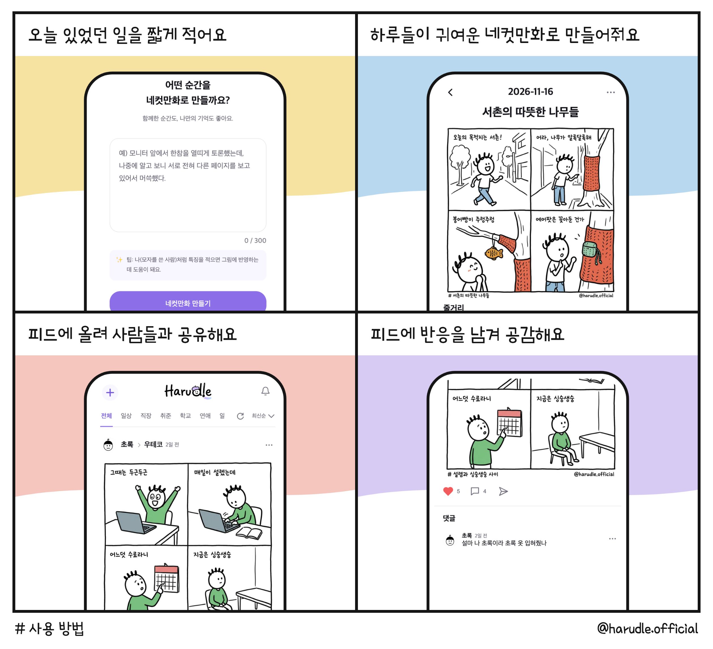

## 하루들 팀원들

<table>
  <tr>
    <td align="center" width="168"> 
      <a href="https://github.com/rix01">
        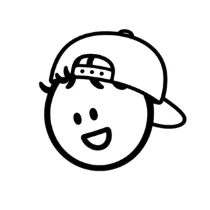 
        <strong>이산</strong> 
        @rix01
      </a>  
    </td>
    <td align="center" width="168"> 
      <a href="https://github.com/e9ua1">
        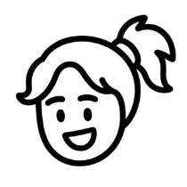 
        <strong>아이큐</strong> 
        @e9ua1
      </a>  
    </td>
    <td align="center" width="168"> 
      <a href="https://github.com/jason0904">
        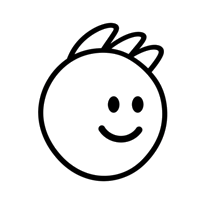 
        <strong>캐모</strong> 
        @jason0904
      </a>  
    </td>
    <td align="center" width="168"> 
      <a href="https://github.com/2jaeheon">
        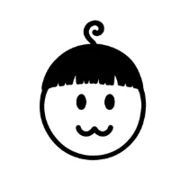 
        <strong>초록</strong> 
        @2jaeheon
      </a>  
    </td>
    <td align="center" width="168"> 
      <a href="https://github.com/jebiyeon02">
         
        <strong>이현</strong> 
        @jebiyeon02
      </a>  
    </td>
  </tr>
</table>

