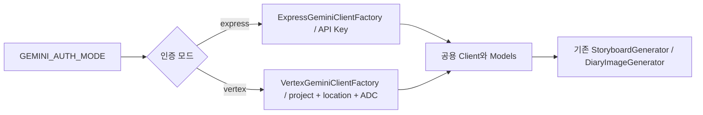

# 하루들 백엔드

Java 21과 Spring Boot 4.1.0 기반의 하루들 백엔드 애플리케이션입니다.

## 기술 스택

- Java 21 (Amazon Corretto)
- Spring Boot 4.1.0
- Spring Web MVC
- Spring Data JPA
- Flyway
- Spring Security
- Spring Security OAuth2 Client & Resource Server
- PostgreSQL 18
- Gradle 9.5.1
- JUnit 6.0.3, AssertJ, Testcontainers

## 사전 준비

- Amazon Corretto 21
- Docker와 Docker Compose 2.2 이상

Gradle은 별도로 설치할 필요가 없습니다. 저장소에 포함된 Gradle Wrapper를 사용합니다.

## 문서

- [API 명세](docs/api-spec.md)

## 도메인 패키지

백엔드는 기능과 데이터 소유권을 기준으로 다음 네 개의 최상위 도메인 패키지로 구성합니다.

```text
com.harudle
├── auth
├── diary
├── generation
└── share
```

| 패키지 | 역할 | 소유 데이터 |
| --- | --- | --- |
| `auth` | 사용자 조회, 카카오 OAuth 로그인, Access/Refresh Token 발급·갱신·폐기 | `users`, `oauth_accounts`, `refresh_tokens` |
| `diary` | 일기 저장, 월간 히스토리와 상세 조회, 소프트 삭제 | `diaries` |
| `generation` | 일일 생성 횟수, 멱등성, AI 생성 상태, 실패 및 고아 작업 복구 | `daily_generation_usage`, `generation_prompts`, `comic_generations` |
| `feed` | 완성된 만화의 공개 게시·상세 조회와 피드 주소 공유 | `feeds` |
| `share` | 기존 공유 링크 데이터와 일기 삭제 시 정리 코드 | `share_links` |

각 도메인은 구현 규모에 따라 `domain`, `application`, `presentation`, `infrastructure` 하위 패키지로 확장합니다.
AI와 S3 같은 외부 시스템 연동은 독립 도메인으로 만들지 않고 `generation.infrastructure`의 어댑터로 둡니다. 보안 설정,
예외 처리와 같은 횡단 관심사는 도메인에 포함하지 않고 별도의 공통 영역에서 관리합니다.

현재 각 도메인의 `package-info.java`는 클래스가 없는 빈 디렉터리를 Git에 추적하고 역할을 표시하기 위한 임시 파일입니다.
해당 패키지에 실제 구현 클래스가 추가되면 대응하는 `package-info.java`를 삭제합니다.

## 로컬 실행

예시 환경 변수 파일을 복사하고 `DB_PASSWORD`에 추측하기 어려운 로컬 비밀번호를 설정합니다.

```shell
cp .env.example .env
```

Windows PowerShell에서는 다음 명령을 사용할 수 있습니다.

```powershell
Copy-Item .env.example .env
```

PostgreSQL을 실행합니다. Docker Compose는 `backend/.env`를 자동으로 읽으며 데이터베이스 포트는 로컬
인터페이스에만 바인딩됩니다.

```shell
docker compose up -d
```

애플리케이션을 실행합니다.

```shell
./gradlew bootRun
```

Windows PowerShell에서는 다음 명령을 사용할 수 있습니다.

```powershell
.\gradlew.bat bootRun
```

기본 데이터베이스 접속 정보는 다음과 같습니다.

| 환경 변수 | 기본값 |
| --- | --- |
| `DB_HOST` | `localhost` |
| `DB_PORT` | `5432` |
| `DB_NAME` | `harudle` |
| `DB_USERNAME` | `harudle` |
| `DB_PASSWORD` | 기본값 없음, 필수 |

애플리케이션은 실행 디렉터리의 `.env` 파일을 선택적으로 읽습니다. IntelliJ에서 애플리케이션을 직접 실행할 때는 Working
directory를 `backend`로 지정하거나 Run Configuration에 환경 변수를 설정합니다. 운영 환경에서는 `.env` 파일 대신 배포
환경의 Secret 또는 환경 변수로 모든 데이터베이스 접속 정보를 주입합니다.

PostgreSQL 18부터 데이터 볼륨은 `/var/lib/postgresql`에 마운트됩니다. 이전 설정으로 만든 개발용 볼륨을 초기화해도 되는
경우 다음 명령으로 삭제한 뒤 컨테이너를 다시 생성할 수 있습니다.

```shell
docker compose down -v
docker compose up -d
```

이 명령은 기존 로컬 데이터베이스 데이터를 삭제하므로 필요한 데이터가 있다면 먼저 백업합니다.

## Gemini Client 인증

외부 생성 어댑터를 활성화하면 `GEMINI_AUTH_MODE`로 Client 생성 방식을 선택합니다.
기본값인 `express`는 기존 Vertex AI Express API Key 방식을 사용합니다. `vertex`는 GCP 프로젝트와
위치를 지정하고 Application Default Credentials(ADC)로 인증합니다.
인증 모드를 생략하거나 빈 값·공백으로 설정하면 `express`를 사용합니다. 모드 이름의 앞뒤 공백과
대소문자 차이는 허용하며, 지원하지 않는 이름은 애플리케이션 시작 시 설정 오류로 거절합니다.

| 설정 | `express` | `vertex` |
| --- | --- | --- |
| `GOOGLE_API_KEY` (또는 `GEMINI_API_KEY`) | 필수 | 사용하지 않음 |
| `GOOGLE_CLOUD_PROJECT` | 사용하지 않음 | 필수 |
| `GOOGLE_CLOUD_LOCATION` | 사용하지 않음 | 기본값 `global` |
| `GOOGLE_APPLICATION_CREDENTIALS` | 사용하지 않음 | WIF credential configuration 파일의 절대 경로 |

`GeminiClientFactory`의 구현체만 교체되며, 기존 생성 서비스의 `ObjectProvider`와
`StoryboardGenerator` / `DiaryImageGenerator` 인터페이스는 유지됩니다. 모델, 요청 제한 시간,
SDK 재시도 횟수는 기존 설정을 그대로 사용합니다.



Nano Banana 2.1을 표준 Vertex AI에서 사용하려면 다음 환경 변수를 설정합니다. 기존 S3 및 생성
프롬프트 설정도 필요합니다.

```dotenv
HARUDLE_GENERATION_ADAPTERS_ENABLED=true
GEMINI_AUTH_MODE=vertex
GOOGLE_CLOUD_PROJECT=your-gcp-project-id
GOOGLE_CLOUD_LOCATION=global
GOOGLE_APPLICATION_CREDENTIALS=/var/run/harudle/gcp-wif.json
GEMINI_IMAGE_MODEL=gemini-nano-banana-2.1
```

EC2에서는 기존 인스턴스 역할을 허용하는 GCP Workload Identity Federation 공급자와 서비스 계정
권한을 구성하고, AWS용 `external_account` credential configuration 파일을 생성합니다.
프로젝트의 서비스 계정에는 Vertex AI 호출 권한(예: `roles/aiplatform.user`), 허용한 외부 주체에는
해당 서비스 계정의 `roles/iam.workloadIdentityUser` 권한이 필요합니다. 이 파일에는 서비스 계정의
private key를 넣지 않습니다. Java Google Auth 라이브러리가 ADC 파일을 읽어 AWS 임시 자격 증명을
교환하고 GCP 액세스 토큰을 갱신합니다. 별도의 토큰 저장·갱신 코드는 필요하지 않습니다.

EC2 IMDSv2용 파일은 `--aws`와 `--enable-imdsv2`를 함께 지정해 생성합니다.
아래 `PROJECT_NUMBER`는 프로젝트 ID가 아닌 숫자 프로젝트 번호이며, 나머지 자리에는 구성한
Pool·Provider ID와 서비스 계정 이메일을 넣습니다.

```bash
gcloud iam workload-identity-pools create-cred-config \
  "projects/PROJECT_NUMBER/locations/global/workloadIdentityPools/POOL_ID/providers/PROVIDER_ID" \
  --service-account="SERVICE_ACCOUNT_EMAIL" \
  --aws \
  --enable-imdsv2 \
  --output-file="gcp-wif.json"
```

생성된 JSON의 `credential_source.imdsv2_session_token_url` 값이
`http://169.254.169.254/latest/api/token`인지 확인합니다. 이 항목이 없으면 IMDSv2 토큰 없이
메타데이터를 조회하므로 `Http tokens=required`인 EC2에서 401 응답으로 인증에 실패할 수 있습니다.
파일 생성 옵션은 [Google의 AWS WIF 공식 안내](https://docs.cloud.google.com/iam/docs/workload-identity-federation-with-other-clouds)를 참고합니다.

컨테이너에서는 호스트의 credential configuration 파일을 읽기 전용으로 마운트하고
`GOOGLE_APPLICATION_CREDENTIALS`를 컨테이너 내부 경로로 지정합니다. 현재 Compose에는 이
마운트가 없으므로 배포할 때 추가해야 합니다. 컨테이너에서 EC2 IMDS에 접근할 수 있어야 합니다.
Docker bridge 네트워크에서는 [배포 가이드의 EC2 IMDSv2 설정](../deploy/README.md)에 따라
`Metadata response hop limit`을 `2`로 설정하고 `Http tokens=required`를 유지합니다.
GCP WIF 리소스 생성과 운영 Compose 변경은 이 Client 구현에 포함하지 않습니다.

`backend/.env`를 Spring 설정으로 읽는 것만으로는 ADC의 환경 변수가 설정되지 않습니다.
`GOOGLE_APPLICATION_CREDENTIALS`는 Java **프로세스 환경 변수**로 주입해야 합니다. IntelliJ에서는
Run Configuration에 지정하고, PowerShell에서는 다음과 같이 실행합니다.

```powershell
$env:GOOGLE_APPLICATION_CREDENTIALS='C:\credentials\gcp-wif.json'
.\gradlew.bat bootRun
```

Docker의 `env_file`에 지정한 변수는 프로세스 환경으로 전달됩니다. WIF 파일 없이 로컬 개발을 할
때는 `gcloud auth application-default login`으로 생성한 ADC를 사용할 수도 있습니다. Vertex 모드에서
ADC를 찾을 수 없으면 애플리케이션 시작에 실패하며 Express 인증으로 전환하지 않습니다.

공식 안내: [AWS 연동 WIF](https://docs.cloud.google.com/iam/docs/workload-identity-federation-with-other-clouds),
[Nano Banana 2.1 모델](https://docs.cloud.google.com/gemini-enterprise-agent-platform/models/gemini/nano-banana-2-1).

## Qwen 스토리보드 어댑터

`QwenStoryboardGenerator`는 기존 `StoryboardGenerator`를 구현합니다. Gemini와 Qwen 모두
`StoryboardResponseSchema`, `StoryboardJsonCodec`, `StoryboardResponseMapper`로 네 컷 JSON을 검증하고
같은 `GeneratedStoryboard`를 반환합니다. 따라서 생성된 스토리보드는 기존 이미지 프롬프트 렌더러로
전달할 수 있습니다. Gemini SDK의 `propertyOrdering` 변환은 Gemini 어댑터에서 처리합니다.

Qwen HTTP 호출과 SSE 파싱은 별도 구현체인 `QwenChatClient`가 담당합니다. 현재는 공통
`ChatCompletionClient` 인터페이스를 추가하지 않습니다. 다른 Provider는 `StoryboardGenerator` 구현을
추가하고, 같은 호출 규격을 공유할 실제 구현체가 생기면 클라이언트 인터페이스를 추출할 수 있습니다.

기본 설정은 `qwen3.8-max`, 추론 활성화, `thinking_budget=1024`, `max_tokens=8192`, `json_object`,
요청 전체 제한 시간 180초입니다. `QwenStoryboardSettings`로 모델명, 추론 예산, 출력 한도와 제한 시간을
변경합니다. `json_object`에서는 기존 시스템 프롬프트 뒤에 공통 출력 스키마를 붙입니다.

스토리보드 Provider는 `STORYBOARD_PROVIDER`로 선택합니다. 값은 소문자 `gemini` 또는 `qwen`이며
기본값은 `gemini`입니다. dev에서 Qwen 스토리보드와 기존 Gemini 이미지 생성을 연결하려면 서버의
`.env`에 다음 값을 설정하고 변경된 백엔드로 컨테이너를 재생성합니다.

```dotenv
STORYBOARD_PROVIDER=qwen
QWEN_TOKEN_PLAN_API_KEY=<sk-sp- 전용 키>
QWEN_STORYBOARD_MODEL=qwen3.8-max
QWEN_THINKING_BUDGET=1024
QWEN_MAX_OUTPUT_TOKENS=8192
QWEN_REQUEST_TIMEOUT=180s
```

현재 배포 Compose의 `env_file: .env`로 위 변수가 전달됩니다. Gemini 이미지 생성에 필요한 인증·모델,
S3 설정도 함께 사용합니다. API 키는 서버 환경에 주입하고 Git에는 저장하지 않습니다.
Qwen을 선택했을 때 Qwen 설정을 검증하며, 잘못된 Provider 값이나 필수 키 누락은 시작 시 거절합니다.
설정 변경은 애플리케이션 재시작 후 적용됩니다.

기본 클라이언트는 Token Plan 전용 엔드포인트와 `sk-sp-` 키를 사용합니다. 키는 실행 환경에서 주입하며
예외와 로그에 응답 원문이나 키를 남기지 않습니다. HTTP 상태, 타임아웃, 통신 실패, 잘린 출력과 응답
검증 실패를 기존 `AiGenerationErrorType`으로 변환합니다. 클라이언트 자동 재시도는 비활성화되어 있습니다.
추론 토큰이 응답에 없으면 알 수 없는 값으로 유지하며 최종 답변 토큰을 임의로 계산하지 않습니다.

Qwen 호출은 `generation_stage_completed` 로그에 `provider=qwen`, `stage=storyboard`, 모델,
성공 여부·오류 종류, 생성 시간과 토큰을 기록합니다. 응답을 완전히 수신하면 HTTP 헤더·첫 추론·첫 최종 답변·완료
수신 시간도 기록합니다. 토큰 집계는 기존 생성 완료 저장 경로로 전달하며, 실패 응답에서 이미 받은 사용량은
지표에만 기록합니다. 키·일기·응답·추론 원문을 로그에 포함하지 않습니다.

지표는 `harudle.qwen.stage.calls`, `harudle.qwen.stage.duration`, `harudle.qwen.tokens`,
`harudle.qwen.response.duration`이며 모델과 단계별로 확인합니다. 기존 Gemini 이미지 생성 시간과
Qwen 스토리보드 생성 시간을 각각 비교할 수 있습니다. 종료 시 Qwen HTTP 실행기와 연결 풀을 정리합니다.

Provider 선택은 dev에서 Qwen의 품질과 생성 시간을 확인하기 위한 고정 선택입니다. Gemini에서 Qwen으로
자동 전환하는 보조 Provider 정책은 후속 단계에서 연결합니다.

### 스토리보드 대체 설정과 오류 분류

메인 Provider는 기존 `STORYBOARD_PROVIDER`로 선택합니다. 보조 선택값은 `none`, `gemini`, `qwen`이며
기본값 `none`은 보조를 사용하지 않는 설정입니다. 메인과 보조를 같은 Provider로 지정하면 시작 시 거절합니다.

```dotenv
STORYBOARD_PROVIDER=gemini
STORYBOARD_FALLBACK_PROVIDER=none
STORYBOARD_PRIMARY_TIMEOUT=60s
STORYBOARD_FALLBACK_TIMEOUT=60s
```

각 제한 시간은 1ms 이상, 2,147,483,647ms 이하로 검증합니다. 보조가 지정되면 전체 예산은 두 제한 시간의
합이고, 단독 선택에서는 메인 제한 시간만 사용합니다. 실제 대체 호출은 후속 단계에서 연결합니다.

`AiGenerationException.providerFailureType()`은 어댑터가 SDK 오류를 정규화한 상세 정보입니다.
`NETWORK_ERROR`, `TRANSIENT_SERVER_ERROR`, `AUTH_CONFIGURATION_ERROR`, `REQUEST_REJECTED`, `CANCELLED`,
`UNKNOWN`을 구분합니다. 일시적 서버 오류는 500·502·503이며, 408·504·명시적 deadline 초과와 429는
기존 `TIMEOUT`·`RATE_LIMITED` 오류 타입으로 전달합니다. 미분류 오류는 일시적 오류로 추측하지 않습니다.
기존 `AiGenerationErrorType`, API 응답 코드와 DB 실패 코드는 유지합니다. Gemini의 일반 interrupted I/O는
스레드 인터럽트 상태에 따라 timeout과 취소를 구분합니다. 실제 대체 여부 판단은 아래 조합 서비스가 담당합니다.

### 요청별 제한 시간과 취소 실행기

`StoryboardAttemptRunner`는 `StoryboardGenerator`를 한 번 호출합니다. `StoryboardGenerationBudget`을
한 생성 작업에서 공유하면 각 호출의 제한 시간은 Provider별 설정과 전체 남은 시간 중 작은 값으로 정해집니다.
메인 60초·보조 60초에서는 전체 120초이며, 작업 대기·요청 준비·응답 수신·검증 시간도 포함합니다.
실행기 내부에서 재시도하거나 보조 Provider를 선택하지 않습니다.

실행기는 복사한 `StoryboardGenerationRequest`에 요청별 `StoryboardAttemptContext`를 전달합니다.
기존 두 문자열 생성자는 컨텍스트 없이 그대로 사용할 수 있습니다. 어댑터는 컨텍스트의 남은 시간을 확인하고
`onCancellation`에 해당 HTTP 요청만 취소하는 함수를 등록할 수 있습니다. 이 함수는 신속하게 반환해야 하며,
HTTP 요청이 끝나면 반환된 등록 객체를 닫아 취소 함수를 해제합니다. 이미 취소된 컨텍스트에 등록한 함수는
즉시 실행되므로, 늦게 만들어진 HTTP 요청도 취소할 수 있습니다.

제한 시간 초과는 `TIMEOUT`, 호출자 인터럽트는 `CANCELLED`로 전달하며 호출자의 인터럽트 상태를 유지합니다.
취소 함수 실행 후 해당 작업을 인터럽트하고, 제한 시간을 넘긴 결과는 반환하지 않습니다. 다른 요청의 컨텍스트와
공유 실행기를 취소하지 않습니다. 호출자의 MDC를 작업 스레드에 전달하고 완료·실패 시 이전 MDC를 복원합니다.

### Provider HTTP 취소 연결

Gemini는 스토리보드 전용 `Client`·`Models`와 이미지용 `Client`·`Models`를 이름으로 구분해 주입합니다.
Express와 Vertex 모두 같은 인증 팩토리에 전용 HTTP 옵션을 전달합니다. 스토리보드 SDK 설정은 `attempts=1`과
빈 재시도 상태 코드 목록입니다. SDK 1.65.0에서는 시도 횟수만 1로 설정하면 일부 HTTP 오류 뒤에 대기가 남으므로
상태 코드 목록도 비워 즉시 오류를 전달합니다.

`GeminiStoryboardCallScope`는 동기 SDK 호출 동안만 요청 컨텍스트를 연결하고, 전용 OkHttp 리스너의
`callStart`에서 해당 `Call.cancel()`을 등록합니다. Call 생성 시에는 변경하지 않고, HTTP 완료·실패 시 등록을
해제합니다. SDK 호출이 실패해도 이전 스레드 컨텍스트를 복원합니다. 요청별 `HttpOptions.timeout`에는
컨텍스트의 남은 시간을 밀리초로 올림해 넣으며, 0ms가 무제한으로 처리되지 않도록 최소 1ms를 사용합니다.

Qwen은 `QwenChatClient`가 만든 Call에 취소 함수를 등록하고 남은 시간을 해당 Call의 timeout에 적용합니다.
본문·SSE 읽기가 끝나거나 실패하면 등록을 해제합니다. 컨텍스트 없는 기존 호출은 `QWEN_REQUEST_TIMEOUT`을
사용합니다.
두 Provider 모두 취소 컨텍스트의 `TIMEOUT`·`CANCELLED`를 유지하며, 늦은 응답의 검증 오류가
응답 처리 오류로 덮어쓰지 않도록 검사합니다.

`StoryboardHttpTransport`는 연결 재시도와 리디렉션을 비활성화하고 요청 본문을 재전송하지 않도록 표시합니다.
OkHttp의 `503 + Retry-After: 0` 자동 후속 호출도 방지합니다. 이 설정은 이미지 Client에 적용하지 않습니다.
테스트는 로컬 HTTP 서버에서 지연된 헤더·본문 취소, 동시 요청 격리, 오류 응답·연결 실패의 실제 전송 횟수를 확인합니다.

전체 예산과 보조 호출의 운영 경로 연결은 후속 단계에서 진행합니다. 이미지 생성에는 이 실행기를 적용하지 않습니다.

## 테스트

```shell
./gradlew test
```

통합 테스트는 Testcontainers가 PostgreSQL 컨테이너를 실행하므로 Docker가 필요합니다. Docker를 사용할 수 없는
환경에서는 컨테이너 기반 테스트가 자동으로 건너뛰어집니다.

Testcontainers의 PostgreSQL로 애플리케이션을 직접 실행하려면 다음 명령을 사용합니다.

```shell
./gradlew bootTestRun
```

## 기본 정책

- JPA의 Open Session in View는 비활성화되어 있습니다.
- Hibernate는 스키마를 자동 변경하지 않고 시작 시 스키마를 검증합니다.
- 인증 구현 전까지 Spring Security의 기본 보안 설정이 적용되어 모든 API가 보호됩니다.
