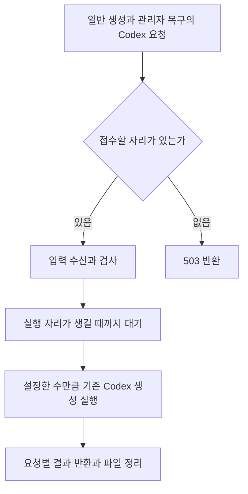

# Codex 이미지 fallback worker

백엔드가 Gemini 이미지 API의 **429 또는 timeout**을 받으면 같은 이미지 입력을 이 내부 HTTP worker로 보낸다.
Worker는 @openai/codex-sdk 0.162.1과 CLI의 ChatGPT OAuth 로그인을 사용한다.
사용자 브라우저의 Kakao 로그인이나 OpenAI API 키를 전달하지 않는다.

## 연결

백엔드 설정:

    IMAGE_FALLBACK_PROVIDER=codex
    CODEX_IMAGE_WORKER_URL=http://codex-image-worker:8090
    CODEX_IMAGE_WORKER_TOKEN=<32자 이상의 임의 ASCII 비밀값>
    CODEX_IMAGE_TIMEOUT=310s

기본 fallback은 none이다. codex를 켜면 Gemini 이미지 SDK의 재시도를 끄고 1회 호출한다.
429와 timeout에서 Codex로 전환한다. HTTP 408/504 및 SDK 요청 시간 초과도 포함한다.
401/403·그 밖의 5xx·응답 처리 오류와 취소된 요청은 그대로 실패한다.
Codex도 HTTP 재시도 없이 1회 호출한다. 실패하면 상위 생성/복구 서비스의 기존 실패 처리로 간다.
스토리보드를 다시 생성하지 않으며 기존 이미지 저장과 S3 업로드를 그대로 사용한다.

Worker 제한 시간 기본값은 300초다. 입력 수신, 대기와 실제 생성을 모두 포함하며 생성 시작 시 시간을 다시 주지 않는다.
백엔드 HTTP 제한 시간 기본값은 기존 310초로 유지한다. Worker의 제한 시간보다 조금 길게 두면 worker의 504를 받을 수 있다.

## 동시 생성과 대기 설정

Worker HTTP 서버 한 개에서 동시에 실행할 Codex 생성 작업 수와 대기할 요청 수를 설정한다.
기존 백엔드의 비동기 작업 처리기와 Gemini 실패 시 대체 호출을 그대로 사용한다.
별도의 DB 작업을 만들거나 스토리보드를 다시 생성하지 않는다.

| Worker 환경 변수 | 기본값 | 의미 |
| --- | --- | --- |
| `CODEX_IMAGE_CONCURRENCY` | `1` | 동시에 실행할 Codex 생성 작업 수. 1 이상의 정수 |
| `CODEX_IMAGE_QUEUE_CAPACITY` | `1` | 실행 외에 받아 둘 요청 수. 0 이상의 정수이며 0이면 대기를 허용하지 않음 |
| `CODEX_IMAGE_TIMEOUT_MS` | `300000` | 입력 수신과 대기, 생성을 합친 제한 시간. 기존 1초 이상, 10분 이하 범위 유지 |

입력을 받는 중인 요청도 한도에 포함한다. 접수한 미완료 요청은 동시 실행 수와 대기 수의 합을 넘지 않는다.
입력 검사가 끝나 대기 목록에 들어간 순서대로 실행한다. 한도가 차면 HTTP 503과 `worker_queue_full`을 반환한다.
대기 중 시간이 지나면 HTTP 504와 `queue_timeout`을 반환하며 Codex를 호출하지 않는다.
입력을 받는 중의 제한 시간 초과는 `request_timeout`, 생성 중의 제한 시간 초과는 `generation_timeout`으로 구분한다.



한 서버가 일반 생성과 관리자 복구 요청을 함께 관리한다. 기존 `generate()`가 요청마다 별도의 Codex 세션과 임시 폴더를 만든다.
기존 취소 신호를 재사용하며 대기 중 연결이 끊기면 해당 요청을 제거한다.
실행 중 취소된 작업은 SDK 호출과 파일 정리가 끝날 때까지 실행 자리를 유지한다.
취소 후 늦게 도착한 이미지는 성공으로 반환하지 않는다.

PowerShell에서 동시 실행 2건과 대기 3건으로 실행하는 예시는 다음과 같다. 내부 토큰과 OAuth 로그인은 아래 로컬 실행 절차로 준비한다.

```powershell
$env:CODEX_IMAGE_CONCURRENCY = "2"
$env:CODEX_IMAGE_QUEUE_CAPACITY = "3"
npm start
```

Compose도 같은 환경 변수를 읽는다. 값을 바꾸면 worker 프로세스를 다시 시작하거나 컨테이너를 재생성한다.
백엔드의 `GENERATION_WORKER_CONCURRENCY`는 일기 전체의 동시 실행 수이며 별도 설정이다.
예를 들어 백엔드 4건과 관리자 복구 1건이 모두 Codex를 호출할 수 있다면, 동시 실행 2건과 대기 3건으로 총 5건을 받을 수 있다.
대기 시간이 길면 기존 제한 시간 안에 완료하지 못할 수 있다. 요청당 최대 입력은 20MiB이므로 대기 수를 늘릴 때 메모리 사용량도 함께 확인한다.
제한은 HTTP worker 서버마다 적용한다. 서버 인스턴스를 여러 개 두면 전체 실행 수와 대기 수는 각 서버의 합이 된다.

Worker의 JSON 로그에서 `queueMs`, `generationMs`, `elapsedMs`를 구분해 확인한다.
`image_generation`은 최종 상태와 실패 코드, 실행 중인 수와 대기 수를 기록한다.
`image_generation_rejected`는 접수 한도 초과와 종료 중 거절을 기록한다. 프롬프트와 참조 이미지, 인증 값은 기록하지 않는다.
시간 기본값은 이 기록을 확인한 뒤 별도로 조정한다.

종료 신호를 받으면 새 요청을 받지 않고 대기와 입력 수신, 실행 중인 요청을 모두 취소한다.
진행 중인 생성의 파일 정리가 끝난 뒤 기존 세션 정리기를 닫는다. 기존 프로세스 종료 제한 시간은 유지한다.

## 로컬 실행

Node 22 이상을 사용한다. 다음 명령은 이 디렉터리에서 실행한다.

    npm ci
    npm test

Worker 전용 CODEX_HOME을 지정하고 설치된 CLI로 ChatGPT 로그인한다.
실제 서비스 프로세스에서도 같은 운영체제 사용자와 CODEX_HOME을 사용해야 한다.
자격 증명 디렉터리는 Git에 추가하지 않는다. Worker 토큰은 별도로 환경 변수로 설정한다.

    node --input-type=module -e "import {bundledCli} from './generator.mjs'; console.log(bundledCli())"

위에서 확인한 CLI로 codex login을 실행한 다음 npm start로 시작한다.
PowerShell에서는 $env:CODEX_HOME, $env:CODEX_IMAGE_WORKER_TOKEN을 설정한다.
기본 listen 주소는 127.0.0.1:8090이다. 컨테이너 밖에서 접근해야 하는 경우에만 HOST를 지정한다.

## 선택적 Docker 실행

compose.yaml은 이미 실행 중인 백엔드의 Docker 네트워크에 worker만 붙인다.
백엔드 이미지에는 Node를 추가하지 않는다. 포트를 호스트에 공개하지 않는다.
HARUDLE_DOCKER_NETWORK의 기본값은 harudle_app이다.

    docker compose build
    docker compose run --rm --entrypoint sh codex-image-worker
    # 컨테이너 안에서 CLI 경로를 확인하고 해당 CLI로 login --device-auth 실행
    # OAuth 로그인 후 exit
    docker compose up -d

토큰은 worker와 백엔드에 동일하게 주입한다. 로그인은 비밀값을 CLI 밖으로 추출하지 않고 진행한다.
codex-auth 볼륨은 OAuth 갱신을 위해 쓰기 가능해야 한다. 운영 백엔드의 AWS/GCP/DB 자격 증명은
worker에 전달하지 않는다. Worker 로그에는 프롬프트, 참조 이미지와 OAuth 토큰을 출력하지 않는다.

SDK가 만든 세션 JSONL에는 입력 프롬프트가 들어간다. 요청이 성공하거나 실패하면 해당 요청의 세션을 바로 삭제한다.
실행 중인 요청의 기록은 삭제하지 않는다. 강제 종료로 남은 worker 세션은 시작할 때와 이후 5분마다 확인하고,
마지막 수정 후 1시간이 지난 기록을 삭제한다.

정리 범위는 CODEX_HOME/sessions 안에서 worker의 임시 작업 경로가 확인된 세션 파일이다.
OAuth 인증 파일, 설정 파일과 다른 작업의 세션은 삭제하지 않는다. 심볼릭 링크도 따라가지 않는다.
정리 실패는 안전한 오류 코드만 기록하고 다음 정리 때 다시 시도한다.
이 구분은 고정한 SDK 0.162.1의 session_meta 형식을 사용하므로 SDK 버전을 바꾸면 함께 확인해야 한다.

Windows에서 기존 서비스의 실제 Storyboard/스타일/참조 이미지를 이용한 SDK 실생성을 검증했다.
Linux 컨테이너의 native image tool 제공 여부와 OAuth 로그인은 배포 환경에서 별도 실생성 검증이 필요하다.
이 때문에 기본 배포 구성에는 worker와 fallback을 자동 활성화하지 않는다.

## 내부 계약

POST /v1/images/generations, Authorization: Bearer <internal token>, application/json:

    {
      "systemInstruction": "GenerationPrompt의 실제 스타일 지시문",
      "referenceInstruction": "Gemini와 공유하는 참조 이미지 지시문",
      "finalTask": "[Final Task]\n실제 Storyboard를 렌더링한 전체 문자열",
      "reference": {"mediaType": "image/png", "base64": "..."}
    }

성공 응답은 바이너리 image/png다. 입력/출력은 각각 20MiB 이하로 제한한다.
실제 생성 파일은 해당 Codex thread의 generated_images 디렉터리 안에 있고,
이번 요청에서 새로 만들어졌으며 참조 이미지와 다른 PNG여야 한다.
임시 입력과 해당 thread의 생성 이미지 파일은 이미지 읽기를 끝낸 뒤 정리한다.
클라이언트 연결 종료·worker 제한 시간·프로세스 종료 신호는 SDK AbortSignal로 전달한다.
원격 추론 시작 후 취소하면 원격 비용이나 실행이 즉시 중단된다고 보장할 수는 없다.

검증:

    node ../tools/codex-image-poc/verify-worker.mjs <captured-service-input.json>

## 백엔드 오류 분류

CodexExceptionTranslator가 단계별로 예외를 공통 생성 오류로 바꾼다.
이미 AiGenerationException으로 분류된 예외는 같은 객체를 유지한다.

| 실패한 단계 또는 원인 | 기록하는 오류 |
| --- | --- |
| 참조 이미지 읽기, 프롬프트 작성, 요청 구성 | INTERNAL_ERROR |
| HTTP 429 | RATE_LIMITED |
| HTTP 408/504, SDK 또는 HTTP 제한 시간 초과 | TIMEOUT |
| HTTP 401/403 | PROVIDER_ERROR / AUTH_CONFIGURATION_ERROR |
| HTTP 500/502/503 | PROVIDER_ERROR / TRANSIENT_SERVER_ERROR |
| 연결 실패 | PROVIDER_ERROR / NETWORK_ERROR |
| 취소 또는 인터럽트 | PROVIDER_ERROR / CANCELLED |
| Provider 호출 중 그 밖의 예외 | PROVIDER_ERROR / UNKNOWN |
| 받은 PNG의 형식 확인 또는 응답 처리 실패 | RESPONSE_PROCESSING_ERROR |

본문을 읽는 중에도 실제 통신 timeout이나 연결 오류가 나면 통신 오류로 기록한다.
백엔드 호출 스레드가 인터럽트되면 헤더나 PNG 본문을 기다리는 중에도 해당 HTTP 요청을 취소한다.
성공 결과를 반환하기 전에 인터럽트를 다시 확인하고, 취소된 요청은 PROVIDER_ERROR / CANCELLED로 처리한다.
Worker는 연결 종료를 받아 진행 중인 SDK 호출에 취소 신호를 전달한다.
지표 기록이 실패해도 이미지 결과나 원래 오류는 바꾸지 않는다.
