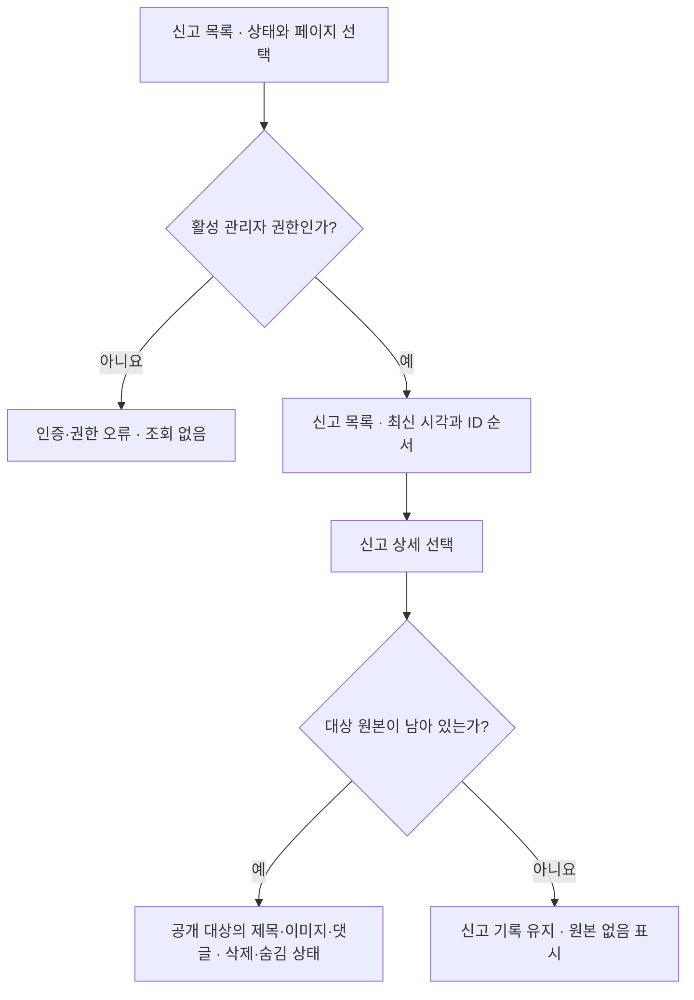
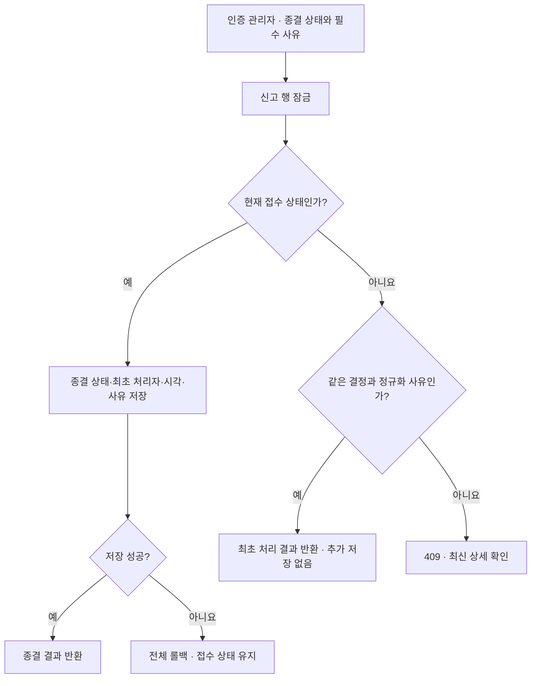
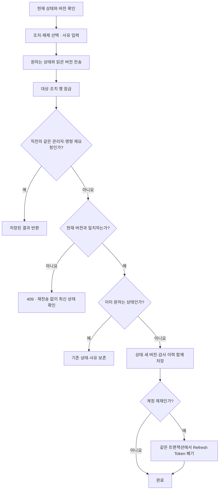
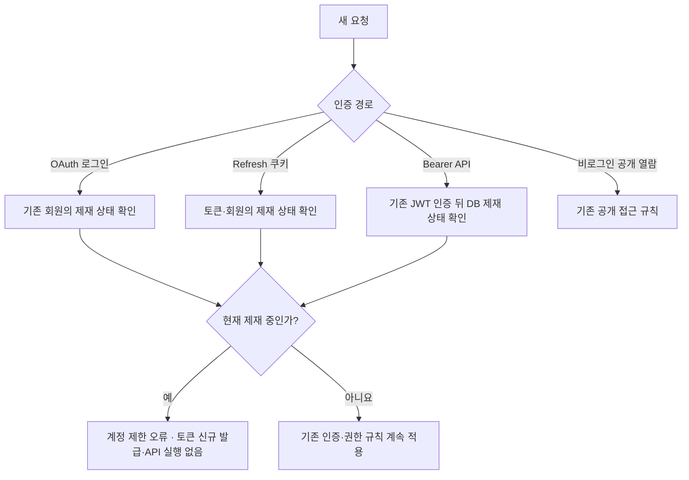
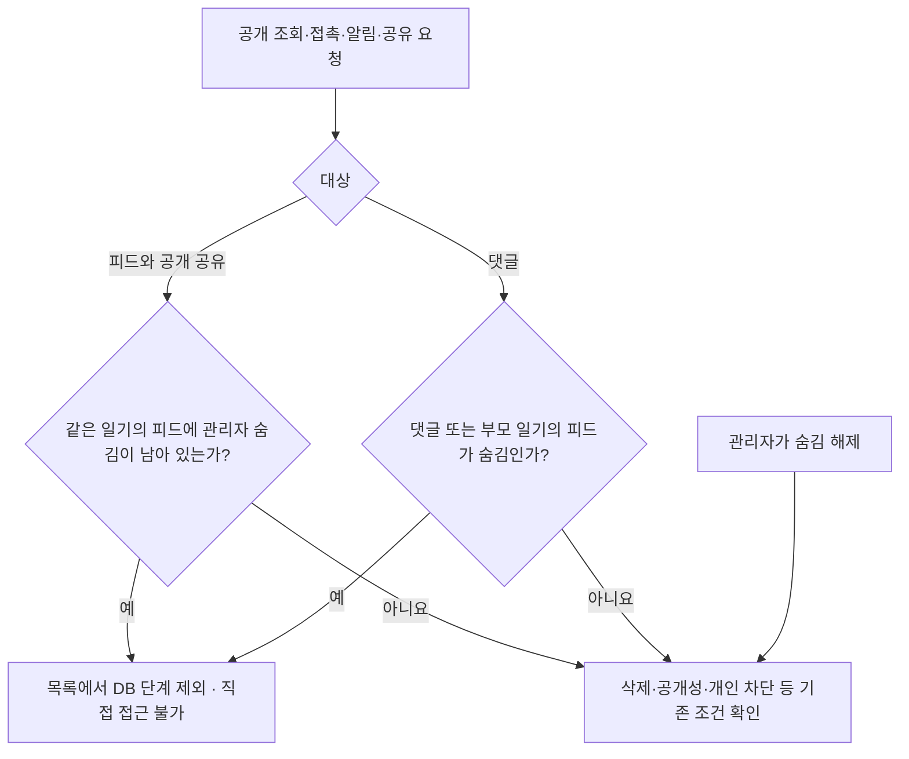

# 관리자 심사: 상황별 처리 흐름

[정책 요약](admin-moderation.md). 심사·제재·숨김은 별도 상태로 저장하며 사유와 처리 정보를 보존한다.

## 1. 신고 조회와 삭제된 대상

논리 삭제된 원본은 관리자 전용 조회에서 확인한다. 물리 삭제된 원본은 복구하지 않으며 비공개 일기 원문을 증거로 반환하지 않는다. 신고자·처리자 연결이 없어도 상세는 조회할 수 있다.

## 2. 심사 종결과 동시 처리

반려·처리 완료는 자동으로 계정을 제재하거나 콘텐츠를 숨기는 명령이 아니다. 이미 적용한 조치도 종결 실패만으로 되돌리지 않는다. 일반 사용자의 동일 대상 재신고는 기존 접수 안내를 유지한다.

## 3. 계정·콘텐츠 조치와 오래된 요청

해제 이후 과거의 제재 요청이 늦게 도착해도 버전이 달라 다시 제재하지 않는다. 이력 저장이나 토큰 폐기가 실패하면 상태 변경도 롤백한다. 관리자 계정·없는 대상의 변경은 거절한다. 물리 삭제된 대상도 남아 있는 조치 이력은 조회할 수 있다.

## 4. 제재된 계정의 로그인과 기존 세션

발급은 사용자 공유 잠금을 먼저 잡고 세션·토큰 순서로 진행한다. 제재는 같은 사용자의 배타 잠금을 잡은 뒤 토큰을 폐기하므로, 앞서 진행하던 발급이 끝나면 새로 발급된 토큰까지 폐기한다. 잠금 대기 뒤에는 READ COMMITTED로 최신 제재 상태를 확인한다.

로그아웃·CSRF 토큰 발급은 세션 정리에 필요한 예외다. 제재 확인용 DB에 문제가 생기면 허용 상태로 간주하지 않고 요청을 실패시킨다. 제재 커밋 전에 이미 통과한 요청·진행 중 생성·이미 발급된 이미지 URL을 소급 취소하지 않는다.

## 5. 콘텐츠 숨김과 해제

같은 일기의 과거 피드에 숨김이 남아 있으면 재게시나 새 피드의 개별 숨김 해제로 우회할 수 없다. 조치와 접촉은 일기→피드→댓글 순서로 잠가 동시 변경을 확인한다. 숨김 해제는 작성자 삭제·비공개 상태를 되돌리지 않는다. 개인 차단은 별도 조건이다. 목록은 숨김 대상을 제외한 뒤 정렬·페이지 제한을 적용하며, 기존 반응 수는 소급 재집계하지 않는다.

API 계약

| 요청 | 역할 |
| --- | --- |
| `GET /api/v1/admin/reports?status=RECEIVED&page=0&size=20` | 상태별 신고 목록 |
| `GET /api/v1/admin/reports/{id}` | 신고와 현재 대상 상세 |
| `PUT /api/v1/admin/reports/{id}/review` | `{status:DISMISSED 또는 RESOLVED,reason}` |
| `GET /api/v1/admin/moderation/{USER 또는 FEED 또는 COMMENT}/{id}` | 현재 조치 상태·버전 |
| `PUT /api/v1/admin/moderation/{type}/{id}` | `{restricted,expectedVersion,reason}` |
| `GET /api/v1/admin/moderation/{type}/{id}/history?page=0&size=20` | 최신 버전부터 조치 이력 |

조치가 없는 대상의 초기 버전은 0이다. 변경 사유는 앞뒤 공백을 제거한 Unicode 코드 포인트 기준 1~500자이며 NUL과 잘못된 UTF-16 문자열은 거절한다. 모든 경로는 기존 관리자 DB 권한 확인을 사용하고 응답은 `Cache-Control: no-store`다.

