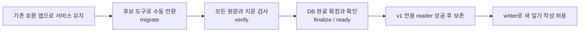
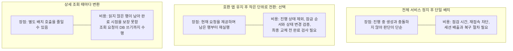
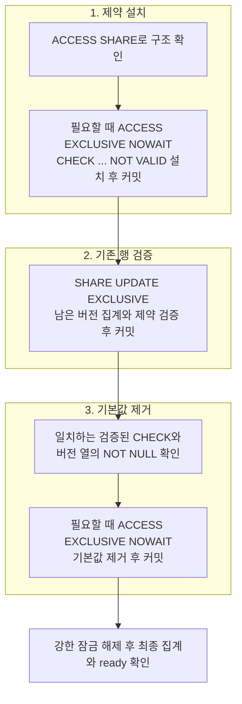

# 기존 일기 원문과 지문을 어떻게 온라인 전환하고 평문 경로를 닫을 것인가

- 작성일: 2026-10-20
- 담당: 아이큐
- 상태: 채택 (#423 구현 결정, 실제 운영 전환은 별도 수행 후 기록)
- 관련: [#423](https://github.com/woowacourse-teams/2026-Harudle/issues/423),
  [신규 저장 암호화 #422](https://github.com/woowacourse-teams/2026-Harudle/issues/422)
- 운영: [원문 암호화](../diary-source-text-encryption.md),
  [과거 백업 정책](../diary-source-text-backup-policy.md)

## 배경과 완료 조건

**기존 앱으로 서비스를 계속 제공하면서, 별도 도구로 과거 일기를 조금씩 암호화한다.**
서비스 전체를 멈추는 시간을 줄이고, 중단되어도 남은 일기부터 다시 처리하기 위해 이 방식을 선택했다.
모두 바뀐 것을 확인한 뒤에만 평문을 읽지 않는 새 앱으로 교체한다.

#422는 새 일기를 v1 암호문과 HMAC 지문으로 저장하고, 기존 v0 평문과 SHA 지문도 읽도록 했다.
#423은 남은 v0 원문과 지문을 함께 전환한 뒤 이 호환 경로를 제거한다.
**새 배포를 적용하는 것만으로 운영 데이터가 전환되지는 않는다.**

완료하려면 v0와 지원하지 않는 버전이 모두 0건이어야 한다.
모든 암호문을 정상 복호화할 수 있고 요청 지문도 일치해야 한다.
DB에 v1 전용 제약을 적용하고 v0 기본값을 제거한 뒤, v1 전용 복구 배포본까지 확보한다.
**과거 백업에 남은 평문을 폐기하는 일은 별도 운영 작업이다.**

v0와 v1, 지문, 온라인 전환 용어

- **v0**는 암호화 전 원문과 기존 SHA 요청 지문을 사용하는 저장 버전이다.
- **v1**은 AES-GCM으로 원문을 암호화한 저장 버전이다. 일기 ID와 사용자 ID가 달라지면 복호화 검증이 실패한다. 요청 지문도 키를 사용하는 HMAC으로 보호한다.
- **요청 지문**은 같은 생성 요청인지 비교하는 값이다. 기존 SHA는 키 없이 계산한다. HMAC은 비밀 키가 있어야 계산할 수 있다.
- **온라인 전환**은 #442 호환 앱으로 서비스를 유지하면서 별도 후보 이미지의 CLI로 기존 행을 바꾸는 방식이다.
- **Command-Line Interface(명령줄 인터페이스, CLI)**는 운영자가 명령을 입력해 프로그램을 실행하는 방식이다. 여기서는 전환 도구를 뜻한다.
- **Key ring(키링)**은 현재 키와 아직 필요한 구키를 모은 설정이다. 활성 키는 새 암호문을 만들 때 사용하는 키다.
- **Transaction(트랜잭션)**은 여러 DB 변경을 함께 저장하거나 함께 취소하는 처리 단위다. **행 잠금**은 같은 행을 바꾸는 처리의 순서를 정한다. 일반 조회까지 자동으로 막는 것은 아니다.
- **worker(작업 처리기)**는 접수된 AI 생성 작업을 실행한다. `PENDING`은 실행 대기, `PROCESSING`은 생성 진행 상태다.
- **finalize**는 전체 결과를 확인하고 DB를 v1 전용으로 확정하는 명시적 명령이다.
- **reader / writer**는 신규 작성 허용 여부다. 평문 읽기를 다시 켜는 설정이 아니다.

## 실행 방식 비교와 결정

현재 요청을 계속 제공할 수 있고, 작은 단위로 다시 실행할 수 있는 두 번째 방식을 선택했다.
대신 작업 처리기와 같은 잠금 순서를 지키고, 앱 교체 전에 전환 완료를 별도로 확인해야 한다.

기존 생성 선점과 실패 정리는 **생성 기록을 먼저 잠그고 일기를 잠근다.** 배치도 같은 순서를 쓴다.
잠근 생성 기록이 `PROCESSING`이면 건너뛴다. 현재 구현에는 성공하거나 실패한 기록을 다시
`PROCESSING`으로 바꾸는 기능이 없다.

`PENDING`은 아직 AI 실행 전이다. 이 상태에서는 원문, 저장 버전, HMAC을 같은 트랜잭션에서 바꾼다.
배치가 먼저 잠그면 worker는 `SKIP LOCKED`로 해당 작업을 건너뛴다.
worker가 먼저 선점하면 배치는 `PROCESSING`을 확인해 건너뛴다.
생성 상태와 시각, 사용량은 변경하지 않는다. 따라서 실행 중인 작업의 원문과 지문을 중간에 바꾸지 않는다.

전환에는 `READ_COMMITTED` 연결만 허용한다. 생성 기록이 없는 일기를 잠근 다음에는
새 생성 기록이 연결되었는지 다시 확인한다. 이때 앞선 조회 이후 저장된 기록도 보여야 한다.
다른 격리 수준이면 쓰기 전에 거절한다. 현재 일반 API에는 이런 일기에 생성 기록을 추가하는 경로가
없지만, 별도 관리 작업이나 DB 설정 변경이 이 확인을 무효로 만들지 않도록 한다.

연결의 격리 수준을 자동으로 바꾸지 않는 이유

**Isolation level(격리 수준)**은 한 트랜잭션이 다른 트랜잭션의 변경을 언제 볼 수 있는지 정한다.
`READ_COMMITTED`에서는 각 조회를 시작할 때 이미 저장된 변경을 읽을 수 있다.

자동으로 바꾸면 실행자가 접속 설정을 고치지 않아도 된다. 대신 작업 후 원래 설정으로 돌려놓아야 하고,
복원에 실패하는 경우까지 처리해야 한다.

지원하지 않는 설정을 거절하면 실행자가 설정을 확인해야 한다. 대신 도구가 호출자의 격리 수준을 바꾸지 않는다.
이 방식을 선택했다. 전용 CLI와 기존 기본 설정은 그대로 실행할 수 있으며, 다른 설정은 쓰기 전에 거절한다.
조회만 하는 명령의 격리 수준까지 제한하지는 않는다.

분리 조회를 그대로 둘 수 있는 조건

실행기는 생성 기록과 일기를 따로 읽는다. 배치가 두 값을 함께 저장한다는 이유만으로 이 조회가 안전한 것은 아니다.
다음 조건이 함께 필요하다.

- 배치가 생성 기록을 잠근 뒤 상태를 확인하고 `PROCESSING`을 제외한다.
- 종료된 생성 상태를 새 실행 상태로 되돌리지 않는다.

실행기가 예전 `PROCESSING`을 읽은 뒤 그 작업이 이미 실패하거나 종료될 수 있다.
그 후 전환까지 끝났다면 옛 명령과 새 저장 지문이 일치하지 않아 실행이 거절된다.
이미 종료된 작업의 실행을 막는 결과다.

같은 생성 기록을 다시 `PROCESSING`으로 바꾸는 재실행 기능을 도입하면 이 판단도 다시 검토한다.
여러 배치 프로세스를 동시에 실행해 처리량을 늘리는 운영은 이번 범위가 아니다.

## 전용 CLI와 작은 트랜잭션

후보 #423 이미지의 전용 main으로 전환 도구만 실행한다. 전체 앱이나 AI 호출은 시작하지 않는다.
앱과 같은 키 설정을 읽고 신뢰한 검증 파일로 키가 맞는지 확인한다.
기존 암호화와 지문 계산 코드를 사용하며, DB 함수에 비밀 키를 전달하지 않는다.

도구가 사용하는 앱 설정과 DB 연결

키는 앱과 같은 Compose 설정, `JAVA_OPTS`, Boot ConfigData/Binder로 읽는다.
Compose는 컨테이너 실행 설정이고, ConfigData/Binder는 앱 설정 파일과 환경 변수를 읽어 객체에 연결하는 기능이다.
canary는 미리 신뢰한 암호화 검증값이며 후보가 올바른 키를 갖고 있는지 검사하는 데 쓴다.

JDBC로 DB에 직접 연결한다. Spring context, JPA, Flyway, AI 어댑터는 시작하지 않는다.
따라서 도구 실행이 웹 앱 시작이나 자동 스키마 변경, AI 생성 실행으로 이어지지 않는다.

### 실행 중 앱의 키링과 후보 키링

**배치가 쓰는 키를 현재 모든 서비스 앱도 읽을 수 있어야 한다.**
후보 CLI는 호스트의 현재 설정을 읽지만, 실행 중인 #442 앱은 시작할 때 읽은 키를 메모리에 보관한다.
같은 `.env`를 사용하거나 후보의 키 검사가 성공했다는 이유만으로 두 설정이 같다고 판단하지 않는다.
현재 배포는 dev/prod별 EC2의 Compose backend를 기준으로 한다.

새 키를 쓰려면 구키와 기존 활성 키를 유지하고 새 키를 키링과 canary에 등록한다.
모든 호환 앱을 먼저 그 키링으로 재배포한다. 각 앱의 키 검사, 배포 성공, 기존 일기 조회를 확인한 뒤
배치의 활성 키를 바꾼다. 앱과 배치의 활성 키는 달라도 되지만, 앱 키링에는 배치가 쓰는 키가 있어야 한다.
v0가 남았을 때는 #442 호환 버전으로 재배포한다. #423의 v1 전용 앱으로 먼저 바꾸지 않는다.

게스트 일기 가져오기를 전환 중에도 허용한다면 현재 호환 앱에 #545의 소유권 이전 수정도 먼저 배포한다.
그렇지 않으면 전환 중 가져오기 요청을 중단한다. 후보 CLI를 실행해도 현재 서비스 앱의 코드는 바뀌지 않는다.

실제 실행 앱과 배포, 조회 기록은 배포 책임자가 확인한다. 호스트 `.env` 수정이나 후보 검사만으로 완료 처리하지 않는다.
모든 인스턴스의 메모리 키링을 프로그램이 자동 확인하는 기능은 추가하지 않는다.
이를 확인하려고 키 값을 inspect하거나 출력하지도 않는다.

### 행 전환과 검증

`migrate`는 v0 행의 **원문, 버전, 연결 지문을 함께 저장하거나 함께 취소**한다.
일기 하나씩 별도 트랜잭션으로 처리하며, 삭제된 일기와 생성 기록이 없는 일기도 포함한다.
원문을 복사한 임시 테이블이나 백업 열은 만들지 않는다.

이미 v1인 행은 다시 암호화하지 않는다. 커밋 전 실패하여 취소가 확인된 행은 다시 실행할 수 있다.
`PROCESSING`은 건너뛴다. 처리 한도에 도달했거나 v0가 남았다면 완료로 보고하지 않는다.

복원한 DB의 구조도 매 트랜잭션에서 검사한다. 필수 열과 키가 올바른지 확인하고, 일부 행을 숨기거나
중복시키는 구조는 거절한다. 검사와 조회 또는 갱신 사이에는 테이블 잠금으로 구조 변경을 막는다.

스키마 검사에서 확인하는 조건

Schema(스키마)는 DB의 테이블, 열, 제약을 정의한 구조다.
`public`의 실제 테이블, 필수 열 형식과 `NOT NULL`, UUID 기본키, 일기별 생성 기록의 단일 `UNIQUE` 제약을 확인한다.
`NOT NULL`은 빈 값을 금지하고, 기본키와 `UNIQUE`는 같은 키가 중복 저장되지 않게 한다.

Row-Level Security(행 수준 보안, RLS)는 조회자에게 일부 행만 보이게 할 수 있다.
이 상태나 상속 테이블, 파티션 테이블은 지원하지 않는다. 숨겨진 행이나 중복 키를 놓치고 완료로 판단할 수 있기 때문이다.
검사하는 동안 DDL, 즉 테이블이나 열을 바꾸는 작업도 잠금으로 막는다.

커밋 응답이 사라지면 DB에는 이미 저장되었을 수 있다. 이때 전체 취소를 보장하지 않는다.
롤백이나 연결 상태 복구에 실패한 경우도 다음 행으로 진행하지 않고 연결을 폐기한다.
새 연결의 `status`와 전수 `verify`로 실제 저장 상태를 확인한다. 원인을 해결한 뒤 남은 v0만 다시 처리한다.

`verify`는 모든 행의 저장 버전과 암호문 인증을 검사한다. 복호화한 원문으로 앱의 정해진 SHA 지문을 다시 계산하고,
키로 보호한 HMAC이 저장값과 같은지 비교한다. **SHA와 HMAC은 모두 64자리 hex이므로 길이와 전환 건수만으로 완료를 판단하지 않는다.**
생성 기록이 없는 일기는 원문 암호화와 인증만 검사한다. 존재하지 않는 지문을 새로 만들지 않는다.

## 평문 호환 경로를 닫는다

일반 앱의 v0 복호화와 SHA 반환 분기를 제거한다. 설정으로 다시 켜는 모드는 추가하지 않는다.
v0를 읽는 코드는 전용 배치의 전환 입력으로만 남는다. v1 처리 오류가 나도 원문을 평문으로 해석하지 않는다.

`finalize`는 전수 검증과 v0 0건을 확인한 뒤 DB를 v1 전용으로 확정한다.
**제약 설치, 기존 행 검증, v0 기본값 제거를 각각 커밋한다.**
전체 배치를 하나의 긴 트랜잭션으로 묶거나 앱 시작 시 자동 실행하지 않는다.

2026-11-06 리뷰: 최종화의 강한 잠금을 분리한 이유

처음에는 실패 시 함께 취소할 수 있도록 한 트랜잭션으로 확정했다.
그러면 모든 행을 집계하고 제약을 검증하는 동안 일반 조회도 기다려야 했다.
2026-11-06 리뷰에서 강한 잠금을 필요한 짧은 변경에만 사용하도록 결정했다.

첫 단계는 `ck_diaries_source_text_encrypted_only`의 `CHECK ... NOT VALID`만 설치한다.
이때 기존 행 전체를 검사하지 않는다. 설치된 제약은 새로 저장하거나 변경하는 v0를 거절한다.
두 번째 단계의 `SHARE UPDATE EXCLUSIVE` 잠금은 일반 조회와 쓰기를 허용한다.
세 번째 단계는 `source_text_version`의 v0 기본값만 제거한다.
**강한 잠금을 잡은 동안에는 전체 행 집계나 검증을 하지 않는다.**

명령 전체에는 Session-level advisory lock(세션 단위 실행 잠금)을 유지한다.
같은 잠금을 사용하는 다른 `migrate`, `verify`, `finalize`가 동시에 실행되지 않게 한다.
중단되면 이미 커밋한 단계를 보존하고 다시 실행한다.
제약 검증이나 기본값 제거가 덜 끝났다면 `ready`가 거절한다.
제약 이름만 같고 CHECK 내용이 다르면 완료로 인정하지 않는다.

`NOWAIT`는 강한 잠금을 즉시 얻을 수 없으면 기다리지 않고 실패한다는 뜻이다.
이 잠금을 요청하기 전에 `statement_timeout`과 `idle_in_transaction_session_timeout`을 각각 1초로 설정한다.
앞의 설정은 개별 SQL 실행 시간을, 뒤의 설정은 트랜잭션을 연 채 다음 명령을 기다리는 시간을 제한한다.
**각 제한이 1초라는 뜻이지, 전체 잠금 시간이나 명령 시간이 1초라는 보장은 아니다.**
실제 운영 규모의 조회 지연은 [격리 복원 DB 측정 절차](../diary-source-text-finalize-measurement.md)로 확인한다.
아직 실측하지 않았다. 측정할 때 전체 명령 시간과 일반 조회를 막는 잠금 시간을 구분한다.

근거는 PostgreSQL 18의 [ALTER TABLE](https://www.postgresql.org/docs/18/sql-altertable.html),
[LOCK과 NOWAIT](https://www.postgresql.org/docs/18/sql-lock.html),
[시간 제한 설정](https://www.postgresql.org/docs/18/runtime-config-client.html)이다.

배포 전에는 키 검사 다음에 `ready`를 별도로 실행한다. 두 검사에 성공해야 컨테이너를 교체한다.
`ready`는 완료 조건만 확인한다. `migrate`나 `finalize`를 대신 실행하지 않는다.
앱 자체의 운영 시작 검사도 완료되지 않은 DB를 거절한다.

## 최초 전환과 복구

전환 도구를 실행하는 동안에는 #442의 v0/v1 호환 앱과 검증된 키, canary를 유지한다.
후보 #423 이미지는 별도로 로드한다. 실행 중 앱 이미지가 아니라 명시한 후보 이미지 ID로
`status`와 제한된 `migrate`를 반복한다. `PROCESSING`이 끝난 일기도 다시 처리한다.

모든 행을 바꾼 뒤 `verify`, `finalize`, `ready`를 확인한다.
새 v1-only `reader`를 성공적으로 배포하고 복구용으로 보존한 다음, 같은 코드의 `writer`를 연다.
reader는 새 작성을 막고 writer는 허용한다. 이 차이가 평문 읽기 허용 여부를 바꾸지는 않는다.
prod writer를 허용하기 전에는 dev에서 서버 밖 백업을 실제로 격리 복원하고 결과를 검토한다.
prod 키링과 canary 백업, 복구용 reader 원본도 별도로 확인하고 운영자 승인을 받는다.

#442의 reader 선배포는 최초 암호문 쓰기 전에 호환 복구 기준을 마련하는 단계다.
#423의 reader 선배포는 기존 데이터 전환 후 v1-only 복구 기준을 마련하는 단계다.
**둘을 같은 배포본으로 취급하지 않는다.**

완료 후 복구 목록에서는 v0를 읽는 #442 reader를 제외한다.
DB를 평문으로 되돌리거나 버전과 제약을 없애서 복구하지 않는다.
과거 v0 백업은 외부 서비스와 격리한 환경에서 다시 전환을 끝낸 뒤 공개한다.

## 검증과 운영 한계

DB 통합 테스트로 전환, HMAC, 진행 상태 제외, 재실행, 제약 조건을 확인한다.
운영 runner는 후보 이미지 고정, 안전한 결과 필드, 로그 억제, 미완료 시 교체 생략을 오프라인 회귀 테스트로 확인한다.
**테스트 통과는 실제 운영 배치, 백업 복원, 폐기를 수행한 기록이 아니다.**

기존 스냅샷, PITR, WAL, 논리 덤프와 이전 행 버전의 평문은 [과거 백업 정책](../diary-source-text-backup-policy.md)으로 별도 관리한다.
책임자, 만료일, 복원 확인과 미수행 상태를 구분해 기록한다.
호스트와 앱, 키가 함께 노출되는 경우까지 보호하는 결정은 아니다.
