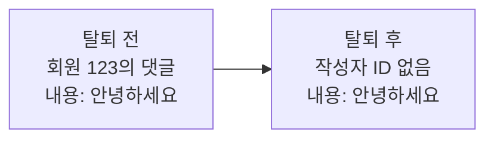

# 회원 탈퇴 후 댓글과 재가입을 어떻게 처리할 것인가

## 배경

회원이 탈퇴하면 회원 정보와 일기, 피드를 DB에서 삭제한다. 다른 회원의 피드에 남긴 댓글은 유지한다.

현재 댓글은 작성자의 회원 정보와 연결되어 있다. 회원 정보를 삭제하면 댓글도 함께 삭제되는 구조다. 회원 정보를 삭제한 뒤에도 댓글을 보여줄 방법이 필요하다.

## 결정

다른 회원의 피드에 남긴 댓글은 내용과 작성 시각을 유지한다. 회원 정보를 삭제할 때 댓글의 작성자 ID는 비운다. 댓글 목록에서는 작성자를 `탈퇴한 사용자`로 표시하고, 기본 프로필 이미지를 보여준다.

탈퇴한 회원이 만든 피드는 삭제한다. 해당 피드에 달린 댓글도 피드와 함께 삭제한다.

같은 소셜 계정으로 다시 가입해도 새로운 회원으로 처리한다. 이전 회원 ID와 일기, 피드는 새 계정에 연결하지 않는다. 남겨진 댓글도 새 계정의 댓글로 연결하지 않는다.

## 이유

탈퇴한 회원의 정보는 삭제해야 한다. 댓글에 이전 회원 ID를 남기면 삭제한 회원과 댓글의 연결이 남는다.

탈퇴 후 다시 가입한 사람은 새로운 회원으로 식별하는 것이 자연스럽다. 이전 댓글의 작성자 연결을 없애면 새 계정이 이전 댓글을 본인 댓글로 조회하거나 삭제하지 않는다.

## DB와 댓글 조회

`comments.author_id`에 값이 없어도 저장할 수 있게 변경한다. 회원이 삭제되면 댓글의 작성자 ID가 비워지도록 회원과 댓글의 연결을 `ON DELETE SET NULL`로 변경한다. 새 댓글은 로그인한 회원이 작성하므로 작성자 ID를 저장한다.

댓글을 조회할 때 작성자 정보가 없어도 댓글을 가져온다. 작성자 ID가 없는 댓글에는 `탈퇴한 사용자`를 표시한다. 작성자 ID와 프로필 이미지 주소는 비우고, 본인 댓글 여부는 `false`로 반환한다.

기존에 회원을 탈퇴 상태로 표시한 댓글도 계속 탈퇴한 사용자로 보여준다. 활성 회원의 프로필을 가져오지 못한 경우는 탈퇴와 구분한다.
