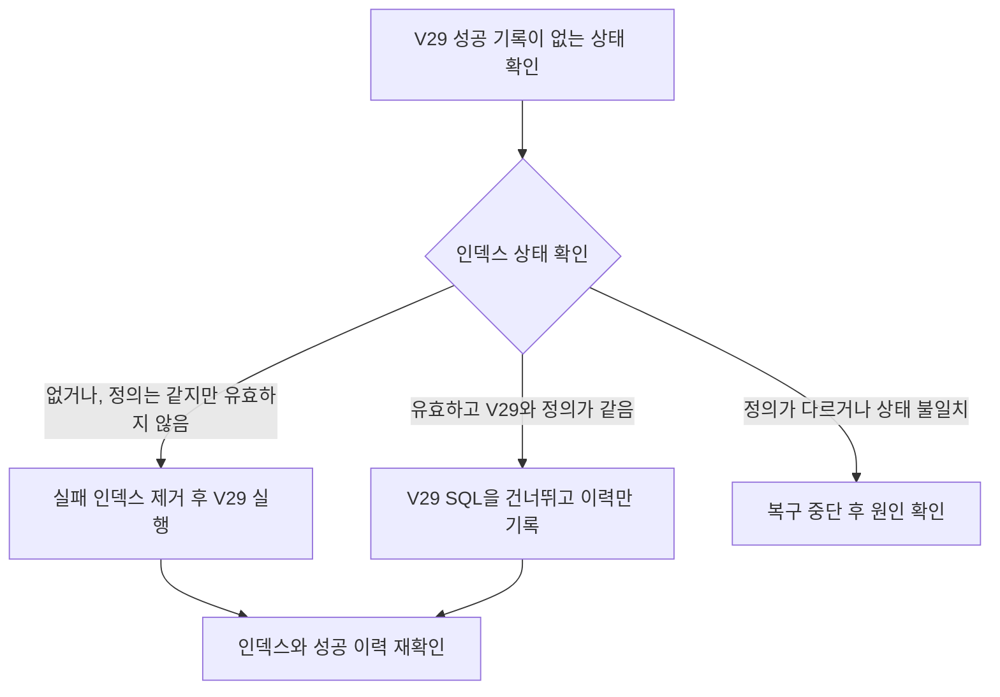

# 2026-10-19 DB 큐의 부하를 어떻게 검증하고 재검토할 것인가

DB 큐의 부하를 dev RDS에서 측정한다. 결과를 보고 조회 간격과 동시 실행 수를 정하며, 필요하면 SQS를 다시 검토한다.

- 상태: 지표 구현, dev 성능 검증 전
- 작성일: 2026-10-19
- 작성자: 캐모
- 결정 대상: DB 큐의 성능 확인 방법과 SQS를 다시 비교할 조건

## 배경

`SKIP LOCKED`를 쓴다는 사실만으로 DB 부하가 작거나 크다고 판단할 수 없다.
조회 횟수, 한 번에 확인하는 행 수, 인덱스, 상태 변경 횟수가 함께 영향을 준다.
아직 실제 조회 시간과 RDS 자원 사용량을 측정하지 않았다.

예를 들어 조회 담당 코드 하나가 3초마다 실행되면 1분에 약 20번 조회한다.
이는 작업을 찾는 조회 횟수의 예시다. 상태 변경과 프론트엔드 조회는 포함하지 않으며, CPU 사용량을 뜻하지도 않는다.

## 고려한 방법

| 방법 | 좋은 점 | 불편한 점 |
| --- | --- | --- |
| 측정 없이 운영값을 고정 | 설정을 빨리 정할 수 있다. | 기존 기능에 주는 영향을 알기 어렵다. |
| dev에서 비교한 뒤 결정 | 같은 조건에서 부하와 지연의 변화를 확인한다. | 데이터 준비와 측정에 시간이 필요하다. |

## 결정과 실제 확인

dev 전용 RDS에서 시험한다. 시험할 데이터 수와 허용할 응답 지연, DB 자원 기준을 먼저 정한다.
구체적인 합격 수치는 아직 정하지 않았다.

1. DB 큐를 켜기 전의 기존 API 응답 시간과 DB 자원 사용량을 기록한다.
2. 대기 작업이 없는 경우, 완료 기록이 많은 경우, 대기 작업이 몰린 경우를 각각 만든다.
3. 여러 처리기를 실행하며 조회 시간과 결과를 비교한다. 조회 간격과 가져오는 수는 한 번에 하나씩 바꾼다.
4. DB CPU, 디스크 읽기와 쓰기, DB 연결 대기, 기존 API 응답 시간이 어떻게 변했는지 확인한다.
5. 측정값과 선택한 운영 설정, 남은 문제를 함께 기록한다.

쿼리는 `EXPLAIN (ANALYZE, BUFFERS)`로 확인한다. 이는 실제 실행 시간과 데이터를 얼마나 읽었는지 보여주는 기능이다.
대기 작업용 인덱스를 실제로 사용하는지도 본다. `ANALYZE`는 쿼리를 실행하므로 개발용 시험 데이터에서 확인한다.
상태를 바꾸는 쿼리는 시험 후 원래 상태로 되돌릴 수 있게 준비한다.

### 2026-10-21 추가한 지표

| 지표 | 실제로 확인하는 내용 |
| --- | --- |
| 대기 시간 | 작업 저장부터 선점까지 걸린 시간이다. 선점 저장이 성공한 뒤에만 기록한다. |
| 대기 작업 수 | DB에서 아직 `PENDING`인 작업 수를 읽는다. |
| 처리 중 작업 수 | DB에서 현재 `PROCESSING`인 작업 수를 읽는다. |
| 접수 거절 횟수 | 접수 상한 때문에 새 요청을 거절한 횟수다. 거절 시점에 기록한다. |


선점 저장이 취소되면 대기 시간 집계를 늘리지 않는다. 접수 거절 횟수는 요청 저장이 취소되어도 유지한다.
작업 수는 지표 수집 때 DB에서 조회하므로 서버가 재시작해도 DB에 남은 작업을 반영한다.
지표의 조회나 기록이 실패해도 작업 접수와 생성을 실패로 바꾸지 않는다.

평균 대기 시간과 기존 생성 시간을 나눠 확인한다. 이 평균값으로 P95를 알 수는 없다.
접수 거절이 잦으면 생성 시간과 메모리 사용량을 함께 보고 동시 실행 수를 늘릴지 판단한다.
수집 설정과 대시보드 생성 도구도 수정했다. 실제 서버 적용과 dev 성능 측정은 아직 진행하지 않았다.

### 2026-10-22 상태별 작업 수 조회용 인덱스

`V29`에서 `diary_generations(status)` 전체 인덱스를 추가한다.
접수 상한 검사와 지표 수집에서 사용하는 `countByStatusIn` 조회를 지원한다.
기존 `V28`의 대기 작업 조회용 인덱스도 유지한다.

완료 기록은 계속 쌓이지만 대기 중이거나 실행 중인 작업 수는 접수 상한으로 제한된다.
필요한 상태의 기록을 찾는 데 인덱스가 도움이 될 것으로 예상한다.
접수 검사는 DB 잠금을 가진 상태에서 진행하므로 조회 시간이 길어지면 다른 접수 요청도 기다릴 수 있다.
현재 상태를 매개변수로 전달하는 조회를 그대로 쓰기 위해 전체 상태 인덱스를 선택한다.

생성은 기존 `V17`과 같은 `CREATE INDEX CONCURRENTLY` 방식을 쓴다.
생성 중에도 다른 요청이 테이블에 읽기와 쓰기를 할 수 있게 한다.
이 명령은 트랜잭션 안에서 실행할 수 없으므로 `V29`의 `.sql.conf`에만 `executeInTransaction=false`를 지정한다.
기존 마이그레이션과 Flyway 공통 설정은 바꾸지 않는다.
생성이 중단되면 아래 V29 복구 절차에 따라 인덱스와 이력을 확인하고 상태에 맞게 복구한다.

인덱스에는 저장 공간이 필요하고 작업 상태를 바꿀 때 관리 비용도 든다.
아직 성능 개선을 측정한 것은 아니다.
dev에서 인덱스 추가 전후의 실행 계획, 접수 지연, DB 잠금 대기 시간과 상태 변경 비용을 비교한다.
이득이 충분하지 않으면 인덱스 유지 여부를 다시 판단한다.

#### V29 생성이 중단됐을 때의 복구

인덱스 상태와 V29 성공 기록을 함께 확인한 뒤 아래 두 경우로 나눈다.
이 절차는 V29의 성공 기록이 없는 경우에 사용한다.
성공 기록은 있는데 인덱스가 없거나 잘못됐다면 별도 복구가 필요하므로 이 절차를 중단한다.
인덱스와 성공 기록이 모두 정상이면 마지막 검증만 한다.



인덱스 생성이 끝났어도 Flyway가 성공 기록을 저장하기 전에 중단될 수 있다.
따라서 정상 인덱스가 남은 경우에는 다시 생성하지 않고 이력을 기록한다.
같은 이름의 인덱스가 V29와 다른 정의라면 아래 명령을 실행하지 않고 원인부터 확인한다.

<details>
<summary>복구 준비와 상태별 실행 명령</summary>

**복구 준비와 상태 확인**

1. 해당 환경의 배포와 백엔드 자동 재시작을 멈춘다. 다른 Flyway 실행도 끝난 상태에서 한 명이 복구한다.
2. DB에 접근할 수 있는 작업 환경에 배포 앱과 같은 버전의 Flyway CLI와 PostgreSQL 클라이언트 `psql`을 준비한다. Flyway CLI는 아래 `flyway` 명령을 실행하는 도구다. 백엔드 Gradle에는 Flyway 플러그인이 없으므로 `./gradlew flywayRepair`를 사용하지 않는다.
3. 배포와 같은 커밋의 저장소 루트에서 작업한다. `V1`부터 `V29`까지의 원본 SQL과 `.sql.conf`를 모두 준비한다. V29 파일만 따로 두고 `repair`하지 않는다.
4. `FLYWAY_URL`, `FLYWAY_USER`, `FLYWAY_PASSWORD`를 해당 서버의 DB 접속값으로 설정한다. URL은 `jdbc:postgresql://DB_HOST:DB_PORT/DB_NAME` 형식이다. `psql`도 같은 DB에 연결하고, 접속한 DB가 복구할 dev 또는 prod DB인지 확인한다. 접속값은 문서나 Git에 저장하지 않는다.

복구용 셸에서 기존 앱과 같은 스키마와 잠금 설정을 적용한다.
`skipExecutingMigrations`의 기본값은 복구 중에도 `false`로 두며, 이력만 기록하는 명령에만 `true`를 지정한다.
기존 셸이나 CLI 설정에 `cherryPick`과 `outOfOrder` 같은 별도 실행 설정이 남아 있다면 제거한 뒤 진행한다.

```bash
export FLYWAY_LOCATIONS="filesystem:$(pwd)/backend/src/main/resources/db/migration"
export FLYWAY_DEFAULT_SCHEMA=public
export FLYWAY_SCHEMAS=public
export FLYWAY_GROUP=false
export FLYWAY_POSTGRESQL_TRANSACTIONAL_LOCK=false
export FLYWAY_SKIP_EXECUTING_MIGRATIONS=false
flyway -v
flyway info
```

같은 DB의 `psql`에서 아래 조회를 실행한다.
첫 조회에 행이 있으면 인덱스 생성 작업이 남아 있으므로 해당 작업이 종료된 뒤 다시 확인한다.
다른 작업자의 생성 진행 상태도 볼 수 있는 DB 권한으로 확인한다.

```sql
SELECT pid, command, phase
FROM pg_stat_progress_create_index
WHERE relid = 'public.diary_generations'::regclass;

SELECT indisvalid, indisready,
       pg_get_indexdef(indexrelid) AS definition,
       pg_get_expr(indpred, indrelid) AS predicate
FROM pg_index
WHERE indexrelid = to_regclass('public.idx_diary_generations_status');

SELECT installed_rank, version, script, checksum, success
FROM public.flyway_schema_history
ORDER BY installed_rank;
```

인덱스 조회에 행이 없으면 인덱스가 없는 상태다.
정상 인덱스는 `indisvalid`와 `indisready`가 모두 `true`여야 한다.
정의는 `public.diary_generations`의 `status` 한 컬럼을 대상으로 하는 일반 B-tree 인덱스여야 한다.
유일 조건과 추가 컬럼이 없어야 하며, 부분 조건인 `predicate`는 `NULL`이어야 한다.

변경 전에 이력 전체를 별도 파일로 보관한다.
아래 명령은 `psql`을 실행한 컴퓨터에 파일을 만든다. 기존 백업과 겹치지 않는 이름을 쓴다.

```text
\copy public.flyway_schema_history TO 'flyway-history-before-v29.csv' WITH (FORMAT csv, HEADER true)
```

**두 경우에 공통으로 적용하는 이력 정리**

`repair`는 실패한 실행 기록을 지운다.
기존 기록의 검사값인 `checksum`, 설명과 종류를 현재 파일에 맞출 수도 있다.
또한 이력에만 남고 파일이 없는 마이그레이션을 삭제된 것으로 표시한다.
실제 인덱스를 고치거나 누락된 성공 기록을 새로 만들지는 않는다.

아래 명령은 각 분기에서 지정한 시점에만 실행한다.
V29 실패 기록인 `success=false`가 있을 때만 실행한다.
첫 번째 경우에는 실패 인덱스를 먼저 제거한 뒤 실행한다.
V1부터 V28의 성공 기록과 원본 파일이 일치하고, V29 외의 실패나 누락이 없어야 한다.
다른 오류가 있으면 원본 파일과 이력부터 확인하며, `repair`로 덮어 맞추지 않는다.

```bash
flyway repair
flyway info
```

출력과 백업을 비교해 V29 실패 기록만 제거됐는지 확인한다.
다른 기록의 검사값 변경이나 삭제 표시가 생겼다면 추가 실행을 멈추고 백업과 비교해 복구한다.
V29 기록이 아예 없으면 `repair`는 생략한다.

**첫 번째 경우: 인덱스가 유효하지 않음**

1. `indisvalid=false`인 인덱스를 아래 명령으로 제거한다. 인덱스가 없으면 이 단계는 생략한다.
2. 위 공통 절차에 따라 V29 실패 기록이 있을 때만 `repair`한다.
3. `flyway info`에서 V1부터 V28은 정상이고 V29가 실행 대기 상태인지 확인한 뒤 V29를 다시 실행한다.

삭제 명령은 `psql`의 자동 커밋 상태에서 한 문장으로 실행한다.
`BEGIN`으로 시작한 트랜잭션이나 Flyway SQL 파일 안에 넣지 않는다.

```sql
DROP INDEX CONCURRENTLY public.idx_diary_generations_status;
```

```bash
flyway -target=29 -skipExecutingMigrations=false migrate
```

**두 번째 경우: 인덱스는 정상이고 V29 성공 기록만 없음**

1. 인덱스의 유효 상태와 정의가 위 조건을 모두 만족하는지 확인한다. `CREATE INDEX`와 `DROP INDEX`는 실행하지 않는다.
2. V29 실패 기록이 남았다면 위 공통 절차로 정리한다. 이미 적용된 V1부터 V28의 기록은 유지한다.
3. `flyway info`에서 현재 성공 버전이 28이고, 실행 대상이 V29 하나뿐인지 확인한다. 반복 마이그레이션과 콜백도 없어야 한다. 콜백은 SQL을 건너뛰어도 실행되는 추가 처리다.
4. 아래 명령을 한 번 실행해 V29의 SQL을 실행하지 않고 성공 이력을 기록한다.

```bash
flyway -target=29 -skipExecutingMigrations=true migrate
```

`target=29`는 29 이하를 대상으로 하므로 이전 미적용 파일을 자동으로 제외하지 않는다.
다른 실행 대상이 있으면 이 명령을 사용하지 않는다.
이력 테이블에 직접 `INSERT`하거나 `UPDATE`하지 않는다.
`skipExecutingMigrations=true`를 앱 환경 변수나 공통 설정에 저장하지 않는다.

**복구 완료 확인**

1. 앞의 인덱스 조회와 이력 조회를 다시 실행한다. 인덱스의 유효 상태와 정의가 맞고 V29 성공 기록이 한 개이며, V1부터 V28의 기록이 그대로인지 확인한다.
2. 아래 검증이 성공하는지 확인한다. 원본 V29 파일과 이력의 검사값도 이 검증에서 비교한다.
3. 복구 결과를 남기고 기존 배포 절차로 백엔드를 시작한다. 복구용 셸은 종료한다.

```bash
flyway -target=29 validate
flyway info
```

</details>

## 결과에 따른 조정과 재검토

실행할 자리가 없을 때는 새 작업을 더 가져오지 않는다. 작업을 찾는 코드와 이미지를 만드는 실행 수를 구분해 조정한다.
현재 백엔드 메모리 제한은 `1200m`이므로 동시 실행 수를 바꿀 때 메모리도 함께 확인한다.
프론트엔드의 상태 조회는 별도 부하로 기록한다.

DB 큐가 기존 API 지연의 원인이고 인덱스와 조회 간격을 조정해도 합의한 기준을 만족하지 못하면 SQS를 다시 비교한다.
그때 서비스 사용료와 운영 부담도 함께 비교한다. 처리기를 여러 개로 늘릴 수 있다는 이유만으로 SQS를 선택하지는 않는다.

## 관련 문서

- [PostgreSQL의 실행 계획 측정](https://www.postgresql.org/docs/18/using-explain.html)
- [현재 생성 이력용 인덱스](../../../src/main/resources/db/migration/V9__add_diary_generations_created_at_id_index.sql)
- [상태별 작업 수 조회용 인덱스](../../../src/main/resources/db/migration/V29__add_diary_generations_status_index.sql)
- [PostgreSQL의 인덱스 동시 생성](https://www.postgresql.org/docs/18/sql-createindex.html#SQL-CREATEINDEX-CONCURRENTLY)
- [PostgreSQL의 인덱스 동시 삭제](https://www.postgresql.org/docs/18/sql-dropindex.html)
- [Flyway repair의 적용 범위](https://documentation.red-gate.com/flyway/reference/commands/repair)
- [Flyway의 SQL 실행 생략](https://documentation.red-gate.com/flyway/reference/configuration/flyway-namespace/flyway-skip-executing-migrations-setting)
- [Flyway의 실행 대상 버전](https://documentation.red-gate.com/flyway/reference/configuration/flyway-namespace/flyway-target-setting)
- [현재 컨테이너 자원 제한](../../../../deploy/compose.prod.yaml)
- [모니터링 운영 안내](../../../../deploy/monitoring/README.md)
