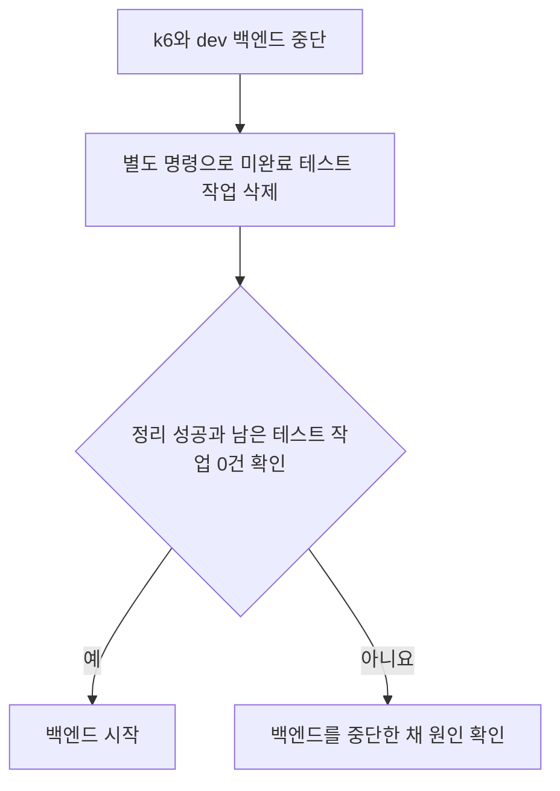

# 2026-10-21 부하 테스트 작업의 종류를 DB에 저장할 것인가

부하 테스트 작업은 현재처럼 메모리에서 구분한다. 이를 위해 운영 DB에 작업 종류 항목을 추가하지 않는다.

- 상태: 기존 방식 유지
- 작성일: 2026-10-21
- 작성자: 캐모
- 결정 대상: dev 부하 테스트의 실행기 선택과 재시작 시 남은 작업 처리

## 배경

dev의 일반 생성과 부하 테스트는 같은 DB 대기열과 작업 처리기를 쓴다.
일반 생성은 실제 AI를 호출한다. 부하 테스트는 생성 ID를 메모리에 등록해 가짜 AI 실행기인 Stub을 선택한다.

백엔드를 재시작하면 메모리의 테스트 ID는 사라진다. DB의 대기 작업은 남을 수 있다.
남은 테스트 작업을 처리기가 가져가면 실제 AI를 호출해 비용이 발생할 수 있다.

## 고려한 방법

| 방법 | 좋은 점 | 불편한 점 |
| --- | --- | --- |
| 현재 메모리 등록 방식 유지 | 부하 테스트를 위해 운영 DB와 일반 작업 모델을 더 바꾸지 않는다. | 중단 후 남은 테스트 작업을 별도 명령으로 지운 뒤 백엔드를 켜야 한다. |
| 작업 종류를 DB에 저장 | 재시작 후에도 테스트 작업을 구분해 Stub을 선택할 수 있다. | DB 항목을 추가하고 일반 작업과 테스트 작업의 구분을 계속 관리해야 한다. |

## 결정과 실제 처리

현재 메모리 등록 방식과 실행기 선택 코드를 유지한다. 작업 종류를 저장하는 DB 변경은 하지 않는다.
부하 테스트는 dev 백엔드 한 인스턴스에서 실행한다.
테스트 중 재시작이 잦지 않다는 현재 운영 조건에서는, 테스트 구분을 위해 운영 테이블을 더 확장할 필요가 크지 않다고 판단했다.

백엔드가 갑자기 꺼지면 작업 완료를 기다리지 못할 수 있다.
따라서 앱의 종료 처리에만 의존하지 않고, 백엔드가 꺼진 상태에서 남은 테스트 작업을 정리한다.

1. k6를 멈추고 dev 백엔드 컨테이너를 중단한다.
2. 별도 정리 명령으로 지정한 테스트 실행의 `PENDING`과 `PROCESSING` 작업을 지운다.
3. 남은 미완료 테스트 작업이 0건이고 명령이 성공한 것을 확인한 뒤 백엔드를 켠다.

정리 명령은 테스트 회원과 실행별 요청 키를 함께 확인한다. 일반 회원과 게스트의 작업은 지우지 않는다.
삭제 범위와 실행 방법은 [중단된 테스트 작업 정리 결정](<2026-10-21_중단된 부하 테스트 작업을 어떻게 정리할 것인가_캐모.md>)을 따른다.

정리는 운영자가 실행한다. 앱 시작과 배포 과정에서 자동으로 실행하지 않는다.

## 남는 위험과 다시 검토할 때

정리 없이 백엔드가 자동으로 다시 켜지면 테스트의 `PENDING` 작업에 실제 AI가 호출될 수 있다.
정리 명령만으로 자동 재시작을 막지는 못한다. 테스트 중 백엔드가 중단되면 운영자가 실행 상태를 확인해야 한다.

테스트 중 재시작이 잦아지거나, 테스트 요청의 실제 AI 호출을 허용할 수 없거나, 백엔드를 여러 대로 늘리면 작업 종류를 DB에 저장하는 방법을 다시 검토한다.

## 관련 문서

- [작업 확보와 병렬 실행](<2026-10-19_DB 작업을 어떻게 확보하고 병렬 실행할 것인가_캐모.md>)
- [테스트 작업의 메모리 등록 코드](../../../src/main/java/com/harudle/generation/loadtest/LoadTestGenerationRegistry.java)
