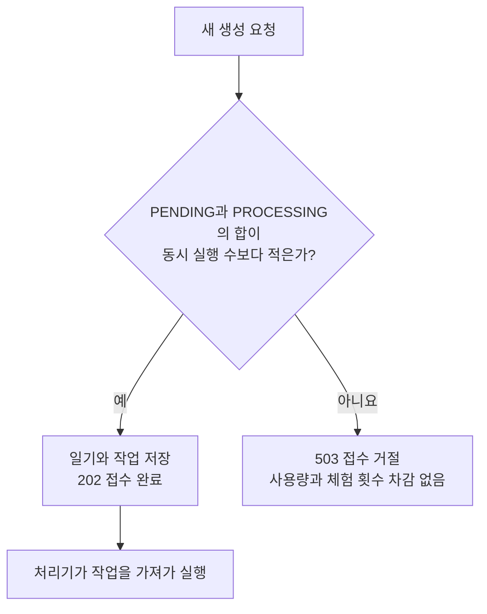

# 2026-10-21 생성 요청을 동시 실행 수만큼만 접수할 것인가

Worker가 동시에 실행할 수 있는 수만큼만 생성 작업을 접수한다. Worker 하나당 맡는 작업은 1개로 제한한다.

- 상태: 접수 제한 구현
- 작성일: 2026-10-21
- 작성자: 캐모
- 결정 대상: 생성 요청의 접수 상한과 상한에 도달했을 때의 응답

## 배경

새 요청을 계속 받으면 사용자는 앞선 작업이 끝나기를 기다려야 한다.
예를 들어 앞선 작업을 120초 기다리고 자신의 이미지를 만드는 데 120초가 걸리면 총 240초가 걸린다.
동시 생성 요청이 많지 않은 현재는, 이렇게 오래 기다리는 요청을 추가로 받지 않기로 한다.

## 고려한 방법

| 방법 | 좋은 점 | 불편한 점 |
| --- | --- | --- |
| 대기 작업을 계속 접수 | 사용자가 요청을 맡겨둘 수 있다. | 앞선 작업이 오래 걸리면 대기도 길어진다. |
| 오래 기다린 작업을 만료 | 대기 시간을 제한할 수 있다. | 이미 접수한 요청이 실행 전에 실패한다. |
| 동시 실행 수만큼만 접수 | 앞선 작업이 끝나기를 기다리는 추가 요청을 제한한다. | 상한에 도달하면 사용자가 나중에 다시 요청해야 한다. |

## 결정과 실제 처리

접수 상한은 `GENERATION_WORKER_CONCURRENCY`로 정한 동시 실행 수와 같게 둔다.
같은 백엔드에서 2개를 동시에 실행하면 최대 2건, 3개를 동시에 실행하면 최대 3건을 접수한다.
이 숫자는 예시이며, 운영의 동시 실행 수는 별도로 정한다.

`PENDING`은 처리기가 아직 가져가지 않은 작업이다. `PROCESSING`은 생성 중인 작업이다.
두 상태의 개수를 더해 아직 끝나지 않은 작업 수를 구한다. 선점 전의 작업도 상한에 포함한다.

1. 접수용 DB 잠금을 얻고 같은 요청이 이미 접수됐는지 확인한다. 이미 있으면 기존 작업의 상태와 결과에 맞춰 응답한다.
2. 새 요청이면 아직 끝나지 않은 작업 수를 확인한다.
3. 이 수가 동시 실행 수보다 적으면 일기와 작업을 함께 저장하고 `202`로 응답한다.
4. 이미 상한에 도달했으면 `503`으로 거절한다. 일기와 작업을 저장하지 않고 사용량과 게스트 체험 횟수도 차감하지 않는다.

회원, 게스트, 부하 테스트의 새 생성 요청에 같은 기준을 적용한다.
동시 요청이 상한을 넘기지 않도록 DB 잠금으로 개수 확인과 저장을 보호한다.
이 구간은 한 요청씩 처리하고, 저장이 끝나면 잠금을 푼다. 이미지 생성은 잠금을 푼 뒤 실행한다.

이 문서를 작성할 때는 접수한 작업을 120초 넘게 기다려도 대기 상태로 유지하기로 했다.
2026-10-22에는 [대기 자동 만료 결정](<2026-10-22_대기 중인 생성 작업을 언제 만료할 것인가_캐모.md>)에 따라 이 부분을 바꿨다.
현재는 120초 이상 지난 대기 작업을 만료 대상으로 삼고 5초 간격으로 정리한다. 동시 실행 수에 따른 접수 상한은 유지한다.
처리기가 작업을 확인하기까지의 짧은 대기는 남는다. 생성 자체가 오래 걸릴 수 있어 120초 안의 완료를 보장하지는 않는다.
생성이 시작된 뒤의 실패와 처리 시간 초과는 기존 정책으로 처리한다.

## 불편한 점과 다시 검토할 때

요청이 한꺼번에 오면 일부 사용자는 바로 접수 거절을 받고 다시 요청해야 한다.
접수 거절이 잦아지면 생성 시간과 메모리, AI 오류를 확인하고 동시 실행 수를 늘릴지 검토한다.
백엔드를 여러 대로 늘릴 때는 전체 동시 실행 수와 접수 상한을 함께 다시 정한다.

## 관련 문서

- [작업 확보와 병렬 실행](<2026-10-19_DB 작업을 어떻게 확보하고 병렬 실행할 것인가_캐모.md>)
- [성능 검증과 재검토](<2026-10-19_DB 큐의 부하를 어떻게 검증하고 재검토할 것인가_캐모.md>)
