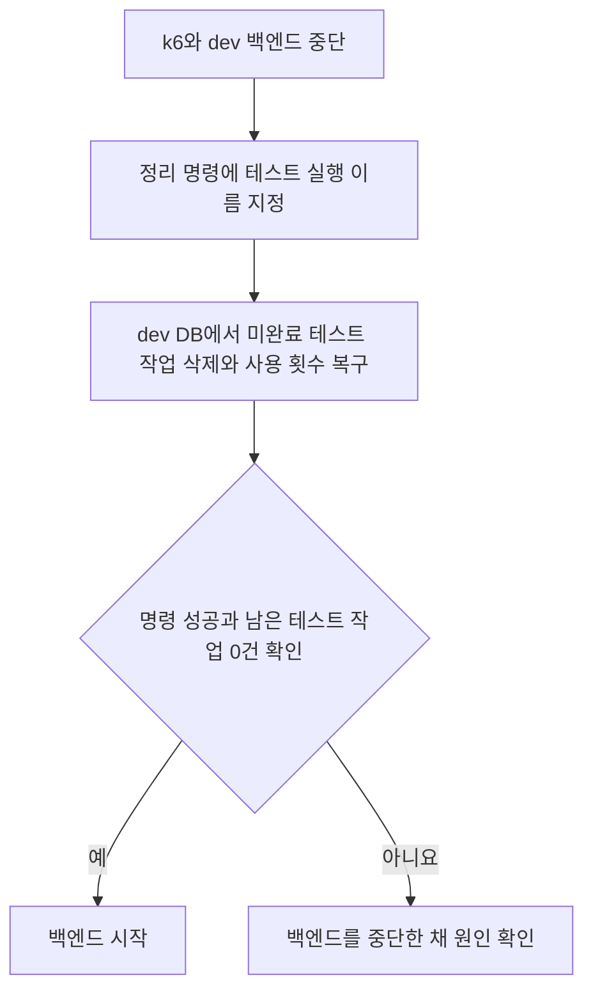

# 2026-10-21 중단된 부하 테스트 작업을 어떻게 정리할 것인가

dev 백엔드가 꺼진 상태에서 별도 명령으로 남은 테스트 작업을 지운다. 정리가 성공한 뒤 백엔드를 켠다.

- 상태: 채택
- 작성일: 2026-10-21
- 작성자: 캐모
- 결정 대상: 재시작 후 테스트 작업이 실제 AI를 호출하지 않도록 정리하는 방법

## 배경

테스트 작업은 DB에 남지만, 가짜 AI 실행기를 고르는 정보는 백엔드 메모리에만 있다.
백엔드가 갑자기 꺼지면 종료 전에 작업을 마칠 수 없다. 다시 켜기 전에 남은 테스트 작업을 정리할 방법이 필요하다.

## 고려한 방법

| 방법 | 좋은 점 | 불편한 점 |
| --- | --- | --- |
| 종료 전에 작업 완료를 기다림 | 정상 종료에서는 이미 접수한 작업을 마칠 수 있다. | 갑자기 꺼지면 이 절차를 실행할 수 없다. |
| 앱 시작 시 자동 삭제 | 켤 때마다 정리 코드를 실행할 수 있다. | 앱 시작과 테스트 데이터 삭제가 연결되고, 처리기가 작업을 가져가기 전에 실행해야 한다. |
| 백엔드가 꺼진 상태에서 별도 명령 실행 | 앱이 실행되지 않아도 DB만 연결되면 정리할 수 있다. 삭제 시점을 운영자가 정한다. | 운영자가 명령을 실행한 뒤 백엔드를 켜야 한다. |

## 결정과 실제 처리

`cleanup_stopped.py`를 dev EC2에서 직접 실행한다. 앱의 시작 코드와 종료 코드에는 정리를 추가하지 않는다.
작업 종류를 저장하는 DB 항목과 기존 실행기 선택 방식도 바꾸지 않는다.

1. k6를 멈추고 dev 백엔드 컨테이너를 중단한다. 컨테이너는 삭제하지 않는다.
2. 정리 명령에 `peak1` 같은 테스트 실행 이름을 지정한다.
3. 명령은 중단된 컨테이너에서 dev DB 접속 정보를 읽는다. 테스트 준비 때 기록한 DB 주소와도 비교한다.
4. 테스트 회원 ID, 테스트 이메일, 실행별 요청 키가 맞는 `PENDING`과 `PROCESSING` 작업만 지운다. 연결된 일기도 함께 지운다.
5. 삭제한 작업이 차감한 생성 사용 횟수를 작업에 기록된 날짜별로 돌려준다. 삭제와 사용 횟수 복구는 함께 저장하거나 함께 취소한다.
6. 남은 미완료 테스트 작업이 0건이고 명령이 성공한 것을 확인한 뒤 백엔드를 켠다.

명령은 백엔드를 직접 켜거나 끄지 않는다. 실행 중인 백엔드, prod 설정, 다른 DB 주소는 거절한다.
같은 명령을 다시 실행해도 이미 지운 작업의 사용 횟수를 다시 돌려주지 않는다.
일반 회원과 게스트 작업, 완료된 테스트 작업, 기본 데이터는 유지한다.
미완료 작업에 이미지 저장 정보나 피드가 있으면 삭제를 중단하고 확인을 요구한다.

## 운영 조건과 남는 위험

dev 백엔드 한 인스턴스를 기준으로 한다. Docker와 DB 접속 권한, 해당 테스트의 준비 파일이 필요하다.
정리하는 동안 백엔드를 시작하거나 배포하지 않는다. 다른 실행의 미완료 테스트 작업이 남으면 해당 실행도 정리한 뒤 시작한다.
이때 지정한 실행의 삭제는 이미 저장됐을 수 있으므로 출력된 건수를 확인한다.

이 명령은 S3 파일을 삭제하지 않는다. 갑자기 꺼지기 직전에 업로드하고 DB에 기록하지 못한 파일은 남을 수 있다.
정리 없이 자동 재시작되면 실제 AI 호출 가능성은 남는다. 자동 재시작 자체를 막는 기능은 추가하지 않는다.

## 관련 문서

- [부하 테스트 작업 구분 결정](<2026-10-21_부하 테스트 작업의 종류를 DB에 저장할 것인가_캐모.md>)
- [실제 정리 명령과 재시작 순서](../../../load-test/README.md#dev-백엔드를-재시작해야-할-때)
