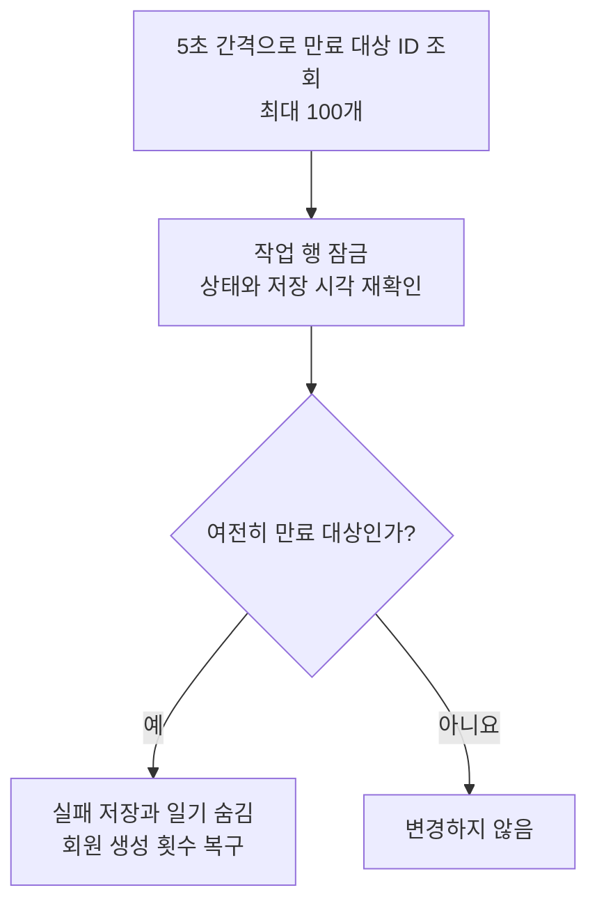

# 2026-10-22 대기 중인 생성 작업을 언제 만료할 것인가

저장한 지 120초 이상 지났는데도 실행을 시작하지 않은 작업은 자동 만료 대상으로 삼는다.

- 상태: 구현, CI 검증 대기
- 작성일: 2026-10-22
- 작성자: 캐모
- 결정 대상: 대기 작업의 만료 기준과 실패 저장 방법

## 배경

접수 상한은 대기 중인 작업과 실행 중인 작업을 함께 센다.
처리기가 작업을 가져가지 못하면 사용자는 계속 기다리고, 새 요청도 상한에 막힐 수 있다.
기존에는 접수한 작업을 계속 대기로 두기로 했지만, 실행이 시작되지 않는 작업에는 제한이 필요하다.

## 고려한 방법

| 방법 | 좋은 점 | 불편한 점 |
| --- | --- | --- |
| 실행할 때까지 계속 대기 | 접수한 작업을 나중에라도 실행할 수 있다. | 사용자가 계속 기다리고 접수 상한도 차지한다. |
| 운영자가 직접 정리 | 자동 정리 코드를 추가하지 않아도 된다. | 문제를 발견하고 정리할 때까지 대기가 이어진다. |
| 일정 시간이 지나면 자동 만료 | 실행되지 않는 작업의 대기를 끝내고 접수 여유를 돌려준다. | 이미 접수한 요청이 실행 전에 실패하고, 정기 DB 조회가 추가된다. |

## 결정과 실제 처리

대기 제한은 `GENERATION_PENDING_TIMEOUT`으로 정하며 기본값은 `120s`다.
실행 시작까지의 대기를 길게 남기지 않도록 정한 초기값이다. AI 생성에 걸리는 시간과는 별도로 관리한다.
정리 간격은 `GENERATION_PENDING_CLEANUP_INTERVAL`로 정하며 기본값은 `5s`다.
만료 대상을 오래 남기지 않으면서 매 순간 DB를 조회하지 않도록 이 간격을 정했다.

1. 처리기는 기한이 남은 `PENDING` 작업만 가져온다. 행 잠금 후에도 시각을 다시 확인해 기한이 지난 작업은 실행하지 않는다.
2. 정리 코드는 5초 간격으로 기한이 지난 대기 작업 ID를 최대 100개 조회한다. 기존 대기 작업 인덱스를 사용하며, ID 조회에는 행 잠금을 걸지 않는다.
3. 각 작업은 별도 트랜잭션에서 행을 잠그고 상태와 저장 시각을 다시 확인한다. 이미 선점됐거나 끝난 작업은 건너뛴다.
4. 여전히 만료 대상이면 `FAILED`와 `GENERATION_PENDING_TIMEOUT` 오류를 저장하고 일기를 숨긴다. 회원의 생성 횟수는 요청에 기록된 사용 날짜에 한 번 돌려준다.
5. 상태 조회는 `200 OK`와 실패 상태, 오류 코드를 반환한다. dev의 테스트 ID는 만료 저장이 성공한 뒤 메모리에서 지운다.

실패 기록과 일기 숨김, 사용량 복구는 함께 저장하거나 함께 취소한다.
게스트의 체험 사용 상태는 유지한다. 생성 기록도 남기므로 같은 요청 키로 다시 보내면 기존 실패를 반환한다.
`PROCESSING` 작업에는 기존 처리 제한을 적용한다.

## 불편한 점과 다시 검토할 때

120초가 지나는 순간에 실패 저장이 끝나는 것은 아니다. 확인 간격과 DB 처리 시간에 따라 늦어질 수 있다.
앱이 꺼져 있으면 정리도 실행되지 않는다. 다시 켜지면 기한이 지난 작업은 실행하지 않고 정리에 맡긴다.
대기 만료가 자주 발생하면 처리기 오류와 DB 지연을 먼저 확인하고 대기 제한과 정리 간격을 다시 정한다.

dev 재시작 전의 테스트 작업 정리 절차는 유지한다. 아직 대기 기한이 남은 테스트 작업은 재시작 후 일반 작업과 구분할 수 없기 때문이다.

## 관련 문서

- [생성 요청의 접수 상한](<2026-10-21_생성 요청을 동시 실행 수만큼만 접수할 것인가_캐모.md>)
- [중단된 테스트 작업 정리](<2026-10-21_중단된 부하 테스트 작업을 어떻게 정리할 것인가_캐모.md>)
- [API 문서](../../api-spec.md#55-생성-작업-상태-조회)
