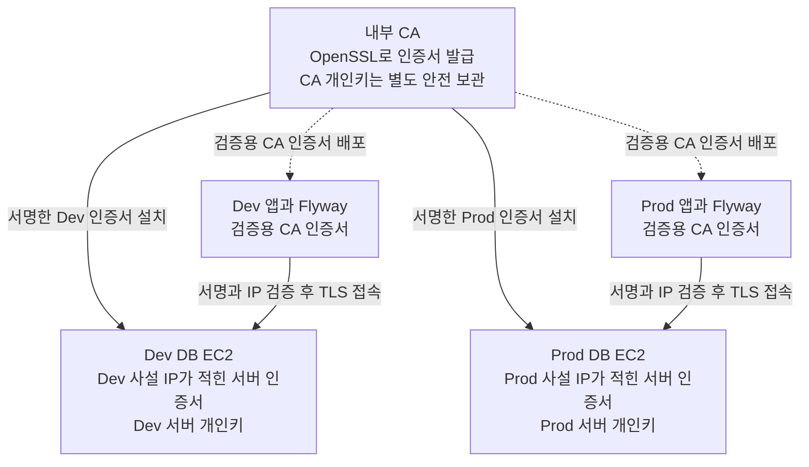
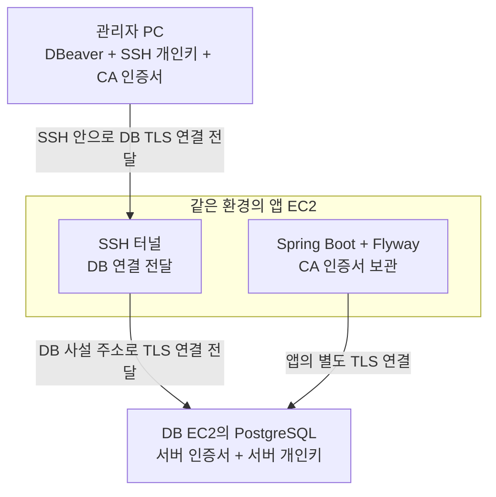
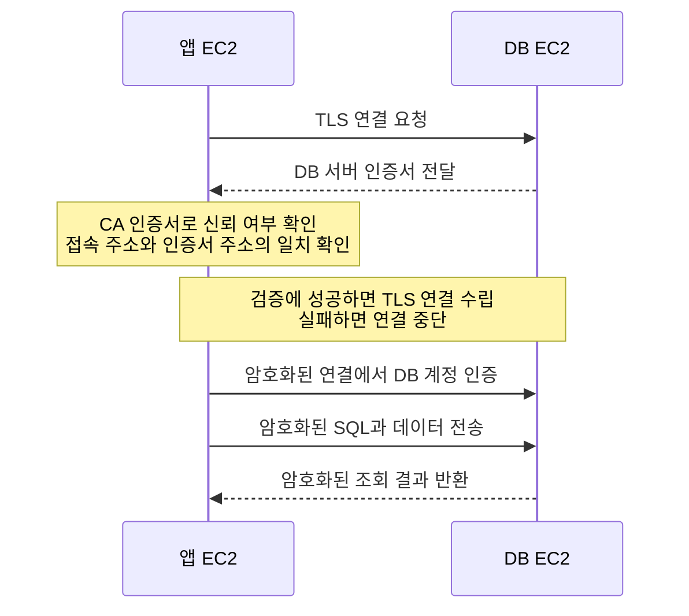

# 2026-10-23 EC2 PostgreSQL의 접속 경로를 제한하는 이유

- 작성일: 2026-10-23
- 작성자: 이산
- 상태: 채택, 서버 적용 및 접속 검증 전
- 결정 대상: Dev와 Prod의 PostgreSQL 접속 경로, 앱 및 Flyway 계정, TLS 통신과 EBS 암호화

## 배경

PostgreSQL을 EC2에서 직접 운영하므로 접속 가능한 서버와 관리자 접속 방법을 정한다.
기존 EC2 관리에는 SSH를 사용하고 있다. 이 접속을 이용해 DB에 접근한다.

## 결정 요인

- DB의 5432 포트를 인터넷에 직접 열지 않는다.
- Dev와 Prod의 DB 접속 경로를 구분한다.
- 추가 관리용 EC2 없이 기존 SSH 접속을 이용한다.
- DB 사설 IP에 맞는 인증서를 발급하고 공개 인증서 기록에 내부 DB 주소를 남기지 않는다.

## 고려한 대안

### 대안 1: 관리자 PC에서 DB 포트에 직접 접속

장점은 중간 서버 없이 접속한다는 점이다.
단점은 외부 DB 접속 경로와 허용할 관리자 IP를 별도로 관리해야 한다는 점이다.

### 대안 2: 같은 환경의 앱 EC2를 통한 SSH 터널

장점은 기존 SSH 접속을 이용하고 DB 포트를 인터넷에 공개하지 않는다는 점이다.
단점은 앱 EC2에 접속할 수 있어야 관리자가 DB에 접근할 수 있다는 점이다.

### 인증서 발급 방법 비교

| 방법 | 장점 | 단점 |
| --- | --- | --- |
| Certbot과 Let’s Encrypt | 공개 인증기관의 인증서를 발급받고 자동 갱신할 수 있다. | 도메인 인증과 갱신 후 DB 반영이 필요하고, 인증서에 포함한 도메인 이름이 공개 인증서 기록에 남는다. |
| OpenSSL로 내부 CA 운영 | 사설 IP를 포함한 DB 인증서를 직접 발급하고 공개 인증서 기록에 등록하지 않는다. | CA 개인키 보관, CA 인증서 배포와 갱신을 우리가 관리해야 한다. |

## 결정

대안 2를 채택한다.

| 접속 주체 | 접속 대상과 방법 |
| --- | --- |
| Dev 앱 | Dev DB의 사설 주소로 접속한다. |
| Prod 앱 | Prod DB의 사설 주소로 접속한다. |
| 관리자 | 같은 환경의 앱 EC2에 SSH 키로 인증하고 DB 사설 주소로 터널을 연결한다. |
| 인터넷의 직접 DB 접속 | 허용하지 않는다. |

DB 로그인에는 SSH 키와 별도로 DB 계정과 비밀번호가 필요하다.
관리자 PC의 터널 포트는 127.0.0.1에서만 받는다. 개인키는 PC에 보관하고 서버나 Git에 복사하지 않는다.
SSH 접속 출발지는 허용된 관리망 또는 관리자 IP로 제한하고 서버 호스트 키를 확인한다.
기존 키는 접근 권한을 확인한 뒤 사용하고, 키 유출이나 담당자 변경 시 접근 권한을 회수한다.

DB의 보안 그룹과 PostgreSQL 접속 규칙에서 같은 환경의 앱과 승인한 관리 경로만 허용한다.
현재 두 앱은 공용 project-public을 사용하며 이 그룹에는 같은 그룹의 모든 트래픽을 허용하는 규칙이 있다.
환경 구분을 위해 필요한 보안 그룹 권한은 아직 확인하지 못했다. 현재 공용 그룹만으로 제한을 적용했다고 보지 않는다.

### 앱과 Flyway 계정

앱과 Flyway는 현재처럼 같은 DB 계정을 사용한다. Flyway는 앱 시작 시 실행한다.
각 환경에서 기존 RDS에 쓰던 DB 이름, 계정과 비밀번호를 새 PostgreSQL에 설정하고, 앱 .env의 DB 접속 주소를 새 DB EC2의 사설 주소로 바꾼다.
.env는 기존처럼 서버의 접근 제한된 파일로 보관하고 Git과 이미지에 넣지 않는다.

계정 생성과 권한 부여는 PostgreSQL에서 수행한다. .env에 값을 적는 것만으로 계정이나 권한이 생성되지 않는다.
앱 계정에 사용하는 스키마의 객체 생성 권한을 주고, 이관한 테이블과 시퀀스, 함수 및 Flyway 이력의 소유권을 맞춘다.
DB 소유자만 바꾸고 기존 테이블의 소유권이 자동으로 바뀐다고 보지 않는다.
앱 계정에는 SUPERUSER, 다른 DB 생성과 역할 생성 권한을 주지 않는다.
앱 계정이 업무 데이터뿐 아니라 자기 객체의 구조를 변경하거나 삭제할 수 있다는 점을 받아들인다.
Flyway용 계정과 별도 migration 배포 단계는 이번 이관에서 추가하지 않는다.

### DB 통신 암호화

Dev와 Prod 모두 앱과 PostgreSQL 사이에 TLS를 적용한다.
DB에 서버 인증서와 개인키를 설치하고 앱에는 인증서를 검증할 CA 인증서를 전달한다.
앱의 JDBC 접속은 sslmode=verify-full로 설정해 인증서 신뢰와 접속 주소를 함께 검증한다.
인증서에 포함된 주소와 실제 DB 접속 주소를 맞춘다. 검증 실패 시 암호화 없는 연결로 전환하지 않는다.
DB 접속 규칙에서도 앱의 TLS 연결을 요구한다. ssl=on만 설정하고 평문 연결을 함께 허용한 상태로 끝내지 않는다.
Flyway도 같은 앱 접속 설정을 사용한다. 관리자 도구의 DB 연결에도 TLS와 인증서 검증을 적용한다.
인증서 개인키는 Git, 이미지와 User Data에 넣지 않고 서버의 접근 제한된 파일로 보관한다.
TLS는 통신 내용을 보호한다. 일기 내용 자체의 암호화는 별도 담당 범위이며 EBS 암호화와도 구분한다.

### OpenSSL과 내부 CA로 인증서 발급

OpenSSL로 내부 CA를 만들고 Dev와 Prod DB에 서로 다른 서버 인증서와 개인키를 사용한다.
내부 CA는 우리가 DB 인증서를 발급하고 앱이 이를 검증하도록 준비하는 방식이다. 별도 상시 CA 서버는 추가하지 않는다.
Certbot과 Let’s Encrypt를 통한 DB 인증서 발급은 사용하지 않는다. 기존 웹사이트의 인증서 운영 방식은 유지한다.

1. DB별 개인키와 인증서 발급 요청을 준비한다. 인증서의 SAN에 해당 DB의 실제 사설 IP를 넣는다.
2. 내부 CA 개인키로 각 DB 인증서에 서명한다. CA 개인키를 DB나 앱 서버에 배포하지 않는다.
3. 각 DB 서버에 자기 서버 인증서와 개인키를 설치한다.
4. 앱과 관리자 PC에는 검증용 CA 인증서를 배포한다. 이 인증서는 비밀키가 아니다.
5. 앱은 DB 사설 IP로 접속하고 CA 서명, 인증서 유효 기간과 IP 일치를 검증한다.

CA 개인키는 접근을 제한해 암호화 보관하고, EC2 장애 때도 사용할 수 있도록 별도 보관 위치와 복구 절차를 준비한다.
CA 개인키가 유출되면 두 환경의 인증서 신뢰에 영향을 줄 수 있어 CA와 서버 인증서 교체가 필요하다.
DB 사설 IP가 바뀌면 새 IP를 포함한 서버 인증서를 다시 발급한다. CA가 유지되면 앱의 CA 인증서까지 다시 발급할 필요는 없다.
인증서 갱신 후 PostgreSQL에 반영하고 실제 연결을 확인한다. 공개 기록에 주소를 남기지 않는 선택이 접속 제한을 대신하지는 않는다.

CA에서 DB로 향하는 선은 인증서 발급과 설치 관계다. 실제 데이터는 각 앱과 같은 환경의 DB 사이에서 오간다.
인증서 발급 과정에서 DB 개인키는 CA에 전달할 필요가 없고, CA 개인키 역시 발급 장소에만 둔다.

### SSH 터널과 TLS 접속 구조

아래 구조를 Dev와 Prod에 각각 적용한다. 관리자는 DB에 직접 접속하지 않고 같은 환경의 앱 EC2를 거친다.
SSH 터널 안으로 전달하는 DB 연결에도 TLS를 적용한다. 관리자 PC부터 DB까지의 TLS 연결은 앱 EC2가 전달하며, 앱 프로세스가 대신 로그인하는 것은 아니다.

SSH 개인키는 앱 EC2 접속에 사용한다. DB 서버 개인키는 DB의 TLS 연결에 사용하는 별도 비밀이다.

### 앱의 DB 인증서 검증과 통신 순서

| 파일 | 보관 위치 | 역할 |
| --- | --- | --- |
| DB 서버 인증서 | DB EC2 | DB의 신원을 확인하는 데 사용한다. |
| DB 서버 개인키 | DB EC2 | TLS 연결에 사용하며 접근을 제한한다. |
| CA 인증서 | 앱 EC2와 관리자 PC | DB 인증서를 신뢰할 수 있는지 검증한다. |

CA 인증서는 검증용 공개 정보다. 인증서 발급에 사용하는 CA 개인키는 별도 비밀로 안전하게 보관한다.

### DB 디스크 암호화

Dev와 Prod의 DB EC2에서 사용하는 EBS 볼륨은 생성할 때 암호화를 켠다.
DB 데이터와 WAL, 로그를 저장하는 볼륨에 적용한다. 같은 볼륨에 Swap을 만들면 해당 파일도 암호화된 디스크에 저장된다.
볼륨이나 스냅샷 접근 권한이 잘못 부여되더라도 복호화에는 KMS 키 사용 권한이 필요하도록 한다.
사용할 KMS 키와 EC2 생성 및 복구에 필요한 권한은 구현할 때 확인한다.

디스크 암호화는 DB 접속 제한을 대신하지 않는다. 정상 DB 계정으로 읽거나 삭제하는 작업과 실행 중인 서버 침해를 막지는 못한다.
볼륨과 KMS 키 사용 권한을 모두 가진 사람의 접근도 막지 못한다.
기존 비암호화 볼륨은 설정만 바꿔 직접 암호화할 수 없으므로 이번 새 서버 구축에서 암호화된 볼륨을 준비한다.

## 긍정적 결과

- 기존 SSH 접속 방식으로 DBeaver 등의 DB 관리 도구를 사용할 수 있다.
- DB 포트를 인터넷에 공개하지 않고 환경별 접근을 제한한다.
- 공개 인증서 기록에 DB 주소를 남기지 않고 사설 IP에 맞는 인증서를 발급한다.

## 부정적 결과와 트레이드오프

- 앱 EC2가 중단되면 이 경로의 관리자 접속도 중단된다.
- SSH는 관리자 PC부터 앱 EC2까지 암호화한다. 앱 EC2부터 DB까지는 별도 TLS 설정과 인증서 갱신 관리가 필요하다.
- SSH 키를 가진 사람이 DB 관리자 권한까지 자동으로 얻는 것은 아니다. DB 계정 권한도 제한해야 한다.

## 후속 결정과 재검토 조건

- 내부 CA 보관 위치와 접근 담당자, 발급 및 갱신 명령, 만료 확인과 복구 시 재배치 절차를 구현할 때 준비한다.
- EBS 암호화에 사용할 KMS 키와 생성, 연결 및 복구 권한을 확인한다.
- 보안 그룹 생성과 연결 권한을 관리자에게 확인하고 실제 규칙을 준비한다.
- 앱 EC2 장애로 터널을 사용할 수 없을 때의 관리 접속 방법을 복구 절차에 포함한다.

## 구현과 검증

접속 경로와 앱 및 Flyway 공용 계정 유지, 내부 CA TLS 및 DB용 EBS 암호화를 결정했다. 새 DB와 터널, TLS 및 EBS 암호화 설정은 아직 적용하지 않았다.
Dev 이관 후 실제 계정과 객체 소유권, Flyway 이력 검증과 새 migration 실행을 확인한다. 기존에 적용한 migration은 다시 실행하지 않는다.
Dev와 Prod 각각의 허용 접속과 반대 환경의 거부, 인터넷 직접 접속 거부를 시험한다.
SSH 인증과 호스트 키 확인, 별도 DB 인증과 터널의 로컬 바인딩을 확인한다.

앱과 관리자 도구에서 TLS 사용과 인증서 검증을 확인한다. 평문 접속과 신뢰하지 않는 인증서, 잘못된 DB 주소는 거부되는지 시험한다.
SSH 터널의 로컬 접속 주소를 DB 인증서의 검증 주소로 잘못 사용하지 않도록 설정을 확인한다.
Dev와 Prod의 인증서가 각 DB 사설 IP와 일치하는지, 갱신 후 연결이 유지되는지 확인한다. 내부 CA로의 발급과 갱신은 아직 실행하지 않았다.

새 DB 볼륨의 암호화 상태와 사용한 KMS 키를 확인하고, 필요한 스냅샷 또는 백업을 이용한 복구 권한도 점검한다.

## 관련 문서

- [인프라 v2 설계 결정 목록](README.md)
- [앱과 DB EC2 분리](<2026-10-22_t4g.medium 2대 대신 t4g.small 4대를 사용하는 이유_이산.md>)
- [OpenSSH 포트 전달](https://man.openbsd.org/ssh#L)
- [AWS 보안 그룹 접속 제한](https://docs.aws.amazon.com/AWSEC2/latest/UserGuide/security-group-rules-reference.html)
- [기존 Flyway 운영 방식](<../2026-08-28_Flyway migration을 어떤 운영 방식으로 실행할 것인가_이산.md>)
- [PostgreSQL 권한과 소유권](https://www.postgresql.org/docs/16/ddl-priv.html)
- [PostgreSQL TLS 설정](https://www.postgresql.org/docs/16/ssl-tcp.html)
- [JDBC 인증서 검증](https://jdbc.postgresql.org/documentation/ssl/)
- [Let’s Encrypt 공개 인증서 기록](https://letsencrypt.org/docs/ct-logs/)
- [AWS EBS 암호화](https://docs.aws.amazon.com/ebs/latest/userguide/ebs-encryption.html)
