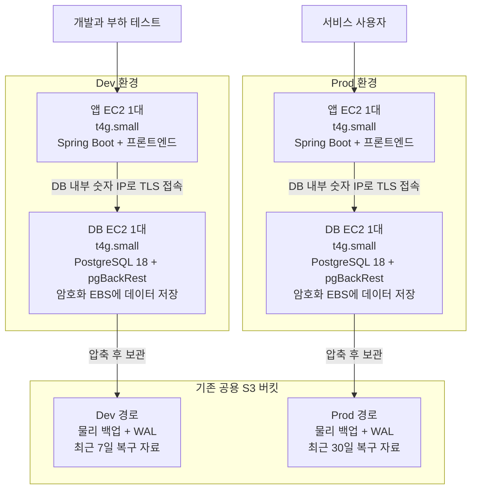
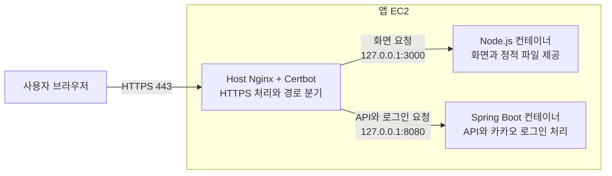
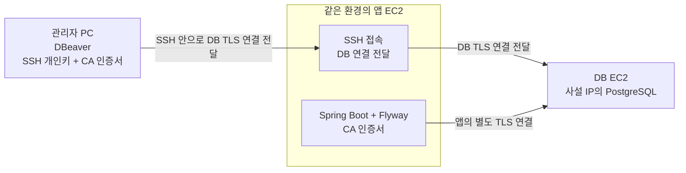
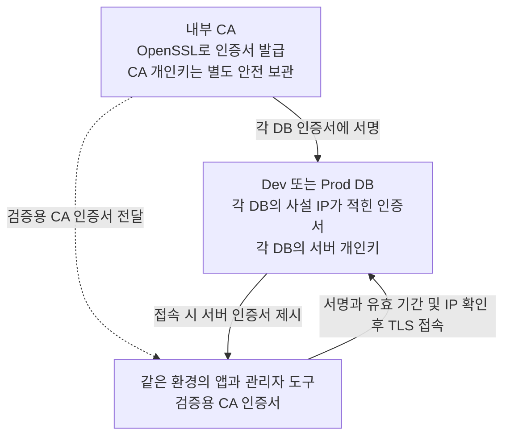
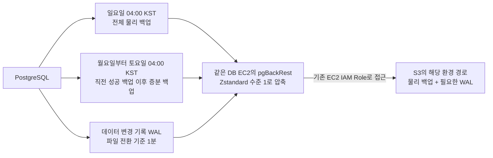
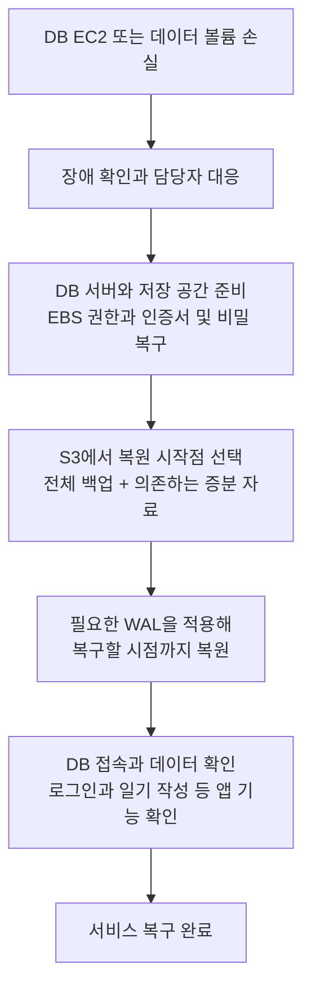
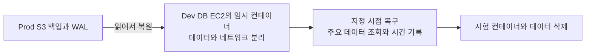
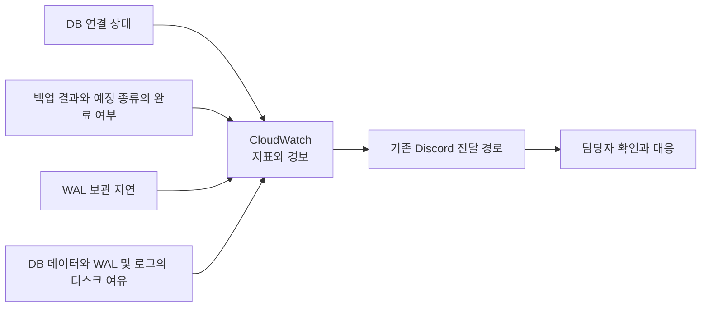
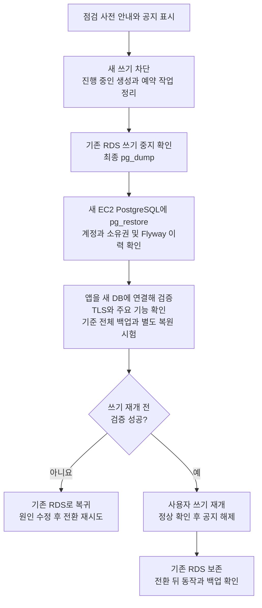

# 하루들 인프라 v2 설계 개요

- 작성일: 2026-10-23
- 작성자: 이산
- 상태: 설계 결정 요약, 서버 적용 및 검증 전
- 근거: [인프라 v2 ADR 목록](README.md)

**Dev와 Prod에 앱 서버와 DB 서버를 각각 둔다. RDS 데이터는 EC2의 PostgreSQL로 옮기고, S3 백업과 WAL로 복구한다.**
이 문서는 채택한 ADR을 한 흐름으로 설명한다. 새로운 설정값이나 비용을 확정한 문서는 아니다.
현재 운영은 앱 EC2와 RDS 구성이며, 아래 구조는 앞으로 적용할 설계다.

## 1. 전체 서버 구조

| 항목 | 결정 |
| --- | --- |
| EC2 구성 | Dev 앱, Dev DB, Prod 앱, Prod DB의 총 네 대 |
| 시작 규격 | 모두 t4g.small, 2 vCPU와 2GiB RAM |
| 실행 시간 | Dev와 Prod 모두 상시 실행 |
| DB 버전 | Dev와 Prod 모두 PostgreSQL 18 |
| 프론트엔드 | SSR용 Node.js도 우선 앱 EC2에서 함께 실행 |
| 앱 배포 | CodeDeploy는 앱 EC2만 대상으로 하며 DB 컨테이너와 데이터는 제외 |
| DB 접근 | 같은 환경의 앱만 DB 포트 5432에 접속 |
| 대기 DB | 추가하지 않음. 장애 시 백업을 복원하는 동안 중단 가능 |

앱 서버를 재시작하거나 교체할 때 DB까지 함께 멈추는 일을 줄이기 위해 나눈다.
DB가 멈추면 앱 서버가 살아 있어도 DB를 쓰는 기능은 제공할 수 없다.
사설 IP는 10.0.1.25처럼 VPC 내부에서 사용하는 숫자 주소다. 이 숫자는 설명용 예시이며 실제 DB 주소는 EC2 생성 후 확인한다.
DB용 공개 도메인은 사용하지 않는다. 앱은 DB의 내부 숫자 IP로 접속하고, 내부 CA가 발급한 인증서에도 해당 IP를 넣어 검증한다.
앱과 DB는 서로 다른 EC2이므로 Docker 서비스 이름만으로 연결하지 않고 DB 사설 IP를 설정한다.
Node.js까지 2GiB 안에서 운영 가능한지는 부하 테스트로 확인한다. 디스크 크기와 컨테이너 메모리 제한은 아직 확정하지 않았다.

근거: [앱과 DB 서버 분리 ADR](<2026-10-22_t4g.medium 2대 대신 t4g.small 4대를 사용하는 이유_이산.md>)

### 화면과 API 요청을 나누는 방법

Host Nginx가 HTTPS를 처리하고 요청 경로에 따라 Node.js 또는 Spring Boot로 전달한다.
기존 프론트엔드 Nginx의 API 전달 역할을 Host Nginx로 옮긴다. Dev와 Prod에 같은 규칙을 적용한다.

| 요청 경로 | 전달 대상 |
| --- | --- |
| `/api`, `/api/**` | Spring Boot |
| `/oauth2`, `/oauth2/**`, `/login/oauth2`, `/login/oauth2/**` | Spring Boot. 로그인 시작과 콜백 경로를 모두 포함 |
| `/scalar`, `/scalar/**`, `/v3/api-docs`, `/v3/api-docs/**` | Spring Boot. 문서 공개 여부는 백엔드 설정을 따름 |
| 그 외 화면과 정적 파일 경로 | Node.js |

Spring Boot의 API 포트도 호스트의 `127.0.0.1:8080`에 연결하도록 Compose를 변경한다.
Host Nginx에서는 Docker 서비스 이름인 `backend` 대신 이 로컬 주소를 사용한다. Node.js도 호스트의 `127.0.0.1:3000`으로만 연결한다.
두 포트를 외부에 공개하지 않고, 요청 경로와 쿼리 문자열을 유지해 전달한다.

기존 `Host`, `X-Real-IP`, `X-Forwarded-For`, `X-Forwarded-Host`, `X-Forwarded-Proto` 헤더를 유지한다.
`X-Forwarded-Proto`에는 사용자가 접속한 HTTPS 정보를 전달해 로그인 리다이렉트 주소가 HTTP로 바뀌지 않게 한다.
기존 업로드 제한 `client_max_body_size 25m`과 프록시 연결 10초, 송수신 240초 제한도 Host Nginx에 반영한다.
기존 `/profile-images/` 파일 제공과 프론트엔드 `/health` 확인은 Node.js 전환 시에도 유지하고, 배포 검증이 새 서버를 확인하도록 맞춘다.

이 내용은 Node.js 전환 시 적용할 설계다. 현재 Nginx와 Compose 설정은 아직 변경하지 않았다.
Dev에서 화면, API, 이미지 업로드와 카카오 로그인 콜백이 동작하는지 확인한 뒤 Prod에 적용한다.

## 2. 앱과 관리자의 DB 접속

아래 그림은 한 환경의 예시다. Dev와 Prod에 각각 같은 구성을 적용하고 서로의 DB 접속은 차단한다.

- 관리자는 기존 SSH 접속으로 앱 EC2를 거쳐 DB에 접근한다. DB 포트는 인터넷에 직접 공개하지 않는다.
- SSH 개인키는 EC2 접속용이다. DB 로그인에는 별도로 DB 계정과 비밀번호가 필요하다.
- 관리자 PC의 터널은 로컬 주소에서만 받고, SSH 접속 출발지는 허용된 관리망이나 관리자 IP로 제한한다.
- 관리 도구도 DB 인증서를 검증한다. SSH 터널의 로컬 주소와 검증해야 할 DB 주소를 구분한다.

앱과 Flyway는 기존처럼 같은 DB 계정을 쓰고, 앱 시작 시 Flyway를 실행한다.
새 DB에 기존 계정을 준비하고 복원한 테이블, 시퀀스, 함수와 Flyway 이력의 소유권을 맞춘다.
앱 계정에는 사용하는 스키마의 객체 생성과 변경에 필요한 권한을 주되 SUPERUSER, 다른 DB 생성과 역할 생성 권한은 주지 않는다.
계정 정보를 .env에 적는 것과 PostgreSQL 안에 계정을 만들고 권한을 주는 작업은 별개다.
.env는 서버의 접근 제한된 파일로 관리하고 Git과 이미지에 넣지 않는다.

근거: [DB 접속과 보안 ADR](<2026-10-23_EC2 PostgreSQL의 접속 경로를 제한하는 이유_이산.md>)

## 3. 인증서 발급과 암호화

OpenSSL로 내부 CA를 만든다. CA는 DB 인증서를 발급하고 앱이 검증할 기준을 준비하는 용도이며, 상시 서버를 추가하지 않는다.

| 보호 대상 | 방법 |
| --- | --- |
| 관리자 PC와 앱 EC2 사이 | SSH 키 인증과 SSH 암호화 |
| 앱 또는 관리자 도구와 PostgreSQL 사이 | TLS와 인증서 검증. 앱 JDBC는 sslmode=verify-full 사용 |
| DB 데이터와 WAL, 로그를 저장하는 디스크 | Dev와 Prod DB용 EBS를 생성할 때 암호화 |
| 일기 내용 자체 | 별도 팀원이 담당하는 데이터 암호화 범위 |

Dev와 Prod는 서로 다른 DB 서버 인증서와 개인키를 사용한다.
CA 개인키를 앱이나 DB 서버에 배포하지 않고, 검증용 CA 인증서만 전달한다.
Certbot과 Let’s Encrypt를 DB 인증서에 사용하지 않아 공개 인증서 기록에 DB 주소를 남기지 않는다.
DB 사설 IP가 바뀌면 해당 IP를 넣은 서버 인증서를 다시 발급한다. 만료 전 갱신과 DB 반영도 준비해야 한다.

EBS 암호화는 디스크와 스냅샷을 보호하며, 실행 중인 DB의 정상 로그인이나 데이터 삭제를 막지는 못한다.
보안 그룹과 DB 접속 제한은 암호화와 함께 적용한다.

근거: [내부 CA TLS와 EBS 암호화 결정](<2026-10-23_EC2 PostgreSQL의 접속 경로를 제한하는 이유_이산.md>)

## 4. 백업과 WAL이 S3에 쌓이는 흐름

물리 백업은 복원의 시작점이고, WAL은 그 이후 변경을 적용하는 데 필요한 기록이다.
각 DB EC2의 pgBackRest가 두 자료를 압축하고 S3에 보관한다.

| 항목 | Dev | Prod |
| --- | --- | --- |
| 정기 전체 백업 | 일요일 04:00 KST | 일요일 04:00 KST |
| 정기 증분 백업 | 월요일부터 토요일 04:00 KST | 월요일부터 토요일 04:00 KST |
| WAL 파일 전환 | archive_timeout 60초 | archive_timeout 60초 |
| 압축 | 물리 백업과 WAL 모두 zst 수준 1 | 물리 백업과 WAL 모두 zst 수준 1 |
| 과거 시점 복구 자료 보관 | 최근 7일 | 최근 30일 |
| 저장소 | 기존 공용 S3의 Dev 경로 | 기존 공용 S3의 Prod 경로 |

WAL이 먼저 가득 차면 1분을 기다리지 않고 전환한다. 전환 간격 1분이 업로드 완료까지 1분을 보장하는 것은 아니다.
일요일에는 정기 증분 백업을 중복 실행하지 않는다. 정기 논리 덤프는 추가하지 않고 pg_dump는 RDS 이관에 사용한다.

보관 기간은 서비스 데이터의 삭제 주기가 아니다. 현재 남아 있는 오래된 일기도 최신 백업에 포함된다.
최근 7일 또는 30일의 복원 시작점을 확보하기 위해 더 오래된 전체 백업과 필요한 증분 자료가 남을 수 있다.
정리는 pgBackRest에 맡기고 S3 객체를 생성 일수만으로 일괄 삭제하지 않는다.

**기존 R2는 이미지 백업이다. S3에 DB 백업을 저장해도 R2로 자동 복사되지 않는다.**
DB 백업의 R2 도입은 연기하고 기존 이미지 백업은 유지한다.

근거: [S3 저장소와 인증](<2026-10-22_DB 백업을 S3와 R2에 함께 보관할 것인가_이산.md>), [pgBackRest](<2026-10-22_EC2 PostgreSQL 백업 도구로 pgBackRest를 사용하는 이유_이산.md>), [백업 일정과 증분 방식](<2026-10-22_Dev와 Prod의 일간 물리 백업을 증분 방식으로 만드는 이유_이산.md>), [WAL 간격](<2026-10-22_Dev와 Prod의 WAL 파일 전환 간격을 1분으로 맞추는 이유_이산.md>), [압축](<2026-10-22_백업과 WAL을 Zstandard 수준 1로 압축하는 이유_이산.md>), [Dev 7일](<2026-10-22_Dev의 특정 시점 복구 자료를 7일 보관하는 이유_이산.md>), [Prod 30일](<2026-10-22_Prod의 특정 시점 복구 자료를 30일 보관하는 이유_이산.md>)

## 5. 장애 복구와 월간 복원 시험

### 실제 장애 때의 복구

| 환경 | 허용할 데이터 유실 목표 | 서비스 복구 목표 |
| --- | --- | --- |
| Prod | 장애 직전 최대 5분 | 서비스 중단 후 4시간 이내 |
| Dev | 장애 직전 최대 24시간 | 중단 후 다음 근무일 이내 |

대기 DB와 자동 장애 전환은 없다. DB 서버를 교체해야 하면 기존 네 대 운영 원칙 안에서 준비한다.
Prod의 4시간에는 장애 발견, 담당자 대응, 서버 준비와 앱 확인까지 포함한다.
위 수치는 아직 검증하지 않은 목표이며, 계정 전체나 리전 장애의 복구 보장값은 아니다.

### 복원 가능성을 확인하는 시험

월 1회와 백업 설정 변경 후 시험한다. Dev 앱과 외부에서 시험 DB에 접근하지 못하게 하고, Prod 백업 경로에 WAL을 다시 보내거나 백업을 쓰지 않게 한다.
같은 t4g.small에 임시 DB를 추가하는 작업이므로 먼저 메모리와 디스크 여유를 확인한다.
DB 복원 시간만으로 전체 서비스의 4시간 복구 목표를 달성했다고 판단하지 않는다.

근거: [복구 목표](<2026-10-22_Dev와 Prod의 DB 복구 목표를 어떻게 나눌 것인가_이산.md>), [월간 복원 시험](<2026-10-23_월 1회 Prod 백업으로 복원 시험을 하는 이유_이산.md>)

## 6. 장애와 백업 문제를 알리는 흐름

| 상황 | 알림 기준 |
| --- | --- |
| DB 연결 불가 | 연결 실패가 1분 지속 |
| 백업 명령 실패 | 실패 확인 후 다음 점검 때 발송 |
| 백업 누락 또는 지연 | 04:00 KST 시작 후 06:00 KST까지 예정 종류의 정상 백업이 없음 |
| WAL 전송 지연 | 미보관 데이터의 시간이 3분에 이르면 주의, 5분에 이르면 긴급 |
| DB 디스크 부족 | 사용률 80% 이상이 5분 지속되면 주의, 90% 이상은 다음 점검 때 긴급 |

Dev와 Prod에 같은 기준을 적용한다. 일요일 전체 백업이 빠지고 증분만 성공한 경우도 구분한다.
전송할 WAL이 없는 조용한 DB를 지연으로 잘못 판단하지 않고, 서버 중단으로 지표가 사라지는 경우도 정상으로 처리하지 않는다.
경보는 자동 복구가 아니다. 실제 대응이 필요하며, 기존 Discord 전달 코드에 새 경보 이름도 등록해야 한다.
백업 완료 기한 2시간은 강제 종료 시간이 아니며, 장애 복구 목표 4시간과 별개다.

근거: [DB와 백업 경보 ADR](<2026-10-23_DB 연결과 백업 및 저장 공간 문제를 알리는 이유_이산.md>)

## 7. RDS에서 새 DB로 전환하는 순서

먼저 Dev에서 이관을 연습하고 시간을 측정한다. 그 결과로 Prod 점검 시간을 안내한다.

공지 표시와 별도로 서버에서 쓰기를 막는다. 일기 생성 처리기와 예약 작업, 열린 트랜잭션까지 확인한다.
새 DB에서 사용자 쓰기를 재개한 뒤에는 옛 RDS가 최신 상태가 아니다. 이때 주소만 옛 RDS로 돌리지 않고 새 데이터를 보존하는 복구 절차를 판단한다.
기존 RDS는 전환 즉시 삭제하지 않는다. 검증 후 삭제 시점과 최종 스냅샷을 정하고, 그동안 겹치는 비용을 확인한다.

근거: [점검 후 RDS 이관 ADR](<2026-10-23_점검 공지 후 쓰기를 멈추고 RDS 데이터를 이관하는 이유_이산.md>)

## 8. 적용 전에 확인할 것

설계 결정과 실제 설정 완료를 구분한다. 아래 항목은 서버 적용 전에 확인한다.

| 준비 | 확인할 내용 |
| --- | --- |
| AWS 권한 | 환경별 보안 그룹 생성과 연결, IAM Role 접근 범위, EBS 암호화와 복구 권한 |
| S3 백업 보호 | 백업 경로의 실제 비공개 여부와 필요한 저장, 조회 및 보관 정리 권한 |
| 서버 자원 | 실제 DB 전체 크기, WAL 증가량, 디스크 여유, Node.js와 DB 및 백업의 메모리 사용 |
| 인증서 | 사설 IP 일치, 개인키 보관, 만료와 갱신, 서버 재구축 시 배치 |
| Dev 검증 | 이관, Flyway, TLS, 전체 및 증분 백업과 WAL, 복원 및 경보 도착 |
| 실행 준비 | 점검 일정과 담당자, 쓰기 차단 및 재개 명령, 실패 시 복귀 절차 |

현재 Dev와 Prod 앱은 같은 공용 보안 그룹을 사용한다. 이 그룹에는 같은 그룹의 모든 트래픽 허용이 있어 환경별 DB 제한에 그대로 사용할 수 없다.
공용 S3도 경로를 나누는 것만으로 비공개와 권한 분리가 되지는 않는다. 실제 적용 권한과 정책을 확인해야 한다.
현재 배포 코드와 AWS 리소스가 이미 이 문서의 구조로 바뀌었다고 보지 않는다.

결정 이유와 대안은 [각 ADR](README.md)을 기준으로 보고, 적용 중 큰 구성을 바꿔야 하면 관련 ADR과 이 요약을 함께 갱신한다.
