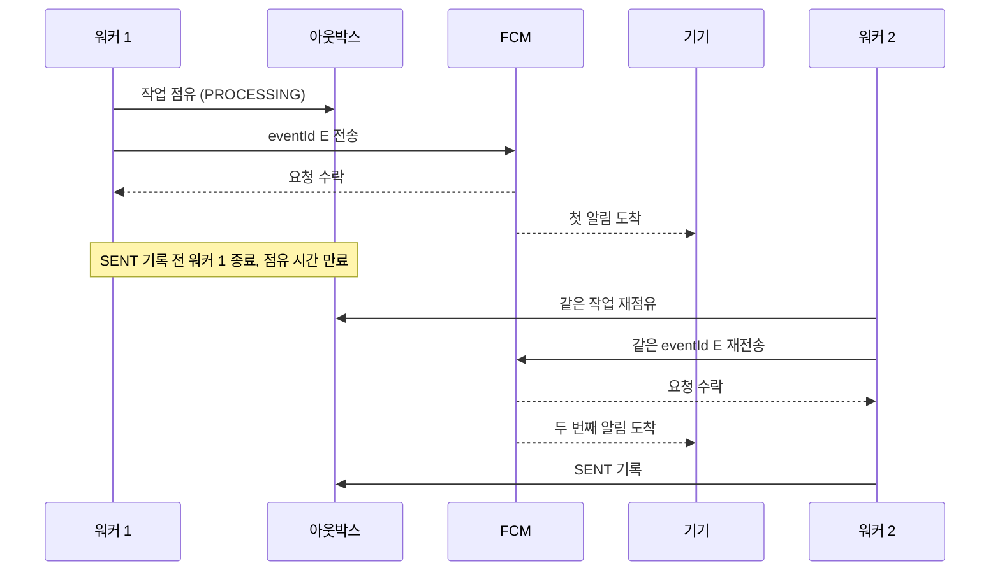

# 2026-10-10 FCM 중복 알림이 생기는 이유와 표시 방지 방법

- 작성일: 2026-10-10
- 작성자: 이산
- 결정 대상: 피드 게시와 FCM 전송의 실패 처리

## 배경

피드 저장은 DB에서 롤백할 수 있지만 FCM이 이미 수락한 알림 전송 요청은 되돌릴 수 없다. 피드 게시가 성공한 뒤 FCM 전송 실패로 게시 결과가 바뀌어서는 안 된다. 또한 게시 직후 서버가 종료되어도 발송 작업이 남아 재시도할 수 있어야 한다.

## 결정

- 피드와 기기별 아웃박스 작업을 같은 DB 트랜잭션에 저장한다. 예약 실패 시 게시도 롤백한다.
- 워커는 작업을 짧은 트랜잭션에서 점유하고 DB 트랜잭션 밖에서 FCM을 호출한다. 성공 응답 후 별도 트랜잭션에서 `SENT`를 기록한다.

### 중복 대응 단계

1. **백엔드:** `(event_id, push_registration_id)` 유일 제약으로 중복 예약을 막는다. 일시 실패하거나 점유 시간이 만료된 작업은 같은 `eventId`로 재시도한다.
2. **웹 알림(첫 버전):** `notification + data`로 보내고 `data`에 `eventId`, `type`, `feedId`를 담는다. `tag=eventId`로 남아 있는 같은 알림을 [교체](https://developer.mozilla.org/en-US/docs/Web/API/Notifications_API/Using_the_Notifications_API)한다.
3. **운영 후 판단:** 닫은 알림이 다시 뜨는 문제가 확인되면 프론트엔드와 `data` 전용 메시지 및 서비스 워커의 `eventId` 중복 기록을 검토한다. `notification`의 [백그라운드 자동 표시](https://firebase.google.com/docs/cloud-messaging/web/receive-messages) 중에는 표시 전 검사가 어렵다.

## 이유

전송 전에 `SENT`를 기록하면 그 직후 서버가 종료됐을 때 알림을 잃는다. 전송 후 기록하면 FCM 수락과 `SENT` 기록 사이에 종료될 경우 중복 전송될 수 있지만, 작업을 재시도할 수 있다. 발송 기회를 잃지 않는 쪽을 선택한다.

### 중복이 생길 수 있는 흐름

1. 워커 1이 기기용 발송 작업을 점유해 `PROCESSING`으로 바꾸고, FCM에 `eventId=E`를 전송한다.
2. FCM이 요청을 수락한다. 이 사례에서는 첫 알림이 기기에 실제로 도착했다고 가정한다.
3. 워커 1이 `SENT`를 기록하기 전에 종료된다. DB에는 `PROCESSING`이 남는다.
4. 점유 시간이 만료되면 워커 2가 **같은 발송 작업**을 다시 점유한다.
5. 워커 2가 **같은 `eventId=E`**로 재전송한다. 두 번째 알림도 도착하면 같은 기기에 알림이 두 번 올 수 있다.

FCM의 수락 응답만으로 실제 기기 도착 여부는 알 수 없다. 따라서 백엔드는 재시도를 유지하며, 전송이 정확히 한 번만 일어난다고 보장하지 않는다.

## 결과

- `SENT`는 **FCM의 요청 수락**을 뜻하며 기기 도착을 뜻하지 않는다. 정확히 한 번의 전송이나 도착은 보장하지 않는다.
- 재전송으로 같은 기기에 알림이 두 번 도착할 수 있다. 같은 `tag`의 알림이 남아 있으면 교체되지만, 이미 닫은 알림은 다시 나타날 수 있다.

## 재검토 조건

대상 브라우저에서 `tag` 교체가 동작하지 않거나 알림 재등장이 사용자 문제로 확인되면 3단계 전환을 검토한다.
