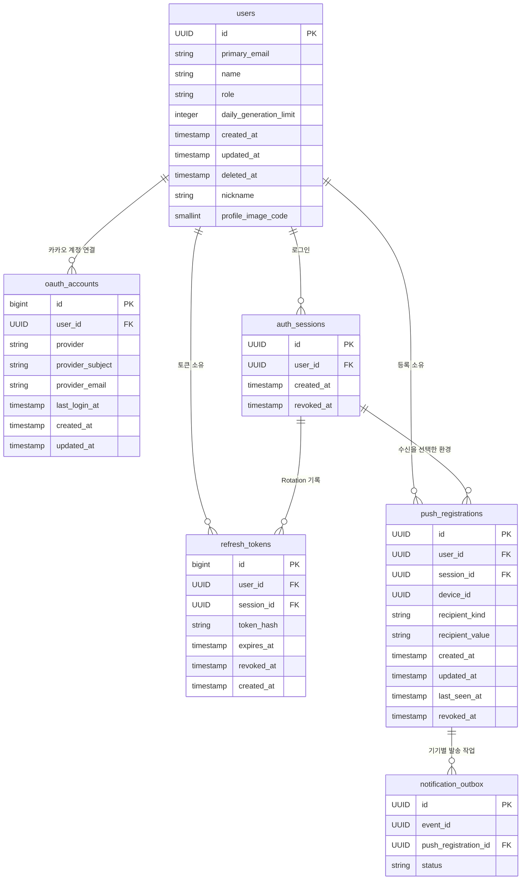
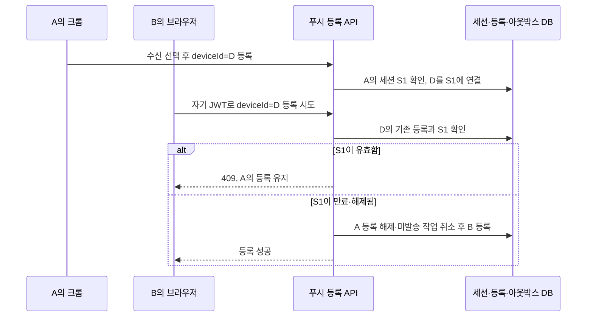
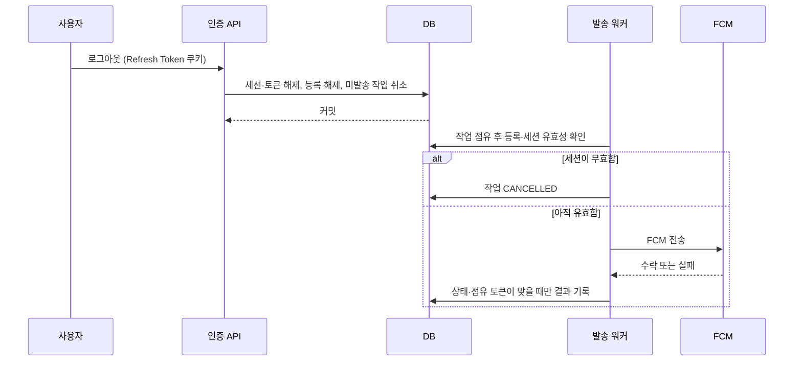

# 2026-10-11 푸시 등록을 로그인 세션에 연결

- 작성일: 2026-10-11
- 작성자: 이산
- 상태: 제안 (인증·피드 담당자와 합의 후 구현)
- 결정 대상: 로그인 종료와 기기 푸시 등록의 관계

## 배경

피드 푸시는 로그인한 계정이 수신을 선택한 브라우저·PWA 환경에 보낸다. [기기 등록 ADR](2026-10-11_FCM%20발송%20대상을%20FID로%20등록_이산.md)은 로그아웃이나 세션 만료 후 기존 등록을 정리하고, 다른 계정이 유효한 등록을 `deviceId`만으로 해제하지 못하도록 정했다. 이를 구현하려면 **등록 당시의 로그인**이 지금도 유효한지 알아야 한다.

현재 `refresh_tokens`는 토큰 갱신 때 이전 행을 폐기하고 새 행을 만든다. 두 행을 같은 로그인으로 묶는 값은 없다. `push_registrations`에는 사용자와 기기만 기록되어 있어, 같은 사용자가 다른 곳에서 여전히 로그인 중인 경우에도 *이 기기*의 로그인이 끝났는지 판별할 수 없다. `last_seen_at`은 마지막 등록 요청 시각이지 로그인 유효성의 근거가 아니다.

여기서 말하는 로그인 세션은 **하루들이 발급한 Refresh Token으로 유지되는 로그인**이다. 카카오 OAuth 요청 중 `state`를 보관하는 Spring Security의 임시 `HttpSession`·`JSESSIONID`와 다르며, 일반 API의 Bearer JWT 인증 방식도 바꾸지 않는다.

## 결정안

- `auth_sessions`에 로그인 1건당 1행을 만든다. `id`, `user_id`, `created_at`, `revoked_at`을 둔다. 세션은 해제되지 않았고, 그 세션에 **폐기되지 않고 만료되지 않은 Refresh Token**이 있으며, 사용자가 탈퇴하지 않았을 때 유효하다. 만료 시각은 `refresh_tokens.expires_at`을 기준으로 삼아 두 곳에 복사하지 않는다.
- `refresh_tokens.session_id`와 `push_registrations.session_id`는 **같은 세션 행을 가리키는 외래 키**다. 상태를 두 곳에 복사하는 컬럼이 아니다. 기존 `oauth_accounts`는 카카오 계정 연결 정보로 유지한다.
- OAuth 로그인 완료 시 세션과 첫 Refresh Token을 함께 만든다. Rotation은 기존 토큰을 폐기하고 새 토큰을 만드는 현재 방식을 유지하며, 새 토큰은 같은 세션을 가리킨다. 토큰 교체는 한 DB 트랜잭션에서 처리한다.
- Access Token JWT에 서명된 `sid`(세션 ID) 클레임을 담는다. 푸시 등록 API는 JWT의 사용자 ID와 `sid`가 가리키는 유효한 세션의 사용자 ID가 같은지 확인한다. 프론트엔드가 `sid`를 요청 본문에 넣지 않는다.
- 푸시 등록 API는 `sid`가 없거나 잘못된 JWT를 거절한다. `user_id`만으로 세션을 추정하거나 요청 본문에서 전달된 `session_id`를 신뢰하지 않는다.
- DB에서도 세션 소유자를 강제한다. `auth_sessions`에 `(id, user_id)` 유니크 키를 두고 `refresh_tokens(session_id, user_id)`와 `push_registrations(session_id, user_id)`가 그 복합 키를 참조하게 한다. `session_id`가 있는 행은 다른 사용자의 세션에 연결할 수 없다.
- 푸시 등록은 해당 세션에 연결한다. 같은 `deviceId`를 **다른 유효한 세션**이 점유했다면 사용자 ID가 같아도 `409`로 거절한다. 이전 세션이 만료·해제됐다면 그 등록과 미발송 작업을 정리한 후 새 세션에 등록한다. 같은 환경의 정상 계정 전환은 먼저 로그아웃을 호출한다.
- 명시적 로그아웃은 해당 세션을 해제하고 그 세션의 유효한 Refresh Token, 푸시 등록, `PENDING`·`PROCESSING` 작업을 같은 트랜잭션에서 정리한다. 동시 Rotation이 로그아웃 뒤에 유효한 토큰을 남기지 않도록 두 요청의 경합도 처리한다. 세션 만료만으로 요청이 발생하지는 않으므로, 다른 계정의 등록 요청이나 발송 워커가 필요할 때 만료를 확인하고 정리한다.
- 워커는 FCM 호출 **직전**에 등록과 세션의 유효성을 확인한다. 무효하면 작업을 `CANCELLED`로 만든다. 늦게 돌아온 워커가 취소 결과를 `SENT`로 덮지 않도록 작업 상태와 점유 토큰을 조건으로 결과를 갱신한다.

`users`, `oauth_accounts`, `refresh_tokens`, `push_registrations`는 전체 컬럼을 표시했다. `auth_sessions`와 두 `session_id`는 `V25`에서 추가한 스키마다. `notification_outbox`는 관계에 필요한 일부 컬럼만 표시했다. 제약 조건, 인덱스, 트리거는 ERD에 표시하지 않았다.

예를 들어 A가 크롬에 로그인하면 세션 `S1`이 생긴다. Refresh Token `R1`을 `R2`로 갱신해도 둘 다 `S1`에 속한다. A가 휴대폰에도 로그인하면 별도 세션 `S2`가 생긴다. 크롬의 푸시 등록은 `S1`에 연결되므로, `S1`이 끝나면 `S2`가 유효하더라도 크롬으로 보내지 않는다.

### 계정 전환과 만료

정상적인 같은 브라우저 계정 전환은 A의 로그아웃으로 `S1`과 푸시 등록을 먼저 해제한 뒤 B가 로그인·등록하는 순서다. 다른 브라우저에서 유효한 등록의 `deviceId`를 알아내 직접 요청하거나, 같은 사용자가 기존 세션을 종료하지 않고 새 세션으로 동일한 `deviceId`를 등록해도 `409`다. B의 *로그인만으로* A의 등록이 정리되지는 않는다.

### 로그아웃과 발송의 경계

그림의 순서는 로그아웃이 먼저 완료된 사례다. **워커가 유효성을 확인한 직후 로그아웃이 커밋되면 FCM 호출을 완전히 막을 수 없다.** FCM이 이미 수락한 메시지도 회수할 수 없다. 이 결정은 서버가 전송 전에 확인하고 가능한 작업을 취소하는 범위이며, 로그아웃 후 기기 화면에 절대 알림이 나타나지 않는다는 보장은 아니다.

## 검토한 대안

| 대안 | 장점 | 채택하지 않은 이유 |
| --- | --- | --- |
| `last_seen_at`으로 등록 유효기간 추정 | 인증 변경이 적다 | 최근 요청이 없어도 로그인은 유효할 수 있고, 로그인 종료 후에도 일정 기간 푸시가 갈 수 있다. |
| 사용자에게 유효한 Refresh Token이 하나라도 있는지 확인 | 새 테이블이 필요 없다 | 같은 사용자의 휴대폰 세션으로 만료된 크롬 세션을 유효하다고 오판한다. |
| 기존 `refresh_tokens`에 세션 그룹 ID 추가 | 새 테이블이 필요 없다 | 토큰 행들이 세션의 상태를 간접 표현한다. 세션 해제·만료의 기준과 참조 관계가 독립된 행으로 드러나지 않는다. |
| Refresh Token 행을 갱신 때마다 제자리에서 수정하고 푸시가 그 행을 참조 | 푸시 쪽 연결 컬럼 하나면 된다 | 사용한 토큰을 폐기하고 새 행을 남기는 현재 Rotation 기록과 테스트를 바꿔야 한다. |

## 결과와 구현 경계

- `auth_sessions` 1개 테이블과 `refresh_tokens`, `push_registrations`의 외래 키, Access Token의 `sid`가 필요하다. `notification_outbox`는 기존 푸시 등록을 통해 세션을 찾으므로 세션 컬럼이 필요 없다.
- `V25`는 팀 검토를 위해 스키마를 먼저 추가한다. 기존 유효 Refresh Token은 각각 별도 세션으로 연결하지만, 기존 푸시 등록은 세션에 연결하지 않는다. 두 `session_id`는 기존 코드와 배포 중 생성되는 행을 위해 일단 nullable로 둔다. 만료·폐기된 토큰과 기존 푸시 등록을 포함해 `NULL` 행을 이관·정리한 뒤 별도 마이그레이션에서 필수화한다. **`V25`만 적용해도 로그인별 푸시 정리가 작동하는 것은 아니다.**
- 세션의 명시적 종료는 `auth_sessions.revoked_at`, 시간 경과에 따른 만료는 현재 유효한 Refresh Token의 부재로 판단한다. Rotation마다 세션 만료 시각을 별도로 갱신하지 않는다.
- `V25`는 당시 유효한 Refresh Token을 토큰별 세션으로 연결한다. 과거 Rotation의 관계는 복원하지 못하므로 이행 세션의 `created_at`에는 해당 토큰의 생성 시각을 사용한다. 만료·폐기된 과거 토큰은 `session_id` 없이 둔다. 기존 인증 코드가 이후에 만든 `session_id` 없는 토큰, 기존 푸시 등록, `sid` 없는 Access Token의 전환 정책은 코드 변경 시 정해야 한다.
- 이미 로그인한 브라우저가 쿠키만 수동으로 삭제하고 로그아웃 요청을 보내지 않으면 서버는 즉시 알 수 없다. 그 경우 서버 세션은 만료 시각까지 유효할 수 있다. 이는 세션 테이블만으로 해결되지 않는다.
- 현재 로그아웃 API는 Refresh Token 쿠키가 없어도 `204`를 반환한다. 쿠키가 없다면 서버가 종료할 세션을 특정하지 못하므로 푸시 등록도 즉시 정리되지 않는다. 명시적 로그아웃의 정리 보장은 유효한 세션에 연결된 쿠키로 요청했을 때에 한한다.
- `deviceId`만 초기화되고 FID가 유지되면 활성 FID 유일 제약과 충돌한다. 같은 유효 세션의 FID라면 이전 등록과 미발송 작업을 정리한 뒤 새 `deviceId`로 등록하고, 다른 세션의 FID라면 `409`로 보호한다.
- 일반 API의 JWT는 현재처럼 만료 시까지 유효하다. **푸시 등록 API와 발송 워커**는 세션 상태를 추가 확인한다. 로그아웃 즉시 모든 API JWT를 무효화하는 정책은 이 결정의 범위가 아니다.
- 별도 세션 테이블은 이번 푸시 요구를 위한 로그인 상태의 기준이다. 과거 토큰 재사용 탐지와 같은 세션 전체 폐기 정책은 [Token Family ADR](../2026-08-11_TokenFamily%20탐지%20구현%20연기_초록.md)에서 연기했으며, `session_id` 추가만으로 자동 완성되지 않는다.
- 기존 Token Family 결정은 별도 보안 검토 대상이다. 이 설계에서 세션에 토큰 관계가 생겨도 폐기된 Refresh Token의 재사용을 감지했을 때 세션의 남은 토큰까지 폐기하는 동작을 자동으로 제공하지 않는다.

## 구현 전 확인할 시나리오

| 조건 | 행동 | 기대 결과 |
| --- | --- | --- |
| A의 크롬 세션에서 토큰 Rotation | 크롬 푸시 등록 후 발송 | 새 토큰도 같은 세션이며 푸시 등록은 유효하다. |
| A의 크롬 세션 종료, 휴대폰 세션 유효 | 크롬 발송 작업 처리 | 크롬 작업은 취소되고 휴대폰 세션은 유지된다. |
| A의 세션 유효, B가 A의 `deviceId`로 직접 PUT | B의 등록 요청 | `409`; A 등록과 미발송 작업은 유지된다. |
| A의 세션 유효, 같은 사용자 A의 다른 세션이 같은 `deviceId`로 PUT | 새 세션의 등록 요청 | `409`; 기존 세션의 등록은 유지된다. |
| A 세션 만료 후 B가 같은 `deviceId`로 PUT | B의 등록 요청 | A 등록·미발송 작업을 정리한 뒤 B 등록이 성공한다. |
| 사용자 A의 JWT에 사용자 B 세션 `sid`가 포함됨 | 푸시 등록 요청 | 세션 소유자와 JWT `sub`가 다르므로 거절되고 DB 상태는 바뀌지 않는다. |
| JWT에 `sid`가 없거나 올바른 UUID가 아님 | 푸시 등록 요청 | 사용자 ID만으로 우회하지 않고 거절한다. |
| DB 쓰기에서 세션 ID와 사용자 ID가 서로 다름 | 토큰 또는 등록 저장 | 복합 외래 키가 저장을 거절한다. |
| 워커 점유 뒤 로그아웃 | FCM 응답 후 결과 기록 | 취소된 작업을 `SENT`로 덮지 않는다. |
| 토큰 Rotation과 로그아웃이 동시에 발생 | 두 요청의 트랜잭션 완료 | 로그아웃한 세션에 유효한 후속 토큰이나 푸시 등록이 남지 않는다. |

인증 담당자와는 세션 생성·Rotation·로그아웃의 트랜잭션 경계 및 기존 토큰 이행 방식을, 피드·푸시 담당자와는 등록 해제·작업 취소·워커 검사 위치를 합의한 뒤 구현한다.
