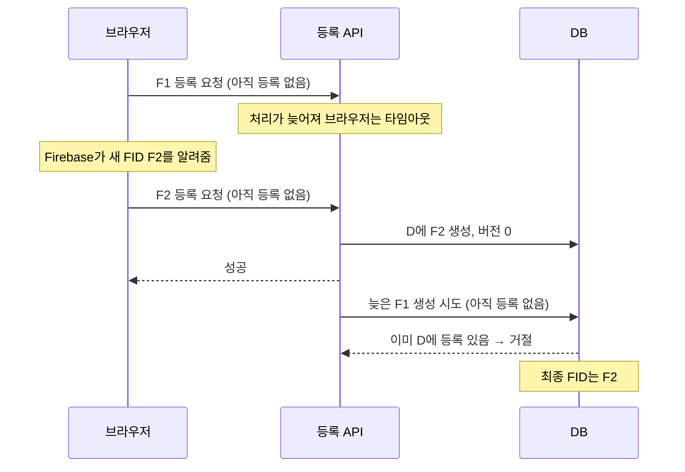

# 2026-10-14 FID 등록 요청의 순서 보장

- 작성일: 2026-10-14
- 작성자: 이산
- 결정 대상: 같은 `deviceId`의 FID 변경 요청이 겹칠 때 저장할 값

## 배경

FID는 알림을 보낼 주소다. Firebase가 주소를 `F1`에서 `F2`로 바꾸면 하루들도 새 주소를 저장해야 한다. 그런데 `F1` 등록 요청이 타임아웃돼도 서버에서는 계속 처리될 수 있다. `F2`를 먼저 저장한 뒤 늦게 끝난 `F1`이 덮어쓰면 알림을 옛 주소로 보내게 된다. [Firebase 웹 등록 가이드](https://firebase.google.com/docs/cloud-messaging/web/get-started)

## 결정

- `push_registrations`에 `version BIGINT NOT NULL DEFAULT 0`을 추가한다. 버전은 **이 등록의 FID가 몇 번 바뀌었는지 알려주는 번호표**다. 같은 FID를 다시 등록하면 번호를 올리지 않는다.
- 등록 요청은 `deviceId`와 FID에 더해, 클라이언트가 알고 있는 상태를 보낸다: **아직 등록 없음** 또는 **등록 ID와 버전**. 서버는 그 상태가 현재 DB와 같을 때만 생성하거나 FID를 변경하고, 변경하면 버전을 올린다. 상태가 다르면 현재 등록 ID·버전을 알려준다.
- 같은 세션·`deviceId`·FID를 다시 보내면 이미 완료된 요청으로 보고 성공 처리한다. 다른 유효 세션의 등록을 바꾸려는 요청은 기존 결정대로 `409`로 거절한다.
- 프론트엔드는 충돌 후 **현재 Firebase가 알려준 FID**만 다시 등록한다. 이미 옛 값이 된 `F1` 요청은 새 버전으로 재시도하지 않는다. FID가 `F2`로 바뀌었으면 같은 `deviceId`로 `F2`를 등록한다.

## 이유

번호표 없이 저장하면 **늦게 끝난 요청이 이긴다**. 번호표를 확인하면 옛 요청은 새 값을 덮지 못한다. `deviceId`만 비교하면 같은 환경에서 온 `F1`과 `F2`의 순서를 알 수 없으므로 등록 ID와 버전을 함께 확인한다. 이런 조건부 변경을 낙관적 잠금이라고 한다. [HTTP 조건부 요청](https://www.rfc-editor.org/rfc/rfc9110.html#section-13)

### F2가 먼저 저장되는 경우

반대로 **F1이 먼저 저장되면**, F2의 ‘아직 등록 없음’ 조건이 맞지 않는다. 서버가 현재 등록 ID·버전을 알려주면 브라우저가 그 번호표로 **F2를 다시 요청**한다. F2가 저장된 뒤에는 F1의 옛 번호표로 덮어쓸 수 없다.

## 결과

- Flyway `V25`는 `push_registrations.version`만 추가한다. 기존 행과 새 행은 버전 `0`부터 시작하며 음수는 허용하지 않는다. 새 테이블이나 아웃박스 변경은 없다.
- 등록 API와 프론트엔드는 현재 등록 상태 확인, 조건부 생성·갱신, 충돌 후 최신 FID 재시도를 구현한다. 같은 요청의 타임아웃 재시도도 중복 행을 만들지 않아야 한다.
- **F2 등록이 성공했다면** 뒤늦은 F1 요청은 이를 되돌리지 못한다. F2 요청이 끝내 성공하지 못한 경우까지 F2 저장을 보장하지는 않는다.
- 등록 해제와 이미 진행 중인 PUT의 경합은 별도로 설계·검증한다.
