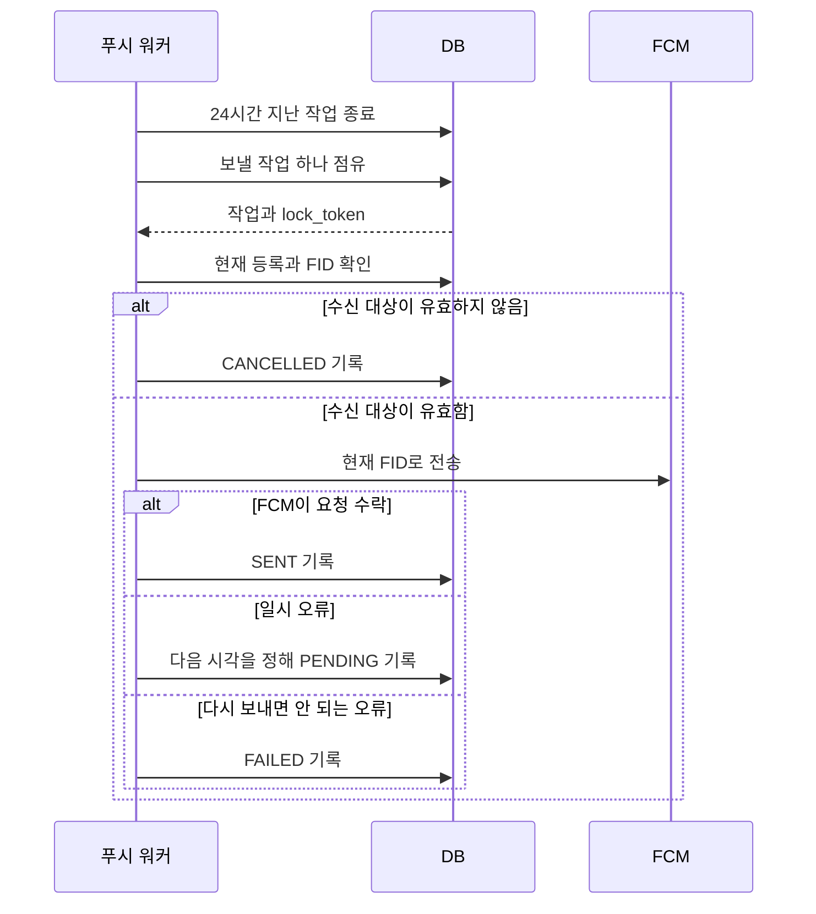

# 피드 푸시 워커 실행 흐름

- 작성일: 2026-10-14
- 작성자: 이산
- 결정 대상: 저장된 발송 작업을 FCM에 보내고 결과를 기록하는 순서

## 무엇을 실행하는가

피드를 게시하면 알림을 받을 기기마다 `PENDING` 작업이 DB에 생긴다. 워커는 이 작업을 읽어 FCM에 보낸다. 워커는 `HARUDLE_PUSH_FCM_ENABLED=true`인 서버에서만 실행한다. 1초마다 시작하며 한 번에 최대 100개 작업을 처리한다. 다른 예약 작업과 실행 시간을 나누지 않도록 푸시 전용 스케줄러를 쓴다.

## 한 작업을 처리하는 순서

1. 워커는 피드 게시 후 24시간이 지난 미발송 작업을 `FAILED`로 끝낸다.
2. 보낼 시간이 된 작업 하나를 DB에서 점유한다. 상태는 `PROCESSING`이 된다. 점유 시간은 5분이다. `lock_token`은 이번 점유를 구분하는 값이다.
3. FCM 호출 직전에 피드, 사용자, 기기 등록, 로그인 세션과 Refresh Token을 확인한다. 모두 유효하면 현재 DB의 FID를 읽는다. 유효하지 않으면 FCM을 호출하지 않고 작업을 `CANCELLED`로 바꾼다.
4. 현재 FID에 `eventId`, `feedId`와 알림 내용을 보낸다. 이 호출은 작업을 점유한 DB 트랜잭션이 끝난 뒤에 실행한다.
5. FCM이 요청을 수락하면 `SENT`를 기록한다. `SENT`는 기기에 도착했다는 확인이 아니라 FCM이 요청을 받았다는 뜻이다.
6. FCM 호출이 실패하면 오류에 따라 재시도하거나 작업을 끝낸다. 결과를 저장할 때는 작업의 상태와 `lock_token`을 다시 확인한다.

## 오류에 따라 무엇이 달라지는가

| 상황 | 워커가 하는 일 |
| --- | --- |
| `UNAVAILABLE`, `INTERNAL`, `QUOTA_EXCEEDED`, 응답 시간 초과 | `PENDING`으로 되돌리고 다음 전송 시각을 저장한다. |
| 전송 중 예외가 나서 결과를 알 수 없음 | 중복 수신 가능성을 감수하고 같은 `eventId`로 재시도한다. |
| `INVALID_ARGUMENT`, `SENDER_ID_MISMATCH`, `THIRD_PARTY_AUTH_ERROR` 등 | 같은 요청을 다시 보내지 않고 `FAILED`로 끝낸다. |
| `UNREGISTERED` | 실제로 보낸 FID와 현재 등록을 비교한 뒤 아래 규칙을 따른다. |

재시도 간격은 시도할수록 늘어난다. 같은 시각에 실패한 작업이 다시 한꺼번에 몰리지 않도록 각 작업의 간격을 조금씩 다르게 정한다. 첫 간격은 10초에서 20초 사이다. 최대 범위는 30분에서 60분 사이다. FCM이 `Retry-After`를 알려주면 그 시각보다 일찍 보내지 않는다. `QUOTA_EXCEEDED`는 최소 60초 기다리고, `Retry-After`가 더 길면 그만큼 더 기다린다. 다음 전송 시각이 피드 게시 후 24시간을 넘으면 `FAILED`로 끝낸다.

## FID가 무효하다는 응답을 받으면

워커가 `F1`로 보낸 뒤 FCM에서 `UNREGISTERED`를 받을 수 있다. 그사이 같은 기기의 등록이 `F2`로 바뀌었을 수도 있다. 워커는 **전송한 FID와 버전이 현재 등록과 같을 때만** 등록을 해제한다. 이때 해당 등록의 미발송 작업도 함께 취소한다. 이미 `F2`로 바뀌었다면 등록을 유지하고 같은 작업을 다시 예약한다.

기기 등록이 해제되거나 피드가 삭제되면 미발송 작업은 `CANCELLED`가 된다. 늦게 끝난 워커는 `lock_token`이 맞지 않으므로 이 상태를 `SENT`로 바꿀 수 없다. 유효성을 확인한 직후 FCM 호출과 등록 해제가 겹치면 이미 시작한 전송은 회수할 수 없다. FCM 응답이 유실되거나 점유 시간이 끝나 작업을 다시 보내면 같은 알림이 두 번 도착할 수도 있다.

## 어떻게 확인했는가

워커 테스트는 FCM 수락, 일시 오류, 영구 오류, `Retry-After`, 24시간 기한과 FID 변경을 확인한다. DB 테스트는 한 작업을 두 워커가 함께 점유하지 않는지, 점유가 끝난 뒤 다시 처리되는지, 옛 FID의 오류가 새 FID 등록을 해제하지 않는지 확인한다.
