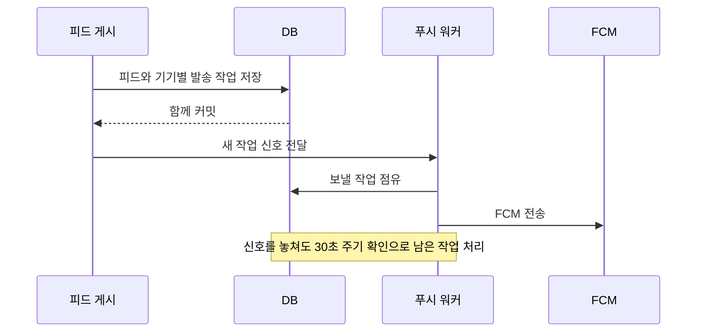

# 피드 푸시 워커 실행 시점

- 작성일: 2026-10-15
- 작성자: 이산
- 결정 대상: 발송 작업을 저장한 뒤 워커를 언제 실행할지

## 배경

기존 워커는 보낼 작업이 없어도 약 1초마다 DB를 확인했다. 확인할 때마다 지난 작업을 정리하고 새 작업을 찾는 DB 요청을 한다. 새 피드를 빠르게 알릴 수 있지만, 대기 작업이 없는 동안에도 확인을 계속한다. 반대로 확인 간격만 늘리면 새 피드의 알림도 그만큼 늦게 시작할 수 있다.

## 결정

1. 피드와 기기별 발송 작업을 **같은 DB 트랜잭션**에 저장한다. 발송 작업이 한 건 이상 생기면 워커 실행 신호를 등록한다.
2. **DB 저장이 완료된 뒤에만** 신호를 처리한다. 게시가 취소되거나 발송 대상이 0건이면 즉시 실행하지 않는다.
3. 신호를 받은 서버는 푸시 전용 스케줄러에 워커 실행을 맡긴다. 워커는 DB에서 작업을 가져와 FCM에 보낸다. 신호 자체에 발송 작업을 담지 않는다.
4. 신호를 처리하지 못하거나 서버가 종료될 수 있으므로, **30초마다 실행 가능한 워커 자리를 확인**한다. 서버 시작 후 첫 확인도 30초 뒤에 한다. 평소 새 작업은 신호로 바로 확인하므로, 주기 확인은 놓친 작업을 다시 찾기 위한 것이다.
5. 한 묶음은 최대 100건이다. 100건을 처리했다면 기다리지 않고 다음 묶음을 확인한다. 보낼 작업이 없어지면 실행을 끝낸다.

## 이 방식에서 확인할 점

- 즉시 실행 예약에 실패해도 **이미 완료된 피드 게시를 실패로 바꾸지 않는다**. 작업은 DB에 남고 다음 주기 확인에서 처리한다.
- 여러 서버가 동시에 실행해도 DB 점유 규칙이 같은 작업의 동시 처리를 막는다. 게시 요청을 처리한 서버의 신호는 그 서버의 워커에 전달된다. 모든 서버는 자기 설정에 따라 주기 확인을 한다.
- 일시 오류로 `PENDING`에 다시 저장된 작업은 `available_at` 이후에 처리한다. 재시도 시각에 별도 신호를 보내지 않으므로 다음 30초 주기 확인까지 더 기다릴 수 있다.
- `HARUDLE_PUSH_FCM_ENABLED=false`인 서버에는 워커가 없다. 발송 작업은 계속 DB에 저장되며, 전송을 켠 뒤 주기 확인으로 처리한다.
- 한 서버에서 워커를 최대 4개 실행하는 결정은 [병렬 처리 ADR](2026-10-16_피드%20푸시%20작업을%20워커%204개로%20처리_이산.md)에 기록했다.

## 검증

DB 테스트로 커밋 전에는 신호가 전달되지 않고, 롤백되거나 대상이 0건이면 신호가 없는지 확인한다. 워커 테스트로 신호를 받으면 즉시 실행을 예약하는지, 예약이 실패해도 예외를 전파하지 않는지, 작업이 100건을 넘어도 다음 묶음을 바로 처리하는지 확인한다.
