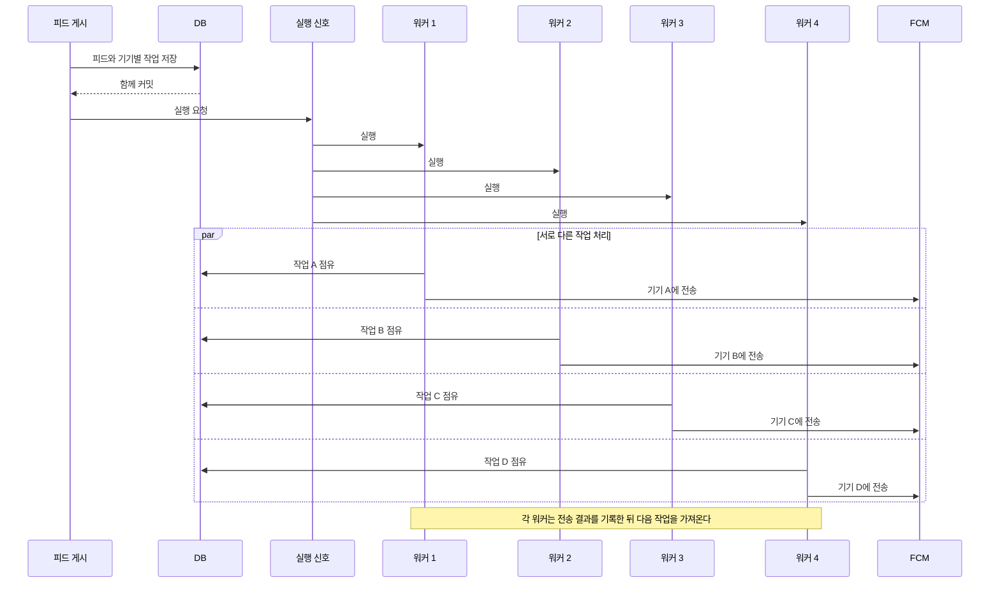

# 피드 푸시 작업을 워커 4개로 처리

- 작성일: 2026-10-16
- 작성자: 이산
- 결정 대상: 한 서버에서 동시에 실행할 FCM 발송 작업 수

## 배경

기존 워커는 FCM 응답을 기다린 뒤 다음 기기 작업을 처리했다. 피드 하나에 수신 기기가 많으면 마지막 기기는 오래 기다릴 수 있다. 현재 약 180명에게 기기당 2건씩 보내면 최대 약 360건이다. 한 건에 평균 0.5초가 걸린다고 가정하면 워커 1개는 전송에만 약 180초가 걸린다.

[팀의 부하 테스트](https://app.notion.com/p/3f9676b0adce8095bc75d6d0b1084cb6)는 푸시 병렬 전송을 측정하지 않았다. 개발 서버에서 진행한 5차 테스트는 일반 API 1,420건을 완료했지만 메모리 부족과 스왑 읽기가 관측됐다. 따라서 많은 워커를 바로 운영에 적용할 근거는 없다.

## 결정

1. 한 백엔드 서버에서 **전송 워커를 최대 4개** 실행한다. 이는 첫 시험 값이다. 서버나 컨테이너를 4개로 늘리지는 않는다.
2. 피드 게시가 커밋되면 워커 실행을 요청한다. 실행 중인 워커가 이미 4개면 더 만들지 않는다. 놓친 작업을 찾는 30초 주기 확인도 유지한다.
3. 각 워커는 DB에서 서로 다른 기기 작업을 하나씩 점유한다. FCM 응답을 기다리는 동안 DB 트랜잭션은 열어 두지 않는다. 한 워커가 100건을 처리해도 작업이 남으면 바로 다음 묶음을 처리한다.
4. 점유 SQL은 **아웃박스 행만 잠근다**. 같은 피드의 다른 기기 작업을 다른 워커가 가져갈 수 있어야 한다.

작업마다 기존의 `lock_token`을 사용한다. 늦게 끝난 워커는 다른 워커의 결과나 취소 상태를 덮어쓸 수 없다. FCM 응답 전에 서버가 종료되면 점유 시간이 지난 뒤 재시도한다.

## 왜 4개인가

현재 약 360건을 한 건당 평균 0.5초에 보낸다면 4개 워커의 전송 시간은 이론상 약 45초다. DB 처리와 FCM 응답 차이는 이 계산에 포함되지 않는다. 1,000명이 기기를 2개씩 등록한 2,000건을 1분 안에 보내려면 같은 가정에서 4개로는 부족하다. 워커 수를 늘리기 전에 실제 FCM 전송 시간과 일반 API 영향을 측정한다.

## 검증과 다음 판단

테스트에서 실행 신호가 겹쳐도 워커가 4개를 넘지 않는지, 4건을 동시에 보내는지, 피드 행이 잠겨 있어도 아웃박스 작업을 점유하는지 확인한다.

**4개로 시작하고 부하 테스트 결과로 조정한다.** 운영과 비슷한 환경에서 일반 API 요청과 푸시 발송을 함께 실행한다. 알림을 모두 보내는 시간, API 응답 시간, EC2 메모리와 스왑, RDS 메모리와 DB 연결 대기를 확인한다.

- 푸시 발송 중 DB나 일반 API가 느려지거나 메모리가 부족하면 워커 수를 줄인다.
- 서버와 DB에 여유가 있는데 알림 전송만 늦으면 워커 수를 늘려 다시 테스트한다.

현재 운영 서버는 `t4g.small`이고 백엔드 컨테이너 메모리 제한은 `1200m`이다. 워커 4개는 이 서버 안에서 전송을 최대 4건 동시에 처리한다. 실제 푸시가 몰릴 때의 자원 사용량은 아직 측정하지 않았으므로, 4개를 최종 수치로 확정하지 않는다.
