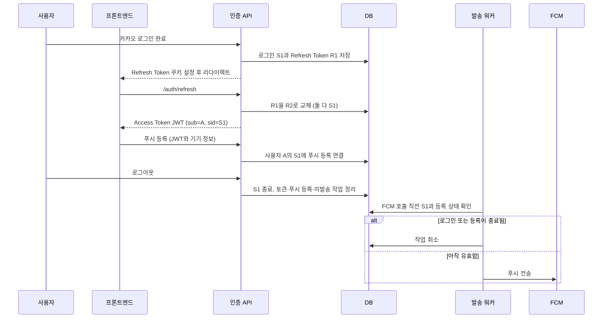

# 푸시 등록과 로그인 세션 연결 변경 기획

- 작성일: 2026-10-11
- 작성자: 이산
- 상태: 팀 검토용 제안
- 관련 ADR: [푸시 등록을 로그인 세션에 연결](2026-10-11_푸시%20등록을%20로그인%20세션에%20연결_이산.md)

## 한눈에 보기

현재 시스템은 **누가 로그인했는지**는 알지만, 그 사용자가 **어느 로그인으로 접속했는지**는 구분하지 않는다. 그래서 같은 사용자의 크롬과 휴대폰 중 한쪽에서 로그아웃해도, 그쪽 푸시 등록만 정확히 찾아 정리하기 어렵다.

`auth_sessions`를 추가하면 로그인할 때 로그인 ID 하나를 만들고, Refresh Token과 푸시 등록이 그 ID를 함께 가리킨다. 그러면 로그아웃한 로그인에 속한 푸시 등록과 아직 보내지 않은 작업만 정리할 수 있다.

여기서 세션은 기기 자체의 ID가 아니다. **한 번의 로그인에서 발급된 Refresh Token 교체 기록을 묶는 ID**다. 기기·브라우저를 서버가 직접 식별하는 방식은 그대로 `deviceId`가 담당한다.

## 지금의 흐름

1. 카카오 로그인이 끝나면 서버가 Refresh Token을 발급해 쿠키에 넣는다.
2. 프론트엔드가 `/auth/refresh`를 호출하면 서버는 Refresh Token을 교체하고 Access Token JWT를 돌려준다. JWT에는 사용자 ID(`sub`)가 들어간다.
3. Refresh Token을 다시 갱신할 때마다 이전 토큰을 폐기하고 새 토큰을 저장한다. 두 토큰이 같은 로그인에서 나온 것인지는 DB에서 알 수 없다.
4. 로그아웃하면 쿠키에 들어온 Refresh Token 행을 폐기하고 쿠키를 지운다.
5. 푸시 등록 스키마에는 사용자와 기기 정보가 있지만, 그 등록이 어느 로그인에 속하는지는 없다.

예를 들어 A가 크롬과 휴대폰에서 로그인하면 두 로그인 모두 `userId=A`로 보인다. 크롬에서 로그아웃했을 때 푸시 등록을 `userId=A`로만 찾으면 휴대폰 등록까지 구분할 수 없다.

OAuth 진행 중 `state`를 보관하는 Spring `HttpSession`/`JSESSIONID`는 이 로그인 ID와 다르다. 기존처럼 OAuth 과정에서만 사용하고 API 인증에는 사용하지 않는다.

## 바뀐 뒤의 흐름

| 시점 | 현재 | 변경 후 |
| --- | --- | --- |
| 카카오 로그인 완료 | 사용자와 Refresh Token 저장 | `auth_sessions` 행을 만들고 첫 Refresh Token을 그 세션에 연결 |
| Access Token 발급 | JWT에 사용자 ID(`sub`) 포함 | 기존 `sub`에 서명된 로그인 ID(`sid`)를 추가 |
| Refresh Token 갱신 | 새 토큰이 이전 토큰과 연결되지 않음 | 이전·새 토큰이 같은 `session_id`를 가리킴 |
| 푸시 등록 | 사용자와 기기에 연결 | 사용자, 기기, `sid`가 가리키는 로그인에 연결 |
| 로그아웃 | 요청 쿠키의 Refresh Token만 폐기 | 해당 로그인과 그 로그인에 속한 Refresh Token, 푸시 등록, 미발송 작업을 함께 정리 |
| FCM 발송 | 세션 종료 여부를 확인하지 않음 | FCM 호출 직전에 로그인과 등록이 유효한지 확인하고, 아니면 작업 취소 |

### 로그인·푸시·로그아웃 흐름

## 쉬운 예시

- A가 크롬에서 로그인하면 `S1`이 생기고, 그 크롬의 Refresh Token과 푸시 등록은 `S1`에 연결된다.
- A가 휴대폰에서도 로그인하면 별도 `S2`가 생긴다.
- 크롬에서 로그아웃하면 `S1`에 연결된 등록만 해제한다. 휴대폰의 `S2`와 푸시 등록은 유지한다.
- 이후 B가 크롬에서 로그인하면 새로운 세션이 생기고, 로그아웃으로 해제된 크롬 등록을 B의 로그인으로 다시 등록할 수 있다.
- 다른 계정의 세션이 아직 유효한 `deviceId`를 직접 등록하려 하면 `409`로 거절한다. 이전 세션이 종료되었거나 만료됐다면 이전 등록과 미발송 작업을 정리한 뒤 새 등록을 허용한다.
- 같은 사용자라도 **다른 유효 세션**이 쓰는 `deviceId`는 `409`로 보호한다. `deviceId`만 초기화되고 FID는 유지된 경우, 같은 세션의 기존 등록을 해제한 뒤 새 `deviceId`로 등록한다.

## 저장 구조에서 달라지는 부분

| 테이블 | 변경 |
| --- | --- |
| `auth_sessions` | 새로 추가한다. 로그인 ID, 사용자 ID, 생성 시각, 종료 시각을 저장한다. |
| `refresh_tokens` | `session_id`를 추가한다. Rotation으로 만들어진 토큰들을 같은 로그인 ID로 묶는다. |
| `push_registrations` | `session_id`를 추가한다. 푸시 수신 등록이 어느 로그인에서 만들어졌는지 기록한다. |
| `oauth_accounts`, `users` | 이 변경 때문에 컬럼을 추가하지 않는다. 기존 카카오 계정 연결과 사용자 정보는 유지한다. |
| `notification_outbox` | 세션 ID를 직접 추가하지 않는다. 발송 대상인 푸시 등록을 따라 세션을 확인한다. |

DB 외에도 로그인 시 세션 생성, Refresh Token Rotation, JWT 발급, 로그아웃, 푸시 등록, 발송 워커가 변경 범위에 들어간다. 같은 사용자의 토큰이 다른 사용자의 세션에 연결되지 않도록 DB 외래 키와 서버 검증도 함께 둔다.

세션은 `revoked_at`이 비어 있고, 그 세션에 만료·폐기되지 않은 Refresh Token이 남아 있을 때 유효하다. 별도의 세션 만료 시각을 복사해 저장하지 않는다.

첫 Flyway 마이그레이션 `V20`은 테이블·외래 키를 추가하고 기존 유효 Refresh Token을 토큰별 초기 세션에 연결한다. 과거 로그인 시작 시각은 복원할 수 없어 이 세션의 `created_at`에는 해당 토큰의 생성 시각을 쓴다. 기존 푸시 등록은 세션에 연결하지 않는다. 기존 코드가 계속 쓸 수 있도록 두 `session_id`는 일단 nullable이다. **이 단계만으로 로그인별 푸시 정리는 동작하지 않는다.** 인증·푸시 코드 전환 후 만료·폐기된 토큰과 기존 푸시 등록을 포함해 `NULL` 행을 이관·정리한 뒤 별도 마이그레이션에서 필수화한다.

## 프론트엔드에 보이는 변화

- 로그인 콜백은 지금처럼 `/auth/refresh`로 Access Token을 받는다. 새 JWT에는 로그인 ID `sid`가 추가된다.
- 푸시 등록 요청에는 기존처럼 기기 정보와 FID를 보내고, 로그인 ID는 보내지 않는다. 서버가 JWT의 `sid`를 읽어 등록에 연결한다.
- 로그아웃 요청 형식은 유지한다. 서버가 Refresh Token 쿠키로 세션을 식별할 수 있으면 해당 푸시 등록과 미발송 작업도 정리한다. 현재 API는 쿠키가 없어도 `204`를 반환하므로, 쿠키가 없는 요청까지 즉시 정리된다는 뜻은 아니다.
- 배포 전에 발급된 `sid` 없는 Access Token은 푸시 등록에 사용할 수 없으므로, 등록 전에 새 JWT를 받도록 전환해야 한다.

## 그대로 유지되는 동작과 한계

- 일반 API는 기존처럼 서명과 만료 시각을 확인하는 Bearer JWT 인증을 사용한다. 모든 API 요청에서 `auth_sessions`를 조회하지 않는다.
- 따라서 로그아웃 직후에도 이미 발급된 Access Token은 원래 만료 시각까지 다른 일반 API에서 사용할 수 있다. 이 변경은 푸시 등록과 발송의 로그인 유효성을 확인하는 범위다.
- 프론트엔드는 `sid`를 직접 만들거나 요청 본문으로 보내지 않는다. 서버가 서명된 JWT에서 읽는다.
- 워커가 세션을 확인한 직후 로그아웃이 완료되는 경합은 완전히 없앨 수 없다. 이미 FCM이 수락한 메시지는 회수할 수 없다.
- Refresh Token이 자연 만료돼도 별도 요청이 자동으로 오지는 않는다. 별도 주기 작업을 추가하지 않고, 푸시 등록 요청이나 워커가 필요할 때 만료 여부를 확인해 정리한다.

## 구현 순서와 확인할 테스트

1. Flyway `V20`으로 `auth_sessions`와 nullable `session_id` 컬럼·소유자 제약을 추가하고 기존 유효 Refresh Token을 이관한다.
2. 로그인에서 세션과 첫 Refresh Token을 함께 저장하고, Rotation은 같은 세션을 유지한다.
3. Access Token에 `sid`를 넣고 푸시 등록은 JWT의 `sub`와 세션 소유자가 일치하는지 확인한다.
4. 로그아웃에서 해당 세션과 관련 푸시 등록·미발송 작업을 한 트랜잭션으로 정리한다.
5. 워커에서 FCM 호출 직전 유효성을 확인하고, 취소된 작업을 늦은 결과가 `SENT`로 덮지 못하게 한다.
6. 기존 코드가 만든 `session_id` 없는 행의 이행을 마치고 두 컬럼을 필수화한다.

검증할 대표 사례는 크롬과 휴대폰의 세션 분리, Refresh Token 교체 후 세션 유지, 다른 사용자의 세션 ID 거절, 로그아웃 정리, 만료된 세션의 재등록, 로그아웃과 워커의 경합이다. 자세한 제약과 미해결 경계는 관련 ADR에서 확인한다.

`V20` 적용 뒤 기존 코드가 새로 만든 `session_id` 없는 토큰과 기존 푸시 등록, 배포 전에 발급된 `sid` 없는 Access Token을 어떻게 전환할지는 코드 배포 전에 정해야 한다. 과거 토큰의 교체 관계는 복원하지 않는다.
