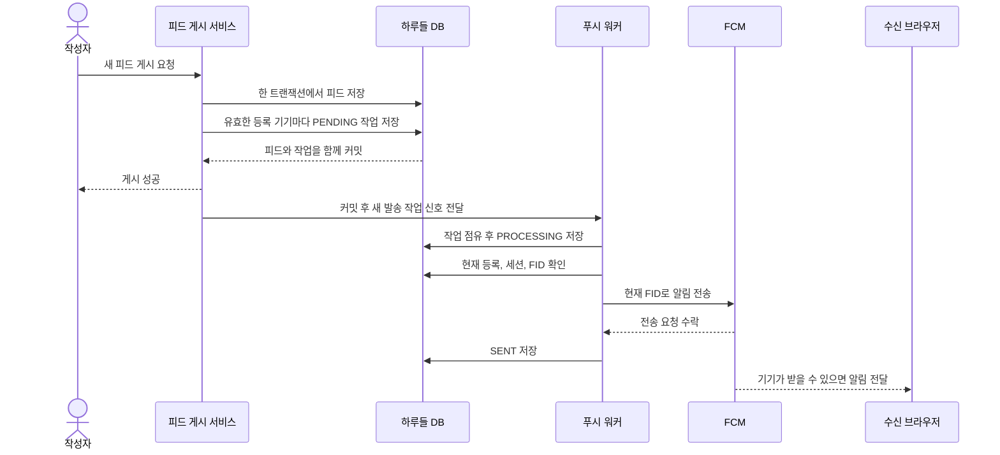
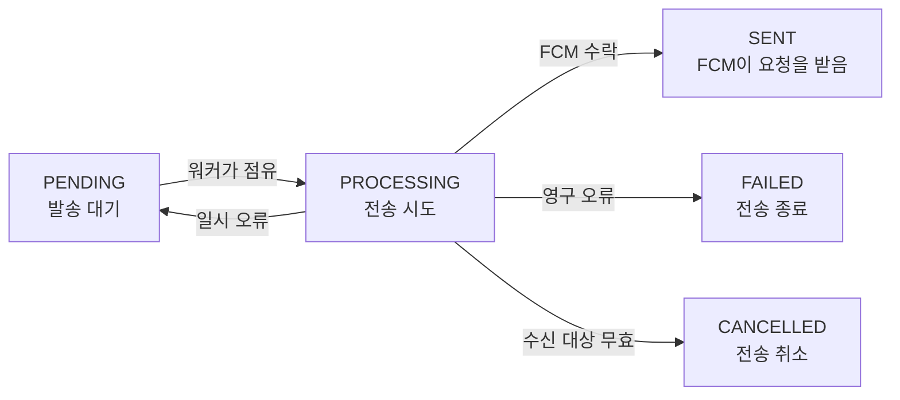
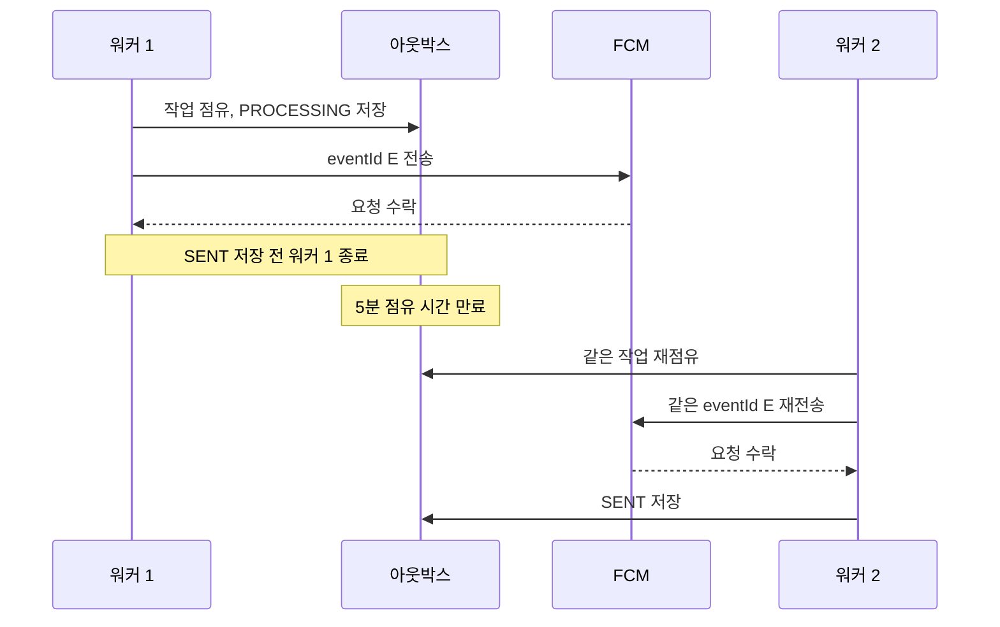

# 피드 푸시 아웃박스 구현 흐름

- 작성일: 2026-10-15
- 작성자: 이산
- 범위: 현재 백엔드 코드가 피드 게시부터 FCM 전송 결과 기록까지 처리하는 방법

## 먼저 알아둘 것

피드와 발송 작업은 우리 DB에 저장할 수 있다. FCM 전송은 Firebase 서버에 요청하는 일이다. 우리 DB에서 피드 저장을 되돌려도 Firebase가 이미 받은 요청은 되돌릴 수 없다. 반대로 피드만 저장하고 발송 작업을 메모리에 두면, 서버가 종료될 때 작업을 잃을 수 있다.

**아웃박스 패턴**은 외부 전송을 바로 하지 않고, **전송해야 한다는 작업을 DB에 먼저 저장하는 방법**이다. 하루들은 피드와 기기별 `notification_outbox` 행을 **같은 DB 트랜잭션**에 저장한다. 트랜잭션은 이 저장을 모두 완료하거나 모두 취소한다. 저장이 끝난 뒤 별도 워커가 작업을 읽어 FCM에 보낸다. 워커는 저장된 작업을 반복해서 확인하는 서버 코드다.

| 상황 | 결과 |
| --- | --- |
| 피드 저장 또는 발송 작업 저장 실패 | 두 저장을 함께 취소한다. |
| 수신할 등록 기기 0개 | 발송 작업 없이 피드만 게시한다. |
| 피드와 발송 작업을 저장한 뒤 서버 종료 | 서버가 다시 실행되면 DB에 남은 작업을 처리한다. |
| FCM 전송 실패 | 게시된 피드는 유지하고 발송 작업만 재시도하거나 종료한다. |

## 피드를 게시하면 실제로 하는 일

[`FeedPublicationService`](../../../src/main/java/com/harudle/feed/service/FeedPublicationService.java)는 피드를 저장한 뒤 [`JpaFeedPushOutbox`](../../../src/main/java/com/harudle/push/infrastructure/JpaFeedPushOutbox.java)를 호출한다. 아웃박스는 작성자를 제외한다. 탈퇴 사용자, 해제된 기기 등록, 종료된 세션, 유효한 Refresh Token이 없는 세션도 제외한다. 한 사용자가 기기 두 대를 등록했다면 작업 두 건을 만든다. 같은 이벤트와 같은 등록에 작업을 두 번 만들지 않도록 DB 유일 제약을 사용한다.

작업에는 `event_id`, `feed_id`, 수신 사용자 ID, 기기 등록 ID, 상태와 처리 시각을 저장한다. **`SENT`는 FCM이 요청을 수락했다는 뜻**이다. 브라우저에 도착했거나 사용자가 읽었다는 뜻은 아니다.

## 워커가 작업을 처리하는 방법

발송 작업이 한 건 이상 저장되면 커밋 후 [`FeedPushDeliveryWorker`](../../../src/main/java/com/harudle/push/infrastructure/FeedPushDeliveryWorker.java)에 즉시 실행 신호를 보낸다. 롤백되거나 대상이 0건이면 신호를 보내지 않는다. 서버 종료 등으로 신호를 처리하지 못해도, 워커가 주기 확인을 마친 뒤 30초 후에 DB에 남은 작업을 다시 확인한다. 한 묶음은 최대 100건이며, 묶음을 모두 처리하면 다음 묶음을 기다리지 않고 확인한다. 자세한 실행 기준은 [워커 실행 시점 ADR](2026-10-15_피드%20푸시%20워커%20실행%20시점_이산.md)에 기록했다.

[`JdbcPushDeliveryQueue`](../../../src/main/java/com/harudle/push/infrastructure/JdbcPushDeliveryQueue.java)는 보낼 작업을 하나씩 가져와 `PROCESSING`으로 바꾸고 5분 동안 점유한다. 여러 워커가 같은 작업을 동시에 고르지 않도록 DB 잠금으로 이미 점유된 행을 건너뛴다.

`HARUDLE_PUSH_FCM_ENABLED=false`이면 워커와 Firebase 전송기는 실행되지 않는다. 피드 게시 시 아웃박스 작업 저장은 계속된다. 나중에 전송을 켜면 아직 24시간 기한 안에 있는 작업을 처리할 수 있으므로, 설정을 바꾸기 전에 대기 작업을 확인해야 한다.

점유가 끝나면 DB 트랜잭션을 닫는다. 워커는 **FCM 호출 직전** 피드, 사용자, 기기 등록, 로그인 세션과 Refresh Token을 다시 확인하고 현재 FID를 읽는다. FCM 응답을 기다리는 동안에는 DB 트랜잭션을 열어 두지 않는다. 전송 결과는 새 DB 트랜잭션에서 저장한다.

Firebase Admin SDK의 연결 대기는 10초, 응답 읽기 대기는 30초, 요청 쓰기 대기는 10초로 설정한다. 타임아웃이 나면 FCM이 요청을 받았는지는 알 수 없으므로 같은 `eventId`로 재시도한다. [전송 대기 시간 ADR](2026-10-16_FCM%20전송%20호출%20대기%20시간_이산.md)에 선택 이유와 점유 시간과의 관계를 기록했다.

위 그림은 한 작업의 기본 흐름이다. 일시 오류가 나면 `PENDING`으로 돌아가 저장된 다음 전송 시각까지 기다린다. 다음 상황은 여러 상태에서 일어날 수 있어 따로 적었다.

| 추가 상황 | 처리 |
| --- | --- |
| 피드 삭제, 기기 등록 해제, 로그아웃 | 아직 보내지 않은 `PENDING` 또는 `PROCESSING` 작업을 `CANCELLED`로 바꾼다. |
| 게시 후 24시간 경과 | 새 전송을 시작하지 않는다. 대기 중인 작업은 `FAILED`로 끝낸다. 이미 전송 중인 작업은 결과를 기록하거나, 점유 시간이 끝나면 `FAILED`로 정리한다. |
| 워커의 5분 점유 시간 만료 | 게시 후 24시간 전이라면 다른 워커가 같은 작업을 다시 점유한다. 상태는 `PROCESSING`이며 새 `lock_token`을 쓴다. |

작업을 점유할 때마다 새 `lock_token`을 저장한다. 이 값은 **지금 처리할 권한이 있는 워커를 구분**한다. 점유 시간이 끝나 다른 워커가 작업을 가져가면 이전 워커의 `SENT` 기록은 거절된다. 피드 삭제, 기기 등록 해제, 로그아웃으로 `CANCELLED`가 된 작업도 늦은 워커가 `SENT`로 덮어쓰지 못한다.

FCM이 `UNAVAILABLE`, `INTERNAL`, `QUOTA_EXCEEDED`를 반환하거나 전송 결과를 알 수 없으면 재시도한다. 첫 재시도 가능 시각은 10초에서 20초 뒤이며, 이후 간격을 늘리고 작업마다 시각을 다르게 정한다. 이를 **지수 백오프와 지터**라고 한다. 실제 재시도는 그 시각 이후 다음 주기 확인에서 시작될 수 있다. `Retry-After`가 있으면 그 시각보다 일찍 보내지 않는다. 새 전송은 게시 후 24시간까지만 시도한다. `INVALID_ARGUMENT`처럼 다시 보내도 해결되지 않는 오류는 `FAILED`로 끝낸다.

[`FcmFeedPushSender`](../../../src/main/java/com/harudle/push/infrastructure/FcmFeedPushSender.java)는 최신 FID로 `notification + data`를 보낸다. `data`에는 `eventId`, `type=FEED_PUBLISHED`, `feedId`가 있다. 웹 알림의 `tag`는 `eventId`다. FCM이 받은 메시지를 오프라인 기기에 전달할 수 있는 기간인 **TTL은 7일**이다. 백엔드의 24시간 재시도 기한과는 별개다.

## 등록과 로그인 세션이 발송 대상에 미치는 영향

[`PushRegistrationController`](../../../src/main/java/com/harudle/push/presentation/PushRegistrationController.java)는 로그인한 사용자의 기기를 등록하거나 해제한다. `deviceId`는 같은 브라우저 저장 환경의 등록을 다시 찾는 값이다. FID는 FCM에 보내는 대상 값이며 바뀔 수 있다. Access Token의 `sid`로 현재 로그인 세션을 확인한다. 프론트엔드가 보낸 `deviceId`나 FID만으로 다른 유효한 세션의 등록을 해제하지 않는다.

같은 세션에서 같은 `deviceId`와 FID를 다시 등록하면 기존 등록을 반환한다. FID가 바뀌면 등록 ID와 `version`이 현재 값과 맞을 때만 갱신한다. 늦게 도착한 옛 요청은 새 FID를 덮지 못한다. 다른 유효한 세션의 등록은 `409`로 보호한다. 기존 세션이 끝났다면 이전 등록과 미발송 작업을 정리한 뒤 새로 등록한다.

등록과 해제 요청에는 `stateVersion`도 필요하다. 서버는 세션과 `deviceId`별 현재 번호를 `push_registration_states`에 저장한다. `DELETE`가 등록보다 먼저 처리돼도 해제 상태를 남기므로, 뒤늦은 첫 `PUT`은 `409 STALE_PUSH_STATE`로 거절한다. `PUT`이 먼저 처리됐다면 `DELETE`가 현재 번호를 받아 다시 요청할 수 있다. 기존 `version`은 FID 변경 순서를 확인하는 별도 값이다. 자세한 규칙은 [등록과 해제 요청의 순서 ADR](2026-10-15_푸시%20등록과%20해제%20요청의%20순서%20보장_이산.md)에 적었다.

로그아웃은 해당 세션의 Refresh Token과 푸시 등록을 해제하고 미발송 작업을 취소한다. 다른 기기의 로그인 세션은 유지한다. 워커도 전송 직전에 세션을 다시 확인한다. FCM이 `UNREGISTERED`를 반환하면 실제 전송에 사용한 FID와 버전이 현재 등록과 같은지 확인한다. 그사이 새 FID로 바뀌었다면 새 등록을 해제하지 않고 다시 시도한다.

## 중복 알림이 가능한 이유

FCM 수락 뒤 `SENT`를 쓰기 전에 서버가 종료되면 DB에는 `PROCESSING`이 남는다. 다른 워커는 점유 만료 후 다시 보낸다. 두 요청이 모두 기기에 도착하면 알림이 두 번 올 수 있다. 백엔드는 **중복 예약을 막고 전송 실패를 재시도**하지만, 기기 표시를 정확히 한 번으로 보장하지는 않는다. 첫 버전은 웹 알림의 `tag=eventId`로 화면에 남아 있는 같은 알림을 교체한다. 이미 닫은 알림이 다시 뜨는 경우는 막지 못한다.

## 실행 환경

[`FirebaseMessagingConfiguration`](../../../src/main/java/com/harudle/push/infrastructure/FirebaseMessagingConfiguration.java)은 FCM 사용 설정이 켜졌을 때만 Firebase Admin SDK를 준비한다. 서버에는 `FIREBASE_PROJECT_ID`와 Google 인증 정보가 필요하다. 개발 서버와 운영 서버는 Firebase 프로젝트 하나를 함께 쓰지만 DB는 나눠 사용한다. 각 서버는 **자기 DB에 등록된 기기**를 대상으로만 작업을 만든다. 배포할 때 DB 연결이 올바른지 확인해야 한다.

## 테스트로 확인한 범위와 남은 작업

| 확인할 동작 | 현재 테스트 |
| --- | --- |
| 작성자 제외, 기기별 예약, 수신 대상 0건, 같은 이벤트 중복 예약, 게시와 예약의 롤백 | `JpaFeedPushOutboxTest`, `FeedPublicationPersistenceTest` |
| 등록 중복 요청, FID 변경과 버전, 다른 세션 충돌, 만료 세션 교체, 등록 해제 | `JpaPushRegistrationServiceTest`, `PushRegistrationControllerTest` |
| 로그인 세션 유지, 토큰 갱신, 로그아웃과 미발송 작업 취소 | `RefreshTokenServiceTest` |
| 두 워커의 점유 경합, 점유 만료, 늦은 결과 무시, 취소, 무효 FID 처리 | `JdbcPushDeliveryQueueTest`, `FeedPushDeliveryWorkerTest` |
| 메시지 필드, `tag`, 7일 TTL, HTTPS 클릭 주소 | `FcmFeedPushSenderTest` |
| 실제 DB에서 피드 게시부터 워커의 `SENT` 기록과 일시 오류 재시도 | `FeedPushFlowIntegrationTest` |
| 커밋 후 실행 신호, 롤백과 대상 0건, 100건을 넘는 작업의 연속 처리 | `JpaFeedPushOutboxTest`, `FeedPushDeliveryWorkerTest` |

**아직 남은 작업과 검증은 두 가지다.**

1. `Retry-After`의 숫자 초 형식은 테스트했다. 코드가 처리하는 HTTP 날짜 형식은 별도 테스트가 없다.
2. 통합 테스트는 워커 메서드를 직접 실행하고 FCM 응답을 가짜로 준다. 실제 스케줄 실행과 Firebase 전송은 프론트엔드가 FID와 `stateVersion`을 등록한 뒤 [연결 및 검증 계획](피드%20푸시%20프론트엔드%20연결과%20검증%20계획_이산.md)에 따라 확인해야 한다.

이 문서는 **현재 구현 상태**를 설명한다. 이전 ADR의 "아직 워커를 연결하지 않았다"와 같은 문장은 그 문서를 작성하던 시점의 진행 상태다.
