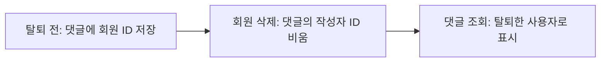

# 회원 탈퇴 후 댓글과 재가입을 어떻게 처리할 것인가

## 결정 (Decision)

회원이 탈퇴하면 회원 정보와 일기, 생성 결과, 피드를 삭제한다. 다른 회원의 피드에 남긴 댓글은 유지하되, 이전 회원과의 연결을 없앤다.

| 대상 | 탈퇴 후 처리 |
| --- | --- |
| 회원 정보, 일기, 생성 결과 | 삭제한다. |
| 탈퇴한 회원의 피드 | 피드와 그 피드에 달린 댓글을 함께 삭제한다. |
| 다른 회원의 피드에 남긴 댓글 | 내용과 작성 시각은 유지하고 작성자 ID는 비운다. |
| 다시 가입한 회원 | 새로운 회원으로 처리한다. 이전 일기, 피드, 댓글과 연결하지 않는다. |

### 차단한 회원에게 댓글 숨기기

탈퇴한 회원과 차단 관계에 있던 회원에게는 탈퇴 후에도 댓글을 숨긴다. 탈퇴한 회원이 상대를 차단했거나, 상대가 탈퇴한 회원을 차단한 경우 모두 적용한다.

회원 정보를 삭제하기 전에 댓글마다 숨길 대상 회원을 기록한다. 이 기록에는 탈퇴한 회원의 ID를 남기지 않는다. 숨김 대상 회원이나 댓글이 삭제되면 해당 기록도 삭제한다.

### DB 변경과 댓글 조회

현재 `comments.author_id`는 비울 수 없다. 회원을 삭제하면 그 회원이 작성한 댓글도 함께 삭제된다. 댓글을 유지하기 위해 다음과 같이 변경한다.

| 항목 | 변경할 내용 |
| --- | --- |
| 댓글 작성자 ID | `comments.author_id`를 비울 수 있게 한다. |
| 회원과 댓글의 연결 | 회원을 삭제하면 작성자 ID가 비워지도록 외래 키를 `ON DELETE SET NULL`로 변경한다. |
| 새 댓글 작성 | 로그인한 회원의 ID를 작성자 ID로 저장한다. |
| 댓글 조회 | 작성자 정보가 없어도 댓글을 조회한다. |

작성자 ID가 없는 댓글은 다음과 같이 응답한다.

| 응답 항목 | 값 |
| --- | --- |
| 작성자 이름 | `탈퇴한 사용자` |
| 작성자 ID | 없음 |
| 프로필 이미지 주소 | 없음 |
| 본인 댓글 여부 | `false` |

기존에 회원을 탈퇴 상태로 표시한 댓글도 계속 탈퇴한 사용자로 보여준다. 활성 회원의 프로필을 가져오지 못한 경우는 회원 탈퇴와 구분한다.

## 근거 (Rationale)

### 배경

회원 정보는 삭제하면서 다른 회원의 피드에 남긴 댓글은 유지해야 한다. 현재 DB 연결을 그대로 두면 회원을 삭제할 때 댓글도 함께 삭제된다.

### 고려한 방법

| 방법 | 결과 |
| --- | --- |
| 회원을 삭제할 때 댓글도 삭제한다. | 이전 회원과의 연결은 없어지지만, 다른 회원의 피드에서 대화 내용도 사라진다. |
| 댓글에 이전 회원 ID를 남긴다. | 댓글은 유지할 수 있지만, 이전 회원과의 연결이 남는다. |
| 댓글의 작성자 ID를 비운다. | 댓글을 유지하면서 이전 회원과의 연결을 없앨 수 있다. |

댓글 내용은 유지하고 이전 회원과의 연결은 없애기 위해 작성자 ID를 비우기로 했다. 같은 소셜 계정으로 다시 가입해도 새로운 회원으로 식별하므로, 이전 댓글을 새 회원에게 연결하지 않는다.

## 결과 (Consequences)

- 다른 회원의 피드에 남긴 댓글은 계속 볼 수 있지만, 원래 작성자는 표시하지 않는다.
- 재가입한 회원은 이전 댓글을 본인의 댓글로 조회하거나 삭제할 수 없다.
- 작성자 없는 댓글을 저장하고 조회할 수 있도록 DB와 댓글 조회 코드를 변경해야 한다.
- 기존 탈퇴 회원의 댓글과 활성 회원의 프로필 조회 오류를 구분해야 한다.
