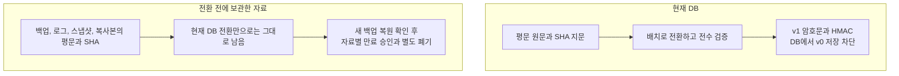
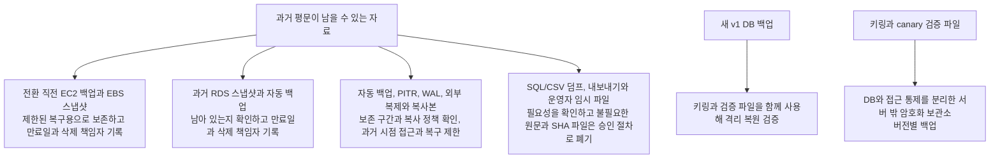

# 일기 원문 전환과 과거 백업의 보존·폐기

관련 이슈: [#423](https://github.com/woowacourse-teams/2026-Harudle/issues/423).
전환 실행은 [일기 원문 암호화 운영 안내](diary-source-text-encryption.md),
명령은 [배포 안내](../../deploy/README.md)를 따른다.

## 완료 범위를 구분한다

**현재 DB를 암호화해도 이전에 만든 백업의 평문까지 바뀌지는 않는다.**
현재 DB 전환과 과거 자료 폐기는 따로 확인하고 기록한다.

배치 완료는 현재 DB 원문이 v1이고, 생성 기록의 지문이 해당 키의 HMAC과 일치한다는 뜻이다.
v0 저장을 막는 DB 제약도 적용되어야 한다.
SHA와 HMAC은 모두 64자리 hex이므로 길이나 정규식만으로 구분하지 않는다.
전수 검증에서 원문을 정상 복호화하고 지문을 다시 계산해 저장 HMAC과 비교한다.

DB의 `UPDATE`는 이전 행을 즉시 지우지 않는다. 이전 행 버전이나 복구 로그, 백업에는 전환 전 평문이 남을 수 있다.
`VACUUM`도 이 작업에서 안전한 물리 삭제의 증거로 사용하지 않는다.
[PostgreSQL 이전 행과 VACUUM](https://www.postgresql.org/docs/current/routine-vacuuming.html#VACUUM-FOR-SPACE-RECOVERY).

이전 행과 백업에서 쓰는 용어

- **Multi-Version Concurrency Control(다중 버전 동시성 제어, MVCC)**은 여러 처리가 DB를 함께 사용할 수 있도록 행의 이전 버전도 유지하는 방식이다.
- **Write-Ahead Log(미리 쓰는 로그, WAL)**는 DB 변경을 복구하는 데 쓰는 기록이다. 평문이었던 시점의 내용도 남을 수 있다.
- **Point-In-Time Recovery(시점 복구, PITR)**는 백업과 로그로 과거 특정 시점의 DB를 복구하는 기능이다.
- **스냅샷**은 특정 시점의 저장소 상태를 보관한 자료다. **논리 덤프**는 SQL 같은 형태로 내보낸 DB 자료다.
- **VACUUM**은 더 이상 필요한 조회가 없는 이전 행의 공간을 다시 사용할 수 있게 하는 처리다. 원문이 물리적으로 완전히 지워졌다는 확인은 아니다.

**앱의 AES 키를 삭제해도 평문 백업은 그대로 읽을 수 있다.**
DB 저장소를 암호화하는 키와 앱이 원문을 암호화하는 키는 역할도 다르다.
필요한 앱 키부터 지워 현재 DB나 암호문 백업을 복구하지 못하게 만들지 않는다.

## 보관 대상을 확인한다

배포 책임자와 백업 관리자는 환경별로 실제 보관 위치, 접근자, 복사본을 조사한다.
현재 dev와 prod는 EC2의 PostgreSQL을 사용한다. 이전 RDS에 남은 자료도 확인한다.
저장소 코드를 읽은 것만으로 보존 설정이나 삭제 상태를 확인했다고 기록하지 않는다.

조사 중 원문이나 키를 채팅, 이슈, PR, 로그에 복사하지 않는다.
새 덤프를 만들 때도 비밀 보호, 보관 위치, 접근 권한, 만료일을 먼저 정한다.
**백업 파일 자체가 암호화되어 있어도 그 안의 평문이 앱의 암호문으로 바뀌었다는 뜻은 아니다.**
[RDS 백업 안내](https://docs.aws.amazon.com/AmazonRDS/latest/UserGuide/USER_WorkingWithAutomatedBackups.html).

키링과 canary 검증 파일

**Key ring(키링)**은 현재 키와 아직 필요한 구키를 모아 둔 설정이다.
**canary 검증 파일**은 미리 신뢰한 암호화 검증값을 담는다. 보관한 키가 올바른지 확인할 때 사용한다.
검증 파일만 복원한 것으로 실제 DB 행과 지문까지 복구했다고 판단하지 않는다.

## 폐기 전 복원 조건

**새 백업으로 실제 복구할 수 있는지 먼저 확인한 뒤 과거 자료를 폐기한다.**
다음 조건을 모두 충족해야 한다.

- 새 v1 백업을 격리된 환경에 실제 복원하고, 보존한 키링과 검증 파일로 `verify`와 `ready`를 확인한다.
- 본인 상세와 동일 요청 재조회가 정상인지 확인한다. 원문이나 키를 출력하지 않는다.
- 새 v1-only `reader` 복구 revision과 원본 배포 묶음으로 실제 재배포할 수 있는지 확인한다.
- 복구 기간과 서비스 보존 정책에 맞춰 **자료마다 만료일을 승인**한다. 일률적인 날짜를 코드에서 정하지 않는다. 관리자가 만료일을 지정하지 않았다면 폐기 계획도 완료된 것이 아니다.
- 만료된 자료와 복사본을 보관 시스템의 절차로 폐기한다. 실행 결과와 남은 예외를 기록한다.

전환 전 백업을 복원할 때는 외부 서비스와 격리한다.
#442 호환 도구 또는 검토된 배치 후보로 다시 전환하고 전수 검증과 `finalize`를 마친다.
v0가 남은 백업을 #423의 v1 전용 앱에 바로 연결하거나 구버전 서비스를 외부에 공개하지 않는다.
전환 중 게스트 일기 가져오기를 제공한다면, 사용하는 호환 앱에도 #545의 소유권 이전 수정이 필요하다.
그 수정이 없다면 해당 요청을 중단한다.

암호문이나 보존해야 할 백업이 참조하는 구키는 계속 보관한다.
canary 확인뿐 아니라 실제 백업 행과 지문도 검증한다.
잘못된 키 문제를 canary 재생성으로 우회하지 않는다.

## 실제 운영 기록

**현재 저장소 작업에서 실제 dev/prod 배치 실행, 백업 복원, 자료 폐기는 수행하지 않았다.**
아래 양식은 운영자가 실제 수행한 뒤 채운다. 예시의 0이나 성공 상태를 실제 결과로 옮겨 적지 않는다.

- **환경 / DB / 실행자 / 검토자:** 미기록. 실제 대상을 확인한 뒤 입력한다.
- **후보 이미지 ID / 커밋 / 배포 revision:** 미기록.
- **키 ID 목록 / 키링과 canary 백업 버전:** 미기록. 키 값은 기록하지 않는다.
- **전환 전 DB 백업 위치 / 복구 확인:** 미수행.
- **전환 시작과 종료 시각 / 전환, 미처리, 실패 건수:** 미수행.
- **전수 검증 / finalize / ready 결과:** 미수행.
- **새 v1 백업 복원과 기능 확인:** 미수행.
- **v1-only reader 복구 revision / 재배포 확인:** 미수행.
- **과거 평문과 SHA 자료별 보관 책임자 / 만료일 / 승인자:** 미지정.
- **폐기 실행 시각 / 결과 / 잔여 복사본과 예외 / 다음 확인일:** 미수행.

운영자는 실제 수치와 보관 시스템의 기록 식별자만 남긴다.
`status`의 종료 코드 0이나 테스트 통과를 운영 전환 또는 백업 폐기 완료의 근거로 사용하지 않는다.
