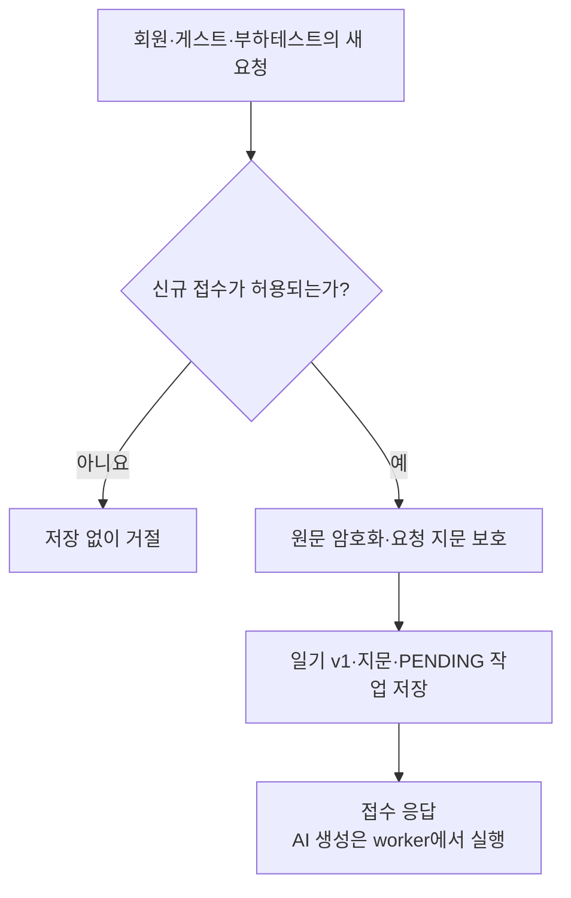
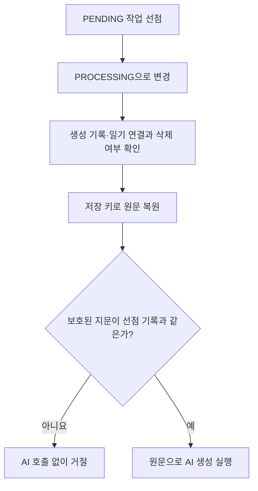
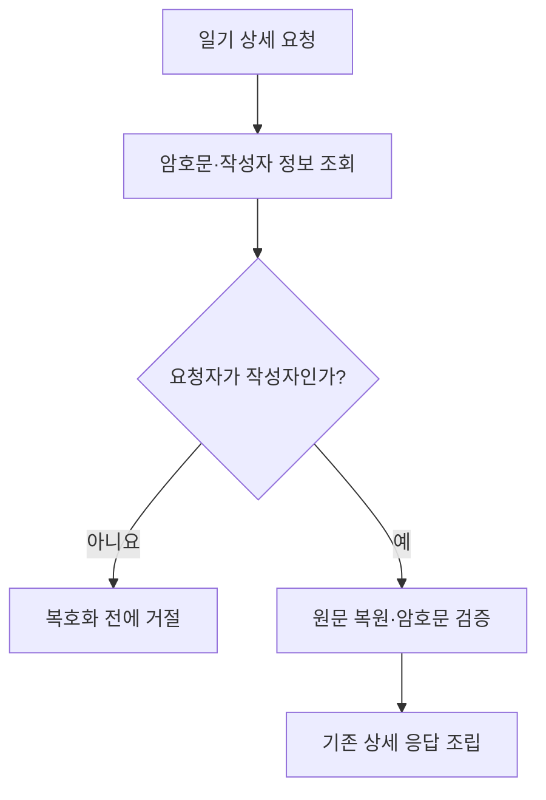
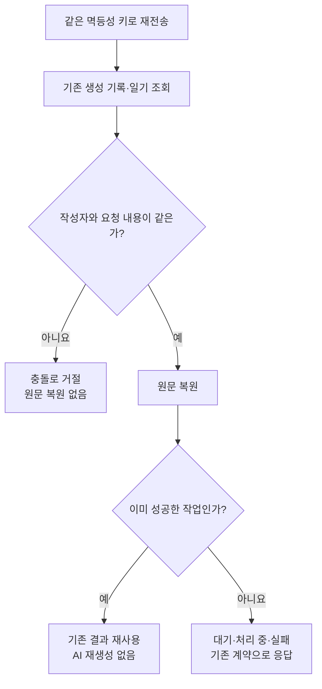
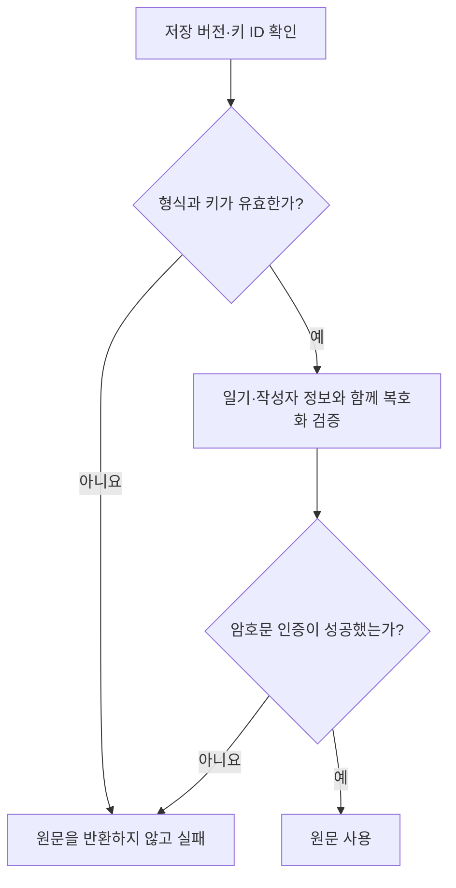
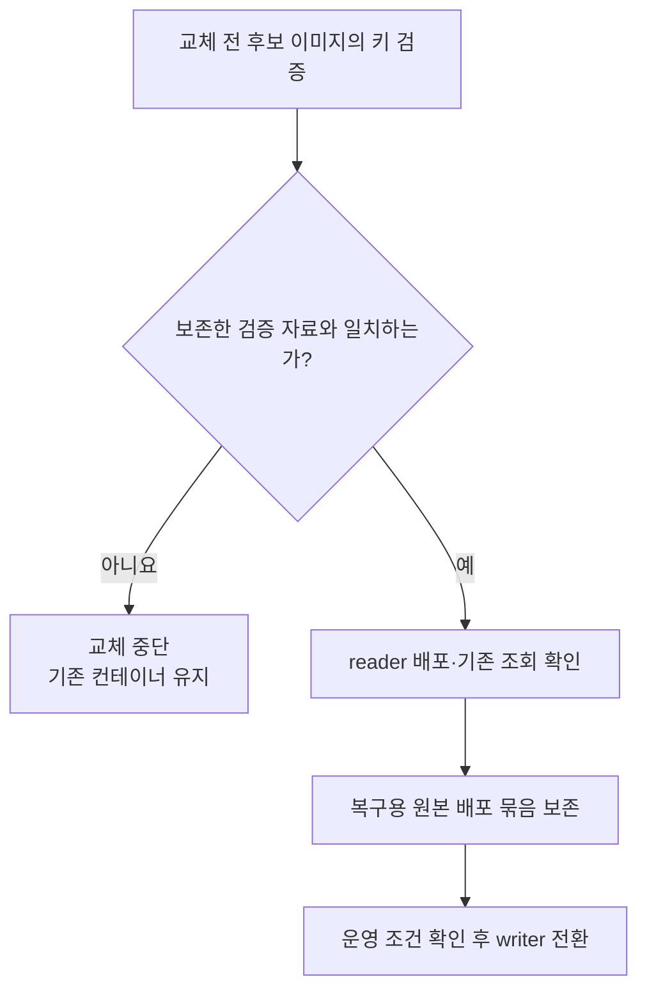

# 일기 원문 암호화: 상황별 동작

새 요청의 접수부터 백그라운드 생성, 본인 조회와 배포까지 원문을 다루는 순서를 정리한다.
암호화 선택 근거는 [ADR](adr/2026-10-20_일기%20원문을%20어떤%20경계와%20방식으로%20암호화할%20것인가_아이큐.md),
키·배포 명령은 [운영 안내](diary-source-text-encryption.md)를 참고한다.

이 문서의 v0 읽기·복구 설명은 #442의 호환 단계 기준이다. #450의 v1 전용 런타임과
전환 완료·복구 조건은 [기존 데이터 전환 시나리오](diary-source-text-migration-scenarios.md)를 따른다.

| 상황 | 바로가기 |
| --- | --- |
| 새 생성 요청을 접수한다 | [S01](#s01-새-생성-요청을-접수할-때) |
| 저장한 작업을 worker가 실행한다 | [S02](#s02-worker가-저장한-작업을-실행할-때) |
| 본인 일기 상세를 조회한다 | [S03](#s03-본인-일기-상세를-조회할-때) |
| 같은 생성 요청을 다시 보낸다 | [S04](#s04-같은-생성-요청을-다시-보낼-때) |
| 암호문이 변조되거나 키가 맞지 않는다 | [S05](#s05-암호문이-변조되거나-키가-맞지-않을-때) |
| 암호화 배포를 시작하거나 복구한다 | [S06](#s06-암호화-배포를-시작하거나-복구할-때) |

## S01. 새 생성 요청을 접수할 때

새 요청은 원문을 검증한 뒤 암호문과 보호된 지문을 저장한다. 일반 생성 API는 `PENDING` 작업을
접수하며, 요청을 받은 처리 경로에서 AI 생성까지 기다리지 않는다. 같은 요청의 재전송은 [S04](#s04-같은-생성-요청을-다시-보낼-때)로 구분한다.

reader의 신규 작성 차단이나 접수 한도 등 기존 조건을 통과해야 저장한다. 암호화·저장이 실패하면
일기·생성 기록·사용량의 변경을 함께 되돌린다.

PENDING·PROCESSING이란?

`PENDING`은 접수되어 실행을 기다리는 상태다. worker가 작업을 선점하면 `PROCESSING`으로 바뀐다.
작업 접수와 AI 실행이 서로 다른 시점에 진행된다는 뜻이며, 암호화가 새로운 작업 상태를 추가하는 것은 아니다.

관련 코드: [접수 서비스](../src/main/java/com/harudle/diary/service/DiaryCreationClaimService.java),
[일기 저장 표현](../src/main/java/com/harudle/diary/domain/Diary.java),
[저장 형식 준비 V36](../src/main/resources/db/migration/V36__encrypt_diary_source_text.sql).

## S02. worker가 저장한 작업을 실행할 때

worker는 선점한 작업이 여전히 `PROCESSING`인지, 생성 기록과 일기 ID가 연결되어 있는지 먼저 확인한다.
일기가 없거나 삭제되었다면 실행하지 않는다. 원문을 복원한 뒤 생성 실행기가 요청 내용을 다시
지문화하고, 해당 일기에 저장된 키로 보호한 값이 선점 기록과 같은지 확인한다.

연결 확인·복호화·지문 검증 중 하나라도 실패하면 AI를 호출하지 않는다. 생성 상태의 실패 저장과
시간 초과 처리는 기존 작업 관리 흐름을 따른다. 이때 원문·키·암호문을 오류나 로그에 넣지 않는다.

요청 지문과 HMAC이란?

요청 지문은 사용자·일기·날짜·원문 등 생성 입력이 같은지 비교하는 값이다.
HMAC은 서버의 비밀 키도 있어야 계산할 수 있는 지문 보호 방식이다. worker가 요청을 복원한 뒤에도
저장할 때와 같은 규칙으로 비교해야 다른 내용으로 AI를 실행하지 않는다.

관련 코드: [작업 선점](../src/main/java/com/harudle/generation/diary/service/PendingDiaryGenerationClaimService.java),
[worker의 입력 복원](../src/main/java/com/harudle/generation/diary/service/DiaryGenerationWorker.java),
[실행 전 지문 검증](../src/main/java/com/harudle/generation/diary/service/ClaimedDiaryGenerationService.java),
[저장 키를 사용하는 지문 보호](../src/main/java/com/harudle/diary/service/DefaultRequestFingerprintProtector.java).

## S03. 본인 일기 상세를 조회할 때

DB에서 일기를 읽는 순간 자동으로 원문을 풀지 않는다. 요청자가 작성자인지 먼저 확인하고,
본인 상세 응답에 필요한 지점에서만 복원한다. 복호화에 실패한 값을 원문처럼 반환하지 않는다.

목록·연속 기록·공개 피드·공유·관리자 조회는 원문을 복원하지 않는다. 본인 응답과 AI 생성에는
원문이 필요하므로, 서버도 원문을 읽을 수 없는 구조를 제공하는 변경은 아니다.

관련 코드: [본인 상세 조회](../src/main/java/com/harudle/diary/service/DiaryQueryService.java),
[저장 표현을 가진 조회 결과](../src/main/java/com/harudle/diary/repository/DiarySnapshot.java).

## S04. 같은 생성 요청을 다시 보낼 때

요청에 담긴 원문을 비교 지문으로 만들 때는 기존 일기의 저장 키를 사용한다. 본인인지와 요청
내용이 같은지 확인한 뒤 원문을 복원한다. 같은 키로 다른 날짜나 내용을 보내면 충돌로 거절한다.

`SUCCEEDED`는 기존 결과를 사용한다. `PENDING`·`PROCESSING`·`FAILED`도 각 API의 기존 상태·실패
응답 계약을 유지한다. 재전송만으로 새 일기나 새 작업을 만들거나 실패한 작업을 다시 실행하지 않는다.

멱등성 키란?

응답을 받지 못해 같은 요청을 다시 보낼 때, 기존 작업을 찾는 식별자다.
키가 같다는 사실만으로 같은 요청으로 인정하지 않고 작성자와 요청 지문도 확인한다.

관련 코드: [기존 요청 확인](../src/main/java/com/harudle/diary/service/DiaryCreationClaimService.java),
[접수·기존 결과 반환](../src/main/java/com/harudle/diary/service/DiaryCreationService.java),
[게스트 접수·재조회](../src/main/java/com/harudle/diary/service/GuestDiaryCreationService.java).

## S05. 암호문이 변조되거나 키가 맞지 않을 때

아래는 저장 버전 v1의 암호문을 읽는 흐름이다.

A의 일기에서 암호문만 B의 일기로 복사하면, 읽을 때 B의 일기·작성자 정보와 맞지 않아 인증이
실패한다. 잘못된 키·손상된 형식·지원하지 않는 버전도 거절하며, v1 오류를 평문 읽기로 우회하지 않는다.
변조 시점에 DB가 자동 탐지하는 기능은 아니다.

AAD·저장 버전과 보호 범위

AAD는 숨기지는 않지만 암호문과 함께 검증하는 정보다. 목적·버전·키 ID·일기 ID·작성자 ID를 사용한다.
v0는 기존 평문, v1은 암호문을 뜻한다. #442는 전환 중의 v0 읽기를 유지하므로, DB 쓰기 권한을 가진
사람이 버전까지 바꾸는 모든 조작을 막는다고 설명하지 않는다. v0 종료는 [후속 #450](https://github.com/woowacourse-teams/2026-Harudle/pull/450)에서 진행한다.

관련 코드: [암호화·복호화·인증](../src/main/java/com/harudle/diary/infrastructure/crypto/AesGcmDiarySourceTextCipher.java).
키 설정·검증 자료가 맞지 않는 배포를 거절하는 흐름은 [S06](#s06-암호화-배포를-시작하거나-복구할-때)을 참고한다.

## S06. 암호화 배포를 시작하거나 복구할 때

키 누락·구키 누락·같은 ID에 다른 키를 입력한 경우를 교체 전에 확인한다. reader의 신규 작성
차단과 writer 허용은 배포 묶음에 고정하며, 최종 실행 설정이 모드와 충돌하면 거절한다.

- **최초 초기화:** 실제 writer·worker를 중지·배출하고, 정상 스키마와 최초 환경임을 확인한 뒤
  검증 자료를 만든다. 현재 v1이 없다는 사실만으로 최초 환경이라고 판단하지 않는다.
- **운영 중 복구:** 검증 자료를 새로 만들지 않는다. 신뢰한 같은 백업 세대의 키링·검증 자료를 복원하고,
  실제 v1 전체의 인증 복호화와 본인 상세·동일 요청 재조회를 확인한다.
- **쓰기 허용:** reader의 성공과 원본 보존을 확인한다. prod writer에는 dev 실제 격리 복원과 prod 키 백업·복구본
  보존을 확인한 승인서가 필요하다. 암호문을 모르는 구버전이나 스키마 되돌리기로 복구하지 않는다.

reader·writer·검증 자료란?

reader는 신규 일기 접수를 막는 복구용 모드다. 기존 조회·동일 요청 재조회는 유지하며, DB 전체를
읽기 전용으로 바꾸는 설정은 아니다. writer는 신규 암호문 저장을 허용한다.
검증 자료(canary)는 신뢰한 키로 미리 만든 암호문·HMAC이다. 배포마다 다시 만들면 잘못된 키까지
통과할 수 있으므로 최초 생성과 이후 검증·복구를 구분한다.

상세 명령과 키 등록 순서는 [운영 안내](diary-source-text-encryption.md),
승인·복구용 원본 보존 조건은 [배포 안내](../../deploy/README.md)를 따른다.
V36은 저장 형식을 준비하는 단계이며 기존 DB 전체를 암호화하지 않는다.
실제 운영 전환·백업 복원·prod 승인·중단 시간 측정의 완료를 이 문서가 증명하지 않는다.
