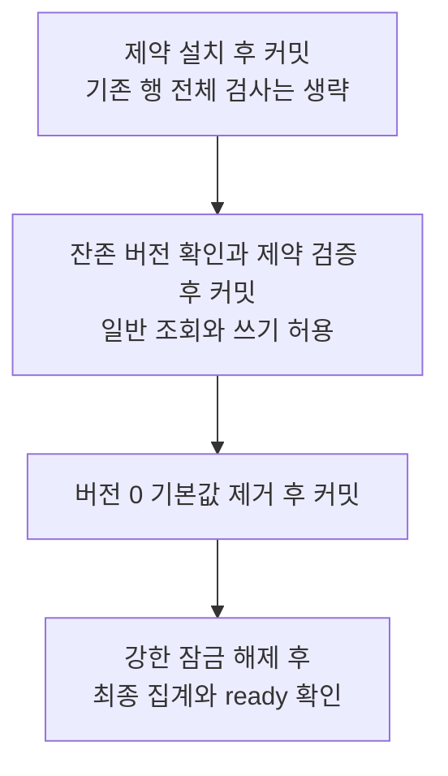
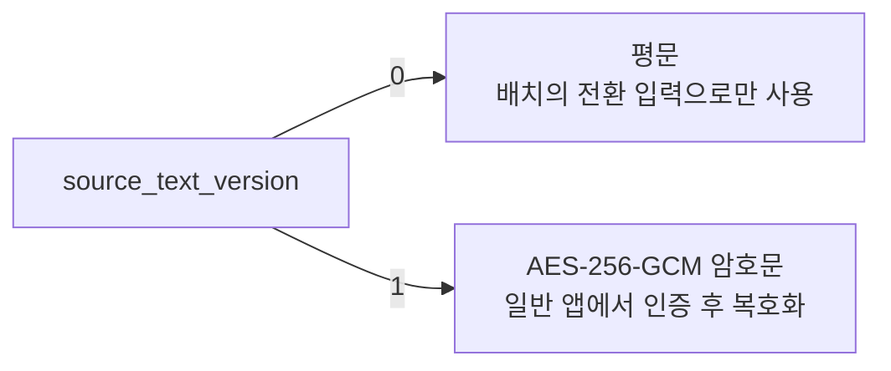

# 일기 원문 암호화

[PR #546](https://github.com/woowacourse-teams/2026-Harudle/pull/546)은 **DB에 이미 저장된 평문과 SHA 지문을
암호문과 HMAC 지문으로 바꾸고, 일반 앱에서 평문 읽기를 끝내는 변경**이다.
기존 #442 앱은 평문과 암호문을 함께 읽는다. 새 앱은 암호문만 읽으므로, 운영자가 먼저 수동 전환을 마쳐야 한다.
PR 머지나 일반 배포가 이 전환을 자동 실행하지는 않는다.


이 문서는 **실행 전 조건과 실패 시 판단**을 정리한다. 필요한 부분부터 읽는다.

- PR 흐름을 처음 배우면 [전환 시나리오](diary-source-text-migration-scenarios.md)를 먼저 본다.
  실제 작업 전에는 아래 [기존 데이터의 온라인 전환](#기존-데이터의-온라인-전환)과 [배포 순서](#최초-배포와-복구-순서)를 확인한다.
- 서버에서 쓸 정확한 명령은 [배포 안내](../../deploy/README.md#기존-원문지문의-온라인-전환-423)를 따른다.
  새 키를 준비하거나 기존 키를 복원한다면 [키 설정](#키-설정)과 [키 검증](#기존-키와-일치하는지-검증)을 함께 확인한다.
- 앱에서 저장하고 읽는 코드는 [암호화 시나리오](diary-source-text-encryption-scenarios.md),
  선택 근거는 [전환 ADR](adr/2026-10-20_기존%20일기%20원문과%20지문을%20어떻게%20온라인%20전환하고%20평문%20경로를%20닫을%20것인가_아이큐.md)과
  [암호화 ADR](adr/2026-10-20_일기%20원문을%20어떤%20경계와%20방식으로%20암호화할%20것인가_아이큐.md)에 있다.

관련 이슈: [신규 원문 암호화 #422](https://github.com/woowacourse-teams/2026-Harudle/issues/422),
[기존 원문 전환 #423](https://github.com/woowacourse-teams/2026-Harudle/issues/423).

<details>
<summary>먼저 나오는 용어: 평문, 암호문, 요청 지문, v0와 v1</summary>

- 평문은 사용자가 쓴 원래 글이다. 암호문은 비밀 키로 암호화한 저장값이다. 복호화는 올바른 키로 원래 글을 복원하는 처리다.
- 요청 지문은 같은 요청인지 비교하는 값이다. SHA 지문은 키 없이 계산할 수 있다.
  HMAC 지문은 서버의 비밀 키도 있어야 계산할 수 있다.
- `v0`와 `v1`은 일기 원문의 저장 형식 번호다. v0는 평문이고 v1은 암호문이다.
  `V44`는 DB 구조를 변경한 SQL 파일의 번호이므로 v0나 v1과 다른 번호다.
- Transaction(트랜잭션)은 DB 변경을 함께 확정하거나 취소하는 단위다. Commit(커밋)은 그 변경의 확정이다.
- `reader`는 새 일기 작성을 막는 배포 모드이고, `writer`는 새 작성을 허용한다. 둘 다 기존 일기는 읽는다.
  어떤 저장 형식을 읽을 수 있는지는 별도 조건이며 [배포 모드](#배포-모드)에서 구분한다.

</details>

## 기존 데이터의 온라인 전환

운영자는 #442의 호환 앱으로 서비스를 계속 제공하면서, 검토한 #423 후보 이미지의 CLI를 별도로 실행한다.
CLI(Command-Line Interface, 명령줄 인터페이스)는 터미널에서 명령을 지정해 실행하는 도구다.
**전환이 끝나기 전에는 v1만 읽는 새 앱으로 서비스 컨테이너를 교체하지 않는다.**

### 전환 전 확인과 명령

실행 전에는 다음 조건을 확인한다.

- **현재 서비스의 모든 앱이 배치의 활성 키를 읽을 수 있어야 한다.** 호스트 `.env`만 바꿔도 실행 중인 앱의
  메모리 키링은 바뀌지 않는다. 새 키라면 구키와 기존 활성 키를 유지한 채 #442 호환 앱에 키링을 먼저
  반영하고 재배포한다. 각 앱의 키 검증, 배포 성공과 기존 일기 조회를 확인한 뒤 배치의 활성 키를 바꾼다.
- **게스트 일기를 회원에게 가져오는 기능을 계속 제공하려면 #545의 소유권 이전 수정이 먼저 배포되어야 한다.**
  이 PR에도 같은 수정이 있지만 후보 CLI만 실행해서는 현재 서비스 앱이 바뀌지 않는다.
  선행 수정이 없으면 전환 중 소유권 이전 요청을 중단한다.
- **이미 가져간 게스트 일기는 이전 이력도 확인한다.** `guest_sessions`의 일기 ID, 이전 게스트 ID와
  가져온 회원 ID를 대조한다. SHA나 암호문 인증이 맞지 않으면 완료를 확정하지 않는다.
  기존 SHA를 덮거나 인증에 실패한 원문을 임의로 다시 암호화하지 않는다. 이력이 확인된 행은 별도 검토 후
  복구하고 전체 검증을 다시 수행한다. 실제 불일치 데이터가 있는지는 아직 확인하지 않았다.

배포 책임자는 위 선행 배포와 조회 결과를 기록한다. canary 검증만으로 현재 앱의 메모리 키링까지
확인했다고 판단하지 않는다. v0가 남아 있을 때 키를 반영하려고 새 v1 전용 앱을 먼저 배포해서도 안 된다.

<details>
<summary>키링과 작성자 확인이 먼저 필요한 이유</summary>

키링은 키 ID와 실제 비밀 키를 짝지어 보관한 설정이다. 배치가 새 키로 기존 일기를 암호화하면
현재 서비스 앱도 그 키를 알아야 해당 일기를 읽을 수 있다. 앱은 시작할 때 키링을 읽는다.
canary는 후보 CLI에 입력한 키를 확인하는 자료이며 다른 앱의 메모리 내용을 확인하는 도구는 아니다.

작성자 ID는 암호문과 요청 지문의 검증에 쓰인다. 작성자 ID만 바꾸면 예전 작성자의 정보로 검증한
암호문이나 SHA가 남을 수 있다. 소유권 이전 시 암호문과 지문도 새 작성자에게 맞춰 변경해야 한다.

</details>

명령은 이름이 비슷해도 역할이 다르다.

- `status`: v0, v1, 지원하지 않는 버전, 진행 중 v0와 생성 기록 없는 일기 수를 조회한다.
  종료 코드 0은 조회 성공이며 전환 완료가 아니다.
- `migrate`: 정한 수만큼 v0 원문과 연결된 SHA 지문을 함께 바꾼다. 아직 v0가 남아 있으면 종료 코드 2로 미완료를 알린다.
- `verify`: 모든 행의 저장 버전, 암호문 복원과 연결된 HMAC을 검사한다. 성공해도 DB 완료 조건을 확정한 것은 아니다.
- `finalize`: 전체 검증을 다시 수행하고, 아래 세 단계로 v1 전용 제약과 기본값 제거를 확정한다.
- `ready`: 검증된 v1 제약, 버전 열의 필수값과 기본값 제거, 남은 저장 버전을 확인한다.
  배포 전과 앱 시작에 쓰는 완료 검사이며, 데이터를 바꾸거나 전체 암호문 검증을 대신하지 않는다.

실행은 [후보 이미지 선택과 명령](../../deploy/README.md#기존-원문지문의-온라인-전환-423)을 따른다.
진입점은 `com.harudle.diary.infrastructure.crypto.DiarySourceTextBackfillMain`이다.
이 도구는 앱과 같은 키, 암호화와 지문 코드를 사용한다. 같은 Compose 설정의 `JAVA_OPTS`,
ConfigData와 Binder로 설정을 읽고 신뢰한 canary를 검증한다. Spring 앱, Flyway와 AI 클라이언트는 시작하지 않는다.

`migrate`는 `READ_COMMITTED` 연결만 허용한다. 다른 격리 수준이면 쓰기 전에 거절하고 연결 설정을
자동 변경하지 않는다. 운영자가 DB와 계정의 접속 설정을 확인한 뒤 새 연결로 재실행한다.
`status`, `verify`, `ready` 같은 조회 명령에는 이 제한을 확대하지 않는다.

`--batch-size`는 migrate/verify/finalize에서 기본 100, 최대 1,000이다.
`migrate` 전용 `--max-batches`는 기본 1, 최대 10,000이다. 작은 범위부터 지연과 실패 수를 확인한다.
`migrate`의 종료 코드 1은 실패, 2는 미완료다. 2를 전체 성공으로 기록하지 않는다.
집계와 `status`를 확인해 재실행하고, 전체 완료는 `finalize`와 `ready`로 확인한다.

### 생성 작업과 함께 전환할 때

배치와 일반 생성 처리는 **생성 기록을 먼저 잠그고 그다음 일기를 잠근다.**
생성 기록이 `PROCESSING`이면 이미 실행 중이므로 배치는 원문과 지문을 바꾸지 않는다.
`PENDING`은 실행 전이므로 같은 잠금 아래 원문, 저장 버전과 지문을 함께 전환할 수 있다.
배치가 먼저 잠그면 worker의 `SKIP LOCKED`가 그 행을 건너뛴다. worker가 먼저 실행을 시작하면
배치는 `PROCESSING`을 확인하고 건너뛴다. 진행 중 v0가 종료되면 배치를 다시 실행한다.

배치는 생성 상태, 생성 시각과 사용량을 변경하지 않는다. 기존 선점과 만료 규칙도 유지한다.
정상 종료되지 않은 작업은 기존 서비스의 상태 정리 절차로 처리하고 지문만 수동 변경하지 않는다.
생성 기록 없는 일기와 삭제된 일기도 전환하고 검사한다. `orphanRows`는 생성 기록 없는 일기 수이며 오류 수가 아니다.
해당 일기의 원문 인증은 검사하되 존재하지 않는 지문을 새로 만들지는 않는다.

실행 검증은 생성 기록과 일기를 따로 읽으므로 같은 트랜잭션으로 바꾸는 것만으로 안전하다고 판단하지 않는다.
이미 끝난 작업의 옛 실행 명령은 전환 뒤 거절될 수 있다. 현재는 종료 상태를 다시 진행 상태로 바꾸지 않는다.
새 재실행 상태를 추가할 때는 이 경계를 다시 검토한다.

### 최종화를 세 번 나누어 확정하는 이유

`finalize`는 전체 암호문과 HMAC을 확인한 뒤 제약 설치, 제약 검증과 기본값 제거를 각각 커밋한다.



설치와 기본값 제거 전에는 `ACCESS SHARE` 잠금으로 DB 구조를 먼저 확인한다.
기본값 제거 시에는 정확히 일치하는 검증된 CHECK와 버전 열의 NOT NULL도 확인한다.
강한 `ACCESS EXCLUSIVE NOWAIT` 잠금은 제약 설치와 기본값 제거에만 사용한다.
전체 행 집계와 제약 검증은 일반 조회와 쓰기를 허용하는 `SHARE UPDATE EXCLUSIVE` 잠금에서 한다.
마지막 집계와 완료 확인도 강한 잠금을 해제한 뒤 수행한다. 세션 advisory lock은 명령 전체에 유지한다.

`NOT VALID` 제약도 설치 이후 저장하거나 변경한 결과가 v0이면 거절한다.
검증이나 기본값 제거가 남으면 `ready`는 실패한다. 이미 커밋된 단계는 보존하고 `finalize`를 재실행한다.
강한 잠금을 즉시 얻지 못하면 기다리지 않고 실패한다. SQL 실행과 트랜잭션 유휴 대기를 각각 1초로
제한하지만 **전체 잠금 시간이 1초 이내라는 보장은 아니다.** 실제 조회 차단 시간과 허용 예산은
[격리 복원 DB 측정 절차](diary-source-text-finalize-measurement.md)로 확인한다.

<details>
<summary>NOT VALID, 테이블 잠금과 유휴 대기의 뜻</summary>

- CHECK constraint(검사 제약)은 DB가 저장값이 조건에 맞는지 검사하는 규칙이다.
  `NOT VALID`는 기존 행 전체를 아직 검사하지 않았다는 표시다. 새로 저장하거나 변경하는 값에는 즉시 규칙을 적용한다.
- `ACCESS EXCLUSIVE`는 일반 조회와 쓰기까지 막는 테이블 잠금이다. `NOWAIT`는 즉시 얻을 수 없으면 실패한다는 옵션이다.
- `SHARE UPDATE EXCLUSIVE`는 여기서 구조 변경과 다른 검증의 간섭을 막는다. 일반 조회와 쓰기는 허용한다.
- Advisory lock(권고 잠금)은 이 도구의 `migrate`, `verify`, `finalize`끼리 겹치지 않게 하는 실행 잠금이다.
- 유휴 대기는 트랜잭션을 열어 둔 채 다음 DB 명령을 보내지 않는 시간이다. SQL 실행 시간과 다른 제한이다.

</details>

### 오류가 생기거나 응답을 잃었을 때

한 일기의 원문, 저장 버전과 연결된 지문은 함께 커밋하거나 함께 롤백한다.
이미 전환한 v1은 다시 암호화하지 않는다. 롤백을 확인한 SQL 오류나 인증 실패는 원문 없이 실패 수로 보고한다.
저장 SHA와 다시 계산한 SHA가 다르면 덮어쓰지 않고 그 행의 이력을 조사한다.
전체 검증은 v1 암호문을 인증 복호화하고 요청에서 계산한 SHA를 HMAC으로 보호해 저장 지문과 비교한다.
SHA와 HMAC은 모두 64자리 hex이므로 길이나 정규식으로 지문 전환 완료를 판단하지 않는다.

커밋 응답 유실, 롤백 실패나 연결 상태 복구 실패가 생기면 전체 명령을 중단하고 연결을 폐기한다.
DB에 이미 반영됐을 수 있으므로 롤백으로 단정하거나 저장 버전을 수동으로 되돌리지 않는다.
새 연결에서 `status`와 전체 `verify`로 실제 상태를 확인한 뒤 남은 v0를 재실행한다.
`finalize`의 응답을 잃었을 때도 `status`와 `ready`로 완료 여부를 확인하고, 남은 단계가 있으면 재실행한다.
원문, 암호문, 키, SHA와 SQL 진단을 로그, CSV나 별도 평문 열에 복사하지 않는다.

도구는 매 트랜잭션에서 `public`의 일반 테이블, 필수 열 형식과 NOT NULL, 일기와 생성 기록의 UUID 기본키,
일기별 생성 기록의 단일 UNIQUE 제약을 확인한다. RLS, 상속이나 파티션, 제약 누락과 NULL 키는
행을 숨기거나 검사 대상에서 빠뜨릴 수 있어 전체 명령을 거절한다. 검사 중에는 테이블 잠금으로 구조 변경을 막는다.
복원 DB가 이 조건과 다르면 제약을 지워 우회하지 않고 원래 스키마와 복원 절차를 조사한다.

### 전환 도구의 빌드 포함과 보관

도구는 서버와 같은 JAR과 이미지에 포함된다. **포함돼 있다는 이유로 자동 실행되지는 않는다.**
일반 서버는 `HarudleApplication`으로 시작한다. 전환 코드에서는 `requireReady()`로 완료 상태만 확인한다.
`DiarySourceTextBackfillMain`은 Spring Bean이 아니며 별도로 선택해야 실행된다. 배포 훅은 이 CLI의 `ready`만 호출한다.
이 두 완료 검사는 원문이나 제약 조건을 변경하지 않는다.

전환 뒤에도 완료 검사와 과거 v0 백업의 재전환에 도구가 필요하다. 앱과 도구가 같은 암호화,
원문 정리와 지문 규칙을 쓰도록 현재는 함께 보관한다. 서버 이미지에서 분리하려면 다음 조건을 갖춘다.

- 수동 전환 코드와 완료 검사를 분리해도 미완료 DB의 배포와 앱 시작을 거절해야 한다.
- v0 백업을 처리할 별도 유지보수 이미지, 해당 키링과 검증 파일을 보관하고 실제 복원을 확인해야 한다.
- 별도 실행 파일에 맞춰 빌드, 배포와 JAR 검증을 함께 바꾸고, 암호화와 지문 규칙은 공통 코드로 유지해야 한다.

v0 백업의 보존 기간이 끝나 실제 폐기까지 확인하면 재전환 도구의 폐기를 검토한다.
키 검사와 dev 부하테스트의 암호화 데이터 준비 도구는 계속 쓰이므로 함께 삭제하지 않는다.

## 최초 배포와 복구 순서

### prod 쓰기 전 실제 복원 승인

**dev에서 서버 밖 백업의 실제 격리 복원과 기록 검토를 마치기 전에는 prod writer를 허용하지 않는다.**
운영자는 canary `verify`, 실제 v1 전체의 `verify-data`, 본인 상세와 성공한 동일 요청 재조회를 확인한다.
prod의 키링과 canary 백업, 복구용 reader 원본도 따로 확인한다. dev 키 복원이 prod 키 복원을 증명하지는 않는다.
실제 기록과 승인서는 [배포 승인 조건](../../deploy/README.md#prod-writer-승인)을 따른다.

ApplicationStart는 prod writer에서 root 소유 승인서와 현재 prod canary 해시를 확인한다.
승인서 누락, 미승인이나 canary 변경이면 컨테이너를 교체하지 않는다. reader와 dev는 이 승인 대상에서 제외한다.
승인서는 운영자의 확인 기록이며, 프로그램이 실제 보관소 복원과 HTTP 조회를 직접 증명하는 것은 아니다.
**실제 사용자 v1 DB의 복원 연습과 prod 승인은 아직 미수행이며 writer 승인 대기다.**

### 작성 중단 시간과 요청 접수

reader는 신규 작성 요청에 503을 반환한다. 원문, 생성 선점과 사용량을 새로 저장하지 않는다.
요청을 나중에 실행하도록 별도로 접수하는 기능은 추가하지 않았다.
A에서 B로, C에서 D로 바꾸는 실제 작성 중단 시간은 **미측정**이다.
dev에서 reader의 차단 시작, 각 컨테이너 교체, writer의 건강성과 실제 생성, 복구 시간을 기록해
점검 창과 사용자 공지 기준을 승인한다. 배포 훅 제한 시간을 예상 중단 시간으로 쓰지 않는다.
키 백업과 복원 연습, A/B 배포 원본 준비는 prod reader 적용 전에 마친다.
승인한 중단 시간을 넘기면 reader를 유지하고 원인을 해결한다. 검증을 생략해 writer를 열지 않는다.

<details>
<summary>작성을 막는 동안 요청을 따로 받지 않는 이유</summary>

별도 접수에는 입력을 보관할 저장소와 중복, 실패, 재시작 후 재처리 규칙이 필요하다.
평문을 새 장소에 보관하거나 reader에도 암호문 쓰기를 허용해야 한다. 메모리 큐는 재시작 시 유실될 수 있어 사용하지 않는다.

</details>

### 배포 모드

`reader`와 `writer`는 새 작성의 허용 여부다. 읽을 수 있는 저장 형식과 구분한다.


A/B는 #442 호환 배포본이고 C/D는 이번 #423의 v1 전용 배포본이다.
앱의 작성 설정 기본값은 `true`이고, CodeBuild의 `DIARY_SOURCE_TEXT_RELEASE_MODE` 기본값은 `reader`다.
신규 작성 차단은 `GENERATION_UNAVAILABLE`(503)이다. v0 읽기를 다시 켜는 토글은 없다.

운영자는 다음 순서를 지킨다.

1. 환경별 키와 canary의 최초 신뢰, 서버 밖 백업과 실제 격리 복원을 기록하고 검토한다.
   prod writer에는 현재 canary와 일치하는 승인서가 필요하다.
2. A의 배포 성공과 조회, 작성 차단을 확인하고 원본을 보존한 뒤 B를 운영한다. 이미 마친 환경은 실제 이력을 확인한다.
3. 검토한 후보 이미지 ID를 고정해 `status`와 제한된 `migrate`를 반복한다. B 이미지에서 배치 Main을 찾지 않는다.
   실행 중이던 v0가 끝나면 다시 처리한다. v0와 미지원 버전 0건, 전체 `verify`, `finalize`, `ready`를 확인한다.
4. C를 배포한다. ApplicationStart는 prod writer 승인 검사, 키 검증 성공 증거, 승인 재확인, `ready`의
   완료 JSON과 종료 0을 확인한 뒤 교체한다. reader/dev는 prod 승인 검사에서 제외한다.
   앱도 지연 초기화 여부와 관계없이 미완료 DB의 시작을 거절한다.
5. C의 CodeDeploy 성공, 본인 상세, 재조회와 작성 차단을 확인한다. 커밋, 이미지 ID, S3의 원본 배포 revision
   위치와 버전, 담당자와 시각을 보존한다. prod 승인서를 C 원본 참조로 갱신한 뒤 같은 검토 코드의 D를 빌드해 배포한다.
6. [백업 정책](diary-source-text-backup-policy.md)에 따라 새 v1 백업을 복원 검증한다.
   과거 평문과 SHA 자료의 책임자, 만료일과 폐기 결과도 따로 기록한다.

모드 파일과 Compose override를 배포 원본에 함께 보존한다. Compose와 앱은 최종 작성 설정을 대조한다.
서버 `.env`, JVM/JSON 설정이나 프로필 변경으로 reader의 차단을 우회하지 못하게 한다.

장애 복구에는 C 또는 이후의 승인된 v1 전용 reader를 사용한다. 완료 후에는 A/B를 복구 목록에서 제외한다.
CodeDeploy의 자동 롤백 그룹 설정과 개별 배포 override도 확인한다. 예전 revision의 훅까지 현재 코드로
제한할 수 없으므로 운영자가 수동과 자동 복구 대상을 제한해야 한다. 현재 `:local` 태그나 dangling 이미지에 의존하지 않는다.
[CodeDeploy 롤백 안내](https://docs.aws.amazon.com/codedeploy/latest/userguide/deployments-rollback-and-redeploy.html).

DB를 평문으로 되돌리거나 v1 제약과 버전 열을 제거하지 않는다. 과거 v0 백업은 격리 환경에서 전환을 마친 뒤 연결한다.
키 문제는 신뢰한 키링과 canary 백업으로 복원한다. canary 재생성이나 평문 해석으로 우회하지 않는다.
잘못된 키로 쓴 행이 의심되면 신규 작성을 중단하고 키 ID별 영향을 조사한다. 손상된 행은 신뢰한 DB 백업과
해당 키로 복구한다. V44를 되돌리거나 `TEXT`를 축소하지 않는다.

**실제 dev/prod 배치, 실제 사용자 v1 DB 백업 복원과 자료 폐기는 이 저장소 작업에서 수행하지 않았다.**
[운영 기록](diary-source-text-backup-policy.md#실제-운영-기록)은 테스트 통과 기록과 구분해 채운다.

## 저장과 조회 경계

`Diary.create`는 앞뒤 공백을 제거하고 최대 300 Unicode code point인지 확인한 뒤 원문을 암호화한다.
회원, 게스트와 부하테스트의 공통 선점 서비스가 이 팩토리를 사용한다.
엔티티의 `sourceText`는 저장값만 보유하며 새 일기는 항상 `sourceTextVersion=1`이다.
저장 실패 시 일기, 생성 기록과 사용량은 같은 트랜잭션에서 롤백한다.

생성 API는 암호문과 `PENDING` 작업을 저장한 뒤 접수 결과를 반환한다.
worker는 선점한 작업의 상태, 일기 연결과 삭제 여부를 확인하고 원문을 복원한다.
실제 생성 실행기는 보호된 요청 지문이 일치할 때만 AI를 호출한다.

`DiaryQueryService`는 요청자와 일기의 작성자가 같은지 먼저 확인한다. 본인일 때만 복호화해 상세 응답을 만든다.
생성 재요청도 소유권과 같은 요청인지 확인한 뒤 복호화한다. 이미 성공한 요청이면 기존 결과를 반환하며
새 일기를 저장하거나 AI를 다시 호출하지 않는다. 생성 입력과 본인 API의 `sourceText`는 원문을 제공하고,
AI 제공자에게도 생성 입력으로 원문을 전달한다.

JPA converter가 DB 조회와 동시에 원문을 자동 복원하도록 만들지는 않았다.
권한을 확인한 뒤 필요한 지점에서만 복호화한다. 월간 기록, 연속 기록, 공유 생성과 피드 발행 및 삭제에서
엔티티나 projection을 읽는 것만으로 복호화하지 않는다. 공개 피드, 공유와 관리자 응답에도 원문을 제공하지 않는다.
원문 보유 record의 `toString()`은 원문을 가리고, API 예외 로거는 예외 메시지와 원인 메시지를 출력하지 않는다.

<details>
<summary>소유권과 변조 검증</summary>

소유권 검사는 요청자가 볼 권한이 있는지 확인한다. GCM 검증은 저장한 데이터가 손상되지 않았는지 확인한다.
권한 확인과 저장값 검증은 각각 필요하다.

</details>

<details>
<summary>생성 재요청과 멱등성</summary>

생성 재요청은 응답을 받지 못해 같은 멱등성 키로 같은 생성을 요청하는 경우다.
Idempotency(멱등성)는 같은 요청을 여러 번 보내도 같은 결과를 쓰는 성질이다.
멱등성 키로 기존 요청을 찾고, 요청 지문으로 같은 내용인지 확인한다.

</details>

<details>
<summary>JPA converter와 projection</summary>

JPA converter는 DB 저장과 조회에서 값을 자동 변환한다.
Projection(프로젝션)은 필요한 열만 담은 조회 결과다. 여기서는 둘 다 자동 복호화의 시작점이 아니다.

</details>

## 형식과 인증

앱과 배치는 `source_text_version`을 보고 `source_text`를 어떤 형식으로 읽을지 결정한다.



v1의 저장값은 `keyId:Base64(nonce + ciphertext + tag)`이다.
새 앱은 v0를 거절한다. v1 복호화에 실패해도 평문으로 다시 읽지 않는다.

V44는 열을 `TEXT`로 넓히고 버전 열을 기본값 `0`으로 추가한다. #423의 명시적 `finalize`가
전환 완료 후 v1 전용 CHECK 제약 조건을 적용하고 이 기본값을 제거한다. 문자열 prefix로
평문을 추측하지 않으므로 기존 사용자가 암호문처럼 보이는 글을 썼어도 혼동하지 않는다.

**이전 브랜치의 암호화 V28 또는 V38을 적용한 환경이면 바로 배포하지 않는다.**
Flyway 이력과 `source_text_version` 존재 여부를 확인해 별도 계획을 세운다. 이력 번호 변경이나 `repair`로 우회하지 않는다.
이 PR은 운영 DB 이력을 수정하지 않는다.

<details>
<summary>기존 브랜치의 V28 또는 V38 암호화 SQL을 이미 적용한 환경</summary>

최신 백엔드의 V28은 비동기 생성 큐, V38은 회원탈퇴에 사용한다. 암호화 SQL 내용은 유지하고 번호를 V44로 옮겼다.

</details>

DB 버전 열과 키 ID는 암호화 비밀이 아니다. 버전 `0`은 배치가 읽는 전환 입력이며
완료 뒤 CHECK 제약 조건은 v0 저장을 거절한다. 제약 조건을 바꾸는 DB 관리 권한이나
애플리케이션, 키 자체가 노출된 경우까지 방어하는 설계는 아니다.

암호화마다 `SecureRandom`으로 96비트 nonce를 만들고 128비트 인증 tag를 사용한다.
목적, 버전, 키 ID, 일기 ID, 사용자 ID를 AAD로 인증하므로 다른 일기/사용자 행으로
암호문을 복사하면 복호화가 실패한다. 같은 원문도 서로 다른 암호문을 만든다.

<details>
<summary>nonce, tag, AAD와 행 복사 예시</summary>

nonce는 같은 키에서 재사용하지 않아야 하는 암호화별 입력값이고, tag는 변조 여부를 검사하는 검증값이다.
AAD는 숨기지는 않지만 암호문과 함께 검증하는 부가 정보다. 예를 들어 A의 일기 1에서 만든
암호문을 B의 일기 2로 복사하면, 서버가 B와 2를 AAD로 사용해 복호화할 때 tag 검증이 실패한다.
DB가 수정 즉시 탐지하는 기능이 아니라 서버가 해당 암호문을 읽고 검증할 때 거절하는 동작이다.

</details>

손상된 형식, 지원하지 않는 버전, 누락된 키, 변조된 암호문과 잘못된 UTF-8은 고정된
안전한 예외로 실패한다. 오류, 원인에 원문, 암호문, 키를 넣지 않는다.
요청 지문도 잘못된 유니코드를 `?`로 치환하지 않고 거절한다. 정상 입력의 기존 SHA 값은 유지하며,
암호화를 다시 실행하지 않는 재요청에서도 서로 다른 입력을 같은 요청으로 판단하지 않게 한다.

근거: [Java 21 Cipher의 GCM nonce, AAD 규칙](https://docs.oracle.com/en/java/javase/21/docs/api/java.base/javax/crypto/Cipher.html).

## 키 설정

기본 설정은 다음 환경 변수를 사용한다.

```dotenv
DIARY_SOURCE_TEXT_ACTIVE_KEY_ID=primary
DIARY_SOURCE_TEXT_KEY_BASE64=<독립적으로 생성한 32바이트 키의 Base64>
```

서버에서는 `/opt/harudle/.env`에 권한 `600`으로 보관한다. dev/prod의 키를 나누고
JWT 키, 테스트 키와 재사용하지 않는다. 키 생성에는 `openssl rand -base64 32` 등
보안 난수 생성기를 쓴다. 키를 채팅, Git, 빌드 아티팩트, 로그에 남기지 않는다.
암호화 설정은 필수이며 키 누락, 길이/형식 오류, 활성 키 불일치 시 앱 시작이 실패한다.
실행 중 자동으로 새 키를 생성하거나 평문 쓰기로 우회하지 않는다.

dev와 prod 서버는 모두 Spring `prod` 프로필을 사용하므로 키 검증 파일도 필수다.
앱 시작 시 `prod` 프로필이거나 실제 배포 모드 환경 변수 `DIARY_SOURCE_TEXT_RELEASE_MODE`가 있으면
같은 검증을 수행한다. 배포 프로필이 `local`로 덮여도 검증 자료 누락이나 잘못된 키를 허용하지 않는다.
호스트의 `/etc/harudle/diary-key-checks.json`을 컨테이너의
`/var/run/harudle/diary-key-checks.json`에 읽기 전용으로 연결한다. 키와 검증 파일은
배포 아티팩트와 분리해 유지한다. Spring 설정 경로는
`harudle.diary.source-text-encryption.verification-file`이다.

여러 키를 보관할 때는 보안 외부 Spring YAML 또는 `SPRING_APPLICATION_JSON`으로
아래 구조의 키링을 주입한다. 키 ID는 소문자 영문, 숫자, `_`, `-`를 사용하면
환경 변수 바인딩의 대소문자 변환과 충돌하지 않는다. 기본 `primary` 항목도 기존
암호문이 있는 동안 유효한 키로 유지해야 한다. 설정 내용을 로그로 출력하지 않는다.

<details>
<summary>키링과 활성 키 ID</summary>

키링은 `키 ID`와 실제 비밀 키를 짝지은 묶음이며 키 ID 자체는 비밀값이 아니다.
활성 키 ID는 새 일기를 암호화할 때 사용할 항목이고, 기존 일기는 저장된 암호문의 키 ID로 복호화한다.

</details>

```yaml
harudle:
  diary:
    source-text-encryption:
      active-key-id: k202611
      keys:
        primary: <기존 32바이트 키의 Base64>
        k202611: <새로운 32바이트 키의 Base64>
```

새 키 ID와 새 키를 먼저 모든 호환 읽기 앱에 추가, 재배포한 뒤 활성 키 ID를 전환한다.
이때 구키와 기존 활성 키를 유지하며 canary 등록, 각 앱의 키 검증, 배포 성공, 기존 조회를 먼저 확인한다.
실행 중 앱의 키링은 시작 시 읽은 메모리 상태이므로 호스트 `.env` 수정만으로 갱신되지 않는다.
기존 ID의 키 내용을 새 값으로 바꾸지 않는다. 암호문이 남아 있는 키는 삭제하지 않는다.
신규 일기의 멱등성 지문도 원문 후보 대입을 막기 위해 키에서 별도로 파생한 HMAC 키로
보호한다. 재요청은 저장 암호문의 키 ID를 사용한다. 기존 일기를 다른 키로 재암호화할 때는
해당 일기의 지문도 같은 트랜잭션에서 재계산해야 한다. 키만 추가, 활성 전환할 때는 기존 행을
변경하지 않는다. 배치는 평문 버전 `0`의 기존 SHA 지문을 원문, 버전과 같은 트랜잭션에서 함께 전환한다.

<details>
<summary>지문에 HMAC과 파생 키를 사용하는 이유</summary>

SHA만 저장하면 DB의 사용자, 날짜와 짧은 원문 후보로 같은 SHA를 계산해 대조할 수 있다.
HMAC은 지문 계산에 서버의 비밀 키도 필요하게 만들어 이 대조 경로를 막는다.
지문용 파생키는 암호화 키와 고정된 지문용 문구로부터 만든 별도 용도의 키다.

</details>

환경변수로 독립 키를 하나 더 받는 구조는 아니며, 기준 암호화 키가 유출되면 두 보호 모두 영향을 받는다.
과거 백업을 복원할 때도 해당 백업의 모든 키가 필요하다. 키 손실은 원문 복구 불가로
이어지므로 데이터와 분리된 접근 통제로 키를 보관, 백업하고 복원 가능성을 확인한다.

## 기존 키와 일치하는지 검증

32바이트 형식을 만족하는 다른 키를 기존 ID에 잘못 입력해도 길이 검사만으로는 찾을 수 없다.
이를 막기 위해 환경별 검증 파일에 키마다 공개된 검증용 문장의 암호문과 HMAC 지문을 보관한다.
검증은 실제 원문 암호화 구현으로 그 값을 복원하고 비교한다. 파일의 환경과 등록된 키 ID 집합도
설정과 일치해야 한다. 사용자 일기 원문을 검증 파일에 복사하지 않는다.

<details>
<summary>검증용 암호문과 최초 신뢰의 의미</summary>

Canary(검증용 암호문)는 내용이 알려진 문장을 미리 암호화한 값이다. 배포할 키로 같은 문장이 복원되는지 검사한다.
파일에는 비밀 키가 없다. 환경에 예약한 일기 ID, 사용자 ID와 키 ID도 검사에 사용한다.
파일까지 잘못된 키로 새로 만들면 그 키가 검사를 통과한다. 그래서 최초 생성과 이후 검증을 구분한다.

</details>

**검증 파일을 잃거나 손상시켰을 때 다시 만드는 것은 복구 방법이 아니다.**
신뢰한 키링과 같은 세대 파일을 복원한다. 아래 키 검사 CLI는 원문 전환 CLI와 다르다.
이 CLI의 `verify`는 canary를 확인하며, 전환 CLI의 `verify`는 실제 일기와 연결 지문 전체를 검사한다.
실행은 [배포 안내](../../deploy/README.md)를 따른다.

- `verify`: 기존 canary의 모든 키, 환경과 ID를 암복호화하고 HMAC을 확인한다.
  DB에 연결하거나 파일을 만들지 않는다. 성공 출력은 `{"verified":true}` 한 줄이다.
- `initialize`: 처음 도입하는 정상 기존 스키마 또는 현재 v0만 있는 암호화 스키마에서 canary를 만든다.
  JDBC 검사와 SHARE 잠금을 사용하며, v1, 미지원 버전이나 불명확한 DB 상태가 있으면 거절한다.
- `register`: 기존 등록값을 검증한 뒤 새 키 ID만 추가한다. DB에 연결하지 않는다.
  구키 삭제, 동일 ID의 키 변경과 파일 재생성은 허용하지 않는다.
- `verify-data`: 실제 DB의 v1 전체를 인증 복호화해 checked/failed를 출력한다.
  v0는 건너뛰며 원문 출력, 데이터 변경과 배치 전환을 하지 않는다.

### 최초 초기화와 운영 복구

`initialize` 전에 운영자가 모든 실제 writer, 진행 요청, worker를 중지, 배출해야 한다. 후보 reader
설정만으로 이를 증명하지 않으며, 확인할 수 없으면 backend를 정지하고 재시작을 통제한다.
JDBC는 `public.diaries` SHARE 잠금 후 암호화 적용 전 정상 schema 또는 현재 v0만 있는 암호화
schema를 확인한다. Flyway 이력은 실제 배포본에 포함된 SQL 버전만 허용하고, 암호화 적용 여부는
V44 이력으로 별도 판정한다. 배포본에 없는 이력, 버전 중복, v1, null/미지원 저장 버전이나 불명확한
DB 상태는 거절한다. 후속 SQL이 추가됐다는 이유로 임의의 상한 번호까지 신뢰하지 않는다.
[최초 조건과 실행 예시](../../deploy/README.md#최초-initialize-조건)를 따른다.

DB 검사 커밋 성공을 확인한 뒤에만 임시 파일을 최종 canary로 덮어쓰기 없이 공개한다. 미완료 임시
파일은 복구 자료가 아니다. 현재 v1 0건이어도 과거 v1이 물리 삭제되었거나 백업에만 남아 있을 수 있으므로 운영 canary
분실, 손상에 initialize를 사용하지 않는다.

파일 검사는 앱 시작, 배포 시 수행하며 실행 중 유실에 즉시 자동 쓰기 중단하지 않는다. 운영자가
쓰기를 차단, 배출하고 필요하면 backend를 정지한다. 복원 전 reader 재배포도 실패할 수 있다.
복구할 때는 같은 백업 세대의 키링과 canary를 복원하고 `verify`, `verify-data`를 수행한다.
reader에서 본인 상세와 동일 요청 재조회를 확인한 뒤 writer를 연다. 전환 중이면 #442 호환 reader를 사용하고, finalize 후에는
ready를 통과한 #423 v1-only reader를 사용한다. canary 복원이 DB 전환 완료 검사를 대신하지 않는다.
신뢰된 복구 쌍이 없으면 중단하고 별도 복구를 진행한다.

`verify-data`는 v1 전체를 GCM 인증 복호화해 checked/failed만 출력한다. 실패 행 또는 schema, 지원
버전 검사 실패가 있으면 쓰기를 열지 않는다. v0를 건너뛰므로 checked=0은 최초 신뢰나 전체 전환
완료를 증명하지 않으며, 아래 배치 CLI의 실제 지문 전수 검증, 전환, finalize를 대신하지 않는다.
원문, 키, 암호문, SQL 진단을 숨기는 [복구 명령](../../deploy/README.md#운영-canary-분실손상-복구)을 따른다.

키 추가는 구키와 기존 활성 키를 유지한 채 register하고 모든 호환 앱에 새 키링을 먼저 배포한다.
키 검증, 배포 성공, 조회 확인 뒤 활성 키를 바꾼다. 실행 중 앱의 키링은 시작 시 읽은 메모리 상태이므로
호스트 `.env`만 고친 것으로 반영 완료를 판단하지 않는다.

### 키 없이 관리자 이미지를 복구하는 모드의 범위

현재는 키 누락 또는 검증 실패 시 정상 앱 시작을 거절한다. 키 없는 이미지 복구 모드는
제공하지 않는다. 기존 `AdminImageRecoveryService`는 성공한 생성 기록의 스토리보드와
이미지 키를 사용하므로 원문 복호화 자체는 필요하지 않다.

그러나 키 검사만 생략해 일반 앱을 시작하면 worker가 기존 대기 작업을 선점한 뒤 복호화
실패로 작업을 실패 처리할 수 있다. 만료 스케줄러와 기존 요청 재조회도 작업 상태를 변경한다.
`reader`의 신규 접수 차단만으로 기존 작업과 사용량 보존을 보장할 수 없어 검사를 우회하지 않는다.

키 없는 복구가 필요하면 별도 복구 진입점으로 분리한다. 정상 모드의 필수 키 검증을 유지하고,
명시적 복구 모드에서만 기존 관리자 인증과 CSRF를 적용한 이미지 복구 API를 허용해야 한다.
원문 생성과 조회 및 재요청은 503으로 거절하고, worker 선점과 PENDING/PROCESSING 만료 처리를
실행하지 않아야 한다. 키 없는 이미지 복구 성공, 권한 거절, 원문 API 거절, 기존 작업과 사용량
불변을 함께 검증하기 전에는 지원 기능으로 취급하지 않는다.

현재 키 손상 시에는 신뢰한 키링과 같은 세대 검증 파일을 복원하고 검증한 뒤 기존 관리자
이미지 복구 API를 사용한다. 임시 키 주입이나 검증 파일 재생성으로 시작 검사를 우회하지 않는다.

### 키 등록 중 재시작 통제

앱 시작과 배포 전 검증은 모두 **설정 키 ID와 canary의 완전 일치**를 유지한다. 신키 등록 뒤 새
canary를 읽는 구키 전용 앱은 시작 검사에서 거절한다. 일부 키만
검증해 시작시키면 신키 암호문이 저장된 이후에도 이를 읽을 수 없는 구키 전용 앱이 시작될 수 있다.
등록 여부만으로 그 키의 실제 사용 이력을 구분할 수 없어 검사를 완화하지 않는다.

키 등록은 무중단 작업으로 취급하지 않는다. 모든 실제 writer, worker를 중지, 배출하고 CodeDeploy,
수동 배포와 재시작 자동화를 통제한 점검 구간에서 수행한다. 구키, 기존 활성 키를 유지하며 register,
키링/canary 서버 밖 백업, 전체 키링을 반영한 컨테이너 **재생성**과 verify/verify-data, 조회 확인을
끝낸 뒤 신키를 활성화한다. 단순 restart는 이전 컨테이너 환경을 갱신하지 않는다. 파일 bind mount도
호스트의 atomic 파일 교체를 기존 컨테이너가 즉시 관측한다고 가정하지 않는다.
상세 [키 등록 순서](../../deploy/README.md#키-등록과-컨테이너-재시작)를 따른다.

파일 생성, 교체는 파일과 부모 디렉터리 동기화까지 성공해야 완료로 반환한다. 최종 파일이 이미
공개된 뒤 동기화에 실패할 수 있으므로 오류만 보고 파일을 삭제하거나 initialize를 반복하지 않는다.
신뢰 자료, 실제 데이터와 대조하고 파일시스템 상태를 확인한다. register의 무변경 재실행도 기존
자료를 인증하고 디렉터리를 다시 동기화한다. 실제 전원 손실을 재현한 내구성 검증은 수행하지 않았다.

## 보관 책임과 복원 확인

환경별 EC2의 권한 600인 암호화 설정과 별도 canary에 대한 쓰기 권한을 제한한다. 키링과 canary는
신뢰한 같은 백업 세대로 서버 밖 암호화 보관소에 함께 보존한다. 최초 쓰기 전과 키 등록 후마다 복원
가능성을 확인하고, 구키는 현재 행뿐 아니라 보존 중인 DB 백업이 참조하는 동안 계속 보관한다.
키와 canary를 함께 바꿀 수 있는 호스트 침해까지 방어하는 장치는 아니다.

배포 책임자, 검토자는 환경, 키 ID 목록, 키링/canary 백업 세대, DB 백업, 복구 revision 식별자,
복원 시각과 verify/verify-data, 조회 결과를 기록한다. 원문, 비밀 키, 암호문, 지문, SQL 진단은 남기지
않는다. 과거 DB 백업도 격리 복원해 검증, 조회한다. **실제 사용자 v1 데이터를 포함한 운영 DB 복구와 백업 복원은 이 저장소 작업에서
수행하지 않았다. dev의 키 백업 복원과 canary 검증은 [별도 준비 기록](diary-source-text-integration.md#2026-11-04-dev-키-준비와-백업-검증-기록)에 남긴다.**

키를 중앙에서 관리할 필요가 생기면 SSM Parameter Store `SecureString` 또는 Secrets Manager로
옮기는 방안을 검토한다. 중앙 보관은 수기 복사를 줄이지만 IAM과 배포 전 조회가 추가되며,
조회한 키는 앱 환경과 메모리에 남을 수 있다. 저장소를 바꿔도 동일한 키 ID의 값 검증, 구키 보존,
검증 파일 백업은 필요하다. Secrets Manager의 교체 기능이 기존 일기 암호문을 자동으로 재암호화하는
것도 아니다. KMS 봉투 암호화와의 비교는 [ADR](adr/2026-10-20_일기%20원문을%20어떤%20경계와%20방식으로%20암호화할%20것인가_아이큐.md#3-키-관리)에 기록한다.
참고: [SSM SecureString과 KMS](https://docs.aws.amazon.com/systems-manager/latest/userguide/secure-string-parameter-kms-encryption.html),
[Secrets Manager 교체](https://docs.aws.amazon.com/secretsmanager/latest/userguide/rotating-secrets.html).

## 검증 범위

테스트는 다음 동작을 확인한다. **테스트 통과는 실제 운영 전환이나 백업 복원 완료 기록이 아니다.**

- 암복호화, nonce, AAD, 변조, 키 전환과 잘못된 설정이나 문자 인코딩의 거절
- 같은 ID의 잘못된 32바이트 키, 검증 파일 누락이나 변조, 환경 불일치와 키 등록 시 기존 ID 보존
- 새 원문의 암호화 저장, v0/v1 전환과 v0 읽기 거절, 권한 확인 후 복호화, 조회와 생성 재요청
- 저장 실패의 롤백, reader의 저장과 사용량 차단, 기존 v1 조회 유지와 필수 키 검사
- PENDING 선점 경합, PROCESSING 제외, 삭제 및 생성 기록 없는 일기, SHA와 HMAC 전체 검증
- 잘못된 복원 스키마와 RLS의 거절, 검사 중 구조 변경 차단, 커밋 응답 유실 시 중단과 재실행
- 세 단계 최종화와 기본값 제거, 미완료 배포 거절, 배포 원본의 reader/writer 설정 우선 적용
- 후보 이미지 ID 고정, Compose 설정 유지, 허용된 JSON만 출력하고 키나 원본 진단을 숨기는 동작

테스트 리소스의 공개 키는 실서비스에 쓰지 않는다.
확인한 운영 이력과 SQL 번호는 [통합 및 배포 확인](diary-source-text-integration.md)을 따른다.
