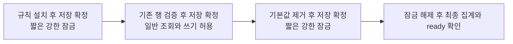
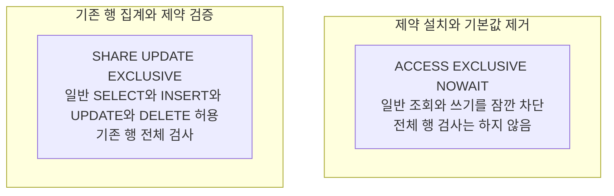
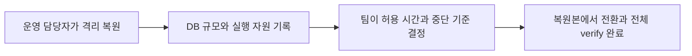
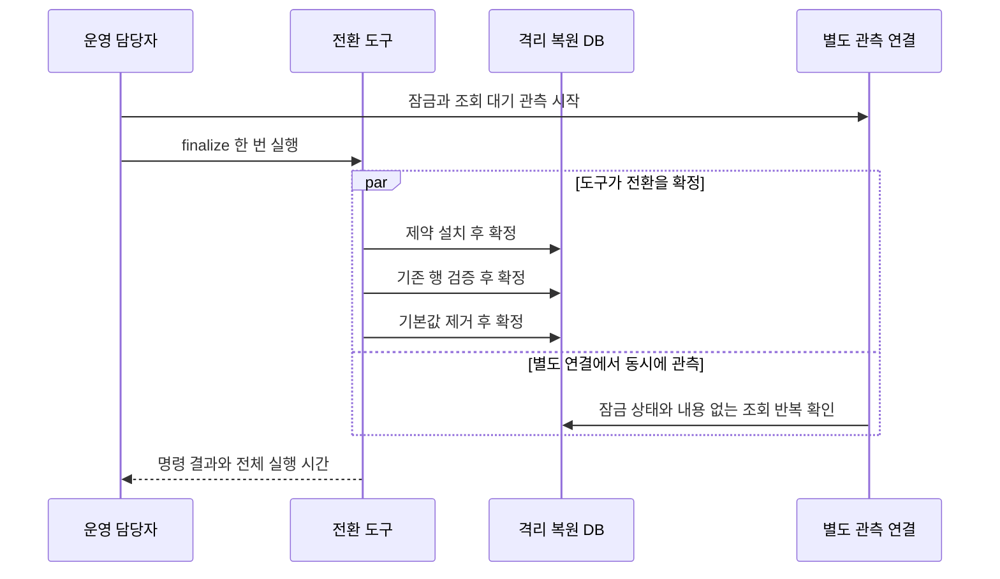
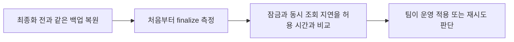

# 최종화의 잠금 시간 측정

운영 담당자는 격리된 복원 DB에서 `finalize`를 실행해 **일반 조회가 실제로 얼마나 기다리는지**
측정한다. 이 결과와 팀이 정한 허용 시간을 비교한 뒤 운영 DB에 적용할지 판단한다.
전체 명령이 끝나는 데 걸린 시간과 조회가 막힌 시간은 따로 기록한다.

2026-11-06 리뷰에서 기존 단일 트랜잭션 결정을 바꿨다. 제약 설치, 기존 행 검증과 기본값 제거를
각각 저장한다. 전체 행을 확인하는 동안에는 일반 조회와 쓰기를 허용한다.



<details>
<summary>무엇이 조회를 막고, 어떤 중간 상태가 남나?</summary>

DB 구조와 필요한 제약 정보는 강한 잠금을 얻기 전에 확인한다. 강한 잠금 아래에서 실행하는
명령은 `CHECK ... NOT VALID` 추가 또는 `DROP DEFAULT` 중 하나다. 전체 행 집계와 검증은
일반 조회와 쓰기를 허용하는 단계에서만 수행한다.



- **ACCESS SHARE**는 DB 구조를 확인할 때 사용하는 잠금이다.
- **ACCESS EXCLUSIVE**는 일반 조회와 쓰기까지 막는 잠금이다. `NOWAIT`는 즉시 얻지 못하면
  대기하지 않고 실패한다는 뜻이다.
- **Constraint(제약 조건)**는 DB가 저장할 데이터에 적용하는 규칙이다. `NOT VALID`는 기존 행의
  전체 검사를 미룬 상태다. 설치 후 새로 저장하거나 변경한 결과가 v0이면 즉시 거절한다.
- **CHECK**는 값이 정한 조건에 맞는지 확인하는 규칙이다. 마지막 단계 전에는 정확한 v1 CHECK가
  검증됐고 버전 열이 `NOT NULL`, 즉 빈 값을 허용하지 않는지 확인한다.
- **Session Advisory Lock(세션 권고 잠금)**은 명령 전체에서 유지하는 실행 잠금이다.
  다른 `migrate`, `verify`, `finalize`가 같은 전환을 동시에 수행하지 못하게 한다.

강한 잠금 요청 전에는 SQL 한 번의 실행 제한과 트랜잭션 안에서 다음 명령을 기다리는 제한을
각각 1초로 설정한다. **전체 잠금 시간이 1초 이내라는 보장은 아니다.**

제약 검증이나 기본값 제거가 남아 있으면 `ready`가 거절한다. 도중에 실패했을 때는 이미 저장된
단계를 되돌리지 않는다. 실제 상태를 확인한 뒤 `finalize`를 재실행하며, 완료된 단계는 생략한다.
설치 전에 남은 v0를 도구가 임의로 고치지는 않고 다음 집계에서 미완료로 판단한다.

잠금과 제약 동작은 PostgreSQL 18의 [ALTER TABLE](https://www.postgresql.org/docs/18/sql-altertable.html),
[LOCK](https://www.postgresql.org/docs/18/sql-lock.html), [잠금 호환 관계](https://www.postgresql.org/docs/18/explicit-locking.html),
[시간 제한 설정](https://www.postgresql.org/docs/18/runtime-config-client.html)을 따른다.

</details>

<a id="대상과-판단-기준"></a>

## 1. 복원 DB와 판단 기준 준비

운영자는 실제 운영 규모의 DB를 외부 서비스와 격리해 복원한다. PostgreSQL 버전, 인덱스,
디스크와 자원을 기록하고, 조회가 기다려도 되는 시간과 실패 시 중단 기준을 팀과 먼저 정한다.
코드가 임의로 합격 시간을 정하지 않는다.



`RESTORE_APP_DIR`는 복원 환경 전용 배포 묶음이어야 한다. 후보 전환 도구가 그 경로의 DB 설정을
사용하는지 먼저 확인한다. 실제 dev/prod DB를 측정 대상으로 바꾸지 않는다. 현재 DB EC2의
백업 방식을 확인하고 과거 RDS 자료와 구분한다.

같은 후보 도구로 전환과 전체 `verify`를 마친 뒤 측정한다. 다른 배포나 DB 관리 작업과
병행하지 않는다. 원문과 키를 로그에 복사하지 않는다. 기록할 값은 후보 이미지 ID, 집계 건수,
전체 명령 시간, 잠금 관측 구간, 동시 조회 지연과 `ready` 결과다.

<a id="실행-순서"></a>

## 2. 관측을 시작하고 finalize 실행

별도 읽기 전용 DB 연결에서 잠금 관측을 먼저 시작한다. 같은 복원 DB에서 `finalize`를 한 번
실행하며, 제약 설치와 검증과 기본값 제거의 잠금 구간을 구분한다.



<details>
<summary>읽기 전용 잠금 관측 SQL</summary>

같은 복원 DB에 접속한 psql 세션에서 실행한다. 세션 계정은 필요한 통계 조회 권한만 사용한다.
실제 데이터 내용과 실행 중인 쿼리 문자열은 조회하지 않는다.

```sql
SET default_transaction_read_only = on;
SET statement_timeout = '1s';
SELECT clock_timestamp() AS observed_at, a.pid, a.xact_start,
       l.mode, l.granted, a.wait_event_type, a.wait_event
FROM pg_stat_activity a
JOIN pg_locks l ON l.pid = a.pid
WHERE a.application_name = 'harudle-diary-source-backfill'
  AND l.locktype = 'relation'
  AND l.relation = 'public.diaries'::regclass
  AND l.mode IN ('AccessExclusiveLock', 'ShareUpdateExclusiveLock');
\watch 0.1
```

주기적으로 관측하면 짧은 잠금을 놓칠 수 있다. 관측 행이 없었다고 0초로 기록하지 않는다.
`granted=false`는 아직 얻지 못한 잠금이다. `xact_start`부터의 시간에는 강한 잠금 전의 구조
확인 시간도 포함되므로 잠금 보유 시간으로 그대로 사용하지 않는다.

검증 단계의 `ShareUpdateExclusiveLock`은 일반 조회를 막지 않는다. 이 시간을
`AccessExclusiveLock`의 보유 시간과 합쳐 조회 차단 시간으로 기록하지 않는다.

</details>

<details>
<summary>전체 명령 시간과 내용 없는 동시 조회</summary>

복원 환경의 후보 이미지 ID와 경로를 검토한 후 실행하는 예다. 접속 비밀번호나 키는 인자로 넣지 않는다.

```bash
: "${RESTORE_APP_DIR:?복원 환경 전용 배포 경로를 지정하세요}"
: "${candidate_image:?검토한 전체 sha256 이미지 ID를 지정하세요}"
/usr/bin/time -p sudo env HARUDLE_APP_DIR="$RESTORE_APP_DIR" \
  bash "$RESTORE_APP_DIR/maintenance/run_diary_source_text_backfill.sh" dev \
  --candidate-image="$candidate_image" finalize
```

전체 명령 시간에는 컨테이너 실행, 키 확인과 전체 데이터 검증도 포함된다. 이 시간을 잠금 시간과
같게 보지 않는다. 한 명령에서 잠금을 보유한 시간보다 짧을 수는 없으므로, 판단에 사용할 수 있는
보수적인 최대 범위로만 기록한다.

별도 읽기 전용 psql 세션에서 `\timing on` 후 `SELECT EXISTS (SELECT 1 FROM public.diaries);`를
잠금 전과 진행 중에 실행한다. 실제 일기 내용 없이 조회 대기를 비교하고 관측 세션도 종료한다.

</details>

검증 단계의 조회와 쓰기는 복원 DB의 합성 데이터로 확인한다. 강한 잠금 요청이 실패한 경우도
기록한다. 명령 종료 후에는 `status`, 전체 `verify`, `ready` 결과를 확인한다.

<a id="결과에-따른-결정"></a>

## 3. 같은 초기 상태로 다시 측정하고 적용 판단

처음 최종화하기 전과 같은 백업으로 DB를 다시 복원한 뒤 반복한다. 이미 검증한 DB 제약은
재실행할 때 기존 행 검사를 생략하므로, 그 시간을 최초 제약 검증 시간으로 사용하지 않는다.
암호문과 HMAC의 전체 검증은 재실행에서도 수행한다.



제약 설치와 기본값 제거 때의 실제 조회 지연을 각각 판단한다. 전체 명령 시간이 허용 시간을
넘어도 조회 차단 시간이 함께 넘었다고 단정하지 않는다. 잠금 관측과 실제 조회 대기 시간을 함께 본다.

`NOWAIT` 실패가 반복되면 서비스가 덜 바쁜 시간이나 승인한 점검 창에서 재시도한다. 잠금 대기나
시간 제한을 무제한으로 늘리지 않는다. 중간 상태에서 `ready`가 실패하고 재실행으로 완료할 수 있는지도 확인한다.

**현재 이 문서는 실제 운영 규모의 복원 DB에서 측정한 완료 기록이 아니다.** 운영 배포 전 해당 실측과
판단을 남긴다. 합성 데이터, 로컬 실행, CI 결과는 운영 규모와 자원에서의 차단 시간 증거로 대체하지 않는다.
