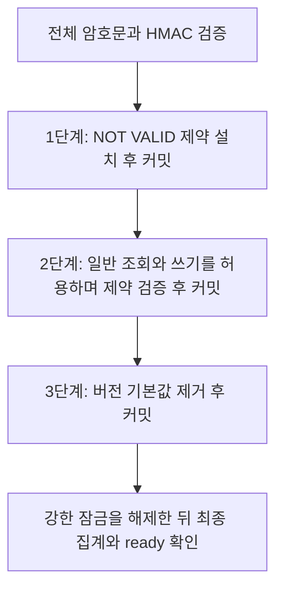

# 최종화의 잠금 시간 측정

2026-11-06 리뷰에서 기존 단일 트랜잭션 결정을 변경했다. 전체 행을 확인하는 동안 일반 조회와 쓰기가
테이블 잠금 때문에 대기하지 않도록, 제약 설치와 검증, 기본값 제거를 각각 커밋한다.



1. `ACCESS SHARE`로 스키마를 확인한다. 필요한 경우 `ACCESS EXCLUSIVE NOWAIT`로 전환해
   `CHECK ... NOT VALID`만 설치하고 커밋한다. 기존 행의 전체 검사는 여기서 하지 않는다.
2. 별도 트랜잭션의 `SHARE UPDATE EXCLUSIVE` 잠금에서 잔존 버전을 집계하고 제약을 검증한다.
   이 테이블 잠금은 일반 `SELECT`와 `INSERT`, `UPDATE`, `DELETE`를 막지 않는다.
3. 별도 트랜잭션에서 정확히 일치하는 검증된 CHECK와 버전 열의 NOT NULL 정보를 확인한다.
   필요한 경우 `ACCESS EXCLUSIVE NOWAIT`를 얻어 `DROP DEFAULT`만 수행하고 커밋한다.
   강한 잠금 안에서는 행 집계나 전체 검증을 하지 않는다.

`ACCESS EXCLUSIVE`는 일반 조회와 쓰기까지 막는 강한 잠금이다. `NOWAIT`는 잠금을 즉시 얻을 수
없으면 기다리지 않고 해당 시도를 실패시킨다. 이 잠금을 요청하기 전에 SQL별 실행 제한과
트랜잭션 안에서 다음 명령을 기다리는 제한을 각각 1초로 설정한다. **전체 잠금 시간이 1초 이내라는 보장은 아니다.**

명령 전체에는 세션 advisory lock을 유지해 다른 `migrate`, `verify`, `finalize`와 겹치지 않게 한다.
`NOT VALID` 제약도 설치 이후 저장하거나 변경한 결과가 v0이면 거절한다. 설치 전에 남은 v0를 자동으로
고치지는 않으며 다음 집계에서 미완료로 판단한다. 제약 검증이나 기본값 제거가 남은 상태는 `ready`를
통과하지 못한다. 실패 시 이미 커밋된 단계를 되돌리지 않고 실제 상태를 확인한 뒤 `finalize`를 재실행한다.
이미 완료한 단계는 확인 후 생략한다.

잠금과 제약 동작은 PostgreSQL 18의 [ALTER TABLE](https://www.postgresql.org/docs/18/sql-altertable.html),
[LOCK](https://www.postgresql.org/docs/18/sql-lock.html), [잠금 호환 관계](https://www.postgresql.org/docs/18/explicit-locking.html),
[시간 제한 설정](https://www.postgresql.org/docs/18/runtime-config-client.html)을 따른다.

## 대상과 판단 기준

- 실제 운영 규모의 DB를 외부 서비스와 격리해 복원하고, 대상과 PostgreSQL 버전, 인덱스, 디스크와 자원을 기록한다.
- 원문이나 키를 새 측정 로그로 복사하지 않는다. 현재 DB EC2의 백업 방식을 확인하며 과거 RDS 자료와 구분한다.
- 팀이 허용하는 조회 차단 시간과 실패 시 중단 기준을 실행 전에 정한다. 코드가 임의로 합격 시간을 정하지 않는다.
- 후보 이미지 ID, 집계 건수, 전체 명령 시간, 잠금 관측 구간, 동시 조회 지연과 `ready` 결과만 기록한다.

후보 CLI가 접속하는 `RESTORE_APP_DIR`의 DB 설정을 먼저 확인한다. 이 경로는 운영 앱 디렉터리가 아닌
복원 환경 전용 배포 묶음이어야 한다. 실제 dev/prod DB를 측정용 대상으로 바꾸지 않는다.

## 실행 순서

1. 복원 DB에서 같은 후보 CLI로 전환과 전수 `verify`를 완료한다. 다른 배포나 DB 관리 작업과 병행하지 않는다.
2. 별도 읽기 전용 DB 연결에서 아래 잠금 관측을 시작한다. 실제 데이터 내용과 쿼리 문자열은 조회하지 않는다.
3. 복원 환경에서 한 번의 `finalize`를 실행한다. 전체 명령 시간과 제약 설치, 검증, 기본값 제거의 잠금 구간을 구분한다.
4. 동시에 내용 없는 조회의 대기 시간을 확인한다. 검증 단계의 조회와 쓰기 확인은 복원 DB의 합성 데이터로
   수행하고, 강한 잠금 시도가 실패한 경우도 기록한다. 종료 후 `status`, 전수 `verify`, `ready`를 확인한다.
5. 처음 최종화하기 전과 동일한 백업으로 다시 복원해 반복한다. 이미 검증한 제약에서의 재실행을 최초 스캔 시간으로 사용하지 않는다.

<details>
<summary>읽기 전용 잠금 관측 SQL</summary>

같은 복원 DB에 접속한 psql 세션에서 실행한다. 세션 계정은 필요한 통계 조회 권한만 사용한다.

```sql
SET default_transaction_read_only = on;
SET statement_timeout = '1s';
SELECT clock_timestamp() AS observed_at, a.pid, a.xact_start,
       l.mode, l.granted, a.wait_event_type, a.wait_event
FROM pg_stat_activity a
JOIN pg_locks l ON l.pid = a.pid
WHERE a.application_name = 'harudle-diary-source-backfill'
  AND l.locktype = 'relation'
  AND l.relation = 'public.diaries'::regclass
  AND l.mode IN ('AccessExclusiveLock', 'ShareUpdateExclusiveLock');
\watch 0.1
```

샘플링은 짧은 잠금을 놓칠 수 있다. 관측 행이 없었다고 0초로 기록하지 않는다.
`granted=false`는 아직 얻지 못한 잠금이며, `xact_start`부터의 시간에는 강한 잠금을 얻기 전의
스키마 확인도 포함되므로 순수 보유 시간으로 해석하지 않는다. 검증 단계의 `ShareUpdateExclusiveLock`을
일반 조회를 막는 `AccessExclusiveLock`의 보유 시간과 합치지 않는다.

</details>

<details>
<summary>전체 명령 시간과 내용 없는 동시 조회</summary>

복원 환경의 후보 이미지 ID와 경로를 검토한 후 실행하는 예다. 접속 비밀번호나 키는 인자로 넣지 않는다.

```bash
: "${RESTORE_APP_DIR:?복원 환경 전용 배포 경로를 지정하세요}"
: "${candidate_image:?검토한 전체 sha256 이미지 ID를 지정하세요}"
/usr/bin/time -p sudo env HARUDLE_APP_DIR="$RESTORE_APP_DIR" \
  bash "$RESTORE_APP_DIR/maintenance/run_diary_source_text_backfill.sh" dev \
  --candidate-image="$candidate_image" finalize
```

전체 명령 시간에는 컨테이너 실행과 키 확인, 전수 검증까지 포함된다. 잠금 시간과 같은 값은 아니며,
완료한 한 명령에서 잠금을 보유한 시간보다 짧을 수는 없는 보수적인 상한으로 사용한다.
별도 읽기 전용 psql 세션에서 `\timing on` 후 `SELECT EXISTS (SELECT 1 FROM public.diaries);`를
잠금 전과 진행 중에 실행한다. 실제 데이터 내용 없이 조회 대기를 비교하고 관측 세션도 종료한다.

</details>

## 결과에 따른 결정

제약 설치와 기본값 제거 때의 실제 조회 지연이 허용 예산 안인지 각각 확인한다. 전체 명령 시간이
예산을 넘었다는 사실만으로 조회 차단이 예산을 넘었다고 판단하지 않고, 잠금 관측과 동시 조회 지연을 함께 본다.
`NOWAIT` 실패가 반복되면 서비스가 덜 바쁜 시간이나 승인한 점검 창에서 재시도한다. 잠금 대기나
시간 제한을 무제한으로 늘리지 않는다. 중간 상태에서는 `ready`가 실패하고 재실행으로 완료할 수 있는지도 확인한다.

**현재 이 문서는 실제 운영 규모의 복원 DB에서 측정한 완료 기록이 아니다.** 운영 배포 전 해당 실측과
판단을 남긴다. 합성 데이터, 로컬 실행, CI 결과는 운영 규모와 자원에서의 차단 시간 증거로 대체하지 않는다.
