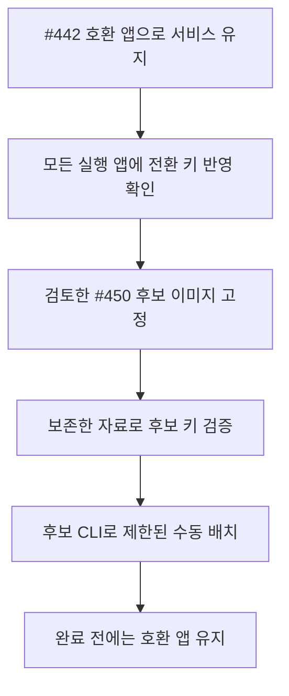
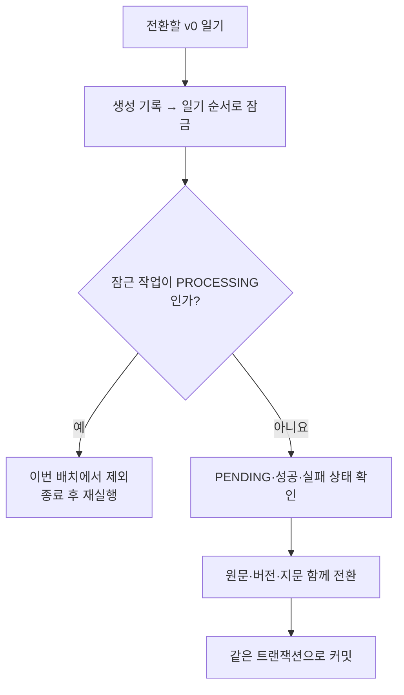
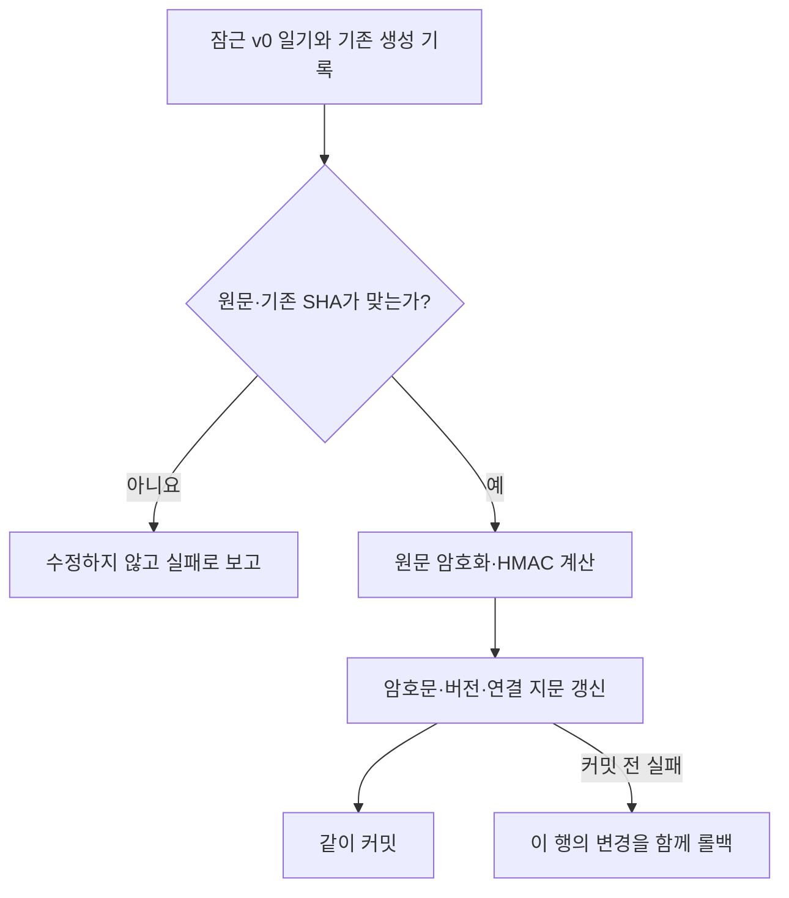
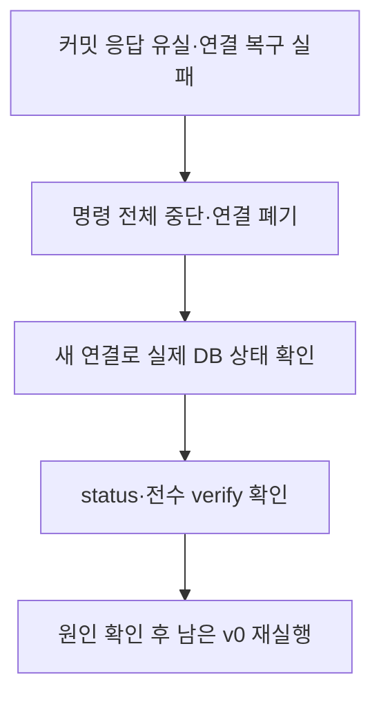
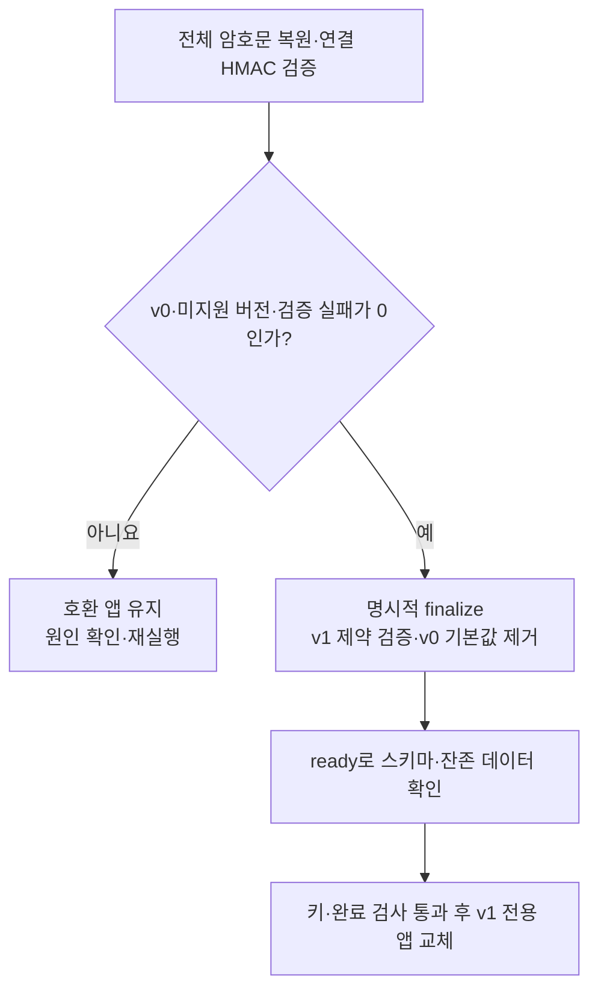
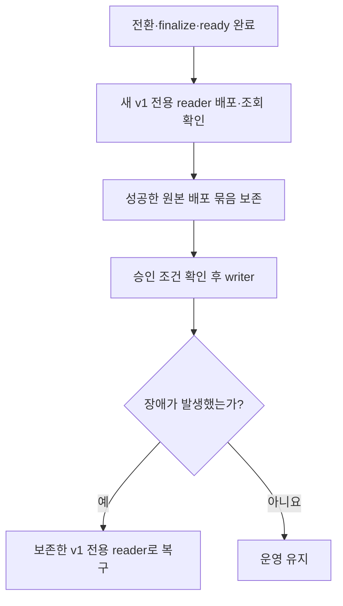

# 기존 일기 원문 전환: 상황별 동작

기존 평문·SHA 지문을 암호문·HMAC으로 바꾸고 평문 호환 경로를 닫는 #450의 흐름이다.
일반 접수·worker·본인 조회는 [암호화 시나리오](diary-source-text-encryption-scenarios.md),
명령·키·배포 조건은 [운영 안내](diary-source-text-encryption.md),
선택 근거는 [전환 ADR](adr/2026-10-20_기존%20일기%20원문과%20지문을%20어떻게%20온라인%20전환하고%20평문%20경로를%20닫을%20것인가_아이큐.md)를 참고한다.

| 상황 | 바로가기 |
| --- | --- |
| 서비스 중 전환을 준비한다 | [M01](#m01-서비스를-유지하며-전환을-준비할-때) |
| 배치와 worker가 같은 작업을 가져간다 | [M02](#m02-배치와-worker가-같은-작업을-처리하려-할-때) |
| 한 일기의 원문·지문을 전환한다 | [M03](#m03-한-일기의-원문과-지문을-함께-바꿀-때) |
| 커밋이나 연결 상태를 확인할 수 없다 | [M04](#m04-커밋이나-연결-상태가-불명확할-때) |
| 전체 전환을 확정하고 앱을 교체한다 | [M05](#m05-전체-전환을-확정하고-앱을-교체할-때) |
| 전환 뒤 장애나 과거 백업을 복구한다 | [M06](#m06-전환-뒤-장애나-과거-백업을-복구할-때) |

## M01. 서비스를 유지하며 전환을 준비할 때

전환 중의 DB에는 평문과 암호문이 섞일 수 있어 #442 호환 앱을 유지한다. #450의 일반 앱은
평문을 읽지 않으므로 배치를 시작한다는 이유로 서비스 컨테이너부터 교체하지 않는다.

후보가 사용하는 키는 현재 **모든 서비스 앱이 이미 읽을 수 있어야** 한다. 호스트 설정 파일을
바꾸는 것만으로 실행 중 앱의 키링이 갱신되지는 않는다. 후보의 키 검증 통과도 각 앱의 반영을
증명하지 않으므로 키링 반영 배포와 조회 확인 기록을 남긴다.

배치는 자동 배포나 앱 시작에서 실행하지 않는다. 행이 숨겨지거나 누락될 수 있는 RLS·스키마·필수
키·제약 조건 문제는 명령을 거절하며, 검사를 우회해 완료로 집계하지 않는다.

v0·v1·후보 CLI란?

v0는 기존 평문, v1은 암호문 저장 버전이다. 후보 CLI는 새 앱을 서비스로 띄우지 않고 실행하는
전용 전환 도구다. 후보의 암호화·지문 코드를 사용하지만 AI 생성이나 Flyway를 자동 실행하지 않는다.

관련 코드: [후보 CLI](../src/main/java/com/harudle/diary/infrastructure/crypto/DiarySourceTextBackfillMain.java),
[수동 실행 도구](../../deploy/scripts/run_diary_source_text_backfill.sh),
[스키마 확인](../src/main/java/com/harudle/diary/infrastructure/migration/DiarySourceTextMigration.java).

## M02. 배치와 worker가 같은 작업을 처리하려 할 때

생성 기록이 연결된 v0 일기를 전환하는 흐름이다.

- **배치가 먼저 잠근 경우:** worker의 `SKIP LOCKED`가 그 생성 기록을 건너뛴다. `PENDING`의
  원문과 지문을 함께 전환한 뒤 잠금을 풀며, 이후 선점은 기존 조건을 따른다.
- **worker가 먼저 선점한 경우:** 작업이 `PROCESSING`으로 바뀐다. 배치는 잠금을 얻은 뒤 이
  상태를 확인해 원문·지문을 바꾸지 않고, 작업 종료 후 다시 처리한다.

배치는 생성 상태·생성 시각·사용량을 바꾸지 않는다. 전환이 대기 작업을 새로 접수하거나 만료
시간을 연장하는 것은 아니다. 전환의 원자성만으로 안전하다고 판단하지 않고 선점 상태와 잠금도 확인한다.

PENDING·PROCESSING·SKIP LOCKED란?

PENDING은 실행 전 대기, PROCESSING은 worker가 선점한 상태다. SKIP LOCKED는 다른 처리가
잠근 행을 이번 조회에서 건너뛰는 방식이다. 배치와 worker가 한 작업의 원문·지문을 서로 다른
세대로 읽지 않도록 같은 생성 기록의 잠금을 사용한다.

관련 코드: [행별 전환](../src/main/java/com/harudle/diary/infrastructure/migration/DiarySourceTextMigration.java),
[worker 선점](../src/main/java/com/harudle/generation/diary/service/PendingDiaryGenerationClaimService.java),
[대기 작업 잠금 조회](../src/main/java/com/harudle/generation/diary/repository/DiaryGenerationRepository.java).

## M03. 한 일기의 원문과 지문을 함께 바꿀 때

연결된 생성 기록이 있으면 기존 요청 지문을 원문으로 재계산해 확인한 뒤 새 HMAC으로 바꾼다.
원문·버전·지문 중 일부만 확정하지 않는다. 기존 원문이나 SHA가 맞지 않으면 임의로 정정하지 않는다.

이미 v1인 일기는 다시 암호화하지 않는다. 삭제된 일기도 포함하고, 생성 기록 없는 일기는 원문을
전환하되 없는 지문을 새로 만들지 않는다. 생성 기록이 없는 일기의 집계는 그 자체로 오류 건수가 아니다.

정상적으로 롤백한 일반 SQL·실행 오류는 행 실패로 집계하고 다음 대상을 처리할 수 있다.
`Error`가 발생하면 해당 행의 변경을 함께 롤백한 뒤 명령 전체를 중단한다. 커밋 응답이나 연결 자체가
불명확하면 계속 진행하지 않고 [M04](#m04-커밋이나-연결-상태가-불명확할-때)를 따른다.

원자 전환·HMAC이란?

원자 전환은 한 행에서 바꿀 원문·버전·연결 지문을 모두 함께 확정하거나 함께 되돌린다는 뜻이다.
HMAC은 서버의 비밀 키가 필요한 지문 보호 값이다. 기존 SHA와 HMAC은 길이가 같아 문자열의
길이나 모양만으로 전환 완료를 판단하지 않는다.

관련 코드: [원문·지문 전환과 롤백](../src/main/java/com/harudle/diary/infrastructure/migration/DiarySourceTextMigration.java).

## M04. 커밋이나 연결 상태가 불명확할 때

응답을 잃었다고 DB 변경이 롤백됐다고 단정하지 않는다. 이미 커밋됐을 수도 있어 수동으로 버전을
되돌리거나 같은 연결에서 다음 행을 처리하지 않는다. 새 연결에서 실제 상태를 확인하고 재개한다.

자동 커밋 복원은 커밋 또는 롤백의 완료를 확인한 뒤에만 수행한다.
미완료 트랜잭션에서 자동 커밋을 켜면 변경이 확정될 수 있기 때문이다.
[JDBC 명세](https://docs.oracle.com/en/java/javase/21/docs/api/java.sql/java/sql/Connection.html#setAutoCommit(boolean))를 따른다.
결과가 불명확한 연결은 폐기하며, 정리 중 오류가 원래 실패를 덮지 않도록 한다. 직접 CLI를 실행한
경우에도 원본 오류·SQL 진단 대신 기존 고정 실패 문구와 종료 코드만 제공한다.

`finalize`의 응답이 유실된 경우에도 스키마 변경의 반영 여부를 `status`·`ready`로 확인한다.
운영 출력에는 집계만 남기며 원문·암호문·키·지문·SQL 진단을 복구 기록에 복사하지 않는다.

관련 코드: [트랜잭션과 불확실한 연결 처리](../src/main/java/com/harudle/diary/infrastructure/migration/DiarySourceTextMigration.java).

## M05. 전체 전환을 확정하고 앱을 교체할 때

`verify`는 모든 v1 원문을 인증 복호화하고 연결된 지문을 HMAC으로 재계산해 대조한다. `finalize`는
이를 확인하고 테이블 잠금 아래 v0·미지원 버전을 다시 점검한 뒤 v1 전용 제약을 검증·적용한다.

`migrate`의 미완료 결과나 `status`의 정상 종료는 완료가 아니다. 배포 전에는 키 검증과 `ready`의
종료 코드·허용된 완료 JSON을 함께 확인하고, 앱의 운영 시작 검사도 미완료 DB를 거절한다.

finalize·ready는 어떻게 다른가?

finalize는 전수 검증 후 DB를 v1 전용으로 확정하는 수동 작업이다. ready는 검증된 v1 제약과 버전 열의
필수값·기본값 제거, 남은 저장 버전을 확인한다. ready가 배치나 전수 검증을 대신 실행하지는 않는다.

관련 코드: [전수 검증·완료 확정](../src/main/java/com/harudle/diary/infrastructure/migration/DiarySourceTextMigration.java),
[앱 시작 검사](../src/main/java/com/harudle/diary/infrastructure/migration/DiarySourceTextReadinessConfiguration.java),
[교체 전 검사](../../deploy/scripts/diary_key_verification.sh).

## M06. 전환 뒤 장애나 과거 백업을 복구할 때

새 reader의 성공·조회·동일 요청 재조회·신규 접수 차단을 확인하고 원본을 보존한 뒤 writer를 연다.
prod writer 승인서는 해당 복구본을 반영해 확인한다. 전환 완료 이후에는 v0 읽기가 남은 #442
호환 reader·writer를 복구 대상으로 사용하지 않는다.

과거 v0 백업은 격리된 환경에서 전환·전수 검증·finalize를 다시 마친 뒤 서비스에 연결한다.
DB를 평문으로 되돌리거나 v1 제약·버전 열을 없애서 앱을 시작하지 않는다.

이번 reader와 #442 reader의 차이

reader는 신규 일기 접수를 막는 복구용 모드이며, DB 전체를 읽기 전용으로 만드는 것은 아니다.
#442 reader는 전환 전 v0/v1 호환용이고, #450 reader는 완료된 DB를 읽는 v1 전용 복구본이다.
같은 이름의 모드라도 보존해야 할 코드와 배포 묶음이 다르다.

현재 DB 전환만으로 과거 백업·WAL·이전 행의 평문이 삭제되지는 않는다. 새 v1 백업을 실제로 복원해
확인한 뒤 자료별 보관 책임자·승인 만료일·폐기 결과를 기록한다. 필요한 구키도 보존한다.
**이 문서는 실제 dev/prod 전환·백업 복원·폐기 완료의 기록이 아니다.**

운영 조건은 [배포 안내](../../deploy/README.md), 과거 자료는
[백업 보존·폐기 정책](diary-source-text-backup-policy.md)을 따른다.
