# 기존 일기 원문 전환: 상황별 동작

운영자는 이미 저장된 일기의 평문을 암호문으로 바꾸고, 연결된 요청 지문도 HMAC으로 바꾼다.
전환이 모두 끝나면 DB와 앱에서 평문을 허용하던 경로를 닫는다. 이 문서는 그 과정에서
서비스 요청, 생성 작업과 전환 도구가 서로 충돌하지 않도록 처리하는 방법을 설명한다.

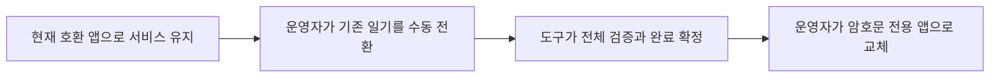

일반 일기 생성과 본인 조회는 [암호화 시나리오](diary-source-text-encryption-scenarios.md),
실행 명령과 키 조건은 [운영 안내](diary-source-text-encryption.md)를 참고한다.
전환 방식을 선택한 이유는 [전환 ADR](adr/2026-10-20_기존%20일기%20원문과%20지문을%20어떻게%20온라인%20전환하고%20평문%20경로를%20닫을%20것인가_아이큐.md)에 있다.

## 상황별 바로가기

- [M01: 서비스를 유지하며 준비](#m01-서비스를-유지하며-전환을-준비할-때)
- [M02: 전환 도구와 생성 작업이 같은 일기를 처리](#m02-배치와-worker가-같은-작업을-처리하려-할-때)
- [M03: 원문과 지문을 함께 변경](#m03-한-일기의-원문과-지문을-함께-바꿀-때)
- [M04: 저장 결과나 연결 상태를 확인할 수 없는 경우](#m04-커밋이나-연결-상태가-불명확할-때)
- [M05: 전환을 확정하고 앱 교체](#m05-전체-전환을-확정하고-앱을-교체할-때)
- [M06: 전환 뒤 장애나 과거 백업 복구](#m06-전환-뒤-장애나-과거-백업을-복구할-때)

코드는 어떤 역할로 나뉘었나?

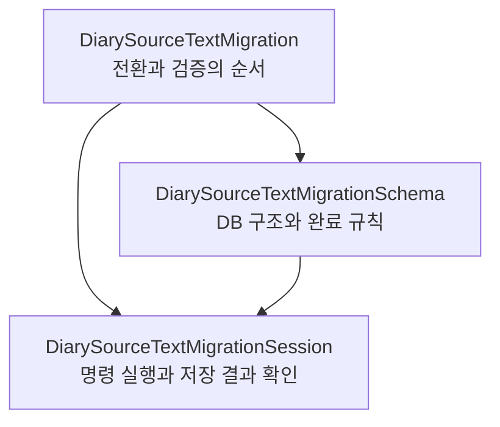

## M01. 서비스를 유지하며 전환을 준비할 때

전환 도중에는 DB에 평문 일기와 암호문 일기가 함께 있다. 운영자는 둘 다 읽을 수 있는
#442 기반 호환 앱으로 서비스를 유지하고, 검토한 별도 유지보수 이미지의 전환 도구를 실행한다.
암호문 전용 앱으로 서비스 컨테이너를 교체하는 시점은 전환 완료 후다.

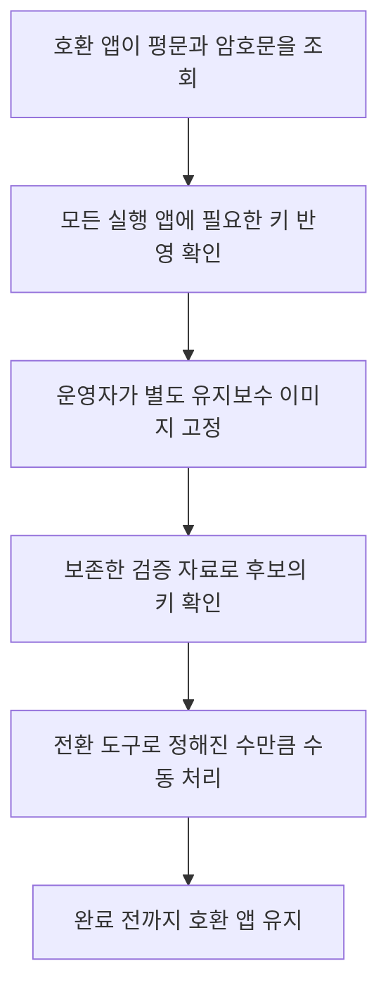

후보 이미지가 사용하는 키로 만든 암호문은 **현재 실행 중인 모든 서비스 앱이 읽을 수 있어야 한다.**
서버 설정 파일만 바꿔서는 이미 실행 중인 앱의 키 목록이 바뀌지 않는다. 각 앱에 키를 반영한
배포 기록과 실제 조회 결과를 확인한다. 후보 이미지의 키 검사 성공만으로 이를 대신하지 않는다.

게스트 일기 가져오기를 계속 허용하려면 현재 호환 앱에 #545의 소유권 이전 수정도 먼저 배포한다.
미반영 상태라면 전환 동안 가져오기 요청을 중단한다. 과거 이전 이력과 불일치 데이터 확인 조건은
[전환 전 확인](diary-source-text-encryption.md#전환-전-확인과-명령)을 따른다.

전환은 자동 배포나 앱 시작에서 실행하지 않는다. DB 구조, 필수 키 또는 조회 범위에 문제가
있으면 도구가 작업을 거절한다. 보이지 않는 행을 빼놓고 완료로 판단하지 않기 위해서다.

v0, v1, 전환 도구와 DB 구조란?

- **v0와 v1**은 `source_text_version`에 저장하는 버전이다. v0는 평문이고 v1은 암호문이다.
- **Command Line Interface(CLI, 명령줄 인터페이스)**는 명령으로 도구를 실행하는 방식이다.
  여기서는 새 앱을 서비스로 띄우지 않고 전환 도구만 실행한다. AI 생성과 Flyway는 시작하지 않는다.
- **Schema(스키마)**는 DB의 테이블, 열과 저장 규칙을 뜻한다.
- **Row-Level Security(RLS, 행 수준 보안)**는 접속자에 따라 보이는 행을 제한하는 DB 기능이다.
  전환 도구는 이 기능으로 일부 행이 숨겨질 수 있는 구성을 거절한다.

관련 코드: [전환 도구 진입점](../src/maintenance/java/com/harudle/diary/infrastructure/crypto/DiarySourceTextBackfillMain.java),
[수동 실행 스크립트](../../deploy/scripts/run_diary_source_text_backfill.sh),
[DB 구조 검사](../src/main/java/com/harudle/diary/infrastructure/migration/DiarySourceTextMigrationSchema.java).

## M02. 배치와 worker가 같은 작업을 처리하려 할 때

Worker(작업 처리기)는 대기 중인 이미지 생성을 실행한다. 전환 도구와 작업 처리기가 같은
일기를 동시에 처리하려 하면, 먼저 잠근 쪽이 작업하고 다른 쪽은 다음 기회를 기다린다.
둘 다 **생성 기록을 먼저 잠그고 일기를 잠그는 순서**를 지킨다.

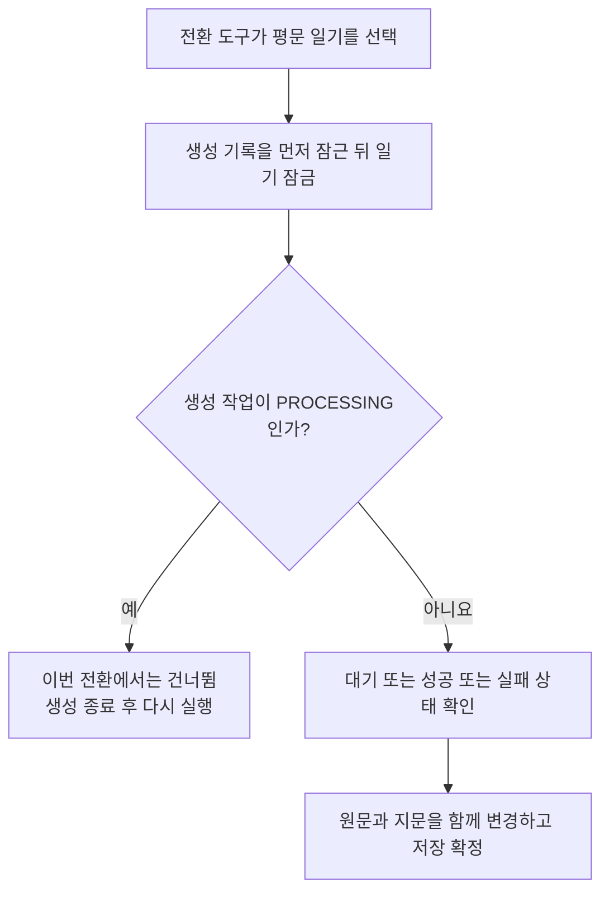

- **전환 도구가 먼저 잠그면:** 작업 처리기는 그 생성 기록을 건너뛴다. 전환 도구가 원문과
  지문을 함께 바꾼 뒤 잠금을 풀면, 작업 처리기가 기존 실행 조건에 따라 다시 확인한다.
- **작업 처리기가 먼저 실행을 맡으면:** 상태가 `PROCESSING`으로 바뀐다. 전환 도구는 이를
  확인하고 원문과 지문을 보존한다. 생성 작업이 끝나면 운영자가 전환을 다시 실행한다.

`migrate`는 조회할 때마다 다른 처리가 저장한 최신 결과를 읽어야 하므로 `READ_COMMITTED`
설정의 DB 연결만 허용한다. 다른 설정은 쓰기 전에 거절하며 도구가 연결 설정을 바꾸지 않는다.
생성 기록이 없는 일기도 잠근 뒤 새로 연결된 생성 기록이 있는지 다시 확인한다.

전환 도구는 생성 상태, 생성 시각과 사용량을 바꾸지 않는다. 대기 작업을 다시 접수하거나
대기 만료 시간을 늘리는 작업도 수행하지 않는다.

PENDING, PROCESSING, SKIP LOCKED란?

`PENDING`은 실행 전 대기 상태이고, `PROCESSING`은 작업 처리기가 실행을 맡은 상태다.
`SKIP LOCKED`는 다른 처리가 잠근 행을 이번 조회에서 건너뛰는 DB 기능이다.
배치는 `PROCESSING`을 제외하므로 정상 실행 중인 작업의 원문과 지문을 바꾸지 않는다.
이미 종료된 작업의 옛 실행 명령은 전환 뒤 새 지문과 달라 거절될 수 있다.

관련 코드: [행별 전환](../src/maintenance/java/com/harudle/diary/infrastructure/migration/DiarySourceTextMigration.java),
[생성 작업 선점](../src/main/java/com/harudle/generation/diary/service/PendingDiaryGenerationClaimService.java),
[대기 작업 조회](../src/main/java/com/harudle/generation/diary/repository/DiaryGenerationRepository.java).

## M03. 한 일기의 원문과 지문을 함께 바꿀 때

전환 도구는 기존 원문으로 요청 지문을 다시 계산해 저장된 SHA 지문과 비교한다.
값이 맞으면 원문을 암호화하고 새 HMAC 지문을 만든다. **암호문, 저장 버전과 지문은
모두 함께 확정하거나 모두 함께 취소한다.**

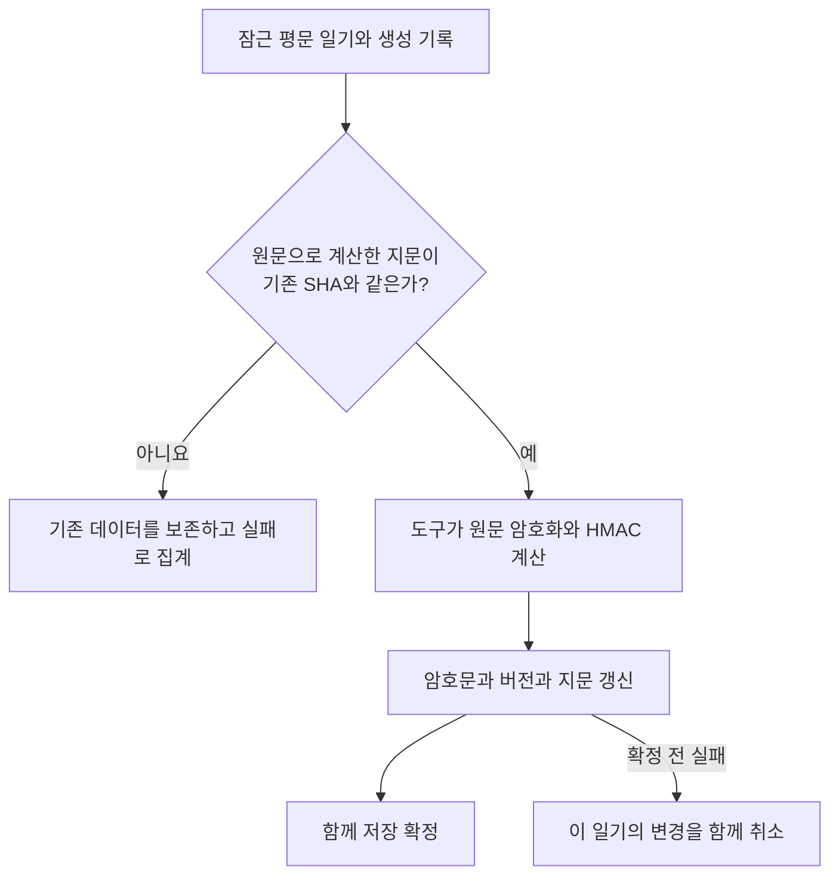

기존 원문이나 SHA가 맞지 않는 행은 도구가 임의로 고치지 않는다. 이미 v1인 행도 다시
암호화하지 않는다. 삭제된 일기는 전환 대상에 포함한다. 생성 기록이 없는 일기는 원문만
전환하고 지문을 새로 만들지 않으며, 기록이 없다는 이유만으로 실패로 세지 않는다.

일반적인 DB 명령 오류에서 변경 취소가 확인되면 해당 행을 실패로 집계하고 다음 행을
처리할 수 있다. Java의 `Error`가 발생하면 해당 행의 변경을 취소하고 명령 전체를 중단한다.
저장 결과나 연결 상태를 확인할 수 없으면 [M04](#m04-커밋이나-연결-상태가-불명확할-때)를 따른다.

요청 지문과 함께 저장한다는 뜻

요청 지문은 같은 요청을 다시 보냈는지 비교하는 값이다. 기존 SHA 지문은 DB에 있는 작성자와 날짜, 원문 후보로
다시 계산할 수 있다. HMAC 지문은 서버의 비밀 키도 있어야 계산할 수 있다.
두 값은 길이가 같으므로 문자열 길이나 모양만으로 전환 완료를 판단하지 않는다.

Transaction(트랜잭션)은 여러 DB 변경을 한 묶음으로 처리하는 범위다.
Commit(커밋)은 변경을 확정하는 작업이고, Rollback(롤백)은 아직 확정하지 않은 변경을 취소하는 작업이다.

관련 코드: [원문과 지문의 동시 전환](../src/maintenance/java/com/harudle/diary/infrastructure/migration/DiarySourceTextMigration.java),
[저장 확정과 취소](../src/main/java/com/harudle/diary/infrastructure/migration/DiarySourceTextMigrationSession.java).

## M04. 커밋이나 연결 상태가 불명확할 때

DB가 변경을 저장했는데 도구가 성공 응답을 받지 못할 수 있다. 도구는 이때 전체 작업을
멈추고 해당 연결을 폐기한다. 운영자는 새 연결에서 실제 DB 상태를 확인한 뒤 재개한다.

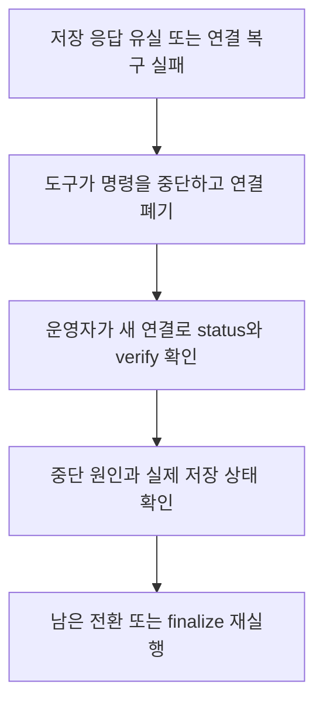

응답이 없었다는 이유로 저장이 취소됐다고 단정하지 않는다. 버전을 수동으로 되돌리거나
결과가 불명확한 연결로 다음 행을 처리하지 않는다. 이미 전환된 행은 재실행해도 다시 암호화하지 않는다.

`finalize`는 일부 단계만 저장된 상태에서 멈출 수 있다. `status`와 `ready`로 완료 여부를
확인하고, 남은 단계가 있으면 원인 확인 후 `finalize`를 재실행한다.

왜 자동 커밋을 바로 복원하지 않나?

Auto-Commit(자동 커밋)은 각 DB 명령을 자동으로 확정하는 연결 설정이다. 아직 끝나지 않은
트랜잭션에서 이 설정을 켜면 변경이 확정될 수 있다. 따라서 도구는 커밋이나 롤백이 끝났음을
확인한 뒤에만 설정을 복원한다. [JDBC 명세](https://docs.oracle.com/en/java/javase/21/docs/api/java.sql/java/sql/Connection.html#setAutoCommit(boolean))를 따른다.

연결을 정리하다 다시 오류가 나도 처음 발생한 오류를 덮지 않는다. 도구의 출력에는 집계와
정해진 실패 코드만 남긴다. 원문, 암호문, 키, 지문과 SQL의 원본 오류를 복구 기록에 복사하지 않는다.

관련 코드: [불확실한 저장 결과와 연결 처리](../src/main/java/com/harudle/diary/infrastructure/migration/DiarySourceTextMigrationSession.java).

## M05. 전체 전환을 확정하고 앱을 교체할 때

운영자는 `finalize`로 DB를 암호문 전용으로 확정한다. 도구는 모든 일기를 복호화하고 HMAC을
다시 계산해 먼저 검증한다. 평문, 미지원 버전이나 검증 실패가 있으면 완료를 확정하지 않는다.
검증을 통과하면 아래 세 단계를 각각 저장한다. DB 구조와 필요한 제약 정보는 강한 잠금을
요청하기 전에 확인한다.

### 1. 새 평문 저장을 막는 규칙 설치

기존 행 검증을 시작하기 전에 새 평문이 들어오지 못하게 막는다. `CHECK ... NOT VALID`만
설치하며, 기존 일기의 전체 검사는 이 단계에서 하지 않는다.

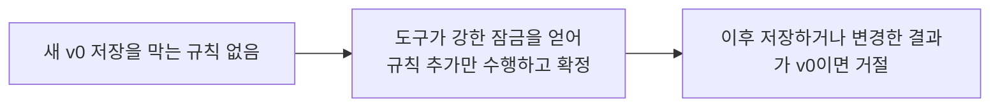

### 2. 기존 일기 전체가 규칙에 맞는지 확인

전체 행 검사는 시간이 걸릴 수 있으므로, 일반 조회와 쓰기를 허용하는
`SHARE UPDATE EXCLUSIVE` 잠금에서 수행한다.

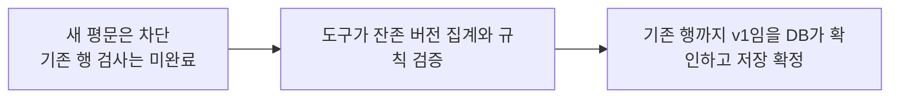

### 3. 버전 기본값 제거

정확한 v1 규칙이 검증됐고 버전 열에 빈 값을 허용하지 않으면, 행을 다시 세지 않고도
기본값을 제거할 수 있다. 강한 잠금에서는 `DROP DEFAULT`만 수행한다.

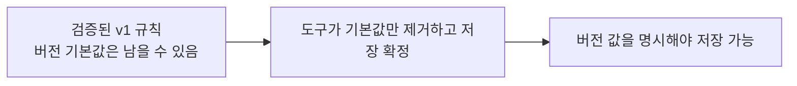

두 강한 잠금 아래에서는 행 집계나 전체 검증을 하지 않는다. 잠금은 `NOWAIT`로 요청한다. 즉시 얻을 수 없으면 기다리지 않고 실패하므로 원인을
확인한 뒤 재실행한다. 각 SQL 실행과 다음 명령을 기다리는 시간을 각각 1초로 제한하지만,
**전체 잠금 시간이 1초 이하라는 뜻은 아니다.** 실제 조회 지연은
[복원 DB 측정 절차](diary-source-text-finalize-measurement.md)로 확인한다.

세 단계 사이에도 같은 실행 잠금을 유지해 다른 `migrate`, `verify`, `finalize`가 끼어들지
못하게 한다. 일부 단계만 저장됐으면 이를 되돌리지 않고 재실행하며, 완료된 단계는 확인 후 생략한다.

### 완료 확인과 앱 교체

운영자는 강한 잠금이 해제된 뒤의 집계와 `ready` 결과를 확인한다. 제약 검증이나 기본값 제거가
남았으면 `ready`가 거절한다. 배포 전 키 검사와 완료 검사도 통과해야 암호문 전용 앱으로 교체한다.
배포와 앱 시작의 `ready`는 서버에 남긴 전용 검사다. 사용자 테이블을 세거나 JOIN하지 않고
검증된 DB 제약과 버전 열의 상태를 읽는다. 수동 전환 도구는 일반 서버 빌드에 포함하지 않는다.

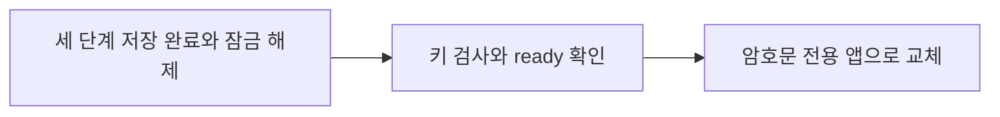

`migrate`의 미완료 결과나 `status`의 정상 종료는 전환 완료가 아니다. 배포 검사는 종료 코드와
허용된 완료 JSON을 함께 확인한다. 앱도 시작할 때 미완료 DB를 거절한다.

finalize, ready와 잠금 이름의 뜻

- **finalize**는 전체 데이터 검증 후 DB의 저장 규칙을 확정하는 수동 명령이다.
- **ready**는 정확한 검증 완료 v1 제약, 버전 열의 필수값과 기본값 제거를 DB 구조 정보로 확인한다.
  `CHECK (source_text_version = 1)`이 기존 행까지 검증됐고 빈 값을 허용하지 않으면 남은 버전을 다시 세지 않아도 된다.
  일기를 전환하거나 모든 암호문을 다시 복호화하지 않는다. 성공 결과는 `{"command":"ready","ready":true}`다.
- **Constraint(제약 조건)**는 DB가 새 데이터나 변경된 데이터를 받아들일 때 확인하는 규칙이다.
  `NOT VALID`는 기존 행의 전체 검사를 미룬다는 뜻이다. 설치 후의 저장과 변경에는 즉시 적용된다.
- **ACCESS EXCLUSIVE**는 일반 조회와 쓰기까지 막는 테이블 잠금이다.
  **SHARE UPDATE EXCLUSIVE**는 여기서 전체를 검증하는 동안 일반 조회와 쓰기를 허용한다.
- **Session Advisory Lock(세션 권고 잠금)**은 도구가 같은 DB 연결에서 유지하는 실행 잠금이다.
  각 단계의 커밋 이후에도 유지되며 다른 전환 명령의 동시 실행을 막는다.

관련 코드: [전체 검증과 완료 순서](../src/maintenance/java/com/harudle/diary/infrastructure/migration/DiarySourceTextMigration.java),
[제약 설치와 검증](../src/main/java/com/harudle/diary/infrastructure/migration/DiarySourceTextMigrationSchema.java),
[짧은 강한 잠금 요청](../src/main/java/com/harudle/diary/infrastructure/migration/DiarySourceTextMigrationSession.java),
[완료 조건 검사](../src/main/java/com/harudle/diary/infrastructure/migration/DiarySourceTextReadiness.java),
[앱 시작 검사](../src/main/java/com/harudle/diary/infrastructure/migration/DiarySourceTextReadinessConfiguration.java),
[배포용 완료 검사 진입점](../src/main/java/com/harudle/diary/infrastructure/crypto/DiarySourceTextReadinessMain.java),
[배포 전 검사](../../deploy/scripts/diary_key_verification.sh).

## M06. 전환 뒤 장애나 과거 백업을 복구할 때

운영자는 새 암호문 전용 앱을 먼저 `reader` 모드로 배포한다. 조회가 정상이고 신규 일기 접수가
막히는지 확인해 복구용 배포본을 보존한다. 그다음 승인 조건을 확인하고 `writer` 모드를 연다.

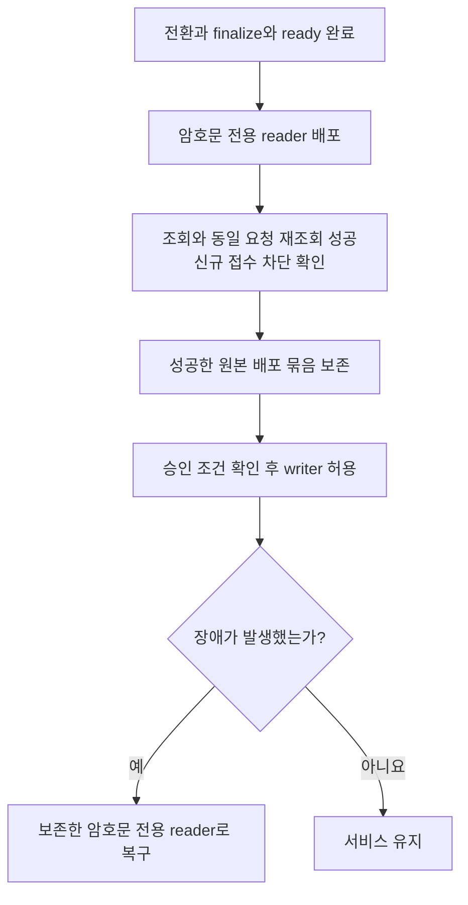

prod writer 승인서도 이 복구본을 반영해 확인한다. 완료 후에는 평문 읽기가 남아 있는
#442 호환 앱을 복구 대상으로 선택하지 않는다. 과거 평문 백업은 격리 환경에서 전환,
전체 검증과 `finalize`를 다시 마친 뒤 서비스에 연결한다. DB를 평문으로 되돌리거나
v1 제약과 버전 열을 없애서 앱을 시작하지 않는다.

reader, writer, WAL 용어

`reader`는 신규 일기 접수를 막는 모드다. DB 전체를 읽기 전용으로 만드는 것은 아니다.
`writer`는 승인 조건을 충족한 뒤 신규 일기 작성을 허용하는 모드다.

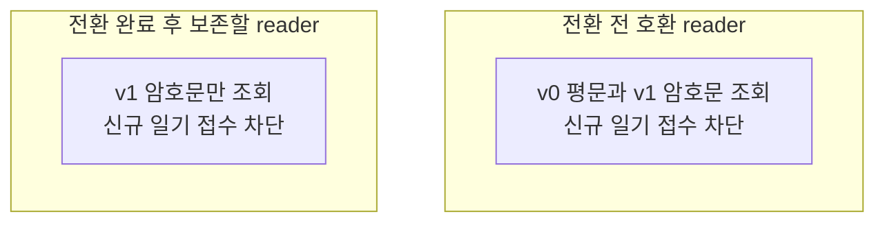

모드 이름이 같아도 읽을 수 있는 데이터가 다르다. 완료 후에는 암호문 전용 코드와 원본 배포 묶음을 보존한다.

Write-Ahead Log(WAL, 선행 기록 로그)는 DB 변경 내용을 남기는 복구용 기록이다.
과거 기록에는 전환 전 평문이 남아 있을 수 있어 백업과 함께 보관과 폐기 대상을 확인한다.

현재 DB를 전환해도 과거 백업, DB 복구 기록인 WAL과 이전 행에 평문이 남을 수 있다. 새 v1 백업을
실제로 복원해 확인한 뒤 자료별 보관 책임자, 승인 만료일과 폐기 결과를 기록한다.
필요한 이전 키도 보존한다. **이 문서는 실제 dev/prod 전환, 백업 복원과 폐기 완료의 기록이 아니다.**

운영 조건은 [배포 안내](../../deploy/README.md), 과거 자료는
[백업 보존과 폐기 정책](diary-source-text-backup-policy.md)을 따른다.
