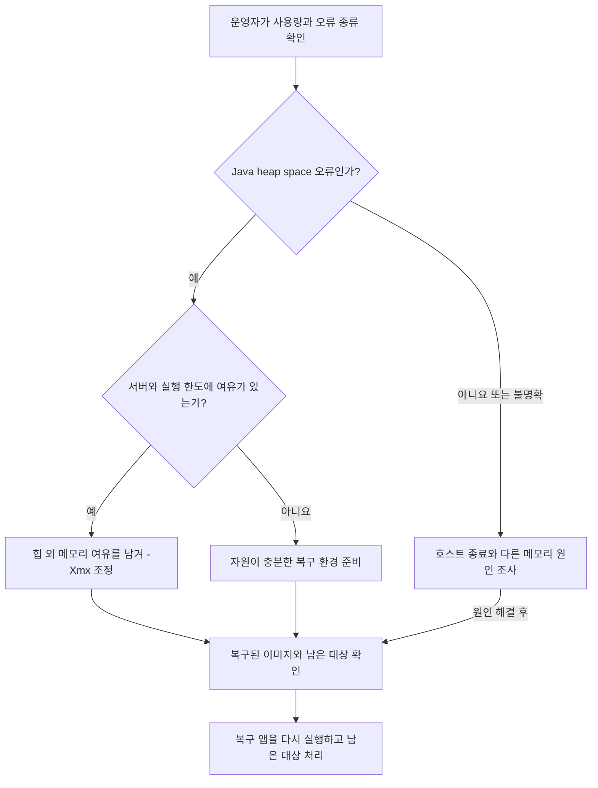

# 키 장애 중 이미지 복구

일기 암호화 키를 복원하는 작업과 이미지 파일을 복원하는 작업은 별개다.
정상 앱은 키 검증과 DB 전환 완료 검사를 모두 통과해야 시작한다. 이미지 복구가 먼저 필요하면
`ImageRecoveryApplication`을 별도 프로세스로 실행한다. 원문 암호화 키와 검증 파일은 필요하지 않다.
JWT 인증 키와 DB, S3 및 사용할 경우 R2 설정은 필요하다. 키 백업 복원은 여전히 따로 진행해야 한다.

## 복구 앱이 하는 일

| 경로 | 역할 |
| --- | --- |
| `POST /api/v1/admin/generations/restore-image/r2` | 기존 R2 백업으로 S3 이미지 복원 또는 dry-run |
| `POST /api/v1/admin/generations/restore-image/upload` | 보관한 이미지를 직접 업로드 |
| `POST /api/v1/admin/generations/{generationId}/restore-image` | 남은 원본으로 변형 이미지 복원 또는 저장된 스토리보드로 재생성 |
| `GET /api/v1/auth/csrf` | CSRF 쿠키와 요청 토큰 발급 |
| `POST /api/v1/auth/refresh` | 기존 Refresh Token 쿠키로 Access Token 갱신 |

복구 요청은 기존 JWT와 현재 DB의 관리자 권한, 계정 제재, 활성화된 약관 수락 정책을 검사한다.
모든 변경 요청에는 Bearer 토큰이 있어도 CSRF 쿠키와 `X-XSRF-TOKEN` 헤더가 필요하다.
일기 상세, 신규 생성, 다른 관리자 API와 OAuth 로그인 경로는 열지 않는다.

앱 전체를 스캔하지 않으므로 일기 암호화와 생성 worker, 만료 정리, 백업 스케줄러와
초기 데이터 등록 작업이 실행되지 않는다. Flyway와 SQL 초기화를 제외하고 Hibernate는
기존 스키마를 확인만 한다. 스키마 변경 설정이나 일반 처리기가 섞이면 시작을 거절한다.
이미지 복구는 생성 상태, 일기 원문과 사용량을 변경하지 않는다. 토큰 갱신은 기존 정책대로
인증 세션과 Refresh Token을 회전한다.

## 실행 순서

1. 신규 요청을 차단하고 정상 백엔드를 중지한다. 진행 중인 생성 작업을 종료할 시간을 준다.
   같은 DB를 사용하는 다른 정상 앱도 실행 중이지 않은지 확인한다. reader만으로는 worker가 멈추지 않는다.
2. 검토한 이미지와 권한 `600`의 해당 환경 파일을 준비한다. DB 주소와 JWT 인증 키를 유지한다.
   일기 키나 canary를 새로 만들거나 임시 키를 넣지 않는다.
3. 아래 수동 명령을 실행한다. CodeDeploy의 정상 배포 경로와 연결하지 않는다.

```bash
sudo deploy/scripts/run_image_recovery.sh <검토한-이미지-ID-또는-digest> /opt/harudle/.env
```

스크립트는 실행 중인 `harudle` Compose 백엔드가 있으면 중단하고, 복구 포트는
`127.0.0.1:18080`으로만 연다. 기존 컨테이너를 교체하거나 재시작하지 않는다.
기본 Docker 네트워크는 `harudle_app`이며 필요한 경우 `HARUDLE_RECOVERY_NETWORK`로 지정한다.
관리자 연결은 SSH 터널을 사용한다. 인증 토큰과 이미지 원본을 공개 URL이나 작업 기록에 넣지 않는다.

기본 모드는 R2와 직접 업로드, 남아 있는 원본 및 썸네일 복구에 사용한다.
AI로 다시 그려야 하면 기존 이미지 공급자 설정과 함께 `HARUDLE_IMAGE_RECOVERY_AI_ENABLED=true`를
명시한다. 원문 대신 기존 스토리보드와 현재 이미지 스타일 및 기준 이미지를 사용한다.
Vertex 인증 파일이 필요한 환경은 `HARUDLE_RECOVERY_GCP_FILE=/etc/harudle/gcp/gcp-wif.json`을
명시한다. 스크립트는 이 파일만 기존 컨테이너 경로 `/var/run/harudle/gcp-wif.json`에 읽기 전용으로 마운트한다. 환경 파일의
`GOOGLE_APPLICATION_CREDENTIALS`도 이 컨테이너 경로와 일치해야 한다.
OpenAI를 직접 선택한 복구는 Gemini/Vertex 인증을 만들지 않는다. R2와 직접 업로드에는 AI 설정이 필요하지 않다.

## 인증과 확인

기존에 발급받은 유효한 관리자 Access Token을 사용한다. 만료됐다면 기존 Refresh Token 쿠키와
`GET /api/v1/auth/csrf`에서 받은 쿠키 및 토큰으로 `/api/v1/auth/refresh`를 요청한다.
응답의 새 Access Token을 복구 API의 `Authorization: Bearer ...` 헤더에 사용한다.
복구 앱은 새 OAuth 로그인을 제공하지 않는다. 유효한 인증 세션도 없다면 정상 인증 경로를
복원해야 하며 JWT 서명 키로 임의의 관리자 토큰을 만들지 않는다.

R2 복구는 먼저 `dryRun: true`로 대상과 환경을 확인하고 이후 명시적으로 실제 복구를 요청한다.
성공한 이미지가 조회되는지 확인한다. 정상 앱을 재개하려면 복구 앱을 종료한 뒤 신뢰한 키와 검증 파일을
복원하고, 키 검증과 DB 전환 완료 검사인 `ready`를 모두 통과해야 한다. 평문 v0가 남은 DB는
[기존 데이터 전환 절차](diary-source-text-encryption.md#기존-데이터의-온라인-전환)를 먼저 마친다.
이미지 복원 성공을 일기 원문 복호화 성공이나 DB 전환 완료, prod writer 승인으로 기록하지 않는다.


## 메모리 부족으로 중단됐을 때

**원인을 확인한 뒤 실행 자원을 조정하고, 아직 복구되지 않은 대상만 다시 처리한다.**
현재 `-Xmx768m`은 복구 앱의 최대 Java 힙 설정이다. 필요한 메모리를 실측한 권장값은 아니며,
이 문서에서 기본값을 변경하지 않는다.

복구가 실행 중일 때 별도 SSH 연결에서 컨테이너 사용량과 서버의 여유를 함께 확인한다.

```bash
docker stats harudle-image-recovery
free -h
```

- `docker stats`는 컨테이너 전체 사용량을 보여 준다. 이 값을 Java 힙 사용량으로 해석하지 않는다.
  `free -h`에서는 `free`만 보지 말고 `available`도 확인한다. OS와 다른 프로세스가 쓸 여유도 남아 있어야 한다.
- 현재 스크립트에는 Docker의 `--memory` 제한이 없다. 정상 백엔드 Compose의 메모리 제한이
  이 복구 컨테이너에도 적용된다고 가정하지 않는다. [Docker 메모리 제한](https://docs.docker.com/engine/containers/resource_constraints/)
- 종료 시각과 실행 터미널의 오류 종류를 확인한다. `OutOfMemoryError: Java heap space`는 Java 힙
  부족의 근거다. 종료 코드 `137`만으로 메모리 부족이라고 단정하지 않는다. 호스트가 프로세스를
  종료했는지는 같은 시각의 커널 메모리 부족 기록 등으로 별도 확인한다.

스크립트는 `--rm`으로 종료한 컨테이너를 제거하고 `--log-driver none`으로 Docker 로그를 보관하지 않는다.
따라서 종료 후 `docker inspect`나 `docker logs`에서 원인을 다시 확인할 수 있다고 기대하지 않는다.
관측 시각, 사용량과 오류 종류만 운영 기록에 남긴다. 환경 파일, 토큰과 이미지 내용은 복사하지 않는다.
[Docker 실행 옵션](https://docs.docker.com/reference/cli/docker/container/run/#clean-up---rm),
[로그 드라이버](https://docs.docker.com/engine/logging/configure/#supported-logging-drivers)

<details>
<summary>Java 힙과 컨테이너 메모리의 차이</summary>

Heap(힙)은 Java가 객체를 보관하는 메모리다. `-Xmx`는 이 영역의 최대 크기를 정한다.
컨테이너 전체 메모리에는 힙 외에도 이미지 변환 도구, Java 실행에 필요한 다른 메모리와 버퍼가 포함된다.
힙 상한만 높여도 서버 전체 메모리가 부족하면 운영체제가 프로세스를 종료할 수 있다.

</details>



Java 힙 부족이 확인됐고 서버에도 여유가 있다면, 검토한
[`run_image_recovery.sh`](../../deploy/scripts/run_image_recovery.sh)의 `-Xmx768m`을 조정한 사본을 준비한다.
변경 전후 값과 이유를 기록하고 OS, 다른 프로세스와 힙 외 메모리에 필요한 공간을 남긴다.
새 값은 관측한 사용량과 서버 여유를 근거로 정한다. 서버 전체 메모리가 부족하거나 다른 메모리 영역의 오류라면
힙만 늘리지 않고 원인을 해결하거나 자원이 충분한 실행 환경을 먼저 준비한다.

복구 앱을 다시 시작해도 이전 요청이 자동으로 이어지지는 않는다. 아래 내용을 확인한 뒤
같은 검토 이미지와 환경 파일로 수동 실행 명령을 다시 사용한다.

- **이미 복구된 파일을 먼저 확인한다.** 받은 응답의 `RESTORED`, `ALREADY_EXISTS`와 실제 이미지 조회를
  대조한다. 응답을 받지 못한 요청은 성공이나 실패로 단정하지 않는다. 이미지가 일부만 저장됐을 수도 있다.
- **R2 대상은 먼저 `dryRun: true`로 다시 확인한다.** 원본과 필요한 변형 이미지가 남아 있는지 확인하고
  누락된 대상만 실제 복구한다. dry-run도 백업 이미지를 읽고 검증하므로 사용량을 관측한다.
  생성 기록의 `SUCCEEDED` 상태만으로 이미지 복구 완료를 판단하지 않는다.
- **적은 수의 남은 대상부터 사용량을 다시 관측한다.** 대상 수를 줄여도 한 이미지에 필요한 메모리가
  줄어드는 것은 아니다. AI 재생성은 필요한 대상에만 명시적으로 선택한다.

재실행 중에도 정상 백엔드와 같은 DB의 일반 처리기는 중지한 상태를 유지한다.
복구 앱의 관리자 인증과 CSRF 검사는 그대로 사용한다. 정상 앱 재개에는 [키 검증과 DB 전환 완료 확인](#인증과-확인)이 별도로 필요하다.
이 절차는 실제 메모리 한계 시험을 완료한 기록이 아니다. 운영자가 확인한 시각, 사용량과 복구 결과를 따로 기록한다.
