# 사용자 차단: 상황별 동작 흐름

A는 화면을 보고 행동하는 회원, B는 상대 작성자, C는 제3자입니다.
**A→B는 A가 저장한 차단 한 건**입니다. 어느 한 방향이라도 남아 있으면 로그인한 A와 B 사이에 숨김·접촉 제한을 적용합니다.

| 확인할 상황                              | 흐름도                                                                                                                                                                                                            |
| ---------------------------------------- | ----------------------------------------------------------------------------------------------------------------------------------------------------------------------------------------------------------------- |
| 피드·댓글에서 차단, 취소, 대기, 실패     | [S01 차단 진입](#s01-%ED%94%BC%EB%93%9C%EB%8C%93%EA%B8%80%EC%97%90%EC%84%9C-%EC%B0%A8%EB%8B%A8%ED%95%98%EA%B8%B0)                                                                                                 |
| 비회원, 만료된 인증, CSRF 재시도         | [S02 인증과 요청](#s02-%EC%9D%B8%EC%A6%9Dcsrf%EC%9D%91%EB%8B%B5%EC%9D%84-%ED%99%95%EC%9D%B8%ED%95%98%EA%B8%B0)                                                                                                    |
| 새 차단, 중복 요청, 자기 차단, 대상 탈퇴 | [S03 차단 저장](#s03-%EC%84%9C%EB%B2%84%EC%97%90-%EC%B0%A8%EB%8B%A8%EC%9D%84-%EC%A0%80%EC%9E%A5%ED%95%98%EA%B8%B0)                                                                                                |
| 한쪽·양쪽 차단과 해제 결과               | [S04 방향별 해제](#s04-%EB%B3%B8%EC%9D%B8-%EB%B0%A9%ED%96%A5%EB%A7%8C-%ED%95%B4%EC%A0%9C%ED%95%98%EA%B8%B0)                                                                                                       |
| 설정 목록, 페이지, 탈퇴한 사용자         | [S05 차단 목록 조회](#s05-%EC%84%A4%EC%A0%95%EC%9D%98-%EC%B0%A8%EB%8B%A8-%EB%AA%A9%EB%A1%9D%EA%B3%BC-%EB%8B%A4%EC%9D%8C-%ED%8E%98%EC%9D%B4%EC%A7%80)                                                              |
| 해제 토스트, 목록 갱신 실패, 재시도      | [S06 해제 화면](#s06-%ED%95%B4%EC%A0%9C-%EC%84%B1%EA%B3%B5%EC%8B%A4%ED%8C%A8%EC%99%80-%EB%AA%A9%EB%A1%9D-%EA%B0%B1%EC%8B%A0-%EC%8B%A4%ED%8C%A8)                                                                   |
| 피드 목록·상세·공유 URL·비로그인         | [S07 피드 조회](#s07-%ED%94%BC%EB%93%9C-%EB%AA%A9%EB%A1%9D%EC%83%81%EC%84%B8%EA%B3%B5%EC%9C%A0-url)                                                                                                               |
| 제3자 피드의 댓글, 탈퇴한 댓글 작성자    | [S08 댓글 조회](#s08-%EB%8C%93%EA%B8%80-%EB%AA%A9%EB%A1%9D%EC%9D%80-%EB%B6%80%EB%AA%A8-%ED%94%BC%EB%93%9C%EC%99%80-%EB%8C%93%EA%B8%80-%EC%9E%91%EC%84%B1%EC%9E%90%EB%A5%BC-%EB%94%B0%EB%A1%9C-%ED%99%95%EC%9D%B8) |
| 댓글·좋아요와 차단이 동시에 들어옴       | [S09 반응 저장과 경쟁](#s09-%EB%8C%93%EA%B8%80%EC%A2%8B%EC%95%84%EC%9A%94%EB%A5%BC-%EC%A0%80%EC%9E%A5%ED%95%A0-%EB%95%8C%EC%99%80-%EC%B0%A8%EB%8B%A8%EC%9D%B4-%EA%B2%B9%EC%B9%A0-%EB%95%8C)                       |
| 차단 후 본인 삭제·신고                   | [S10 삭제와 신고](#s10-%EC%B0%A8%EB%8B%A8-%ED%9B%84%EC%97%90%EB%8F%84-%EA%B0%80%EB%8A%A5%ED%95%9C-%EB%B3%B8%EC%9D%B8-%EC%82%AD%EC%A0%9C%EC%8B%A0%EA%B3%A0)                                                        |
| 기존 인앱 알림·미읽음 수·읽음 처리       | [S11 인앱 알림](#s11-%EC%9D%B8%EC%95%B1-%EC%95%8C%EB%A6%BC-%EB%AA%A9%EB%A1%9D%EB%AF%B8%EC%9D%BD%EC%9D%8C-%EC%88%98%EC%9D%BD%EC%9D%8C-%EC%B2%98%EB%A6%AC)                                                          |
| 새 피드 게시와 차단이 동시에 들어옴      | [S12 푸시 예약](#s12-%EC%83%88-%ED%94%BC%EB%93%9C-%EA%B2%8C%EC%8B%9C%ED%91%B8%EC%8B%9C-%EC%98%88%EC%95%BD%EA%B3%BC-%EC%B0%A8%EB%8B%A8%EC%9D%98-%EA%B2%BD%EC%9F%81)                                                |
| 예약된 푸시, 재시도, 이미 전송된 푸시    | [S13 푸시 발송](#s13-%EC%98%88%EC%95%BD%EB%90%9C-%ED%91%B8%EC%8B%9C-%EB%B0%9C%EC%86%A1%EC%8B%A4%ED%8C%A8%EC%B0%A8%EB%8B%A8)                                                                                       |
| 무엇을 숨기고 무엇을 보존하는가          | [S14 보존 범위](#s14-%EC%88%A8%EA%B9%80%EA%B3%BC-%EB%8D%B0%EC%9D%B4%ED%84%B0-%EB%B3%B4%EC%A1%B4-%EB%B2%94%EC%9C%84)                                                                                               |

화면은 PR 본문의 **프론트 화면 PDF**에서 함께 확인할 수 있습니다. 각 절의 참고 링크는 해당 흐름의 구현과 회귀 테스트입니다.

## S01. 피드·댓글에서 차단하기

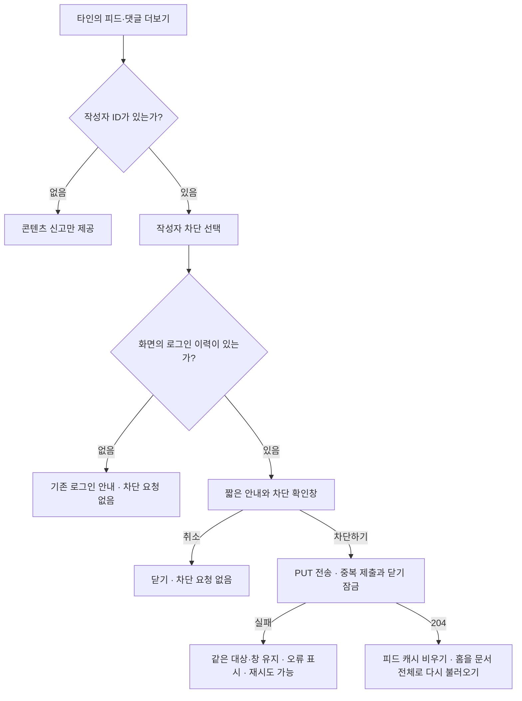

- 본인 콘텐츠에는 기존 삭제 메뉴를 유지합니다. 탈퇴 댓글처럼 작성자 ID가 없는 대상에는 작성자 신고·차단을 만들지 않습니다.
- 확인창은 `네오님이 작성한 피드와 댓글을 더 이상 볼 수 없어요.`처럼 한 문장으로 안내합니다.
- 전송 중 취소·Esc·배경 클릭·추가 제출을 막습니다. 성공하면 이전 상세·댓글·알림의 메모리 상태도 버립니다.
- 로그인 이력은 화면 진입 판단에 사용합니다. 실제 권한은 다음 서버 인증 단계에서 확인합니다.

참고: [메뉴](../../frontend/web/src/shared/content/ContentOptionsButton.tsx), [차단 확인창](../../frontend/web/src/shared/block/BlockDialog.tsx), [진입·잠금 테스트](../../frontend/web/src/shared/content/BlockEntryPoints.test.tsx).

## S02. 인증·CSRF·응답을 확인하기

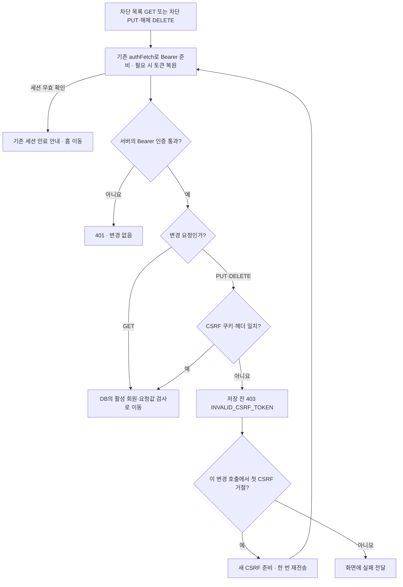

| 상황                                               | 처리                                                        |
| -------------------------------------------------- | ----------------------------------------------------------- |
| 인증 없이 차단 API 호출, 잘못된 Bearer             | 401. 다른 회원으로 대신 실행할 수 없음                      |
| 유효한 JWT지만 회원이 탈퇴했거나 OAuth 회원이 아님 | 서비스의 활성 회원 검사에서 거절                            |
| 경로 UUID 형식 오류·목록 크기 범위 오류            | 400                                                         |
| 일반 403·서버 오류·네트워크 오류                   | CSRF 전용 자동 재시도를 하지 않고 호출한 화면으로 실패 전달 |
| 변경 응답                                          | 204만 완료로 인정. 목록은 필드·커서·날짜 형식도 검사        |

기존 `authFetch`의 **401 후 토큰 복원·한 번 재요청**과, 차단 API의 **명확한 CSRF403에 대한 한 번 재시도**는 별개입니다. 네트워크 오류만으로 서버 저장이 롤백됐다고 단정할 수는 없습니다. 같은 방향의 PUT·DELETE는 반복해도 기록이 중복되지 않도록 처리합니다.

참고: [보안 체인](../src/main/java/com/harudle/common/security/BlockSecurityConfiguration.java), [프론트 API](../../frontend/web/src/domain/blocks/blocks.ts), [CSRF·응답 계약 테스트](../../frontend/web/src/domain/blocks/blocks.test.ts).

## S03. 서버에 차단을 저장하기

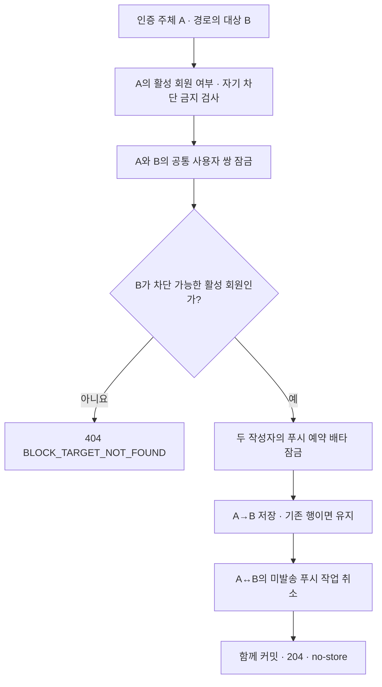

| 경우                                                        | 결과                                                             |
| ----------------------------------------------------------- | ---------------------------------------------------------------- |
| A가 A를 차단                                                | 400 `INVALID_BLOCK`                                              |
| B 부재·탈퇴·OAuth 없는 게스트·개발 환경의 허용 범위 밖 대상 | 404 `BLOCK_TARGET_NOT_FOUND`                                     |
| 유효한 대상에 같은 A→B 반복·동시 요청                       | `UNIQUE`와 `ON CONFLICT DO NOTHING`으로 한 행. 최초 ID·시각 유지 |
| B가 A를 차단                                                | 별도 B→A 행. A→B를 자동으로 만들거나 바꾸지 않음                 |
| 저장 또는 미발송 취소가 실패                                | 같은 트랜잭션의 변경이 함께 롤백                                 |

이미 A→B가 있더라도 B가 그 뒤 탈퇴했다면 PUT의 대상 검사에서 404입니다. **중복 PUT이 언제나 204인 것은 아닙니다.** 해제는 탈퇴한 B에도 가능합니다.

잠금이란?

같은 두 사람의 변경이 순서대로 처리되도록 기다리는 장치입니다. A→B와 B→A는 같은 사용자 쌍 잠금을 사용합니다. 아직 차단 행이 없어도 사용할 수 있고 트랜잭션 종료 때 풀립니다. 푸시 예약용 잠금은 S12에서 별도로 설명합니다.

참고: [BlockService](../src/main/java/com/harudle/block/service/BlockService.java), [저장·취소 SQL](../src/main/java/com/harudle/block/infrastructure/JpaBlockRepository.java), [DB 제약·롤백 테스트](../src/test/java/com/harudle/block/infrastructure/BlockPersistenceTest.java).

## S04. 본인 방향만 해제하기

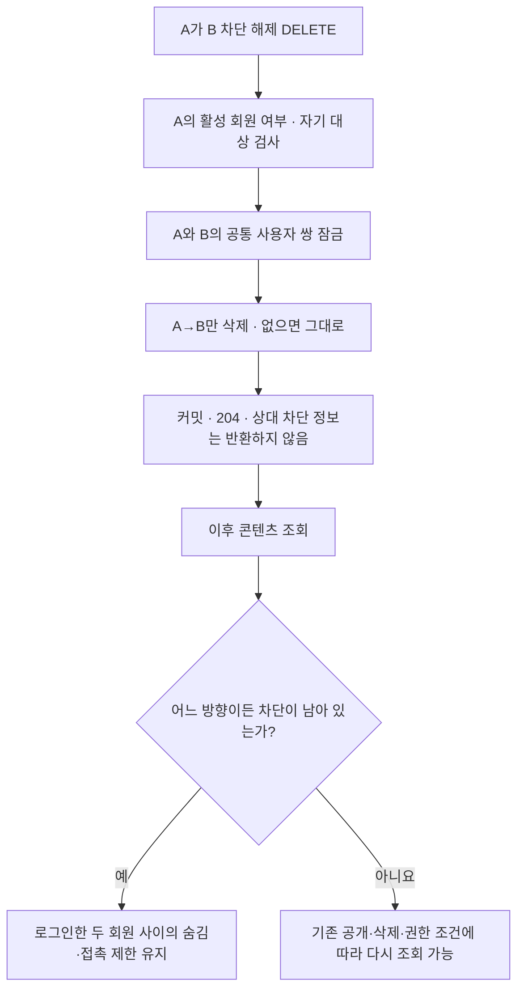

| 해제 전              | A가 B를 해제한 뒤 | 로그인한 두 회원 사이   |
| -------------------- | ----------------- | ----------------------- |
| A→B만 있음           | 차단 없음         | 기존 조회 규칙으로 복구 |
| A→B와 B→A 둘 다 있음 | B→A 유지          | 제한 유지               |
| B→A만 있음           | B→A 유지          | 제한 유지               |
| 차단 없음            | 그대로            | 기존 조회 규칙 유지     |

B가 탈퇴했거나 물리적으로 삭제됐어도 DELETE는 대상의 활성 여부를 요구하지 않습니다. 없는 행의 반복 해제도 204입니다. A 자신에 대한 요청과 비활성 A는 별도 검증에서 거절됩니다. 취소된 푸시 작업을 다시 예약하지 않습니다.

참고: [해제 서비스](../src/main/java/com/harudle/block/service/BlockService.java), [본인 방향 DELETE](../src/main/java/com/harudle/block/infrastructure/JpaBlockRepository.java), [양방향·탈퇴 해제 테스트](../src/test/java/com/harudle/block/infrastructure/BlockPersistenceTest.java).

## S05. 설정의 차단 목록과 다음 페이지

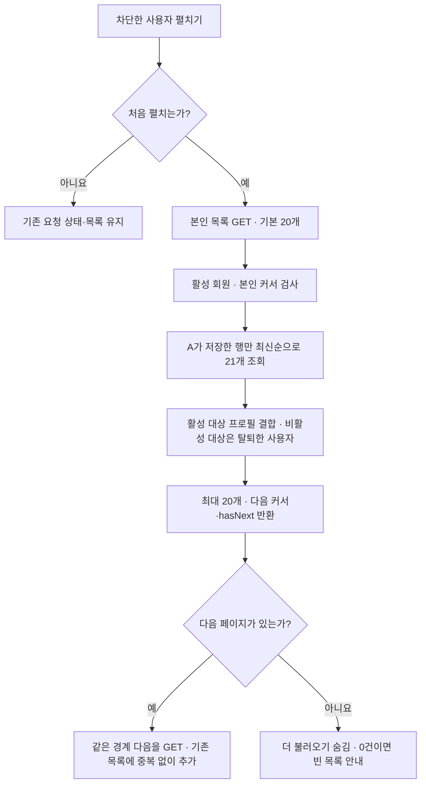

- 서버는 크기 1~50을 허용합니다. 시각이 같아도 행 ID로 순서를 구분합니다.
- 커서는 본인 ID·종류·버전·날짜·행 ID를 검사합니다. 다른 회원의 커서는 400 `INVALID_CURSOR`입니다. 실제 SQL도 항상 본인 범위로 제한합니다.
- 커서 경계의 행을 해제해 삭제해도 다음 조회가 가능합니다. 새 차단은 목록 앞쪽에 생길 수 있으므로 다시 조회하면 최신 목록을 받습니다.
- 첫 조회 실패와 다음 페이지 실패는 **목록 내부의 짧은 오류·새로고침 버튼**으로 안내합니다. 다음 페이지 실패는 현재 목록과 커서를 유지합니다.
- 접었다 펼쳐도 목록 컴포넌트를 유지해 진행 중 요청을 다시 보내지 않습니다. 화면을 떠나면 초기 조회를 취소합니다.
- 활성 대상의 필수 프로필을 제공받지 못하면 503 `BLOCK_UNAVAILABLE`입니다. 목록 조회 중 임의 오류를 모두 이 코드로 바꾸는 것은 아닙니다.

커서와 조회 일관성

커서는 마지막으로 본 위치를 적은 책갈피입니다. Base64URL은 전달 형식이며 서명·암호화는 아닙니다. 한 페이지는 같은 DB 스냅샷으로 읽지만 여러 페이지를 탐색하는 전체 시간을 하나의 고정 스냅샷으로 묶지는 않습니다.

참고: [서버 목록](../src/main/java/com/harudle/block/service/BlockService.java), [커서](../src/main/java/com/harudle/block/service/BlockCursorCodec.java), [설정 목록·페이지 재시도](../../frontend/web/src/pages/setting/BlockedUsers.tsx), [경계 행 삭제 테스트](../src/test/java/com/harudle/block/infrastructure/BlockPersistenceTest.java).

## S06. 해제 성공·실패와 목록 갱신 실패

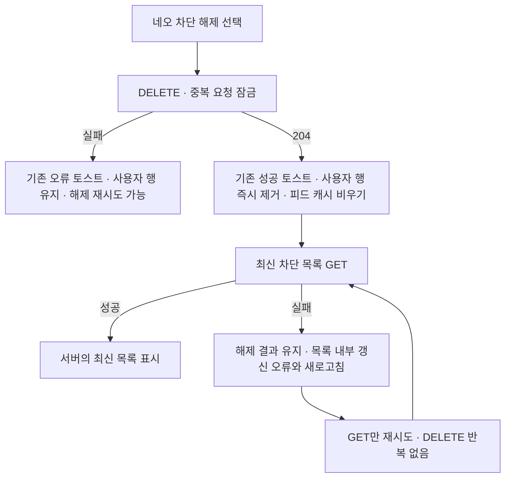

| 실패한 요청           | 화면                                    | 사용자가 다시 누르면 |
| --------------------- | --------------------------------------- | -------------------- |
| 첫 목록 GET           | 박스 내부 오류·새로고침                 | 첫 페이지 GET        |
| 다음 페이지 GET       | 기존 행 유지·내부 오류·새로고침         | 같은 커서 GET        |
| 해제 DELETE           | 오류 토스트·대상 행 유지                | DELETE 재시도        |
| DELETE204 뒤 갱신 GET | 성공 토스트·행 제거 유지·내부 갱신 오류 | 첫 페이지 GET만      |

한 요청 중 목록을 접었다 펼쳐도 잠금·결과를 유지합니다. 해제 후에는 현재 설정 목록을 갱신하고 피드 목록 캐시를 비우며, 차단 성공처럼 문서 전체를 다시 불러오지는 않습니다. 다른 탭의 화면을 실시간으로 갱신하는 기능은 이 경로에 없습니다.

참고: [설정 목록](../../frontend/web/src/pages/setting/BlockedUsers.tsx), [기존 토스트](../../frontend/web/src/shared/ToastContext.tsx), [단위 회귀](../../frontend/web/src/pages/setting/BlockedUsers.test.tsx), [실제 브라우저 회귀](../../frontend/web/e2e/user-blocking.spec.ts).

## S07. 피드 목록·상세·공유 URL

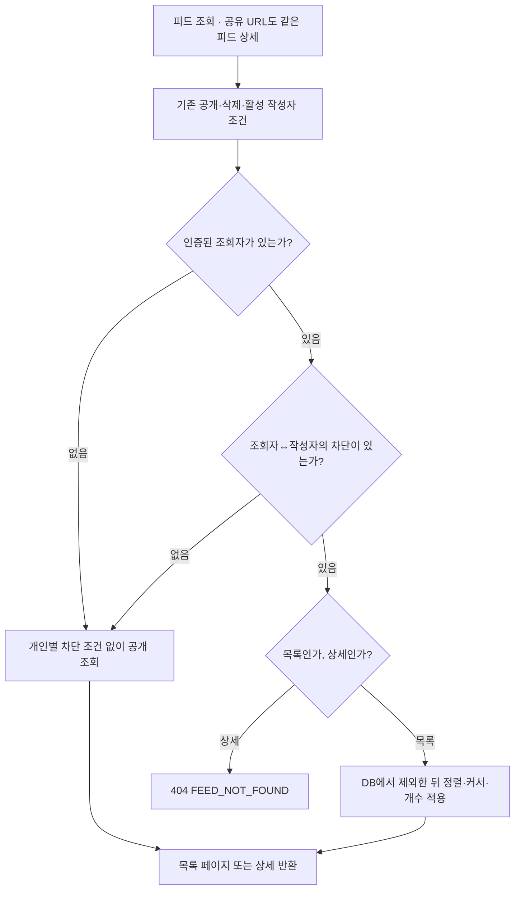

- A가 B를 차단했어도 C의 피드는 그대로 보입니다. B가 A를 차단한 경우도 A의 조회에 같은 조건을 적용합니다.
- 목록은 최신순·인기순·카테고리에 같은 차단 필터를 적용합니다. 후속 프로필 조회에서 사라진 작성자는 건너뛰고 페이지를 보충합니다.
- 이미 알고 있는 피드 ID로 요청해도 상세 검사에 합류합니다. 실제 `shareUrl`은 `/feeds/{feedId}`입니다.
- 잘못된 Bearer를 보내면 익명으로 바꾸지 않고 401입니다. 인증 없는 공개 조회와 구분합니다.
- 이미 진행 중인 조회·이미 내려간 이미지까지 회수하지는 않습니다. 차단 성공 화면은 이전 메모리 상태를 버리고 새로 조회합니다.

참고: [목록 SQL](../src/main/java/com/harudle/feed/repository/FeedListRepository.java), [상세](../src/main/java/com/harudle/feed/service/FeedQueryService.java), [공유 URL](../src/main/java/com/harudle/feed/presentation/FeedResponseAssembler.java), [노출 통합 테스트](../src/test/java/com/harudle/feed/service/BlockedContentVisibilityPersistenceTest.java).

## S08. 댓글 목록은 부모 피드와 댓글 작성자를 따로 확인

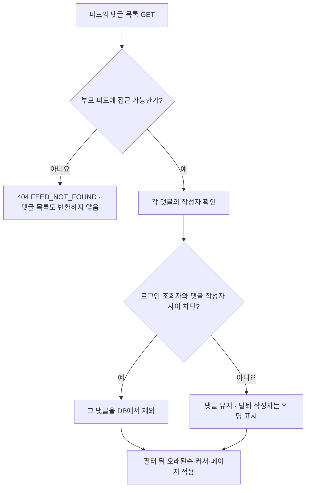

A가 B를 차단한 예시입니다.

| 조회 대상                                 | 결과                                                                                       |
| ----------------------------------------- | ------------------------------------------------------------------------------------------ |
| B의 피드에 달린 모든 댓글                 | 부모 피드가 숨겨져 댓글 API도 404                                                          |
| C의 피드에 달린 B의 댓글                  | B의 댓글만 제외                                                                            |
| C의 피드에 달린 A·C·다른 회원의 댓글      | 기존 조건대로 표시                                                                         |
| 탈퇴한 댓글 작성자                        | 댓글은 유지하고 `id=null`, `탈퇴한 회원`, 이미지 없음으로 표시. 남아 있는 차단 조건은 적용 |
| 부모 피드·일기 삭제 또는 피드 작성자 탈퇴 | 부모 경로가 유효하지 않아 댓글 목록 404                                                    |

참고: [부모 검사](../src/main/java/com/harudle/comment/service/CommentService.java), [댓글 필터 SQL](../src/main/java/com/harudle/comment/infrastructure/JpaCommentRepository.java), [탈퇴 작성자 응답](../src/main/java/com/harudle/comment/presentation/CommentAuthorResponse.java), [통합 테스트](../src/test/java/com/harudle/feed/service/BlockedContentVisibilityPersistenceTest.java).

## S09. 댓글·좋아요를 저장할 때와 차단이 겹칠 때

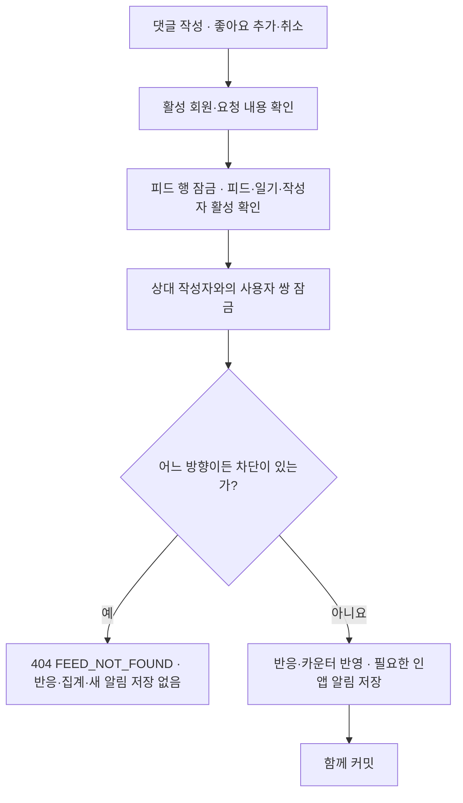

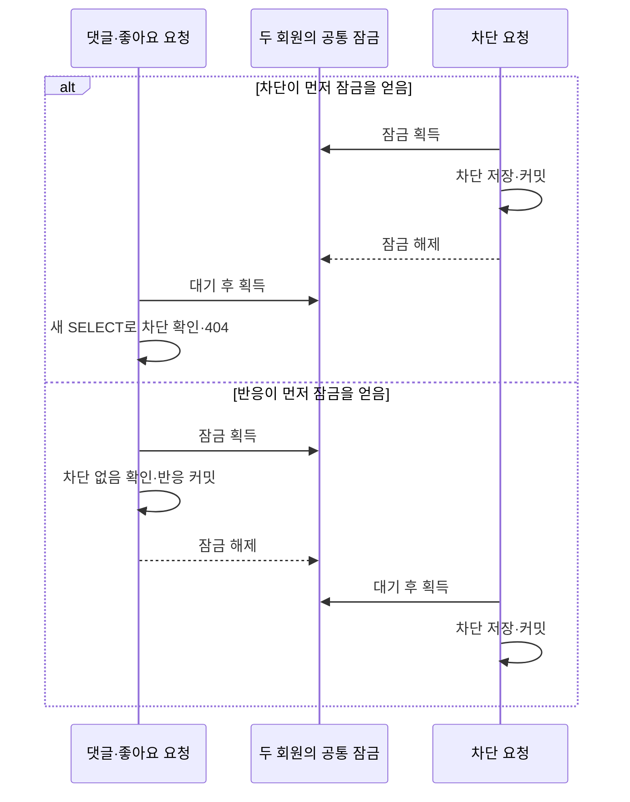

- 좋아요 취소도 차단 검사 대상입니다. 차단 중에는 기존 좋아요를 취소하지 않고 404로 거절합니다.
- 차단이 없을 때 중복 좋아요·이미 없는 좋아요 취소는 멱등 처리합니다. 중복 좋아요는 새 알림을 만들지 않습니다.
- 자기 피드 반응은 상대와의 쌍 잠금·차단 조회를 생략하고, 본인에게 인앱 알림을 만들지 않습니다.
- 반응이 먼저 완료됐다면 이후 차단이 그 반응을 소급 삭제하지 않습니다. 저장 과정이 실패하면 반응·집계·새 인앱 알림이 함께 롤백됩니다.
- 반응은 **피드 행 → 사용자 쌍**, 차단은 **사용자 쌍 → 게시 예약 잠금** 순서입니다. 차단이 피드 행 잠금을 추가로 얻지는 않습니다.

잠금을 기다린 뒤 다시 조회하는 이유

반응·차단·해제는 READ COMMITTED를 사용합니다. 기다리는 동안 완료된 차단을 대기 후의 새 조회에서 확인하기 위해서입니다. 사용자 쌍 잠금 번호를 만드는 해시는 암호화가 아닙니다. 실제 차단 판단에는 원래 두 UUID를 사용하므로 해시 충돌은 불필요한 대기만 추가합니다.

참고: [반응 공통 검사](../src/main/java/com/harudle/feed/service/FeedInteractionService.java), [사용자 쌍 잠금](../src/main/java/com/harudle/block/service/BlockInteractionPolicy.java), [차단 선행 경쟁 테스트](../src/test/java/com/harudle/feed/service/BlockedInteractionPersistenceTest.java), [반응 선행 잠금 테스트](../src/test/java/com/harudle/block/infrastructure/BlockPersistenceTest.java).

## S10. 차단 후에도 가능한 본인 삭제·신고

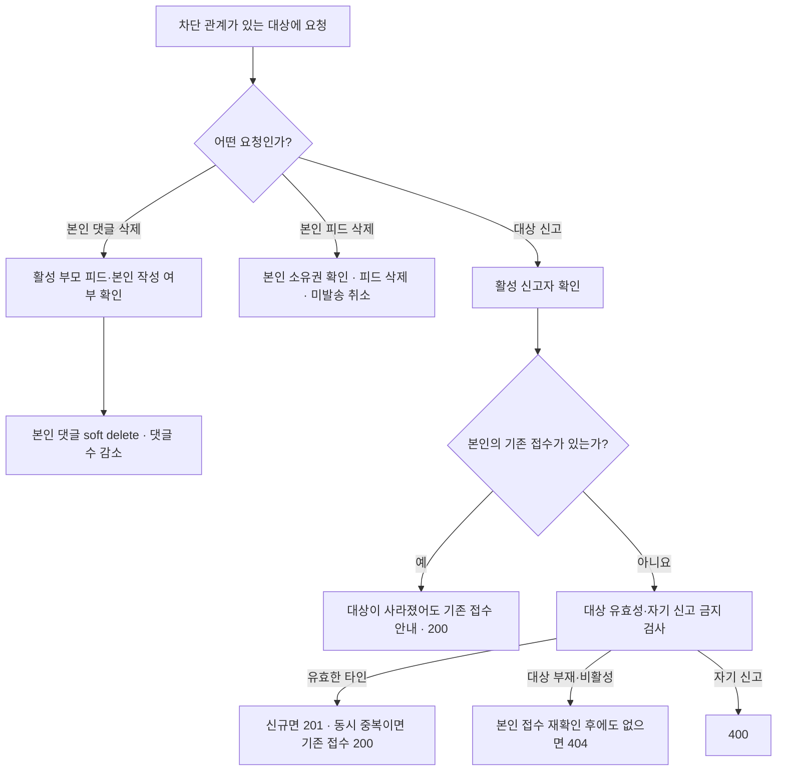

- 차단 상대의 활성 피드에 예전에 남긴 **자신의 댓글은 삭제할 수 있습니다.** 남의 댓글 삭제는 403이며, 부모 경로가 이미 삭제·비활성이면 댓글 삭제도 404입니다.
- 본인 피드 삭제 시 앨범의 원본 일기는 유지합니다.
- 신고 대상 SQL은 차단 필터를 적용하지 않습니다. 차단 뒤에도 알고 있는 유효한 사용자·피드·댓글 ID로 신고할 수 있습니다. 화면에서 숨겨진 콘텐츠를 찾아주는 별도 경로를 추가하지는 않습니다.
- 탈퇴한 신고자·OAuth 회원이 아닌 신고자는 기존 접수도 반환받지 않습니다.
- 기존 접수와 최초 사유·상세를 유지합니다. 다른 사람의 접수·상대 차단 여부·콘텐츠 본문을 반환하거나 상대에게 신고 알림을 보내지 않습니다.
- 신규 신고는 대상 활성 조건을 따릅니다. 삭제된 댓글은 신규 신고할 수 없지만, 본인의 기존 접수는 안내합니다. 댓글 작성자만 탈퇴한 경우는 부모와 댓글이 유효하면 신규 신고가 가능합니다.

참고: [댓글 삭제](../src/main/java/com/harudle/comment/service/CommentService.java), [피드 삭제](../src/main/java/com/harudle/feed/service/FeedDeletionService.java), [기존 접수·신규 접수](../src/main/java/com/harudle/report/service/ReportService.java), [차단 후 신고 테스트](../src/test/java/com/harudle/feed/service/BlockedContentVisibilityPersistenceTest.java).

## S11. 인앱 알림 목록·미읽음 수·읽음 처리

좋아요·댓글은 `notifications`에 인앱 알림을 기록합니다. 새 피드의 외부 푸시는 S12~S13의 별도 경로입니다.

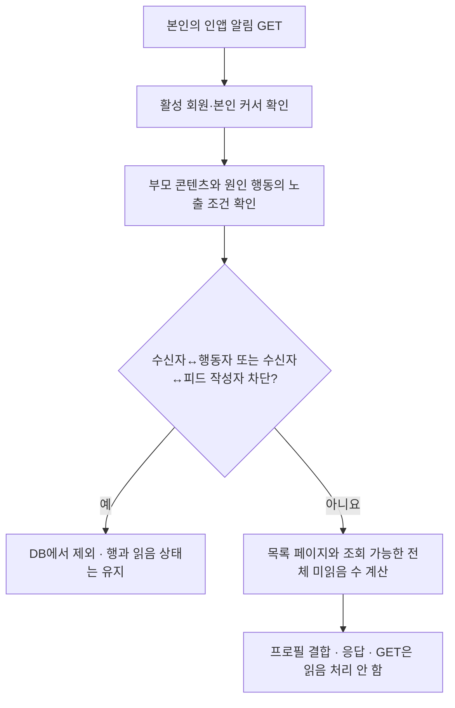

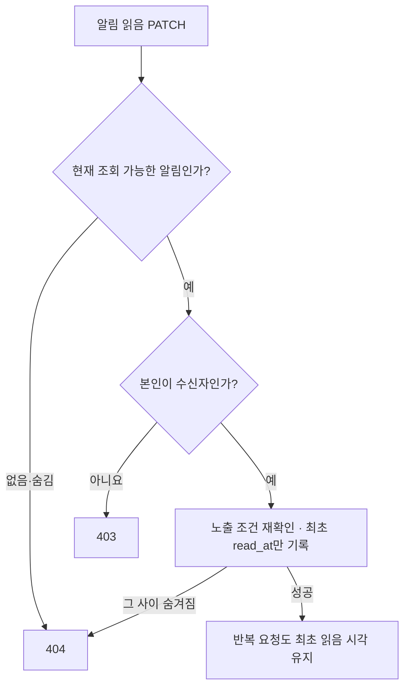

| 원인·콘텐츠 상태                     | 알림 목록·미읽음 수                                      |
| ------------------------------------ | -------------------------------------------------------- |
| 피드·일기 삭제 또는 피드 작성자 탈퇴 | 제외                                                     |
| 어느 방향이든 관련 차단              | 제외                                                     |
| 원래 좋아요가 취소됨                 | 그 좋아요 알림 제외. 다시 좋아요하면 새 행동의 알림 사용 |
| 원인 댓글만 삭제됨                   | 댓글 알림 유지                                           |
| 행동자만 탈퇴함                      | 나머지 노출 조건을 만족하면 익명 프로필로 유지           |

목록과 전체 미읽음 수는 같은 페이지 조회 트랜잭션의 스냅샷을 사용합니다. 필요한 활성 프로필을 제공받지 못하면 503입니다. 읽기 중 생긴 차단으로 이미 진행 중인 응답을 강제 취소하지는 않습니다. 외부 푸시 수신이 인앱 읽음 상태를 바꾸지는 않습니다.

참고: [목록·읽음 서비스](../src/main/java/com/harudle/notification/service/NotificationService.java), [공통 노출 조건 SQL](../src/main/java/com/harudle/notification/infrastructure/JpaNotificationRepository.java), [알림 통합 테스트](../src/test/java/com/harudle/notification/infrastructure/NotificationPersistenceTest.java).

## S12. 새 피드 게시·푸시 예약과 차단의 경쟁

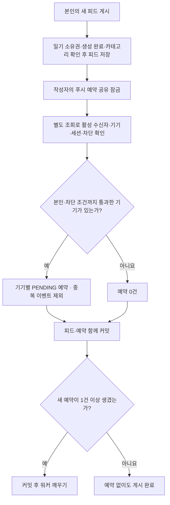

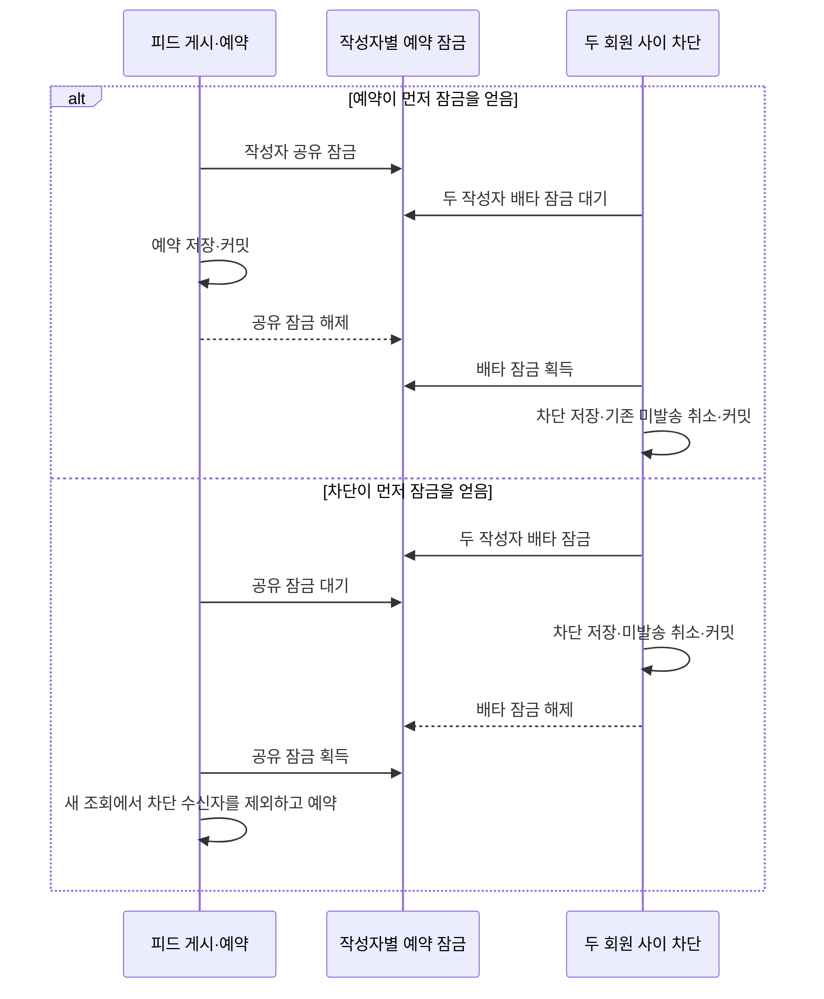

- 다른 회원과 차단 중이어도 **본인의 피드 게시 자체는 가능합니다.** 제한하는 것은 상대에게 노출·예약되는 경로입니다.
- 유효한 기기 등록·인증 세션·리프레시 토큰이 있는 활성 회원을 대상으로 합니다. 같은 회원의 여러 기기는 여러 예약을 가질 수 있습니다.
- 차단은 두 작성자의 잠금을 공통 순서로 얻고 A↔B의 `PENDING`·`PROCESSING`만 취소합니다. `SENT`·무관한 회원 작업은 바꾸지 않습니다.
- 같은 작성자의 게시끼리는 공유 잠금을 함께 사용합니다. 차단 저장과 미발송 취소는 함께 커밋·롤백됩니다.
- 이 DB 잠금을 잡은 채 외부 FCM 응답을 기다리지 않습니다. 발송 경계는 다음 절과 같습니다.

참고: [피드 게시](../src/main/java/com/harudle/feed/service/FeedPublicationService.java), [예약 SQL](../src/main/java/com/harudle/push/infrastructure/JpaFeedPushOutbox.java), [공유·배타 잠금](../src/main/java/com/harudle/push/infrastructure/PostgresFeedPushPublicationGuard.java), [두 순서의 DB 경쟁 테스트](../src/test/java/com/harudle/push/infrastructure/BlockedPushDeliveryPersistenceTest.java).

## S13. 예약된 푸시 발송·실패·차단

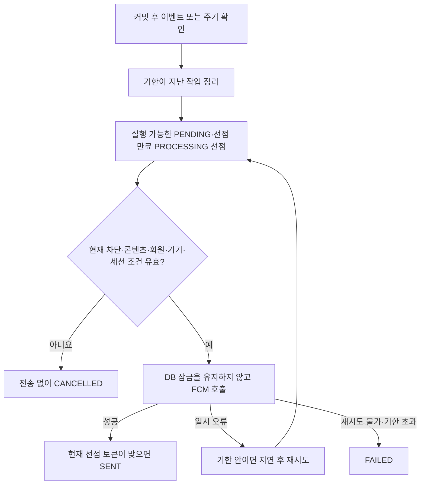

**차단 관계를 발송 직전에 다시 확인합니다. 다만 그 확인을 통과한 직후 차단되거나 외부 서비스로 이미 전달됐다면 푸시는 도착할 수 있습니다.** DB가 `CANCELLED`여도 이미 진행 중인 외부 전송을 회수한다는 뜻은 아닙니다.

| 경계 상황                               | 실제 처리                                                                    |
| --------------------------------------- | ---------------------------------------------------------------------------- |
| 아직 예약 전 차단                       | 예약 대상에서 제외                                                           |
| 미발송 PENDING·PROCESSING 상태에서 차단 | 관련 작업 취소                                                               |
| 선점 후 대상 확인 시 차단 발견          | FCM 호출 없이 취소                                                           |
| 대상 확인 직후 차단·외부 전송 진행 중   | 도착 가능. DB 취소로 외부 전송을 되돌리지는 못함                             |
| 차단 해제                               | 취소한 과거 작업 재예약 없음                                                 |
| 워커 중단·일시적 FCM 오류               | 만료 선점·재시도 정책에 따라 다시 처리. 다음 시도도 대상 검사                |
| 기기 토큰이 폐기됨                      | 전송 당시 값·버전과 같을 때만 등록 해지. 갱신된 기기 값을 잘못 해지하지 않음 |

선점 이후 취소·재시도·실패를 포함한 상태 변경은 현재 선점 토큰이 일치할 때만 적용합니다. 차단이 이미 취소한 작업을 늦게 도착한 발송 결과가 `SENT`·`PENDING`·`FAILED`로 되돌리지 않습니다.

`SENT`는 기기 수신 확인이 아닙니다. 중복 외부 전송을 완전히 없애거나 도착 가능한 개수를 제한하는 보장도 없습니다. 앱의 발송 시도 기한 24시간과 FCM 전달 TTL 7일은 별개입니다. 푸시에는 일반 안내와 이벤트·피드 ID를 담고 일기 원문·댓글 본문을 복사하지 않습니다.

참고: [발송 워커](../src/main/java/com/harudle/push/infrastructure/FeedPushDeliveryWorker.java), [선점·재검사·상태 변경](../src/main/java/com/harudle/push/infrastructure/JdbcPushDeliveryQueue.java), [FCM 메시지](../src/main/java/com/harudle/push/infrastructure/FcmFeedPushSender.java), [차단 발송 테스트](../src/test/java/com/harudle/push/infrastructure/BlockedPushDeliveryPersistenceTest.java).

## S14. 숨김과 데이터 보존 범위

| 대상                  | 차단 시                                                       | 모든 방향의 차단이 해제된 뒤               |
| --------------------- | ------------------------------------------------------------- | ------------------------------------------ |
| 피드·댓글             | 로그인한 두 회원의 조회에서 제외. 행을 삭제하지 않음          | 기존 공개·삭제 조건을 만족하면 다시 표시   |
| 기존 좋아요·댓글 수   | 삭제·재집계하지 않음. 보이는 댓글 수와 전체 수가 다를 수 있음 | 기존 값 유지                               |
| 인앱 알림·읽음 시각   | 관련 알림을 조회·미읽음 집계에서 제외. 상태는 유지            | 다른 노출 조건도 유효하면 기존 상태로 표시 |
| 미발송 외부 푸시      | 관련 예약 취소                                                | 과거 취소 작업을 재예약하지 않음           |
| 신고 접수·최초 사유   | 보존하며 본인의 기존 접수 재사용                              | 그대로 유지                                |
| 비로그인 공개 열람    | 기존 공개 조건 유지                                           | 그대로 유지                                |
| 탈퇴한 상대의 차단 행 | 소프트 탈퇴·OAuth 상실 시 행 유지. 목록에서 본인이 해제 가능  | 본인 방향 DELETE로 정리 가능               |
| 회원의 물리 삭제      | 외래키의 CASCADE로 관련 차단 행 삭제                          | 보존 예외이며 영구 보존을 보장하지 않음    |

상대가 나를 차단했는지는 목록·차단 API 응답으로 반환하지 않습니다. 목록에는 본인이 저장한 방향만 제공합니다. 관리자 신고 심사·계정 제재는 후속 #427의 범위입니다.

참고: [정책 설명](user-blocking.md), [DB 제약·삭제 규칙](../src/main/resources/db/migration/V31__create_user_blocks.sql), [본인 목록 응답](../src/main/java/com/harudle/block/service/dto/BlockedUserResult.java).
