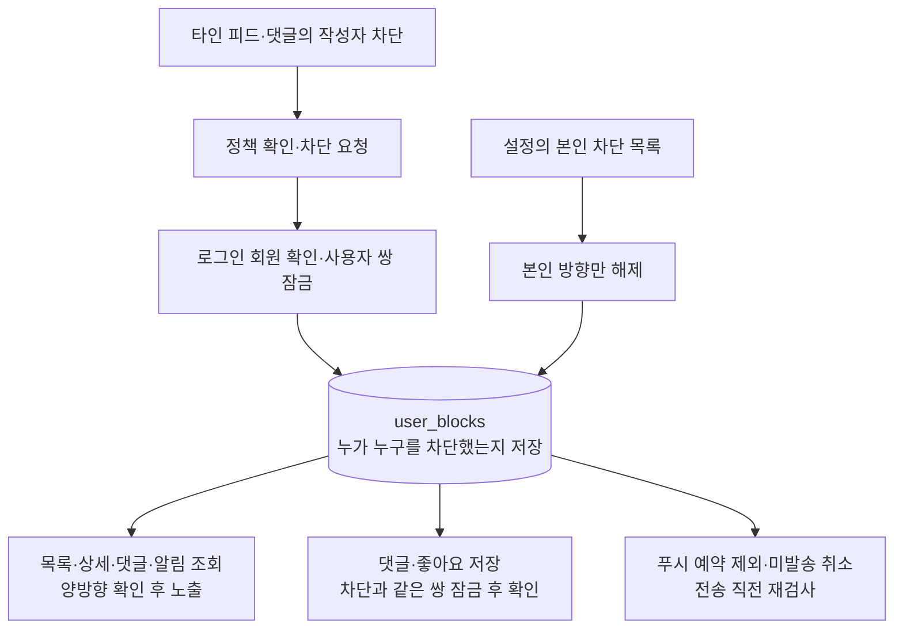

# 사용자 차단·해제 (#425)

다른 회원의 피드나 댓글에서 **작성자 차단**을 선택하면, 로그인한 두 회원은 서로의
피드와 댓글을 보지 않고 새 댓글·좋아요·관련 알림도 주고받지 않는다.
차단은 원치 않는 접촉을 줄이는 기능이다. 공개 콘텐츠의 비로그인 열람은 기존대로 유지한다.

## A가 B를 차단하면

| 상황 | 동작 |
| --- | --- |
| A 또는 B가 로그인해 피드 목록·상세를 조회 | 서로의 피드를 숨긴다. 상세 주소로 직접 들어가도 찾을 수 없음으로 응답한다. |
| 다른 사람 C의 피드에 A와 B가 댓글을 남김 | A와 B에게 서로의 댓글을 숨긴다. C에게는 기존대로 보인다. |
| 서로의 피드에 댓글·좋아요를 요청 | 화면을 오래 열어 뒀거나 API를 직접 호출해도 서버에서 거절한다. |
| 기존 인앱 알림·미읽음 수 조회 | 차단 관계에 해당하는 알림을 제외한다. |
| 새 피드 푸시 예약·발송 | 예약할 때 제외하고, 이미 대기하던 작업도 취소하며 발송 직전에 다시 검사한다. |
| 로그아웃하고 공개 피드 조회 | 기존 공개 콘텐츠를 볼 수 있다. |

화면에서 차단을 완료하면 목록 캐시와 상세·댓글·알림의 메모리 상태를 버리고 홈을 다시 불러온다.
실패하면 확인창에 오류를 보여 주며 다시 시도할 수 있다. 전송 중에는 중복 제출과 창 닫기를 막는다.

## 차단을 해제하면

설정의 **차단한 사용자**에서 본인이 저장한 차단만 해제할 수 있다.
A가 B를 차단한 기록과 B가 A를 차단한 기록은 각각 별개다.
A가 자신의 기록을 해제해도 B가 저장한 기록을 대신 지우지 않는다.
응답이나 차단 목록에 상대의 차단 여부는 포함하지 않는다.

차단 때문에 원래의 피드·댓글·좋아요·인앱 알림을 삭제하지 않는다.
효력이 있는 차단 관계가 모두 없어지면 기존 조회 규칙에 따라 다시 표시한다.
좋아요·댓글 집계는 저장된 전체 반응 수를 유지하므로, 개인에게 보이는 댓글 수와 다를 수 있다.
이미 취소한 미발송 푸시를 해제할 때 다시 예약하지는 않는다.

탈퇴한 상대도 본인의 목록에서 해제할 수 있다. 이때 프로필 대신 **탈퇴한 사용자**로 표시한다.

## 구현에서 지키는 경계

- 차단한 사람의 ID는 로그인 정보에서 얻는다. 요청으로 보낸 다른 사람의 차단 관계는 변경할 수 없다.
- 새 차단은 활성 회원 사이에서만 허용하며 자기 자신을 차단할 수 없다.
- 같은 방향으로 여러 번 차단해도 기록은 한 건이며 처음 차단한 시각을 유지한다.
- 차단 뒤에도 알고 있는 대상 ID로 신고할 수 있다. 신고는 상대에게 알림을 보내거나 콘텐츠를 반환하지 않으며, 본인의 기존 접수와 최초 사유를 유지한다.
- 목록에서 먼저 일정 수를 가져온 뒤 숨기지 않는다. DB에서 차단 대상을 제외한 뒤 페이지를 나눈다.
- 차단과 댓글·좋아요가 동시에 들어오면 같은 사용자 쌍을 잠근다. 차단이 먼저 완료됐다면 뒤의 반응은 저장하지 않는다.
- 외부 푸시 서비스에 이미 전달된 메시지는 회수할 수 없다. 예약과 발송 직전에 검사하고 미발송 작업을 취소한다. 다만 전송 직전 검사를 통과한 직후 차단되면 이미 전송 대상으로 확인한 푸시가 도착할 수 있다.



<details>
<summary>API와 저장 구조</summary>

| 요청 | 결과 |
| --- | --- |
| `PUT /api/v1/blocks/{userId}` | 본인이 상대를 차단한다. 204, 중복 기록은 추가하지 않는다. |
| `DELETE /api/v1/blocks/{userId}` | 본인 방향만 해제한다. 204, 이미 없거나 상대가 탈퇴해도 해제할 수 있다. |
| `GET /api/v1/blocks?size=20&cursor=...` | 본인이 차단한 사용자만 최신순으로 조회한다. 크기는 1~50이다. |

모든 응답은 `Cache-Control: no-store`이며 인증이 필요하다.
저장·해제 요청에는 CSRF 쿠키와 `X-XSRF-TOKEN` 헤더도 필요하다.

목록 응답은 `items`, `nextCursor`, `hasNext`를 포함한다.
각 항목에는 `userId`, `nickname`, `profileImageUrl`, `blockedAt`만 포함한다.
탈퇴한 사용자의 `profileImageUrl`은 null이다.

`user_blocks`의 `(blocker_id, blocked_id)`를 UNIQUE로 제한한다.
역방향 확인과 본인 목록의 페이지 조회에는 각각 인덱스를 둔다.
회원 행이 물리적으로 삭제되면 연결된 차단 관계도 삭제한다.

`V31__create_user_blocks.sql`은 머지된 신고 PR #455의 V30 다음에 차단 테이블을 생성한다.
병합 직전 최신 기준 브랜치와 번호·적용 순서를 다시 대조한다.
이미 적용한 파일의 번호를 바꾸거나 `outOfOrder`로 순서 문제를 우회하지 않는다.

</details>

<details>
<summary>동시 요청과 검증 방법</summary>

**사용자 쌍 잠금**은 A→B와 B→A를 같은 잠금으로 취급한다.
DB의 트랜잭션이 끝나면 자동으로 풀리는 advisory lock을 사용한다.
아직 차단 행이 없는 요청끼리도 경쟁하므로 관계 행 잠금만으로는 부족하다.
회원 한 명 전체를 잠그면 다른 상대와의 반응까지 기다리게 되므로, 지금 접촉하는 두 회원의 쌍만 잠근다.
잠금 번호를 계산할 때 두 ID의 순서를 정규화하고 SHA-256 결과의 일부를 사용한다.
이 값은 암호화나 차단 여부 판단에 쓰지 않는다. 해시 충돌이 생겨도 별개의 요청이 잠시 기다릴 뿐이며,
실제 차단 판단에는 두 회원의 원래 UUID를 사용한다.

차단·해제와 댓글·좋아요 저장은 READ COMMITTED 격리를 명시해, 잠금 대기 뒤 완료된 차단을 새 조회에서 확인한다.
잠금 순서는 반응 저장 시 피드 행 → 사용자 쌍이다. 차단 변경은 사용자 쌍을 잠그며 피드 행 잠금을 얻지 않는다.
외부 푸시 응답을 기다리는 동안 차단용 DB 잠금을 유지하지 않는다.

실제 Flyway 스키마와 PostgreSQL에서 양방향 노출, LIMIT 전 필터, 해제 복구,
반복·동시 변경, 차단과 반응의 경쟁, 미발송 푸시 취소와 전송 직전 검사를 확인한다.
브라우저 자동 검증은 MSW를 이용하므로 실제 DB 검증과 구분한다.

Docker를 사용할 수 없는 로컬 환경에서는 다음 형식의 전용 DB만 사용할 수 있다.
일반 개발·운영 DB 설정으로 대체하지 않으며 다른 주소·DB명·접속 옵션은 거절한다.

```text
HARUDLE_BLOCK_TEST_DATABASE_URL=jdbc:postgresql://127.0.0.1:<port>/harudle_block_test
```

로컬에서는 PostgreSQL 15.13을 사용해 다음 결과를 확인했다.

| 검증 범위 | 결과 |
| --- | --- |
| 차단·조회·동시 요청·푸시·기존 신고와 API | 353개 통과. 실제 DB 테스트 64개를 포함한다. |
| 프론트 전체 검사 | 타입·린트·서식·빌드와 438개 테스트 통과 |
| Chrome 브라우저 | 신고·차단과 기존 삭제·스크롤·캐시·게시·로그아웃 흐름 35개 통과 |

Docker 환경에서는 PostgreSQL 18 테스트 컨테이너를 사용한다.

</details>
