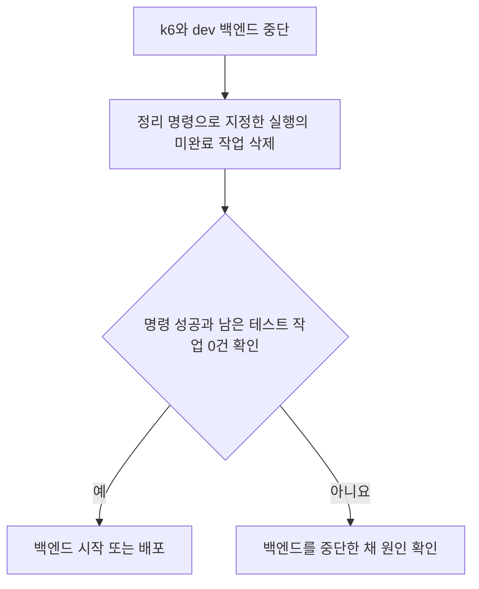

# 회원 200명으로 5분 동안 부하 테스트하기

**dev 서버가 회원 200명의 방문을 처리할 수 있는지 확인합니다.**
5분 동안 분당 40명이 방문합니다. 한 회원이 여러 행동을 할 수 있습니다.
요청을 보낼 주소는 `https://dev.harudle.com`입니다.

| 행동 | 회원 수 | API 요청 수 |
| --- | ---: | ---: |
| 일기 생성 후 피드에 게시 | 20명 | 80건 |
| 피드 목록과 상세 보기 | 160명 | 800건 |
| 댓글 작성과 좋아요 누르기 | 60명 | 240건 |
| 이번 달과 지난달 일기 보기 | 100명 | 300건 |
| 합계 | 서로 겹치는 회원 포함 | **1,420건** |

테스트 전용 일기 생성 API는 **대기 작업을 저장한 뒤 바로 반환**합니다.
작업 처리기가 선점한 뒤 30초를 기다리고 준비된 이미지를 저장합니다.
이때 실제 AI를 대신하는 코드를 AI Stub이라고 합니다.
일기 저장, 피드 게시, S3 이미지 저장은 실제로 실행합니다.
마지막 요청이 끝날 때까지 기다리므로 전체 실행은 5분보다 조금 길어질 수 있습니다.

## 각 파일이 하는 일

| 파일 | 하는 일 | 우리가 실행하는 시점 |
| --- | --- | --- |
| `ec2.py` | dev DB 확인, 데이터 준비와 정리 | EC2에서 직접 실행 |
| `transfer.py` | 회원 파일을 암호화해서 전달하고 로컬에 복원 | 처음 한 번 실행 |
| `prepare.py` | 테스트 회원 정보와 DB에 넣을 SQL 파일 만들기 | `ec2.py`가 실행 |
| `assets.py` | 테스트 이미지 업로드와 삭제 | 준비와 정리 중 자동 실행 |
| `cleanup.py` | 기본 데이터는 남기고 테스트 증가분 삭제와 변경 값 복구 | 초기화와 정리 중 실행 |
| `cleanup_stopped.py` | 백엔드가 꺼진 상태에서 미완료 테스트 작업 삭제와 사용 횟수 복구 | dev 백엔드를 다시 켜기 전에 직접 실행 |
| `runs/members/members.json` | 계속 사용할 회원 200명의 ID와 로그인 정보 | 처음 한 번 받아 계속 보관 |
| `runs/members/baseline/` | 기본 데이터의 ID와 원복 기준, 준비 SQL | EC2에서 자동 생성하며 계속 보관 |
| `run.sh` | 사용할 회원 파일을 고르고 Docker에서 k6 실행하기 | 데이터 준비가 끝났을 때 |
| `members.js` | 회원별로 로그인하고 일기, 피드, 댓글 API 호출하기 | `run.sh`가 실행한 k6에서 자동으로 실행 |

**회원은 한 번 만들고, 기본 일기와 피드, 이미지는 같은 달 동안 계속 사용합니다.**
실행할 때마다 EC2에서 테스트 증가분을 정리하고 변경 값과 로그인 상태를 초기화합니다.
준비 파일과 실행 결과는 `runs/실행이름/`에 따로 저장합니다. 로그인 토큰이 포함되므로 `runs/` 전체를 Git에서 제외합니다.

**dev에서는 일반 사용자에게 더미 피드와 테스트 카테고리를 숨깁니다.**
`DEPLOY_ENV=dev`일 때만 적용하며, 기존 테스트 이메일의 `.loadtest.invalid` 끝부분으로 테스트 계정을 구분합니다.

- 비로그인 사용자와 일반 계정은 더미 피드를 목록에서 볼 수 없습니다. 상세 주소와 댓글 주소를 직접 열어도 `404`를 받습니다.
- `부하` 뒤에 영문 소문자와 숫자로 된 16진수 12자리가 붙는 테스트 카테고리만 숨깁니다. `부하테스트` 같은 일반 이름은 유지합니다.
- 로그인한 테스트 계정은 더미 피드와 테스트 카테고리를 계속 조회할 수 있습니다. 테스트 계정과 일반 계정 사이의 댓글 작성과 좋아요 추가, 취소는 차단합니다.
- 계정 확인용 SQL을 따로 실행하지 않고 기존 조회 SQL에 조건을 넣습니다. DB 구조, 로그인 토큰과 위의 준비 및 초기화 절차는 바꾸지 않습니다.

## members.js는 어떻게 테스트하나요?

| 코드에서 볼 이름 | 실제로 하는 일 |
| --- | --- |
| `setup()` | 회원 파일을 읽어 준비한 계정으로 로그인합니다. CSRF 토큰과 Bearer 토큰을 받고, 테스트 데이터와 AI Stub이 준비됐는지 확인합니다. |
| `options` | 5분 동안 1분에 40명씩, 총 200명의 방문을 시작하도록 정합니다. `smoke`는 4명만 확인합니다. |
| `memberVisit()` | 회원 한 명에게 정해진 행동을 실행합니다. 예를 들어 일기를 만든 회원은 피드 게시와 자기 기록 조회도 합니다. |
| `request()` | 각 API 요청에 로그인 토큰을 넣고, 성공 여부와 응답 시간을 기록합니다. CSRF 쿠키와 헤더도 함께 보냅니다. |
| `journey()` | 일기 생성 후 게시처럼 여러 요청으로 된 행동을 끝까지 마쳤는지 기록합니다. |

로그인 준비가 끝나면 5분 테스트를 시작합니다. 각 회원은 한 번씩 방문하며, 한 방문에서 여러 행동을 할 수 있습니다.
일기 생성 요청은 대기 작업을 저장하고 바로 반환합니다. 일반 생성과 같은 작업 처리기가
`FOR UPDATE SKIP LOCKED`로 선점한 뒤 30초 AI Stub을 실행합니다.
k6는 생성 상태 API인 `GET /api/v1/diary-generations/{generationId}`로 1초마다 상태를 조회하고, 생성이 끝나면 피드를 게시합니다.
한 작업의 완료 대기는 접수 시작부터 최대 75초입니다.

## 1. dev 서버에 이 브랜치 배포하기

이 브랜치의 백엔드를 dev에 배포합니다. **대기 상태를 지원하는 V28 적용까지 끝낸 뒤** 다음 단계로 넘어갑니다.

작업 처리기는 백엔드 앱이 시작되면 항상 등록됩니다. 별도 활성화 설정이나 `load-test` 프로필은 필요하지 않습니다.
동시 실행 수와 확인 간격을 바꾸면 백엔드 컨테이너를 재생성해 적용합니다.
기존 `DEPLOY_ENV=dev`이고 이미지 저장 기능이 켜져 있으면 테스트 API가 자동으로 등록됩니다.
`HARUDLE_GENERATION_ADAPTERS_ENABLED=false`인 로컬 환경에서는 테스트 API도 꺼집니다. 서버는 정상적으로 실행됩니다.

| 호출 주소 | 일기 생성 방식 |
| --- | --- |
| `POST /api/v1/diaries` | 일반 대기 작업 접수. 선점 후 실제 AI 실행 |
| `POST /api/v1/load-test/diaries` | 테스트 대기 작업 접수. 선점 후 30초 AI Stub 실행, 실제 일기와 이미지 저장 |

새 작업의 접수 응답은 `202 Accepted`입니다. 일기 ID와 생성 ID, `PENDING` 상태를 반환합니다.
같은 멱등 요청은 기존 상태와 결과를 `200 OK`로 반환합니다. k6는 신규 접수의 `202`를 확인한 뒤
`GET /api/v1/diary-generations/{generationId}`로 완료 상태를 조회합니다. 성공한 작업의 일기 ID를 확인한 뒤 피드를 게시합니다.

같은 대기열과 같은 처리기를 사용합니다. `GENERATION_WORKER_CONCURRENCY`는 두 종류의 작업을 합한 동시 실행 수입니다.
이 값은 아직 끝나지 않은 작업의 접수 상한이기도 합니다. `PENDING`과 `PROCESSING`의 합이 상한에 도달하면
테스트 API도 `503 GENERATION_CAPACITY_EXCEEDED`로 신규 접수를 거절합니다. 거절된 요청은 사용량을 차감하지 않습니다.
접수 거절은 생성 상태를 조회할 작업이 없는 요청입니다. 같은 키로 이미 접수된 작업은 기존 상태를 반환합니다.
요청이 상한보다 많이 몰리면 기존 성공률과 완료 건수 기준을 통과하지 못할 수 있습니다.
결과에서 `503` 접수 거절과 접수 후 생성 실패를 구분해 확인합니다.
전체 HTTP 흐름을 검증하는 `MemberLoadTestIntegrationTest`는 생성 인원에 맞춰 동시 실행 수를 smoke에서 1개,
peak에서 20개로 설정합니다. 모든 생성과 게시 흐름을 확인하기 위한 테스트 설정이며 운영값과 별개입니다.
부하 테스트 API가 접수한 생성 ID는 메모리에서 Stub 실행기에 연결합니다. 일반 API는 실제 AI를 사용합니다.
대기 중 만료된 테스트 작업은 만료 저장이 커밋된 뒤 메모리 연결을 지웁니다. 저장이 취소되면 연결을 유지합니다.
DB에 작업 종류를 추가하지 않습니다. 테스트 연결은 현재 백엔드 프로세스에서만 유지됩니다.
백엔드 한 인스턴스에서 테스트를 실행합니다. 재시작하면 남은 테스트 작업은 일반 작업과 구분할 수 없습니다.

`generation_duration`은 접수 요청 시작부터 생성 완료 확인까지의 시간입니다. 대기 시간, 선점, Stub 실행과 이미지 저장을 포함합니다.
접수 API 응답 시간은 일반 API 응답 시간으로 측정합니다. 상태 조회 횟수와 오류는
`generation_status_requests`와 `generation_status_failures`에 따로 기록하므로 기존 업무 요청 수 기준은 유지합니다.
기존 생성 시간 기준인 최소 30초와 95백분위 45초 미만을 유지합니다. 대기 작업이 밀리면 이 기준을 넘을 수 있습니다.

k6는 일기를 만들 때 테스트 전용 주소를 호출합니다. 피드 게시와 조회는 기존 API를 호출합니다.
테스트 전용 생성 API는 준비한 테스트 계정만 사용할 수 있습니다. **R2 백업은 실행하지 않습니다.** 기존 자동 백업은 prod에서만 허용됩니다.

### dev 백엔드를 재시작해야 할 때

**k6와 dev 백엔드를 멈춘 뒤, 남은 테스트 작업을 별도 명령으로 지우고 백엔드를 켭니다.**
현재 방식은 dev 백엔드 한 인스턴스의 메모리에 테스트 ID를 등록합니다.
대기 작업이 남은 상태로 재시작하면 테스트 ID가 사라져 실제 AI를 호출할 수 있습니다.
선택한 이유와 남는 위험은 [중단된 테스트 작업 정리 ADR](<../docs/adr/async-diary-generation/2026-10-21_중단된 부하 테스트 작업을 어떻게 정리할 것인가_캐모.md>)에 기록했습니다.

1. 내 컴퓨터의 k6를 종료합니다. dev 사용 시간을 팀과 맞추고, 정리 중에는 다른 배포나 백엔드 시작을 하지 않습니다.
2. dev EC2에서 아래 명령으로 백엔드를 멈춥니다. 이미 꺼졌어도 자동으로 다시 켜질 수 있으므로 실행 상태를 확인합니다.

```bash
cd /opt/harudle
sudo docker compose --project-name harudle --env-file .env \
  --file compose.prod.yaml --file compose.dev.yaml stop backend
```

3. 같은 EC2에서 정리할 테스트 실행 이름을 지정합니다. 아래 `peak1`을 해당 이름으로 바꿉니다. `--client-stopped`는 k6를 멈췄다는 확인입니다.

```bash
sudo python3 /opt/harudle/load-test/cleanup_stopped.py peak1 --client-stopped
```

이 명령은 중단된 컨테이너의 설정으로 dev RDS에 접속합니다. Docker와 Python 3.9 이상, 기존 테스트 준비 파일이 필요합니다.
DB 접속 도구만 임시 컨테이너에서 실행합니다. AWS CLI와 S3 접속은 사용하지 않습니다.
`docker compose down`은 컨테이너를 지우므로 사용하지 않습니다. DB 접속 정보가 필요하므로 컨테이너와 `runs/`를 보관합니다.

정리 대상은 지정한 실행의 테스트 회원 ID, 테스트 이메일, 요청 키가 모두 맞는 `PENDING`과 `PROCESSING` 작업입니다.
연결된 일기를 함께 지우고 작업의 사용 날짜별로 생성 횟수를 돌려줍니다. 두 변경은 함께 저장하거나 함께 취소합니다.
일반 회원과 게스트의 작업, 성공과 실패가 저장된 테스트 작업, 기본 일기와 피드는 유지합니다.
백엔드가 실행 중이거나 prod 설정이거나 준비 때와 DB 주소가 다르면 정리를 거절합니다.
미완료 작업에 이미지 저장 정보나 피드가 있으면 지우지 않고 중단합니다.

출력에서 다음 값을 확인합니다.

| 출력 | 뜻 |
| --- | --- |
| `removedGenerations` | 삭제한 미완료 생성 작업 수 |
| `removedDiaries` | 함께 삭제한 일기 수 |
| `updatedUsageRows` | 생성 횟수를 돌려준 회원과 날짜 조합 수 |
| `remainingTestWork` | dev DB에 남은 모든 미완료 테스트 작업 수 |

4. 명령이 오류 없이 끝나고 `remainingTestWork`가 0인 것을 확인합니다. 그 뒤 같은 컨테이너를 켤 때만 아래 명령을 실행합니다. 이미지나 환경 변수를 바꾸는 배포라면 정리가 성공한 뒤 기존 배포 절차를 따릅니다.

```bash
sudo docker compose --project-name harudle --env-file .env \
  --file compose.prod.yaml --file compose.dev.yaml start backend
```

다른 실행의 미완료 테스트 작업이 남으면 명령은 오류로 끝납니다. 이 경우 지정한 실행의 삭제는 이미 저장됐으므로 출력된 건수를 확인합니다.
백엔드는 중단한 채 나머지 실행 이름으로도 정리합니다. 실행 파일이 없거나 오류 원인을 알 수 없으면 DB와 로그를 확인한 뒤 진행합니다.
같은 명령을 다시 실행해도 이미 지운 작업의 사용 횟수를 다시 돌려주지 않습니다.



정리 명령은 백엔드를 직접 켜거나 끄지 않습니다. 앱 시작과 배포 훅도 이 명령을 자동으로 실행하지 않습니다.
정리 전에 자동 재시작되면 실제 AI가 호출될 수 있습니다. 재시작 후의 호출을 취소해 주는 기능은 아닙니다.
이 명령은 S3 파일을 지우지 않습니다. 중단 직전에 업로드하고 DB에 기록하지 못한 파일은 별도 확인이 필요합니다.
백엔드를 켠 뒤 남은 완료 데이터와 이미지는 기존 `ec2.py cleanup` 또는 다음 `reset` 절차로 정리합니다.
기존 `cleanup`은 여전히 미완료 작업이 있으면 중단합니다. 배포 시 확인 위치는 [배포 안내](../../deploy/README.md#dev-부하-테스트-후-재시작-확인)를 참고합니다.

## 2. 실행 위치와 필요한 도구 확인하기

**데이터 준비와 정리는 dev EC2에서 합니다. k6는 내 컴퓨터에서 실행합니다.**
로컬에서 RDS에 접속하거나 AWS CLI로 로그인할 필요는 없습니다.

| 위치 | 하는 일 | 필요한 도구 |
| --- | --- | --- |
| dev EC2 | RDS에 테스트 데이터 넣기, S3 이미지 준비와 정리 | Python 3.9 이상, Docker, AWS CLI v2, OpenSSL 3 |
| 내 컴퓨터 | 회원 파일 받기, k6로 dev API 호출하기 | Python 3.9 이상, Docker, OpenSSL 3 |
| AWS 콘솔 | Session Manager 접속, CloudWatch 지표 확인 | 해당 EC2 접속 권한과 지표 조회 권한 |

이번 코드를 배포하면 준비 스크립트와 테스트 이미지가 `/opt/harudle/load-test`에 복사됩니다.
**배포만으로 테스트 데이터가 만들어지지는 않습니다.** 테스트할 때 아래 명령을 직접 실행합니다.
EC2에는 dev DB 접속 권한과 이번 테스트의 S3 이미지 업로드, 조회, 삭제 권한이 필요합니다.
DB에는 필수 프롬프트 데이터가 있어야 합니다. dev와 prod가 같은 RDS를 쓴다면 테스트 부하가 prod에도 영향을 줄 수 있습니다.

EC2에서 실행 중인 백엔드의 DB 설정을 읽으므로 비밀번호를 직접 입력하지 않습니다.
Docker에서는 DB 접속 도구인 `psql`만 잠깐 실행합니다. **새 DB를 띄우지 않고 실제 dev RDS에 접속합니다.**
처음에는 `postgres:18-alpine` 이미지를 받을 수 있어야 합니다.

두 컴퓨터에서 `openssl version`이 `OpenSSL 3.`으로 시작하는지 먼저 확인합니다.
모니터링 설정은 [모니터링 적용 방법](../../deploy/monitoring/README.md)에 따라 미리 적용합니다.

## 3. 처음 한 번만 회원을 만들고 파일 받기

**첫째, dev EC2에서 회원 200명을 만듭니다.** AWS 콘솔의 Session Manager에 접속해 실행합니다.

```bash
sudo python3 /opt/harudle/load-test/ec2.py prepare members
```

`Prepared 200 reusable members`가 나오면 성공입니다. 이 단계에서는 회원만 등록합니다.
일기와 피드는 4번의 초기화 명령으로 준비합니다.
DB 연결 문제로 실패했다면 문제를 해결한 뒤 같은 명령을 다시 실행합니다. 회원 파일은 그대로 유지합니다.

**둘째, 내 컴퓨터에서 키를 만듭니다.** 이번 배포와 같은 코드가 있는 저장소의 최상위 폴더에서 실행합니다.

```bash
cd backend
python3 load-test/transfer.py keygen members
```

`load-test/runs/members/`에 파일 두 개가 생깁니다.

- `recipient.pem`: EC2에 전달할 공개키입니다.
- `private.pem`: 회원 파일을 복원할 개인키입니다. **내 컴퓨터에만 보관합니다.**

키는 한 번만 만듭니다. 이미 만들었다면 다음 단계로 넘어갑니다.

**셋째, EC2에서 공개키를 붙여넣습니다.** Session Manager 터미널에서 아래 한 줄을 입력하고 Enter를 누릅니다.

```bash
sudo python3 /opt/harudle/load-test/ec2.py export members <<'CERT'
```

입력을 기다리면 내 컴퓨터의 `recipient.pem`을 코드 편집기로 엽니다.
파일 내용 전체를 복사해 EC2 터미널에 붙여넣습니다. 마지막 줄 아래에 **`CERT`를 직접 입력하고 Enter**를 누릅니다.

**넷째, EC2에 나온 내용을 내 컴퓨터에 저장합니다.**
출력된 `-----BEGIN CMS-----`부터 `-----END CMS-----`까지 두 줄을 포함해 모두 복사합니다.
내 컴퓨터의 코드 편집기에서 `backend/load-test/runs/members/members.cms` 파일을 만들고, 복사한 내용을 붙여넣어 저장합니다.
로그인 정보 원문은 보이지 않습니다. 복사가 빠졌다면 셋째 단계를 다시 진행해 파일을 고칩니다.

**다섯째, 내 컴퓨터에서 회원 파일을 복원합니다.** 현재 폴더는 `backend`여야 합니다.

```bash
python3 load-test/transfer.py receive members < load-test/runs/members/members.cms
```

`Restored members.json`이 나오면 같은 폴더에 `members.json`이 생깁니다.
내용이 빠졌거나 키가 다르면 파일을 저장하지 않습니다. 복원이 실패하면 k6를 실행하지 않습니다.
**이 회원 파일은 계속 사용합니다. 다음 테스트부터는 키 생성, 파일 복사, 복원을 반복하지 않습니다.**
이전 방식의 `version: 2` 파일은 재사용할 수 없습니다. 기존 실행을 먼저 정리하고, 위 절차로 재사용할 회원을 한 번 준비합니다.

## 4. 테스트할 때마다 초기화하고 실행하기

**매번 EC2 명령 1개와 내 컴퓨터 명령 1개를 실행합니다.** 두 곳의 실행 이름을 똑같이 입력합니다.
`smoke1`, `peak1`, `peak2`처럼 매번 새 이름을 사용합니다. 회원 파일은 그대로 두고 결과 폴더만 새로 만듭니다.

먼저 이전 k6와 보고서 탭을 모두 닫습니다. **같은 회원으로 여러 테스트를 동시에 실행하면 안 됩니다.**
`--client-stopped`는 로컬 k6가 끝났음을 직접 확인했다는 뜻입니다. EC2가 로컬 실행 상태를 자동으로 확인하지는 않습니다.

**처음에는 4명으로 확인합니다. dev EC2에서 실행합니다.**

```bash
sudo python3 /opt/harudle/load-test/ec2.py reset smoke1 --client-stopped
```

첫 초기화에서는 이미지 400개와 일기 400개, 피드 200개, 기본 댓글과 좋아요를 준비합니다.
EC2의 `runs/members/baseline/`에 원복 기준을 저장하며, 이후 같은 달의 초기화에서는 다음 작업만 합니다.

1. 이전 테스트에서 추가한 일기, 피드, 댓글, 좋아요와 관련 알림을 지웁니다.
2. 기본 댓글과 좋아요를 복구하고, 바뀐 피드의 댓글 수와 좋아요 수를 원래 값으로 돌립니다.
3. DB 정리가 성공하면 이전 테스트에서 새로 생성한 이미지만 삭제합니다. 기본 이미지 400개는 삭제하거나 다시 올리지 않습니다.
4. 같은 회원 200명의 로그인 토큰과 생성 횟수를 초기화하고, 새 실행의 요청 중복 방지 키를 준비합니다.

기본 일기와 피드의 ID, 회원 ID와 원본 `members.json`은 유지합니다.
월별 일기 조회 조건을 맞추기 위해 **달이 바뀐 첫 초기화에서만 기본 데이터와 이미지를 다시 준비합니다.**
기존 방식으로 준비된 실행은 새 코드의 첫 `reset`에서 한 번 전체 정리한 뒤 전환합니다. 회원 파일을 다시 받을 필요는 없습니다.

개인정보가 없는 테스트 PNG를 사용하며 기존 S3 파일을 덮어쓰지 않습니다.
`Ready: smoke1`이 나와야 다음으로 넘어갑니다. 정리나 준비에 실패하면 k6를 실행하지 않습니다.

**이어서 내 컴퓨터에서 실행합니다.** `backend` 폴더에서 Docker를 켜고 실행합니다.

```bash
bash load-test/run.sh smoke smoke1
```

k6는 같은 회원으로 다시 로그인해 CSRF와 Bearer 토큰을 받고 dev API를 호출합니다.
로컬에서 RDS나 S3에 접속하지 않습니다. 회원 4명, API 요청 28건과 `THRESHOLDS` 통과를 확인합니다.

**통과하면 200명으로 실행합니다. 먼저 dev EC2에서 실행합니다.**

```bash
sudo python3 /opt/harudle/load-test/ec2.py reset peak1 --client-stopped
```

`Ready: peak1`을 확인한 뒤 내 컴퓨터에서 실행합니다.

```bash
bash load-test/run.sh peak peak1
```

`peak`는 200명 테스트 방식이고, `peak1`은 이번 실행 이름입니다. 다음에는 두 명령의 `peak1`만 `peak2`로 바꿉니다.
두 컴퓨터는 같은 코드와 회원 파일을 사용하고, 초기화와 실행은 한국 시간으로 같은 날에 진행합니다.
`runs/peak1/members.json`은 스크립트가 만든 실행용 파일입니다. 직접 옮기거나 고치지 않습니다.
원본 `runs/members/members.json`과 개인키는 계속 보관하며 `runs/` 전체를 공유하거나 Git에 올리지 않습니다.

## 5. 결과 확인하기

**결과 화면을 열고, 요청이 모두 끝났는지 확인한 다음, 걸린 시간과 실패 내용을 기록합니다.**

**첫째, 결과 화면을 엽니다.**

테스트가 실행되는 동안 내 컴퓨터의 브라우저에서 <http://localhost:5665>를 엽니다.
테스트가 끝나면 `Report` 메뉴에서 보고서를 봅니다. 확인한 뒤 브라우저 탭을 닫으면 k6가 종료됩니다.
나중에 다시 볼 때는 내 컴퓨터의 `load-test/runs/peak1/report.html`을 브라우저로 엽니다. 실행 이름이 `peak2`였다면 폴더 이름도 `peak2`입니다.

**둘째, 회원 200명의 테스트가 끝까지 실행됐는지 확인합니다.**

터미널 마지막의 `THRESHOLDS`에서 정해 둔 기준을 통과했는지 봅니다. 아래 표는 200명 테스트 기준입니다.

| 확인할 내용 | 결과에서 찾을 이름 | 기대하는 결과 |
| --- | --- | --- |
| 회원이 모두 방문했나요? | `member_visits` | 200회 |
| API 요청을 모두 보냈나요? | `business_requests` | 1,420건 |
| 정해진 행동을 모두 마쳤나요? | `completed_journeys`, `journey_success` | 340회, 성공률 100% |
| 실패한 요청이 있나요? | `business_failures` | 0% 목표, 통과 기준은 1% 미만 |
| 시작하지 못한 방문이 있나요? | `dropped_iterations` | 0회 |
| 일반 API가 빨리 응답했나요? | `ordinary_api_duration`의 `p(95)` | 1초 미만 |
| 일기 생성이 제시간에 끝났나요? | `generation_duration`의 `p(95)` | 45초 미만 |

한 회원이 여러 행동을 하므로 회원 수는 200명, 행동 수는 340회입니다.
5분이 끝나는 순간 k6가 마지막 반복을 한 번 더 시작할 수 있습니다. 이 마지막 반복은 회원 조회나 API 호출 없이 끝냅니다.
따라서 `iterations`가 201이어도 실제 방문은 `member_visits=200`, API 요청은 `business_requests=1420`으로 확인합니다.
전체 HTTP 요청 수에는 로그인 준비도 포함됩니다. 1,420건인지는 `business_requests`로 확인합니다.

**셋째, 응답 시간과 처리량을 기록합니다.**

- **응답 시간:** API별 평균, p50, p95, p99, 최대값과 요청 수를 적습니다. `p95=1초`라면 응답의 95%가 1초 안에 끝났다는 뜻입니다. p50은 50%, p99는 99% 기준입니다.
- **RPS:** 1초에 응답을 받은 API 요청 수입니다. `business_requests`의 `rate`를 적습니다. 실패한 요청도 포함됩니다.
- **TPS:** 1초에 끝까지 성공한 회원 행동 수입니다. `completed_journeys`의 `rate`를 적습니다. 일기 생성 후 게시 1회는 API 요청 4건, 성공한 행동 1건으로 셉니다.

API 응답 시간과 작업 완료까지 걸린 시간은 따로 봅니다. 생성 작업은 20건뿐이라 p99가 한두 건에 크게 달라질 수 있습니다.
결과를 비교할 때는 같은 시간 범위를 사용합니다. 요약의 초당 처리량에는 로그인 준비와 마지막 요청을 기다린 시간이 영향을 줍니다.
숫자를 자세히 보려면 같은 폴더의 `summary.json`을 엽니다. 이 파일의 시간 단위는 ms이며, `1000ms`가 1초입니다.

**넷째, 결과와 문제를 함께 남깁니다.**

실행 시각, 배포 커밋, 서버 사양, 데이터 수와 위에서 확인한 숫자를 적습니다.
`summary.json`, `report.html`, `k6.log`도 함께 보관합니다.

실패가 있으면 `k6.log`에서 실패한 API와 오류 코드를 찾습니다.
일반 API가 1초 이상 걸리면 성공한 요청도 API 이름, 응답 시간, 연결 대기와 연결, TLS, 전송, 첫 응답 대기, 수신 시간과 서버의 `traceId`를 `k6.log`에 남깁니다. 서버 로그에서 같은 ID를 검색하면 해당 요청을 찾을 수 있습니다. URL과 로그인 정보, 응답 본문은 기록하지 않습니다.
응답이 느리면 같은 시간대의 [dev CloudWatch 대시보드](https://ap-northeast-2.console.aws.amazon.com/cloudwatch/home?region=ap-northeast-2#dashboards/dashboard/DASHBOARD-harudle-dev)에서 CPU, 메모리, DB 연결 대기를 확인합니다.

GC 원인을 재시험할 때는 [GC 로그와 1초 단위 OS 기록 절차](../../deploy/monitoring/README.md#dev-부하테스트에서-gc-원인을-확인합니다)를 먼저 적용합니다. GC 종류와 힙 크기를 유지한 채 새 실행 이름으로 비교합니다.

DB 연결의 평균 시간과 최근 최대 시간, 연결 시간 초과 횟수, Java 힙과 실제 RAM 사용량도 볼 수 있도록 설정을 추가했습니다.
**아직 AWS에는 적용하지 않았습니다.** dev Agent에 설정을 적용하고 그래프를 추가한 뒤 확인할 수 있습니다. [모니터링 적용과 확인 방법](../../deploy/monitoring/README.md)을 참고합니다.
테스트 결과에는 이 다섯 값도 같은 시간 범위로 기록합니다. 연결 시간 초과는 제한 시간 안에 DB 연결을 받지 못한 횟수입니다. 실제 RAM 사용량에는 힙 밖의 메모리도 포함됩니다.
이 값은 k6 보고서에 자동으로 저장되지 않으므로 CloudWatch 그래프나 조회한 값을 함께 보관합니다.
확인한 원인과 다음에 확인할 내용을 짧게 적습니다. 아직 모르는 원인은 `미확인`으로 남깁니다.

## 6. dev EC2에서 테스트 증가분 정리하고 원복하기

**내 컴퓨터의 k6와 보고서 탭이 모두 종료된 뒤**, Session Manager의 EC2 터미널에서 실행합니다.
`RUN`은 정리할 이름입니다. 4명 테스트는 `smoke1`, 200명 테스트는 `peak1`입니다.

```bash
RUN=peak1
sudo python3 /opt/harudle/load-test/ec2.py cleanup "$RUN" --client-stopped
```

`--client-stopped`는 **로컬 k6를 종료했음을 직접 확인했다는 뜻**입니다. EC2가 로컬 실행 상태를 자동으로 확인하지는 않습니다.
재사용 회원의 테스트는 이 옵션 없이 초기화하거나 정리할 수 없습니다.
강제로 중단했다면 로컬 k6 컨테이너도 종료됐는지 확인하고, 서버의 대기 작업과 생성 중인 작업이 끝난 뒤 정리합니다.
백엔드도 재시작하려면 먼저 [재시작 전 확인 절차](#dev-백엔드를-재시작해야-할-때)를 진행합니다.

**DB 원복이 성공한 뒤 이번 테스트에서 새로 생성한 S3 이미지만 삭제합니다.**
기본 회원, 일기, 피드, 댓글, 좋아요와 이미지는 남깁니다. 테스트에서 추가된 데이터와 알림을 지우고, 변경된 댓글 내용과 삭제 상태, 피드 집계 값은 준비할 때의 값으로 복구합니다.
원본 `members.json`은 남기고 DB의 로그인 토큰과 생성 횟수 기록은 지웁니다.
다음 `reset`이 같은 회원 파일로 로그인할 수 있게 다시 준비합니다. 이미 발급한 Bearer 토큰이 즉시 무효가 되는 것은 아니므로 이전 k6를 먼저 종료해야 합니다.
DB 주소가 준비할 때와 다르거나 테스트 회원의 `PENDING` 또는 `PROCESSING` 작업이 있으면 정리를 멈춥니다. R2 백업은 실행하지 않습니다.
이미지 삭제만 실패하면 같은 정리 명령을 다시 실행합니다. 정리가 끝나야 다음 `reset`도 진행됩니다.
준비 도중 실패하면 관련 파일을 보관한 채 오류를 해결하고 새 이름으로 `reset`을 실행합니다. 중단된 기본 데이터 준비 기록도 확인해 정리한 뒤 다시 준비합니다.
`runs/members/baseline/`의 `members.json`, `state.json`, `database.json`과 `.ready`는 원복에 필요하므로 직접 지우거나 수정하지 않습니다.
EC2의 회원 폴더와 실행 폴더에는 정리 범위를 확인하는 파일이 있으므로 직접 지우거나 수정하지 않습니다.
이전 실행 이름으로 새 실행 데이터를 정리하려 하면 중단합니다. **다음 테스트를 바로 할 때는 `reset`이 정리까지 하므로 `cleanup`을 먼저 실행할 필요는 없습니다.**
S3 버전 관리에 남은 이전 버전은 영구 삭제하지 않습니다.

코드와 파일 전달은 로컬 테스트로 확인합니다. **실제 dev 배포, 권한 확인과 dev 부하테스트는 별도로 진행해야 합니다.**

미완료 작업 정리 SQL은 Linux와 Docker가 있는 로컬 환경에서 아래 명령으로 직접 검사할 수 있습니다.
저장소 루트에서 실행합니다. 외부 RDS에 접속하지 않고 임시 PostgreSQL 컨테이너를 만들고 지웁니다. CI에서는 실행하지 않습니다.

```bash
LOAD_TEST_POSTGRES_TEST=1 python3 -m unittest discover -s backend/load-test -p test_reuse.py
```

느린 요청의 S3와 R2 호출 횟수, 피드 조회 시간, 두 Nginx 로그는 [요청 지연 확인 절차](../../deploy/monitoring/request-latency.md)에 따라 비교합니다. 이 지표를 보려면 해당 코드 배포와 로그 설정 적용을 먼저 마칩니다.
