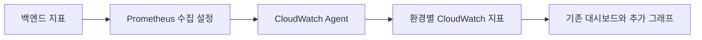

# 서버 모니터링

2026-10-23에 Dev 대시보드의 앱과 DB 대상, Prod 대시보드의 DB 대상을 EC2로 변경했다.
2026-11-05에 4대를 새 인스턴스로 교체하면서 아래 InstanceId와 EBS 대상도 새 값으로 바꿨다.
아래 RDS 지표 설명은 이전 구성의 참고 자료다. 현재 Dev와 Prod DB는 별도 EC2의 PostgreSQL을 사용한다.

| 대상 | InstanceId | Agent 설정 |
| --- | --- | --- |
| Dev 앱 `harudle-dev` | `i-0bf4f4130d31eb443` | `cloudwatch-agent.host.json`과 `cloudwatch-agent.dev.json` |
| Dev DB `harudle-dev-db` | `i-073fa344c2badcf20` | `cloudwatch-agent.db.json` |
| Prod 앱 `harudle-prod` | `i-0709aaaa1b3a1e65c` | `cloudwatch-agent.host.json`과 `cloudwatch-agent.prod.json` |
| Prod DB `harudle-prod-db` | `i-01412b89da45b5f42` | `cloudwatch-agent.db.json` |

**Dev Java와 API 지표 수집 설정은 적용 완료다.** 새 앱 서버에 `cloudwatch-agent.dev.json`을
적용했고 CloudWatch에서 Java RSS와 앱 연결 풀 지표 도착을 확인했다.

Prod DB에도 Agent를 설치하고 자동 시작을 설정했다. 메모리와 Swap, 루트 및 데이터 디스크의
여유 공간이 CloudWatch에 도착하고 Prod 대시보드 조회식이 값을 반환하는 것을 확인했다.

앱용 호스트 설정은 메모리 사용률과 여유 비율, Swap 사용률, 루트 디스크 사용률을 수집한다.
DB 설정은 루트와 데이터 디스크 `/srv/harudle/db-data`의 사용률과 남은 바이트도 수집한다.
DB 설정을 다른 서버에 적용할 때는 실제 데이터 디스크 마운트 경로를 확인한다.
설정 파일은 `/opt/harudle/monitoring/`에 배치하고 기존 설정을 보관한 뒤 Agent에 적용한다.

```bash
sudo /opt/aws/amazon-cloudwatch-agent/bin/amazon-cloudwatch-agent-ctl \
  -a append-config -m ec2 -s \
  -c file:/opt/harudle/monitoring/cloudwatch-agent.db.json
```

현재 `DASHBOARD-harudle-dev`와 `DASHBOARD-harudle-prod`는 앱과 DB의 InstanceId를 각각 사용한다.
공통 `InstanceId` 속성 변수는 두 대상을 같은 값으로 덮어쓸 수 있어 제거했다.
DB CPU와 크레딧, 상태 검사는 `AWS/EC2`, 메모리와 디스크는 `CWAgent`에서 조회한다.
Dev 데이터 디스크의 `AWS/EBS` 대상은 `vol-079e2259ecef5ae0c`,
Prod 데이터 디스크는 `vol-054247052e6a3f58e`이다.
EBS의 `VolumeAvgReadLatency`와 `VolumeAvgWriteLatency`는 밀리초이며
기존 RDS 지연 지표의 초 단위와 다르다. [EBS 공식 지표 안내](https://docs.aws.amazon.com/ebs/latest/userguide/using_cloudwatch_ebs.html)

RDS의 `DatabaseConnections`는 EC2 기본 지표로 바꿀 수 없어 해당 칸은 DB EC2 상태 검사로 교체했다.
PostgreSQL 전체 연결 수는 별도 수집이 필요하다. 기존 HikariPool 그래프는 앱 연결 풀만 보여준다.

**dev와 prod에서 API 응답과 오류, 앱과 DB EC2 자원, Java 메모리를 함께 확인합니다.** dev는 부하테스트 원인 분석을 위해 GC와 힙 외 메모리도 수집합니다.

현재 구성과 결정 이유는 [Prod 대시보드 정리 ADR](adr/2026-10-30_prod-dashboard-cleanup.md)과 [Dev 표시 및 로그 수정 ADR](adr/2026-10-30_dev-dashboard-corrections.md)에 정리합니다. 서버 전환과 Dev 경보 및 백업 감시 적용 이력은 [EC2 PostgreSQL 모니터링 결정](adr/2026-10-29_ec2-postgresql-monitoring.md)을 따릅니다. 과거 배치는 [dev 대시보드 ADR](adr/2026-10-22_cloudwatch-dashboard-layout.md)과 [prod 대시보드 ADR](adr/2026-10-22_cloudwatch-prod-dashboard-layout.md)에 기록합니다.

**처음에는 배포, Agent 설정 적용, Dev 로그 필터 8개 또는 Prod 로그 필터 4개 등록(요청별 저장소 필터 10개는 필요할 때 추가), 대시보드 저장을 모두 해야 합니다.** 대시보드 JSON만 넣으면 새 지표가 수집되지 않습니다. 같은 설정을 쓰는 이후 배포에서는 이 작업을 반복하지 않습니다. 수집 설정이나 서버가 바뀌면 해당 부분을 다시 적용합니다.

## 무엇을 볼 수 있나요?

| 그래프 | 확인하는 내용 |
|---|---|
| Dev와 Prod 맨 위 백엔드 5xx 비율 카드 | 화면 위에서 고른 시간 전체의 백엔드 5xx 응답 수를 전체 백엔드 HTTP 완료 수로 나눈 값입니다. Nginx에서 발생한 502와 504는 포함하지 않습니다. 해당 시간에 요청이 없으면 값이 비어 있습니다. |
| 맨 위 생성 실패 카드 | 화면 위에서 고른 시간 전체에 생성 작업이 실패로 확정된 건수를 보여줍니다. |
| Dev와 Prod Nginx 502/504 응답 수 | Nginx 접근 로그에서 502와 504 응답 수를 구간별로 셉니다. 백엔드가 응답하지 못하면 5xx 비율 카드에는 잡히지 않으므로 이 그래프로 확인합니다. 필터를 만든 뒤의 로그부터 집계합니다. |
| 일기 생성 DB 최종 확정 수의 예상 밖 실패 | 구조화 로그 `generation_unexpected_failure` 건수입니다. 최종 확정 수와 별개인 내부 오류 신호이므로 같은 작업이 두 선에 함께 나타날 수 있습니다. |
| 백엔드 HTTP 응답 수 그래프 | 선택한 시간에 맞는 간격으로 전체 응답 수와 5xx 오류 응답 수를 보여줍니다. 오류가 늘어난 시점을 찾을 때 씁니다. |
| Dev와 Prod API 경로별 P95 | 일반 API는 선택 기간에서 P95가 가장 높았던 경로 5개를 봅니다. 일기 생성은 요청이 있는 모든 경로를 봅니다. 경로 안의 실제 ID는 표시하지 않습니다. |
| Dev 조회 TPS와 쓰기 TPS | 피드 목록과 상세, 일기 생성과 피드 게시의 초당 성공 건수를 그래프 2개로 나눠 봅니다. 건수 차이가 커서 한 그래프에 넣으면 쓰기 선이 보이지 않기 때문입니다. |
| Dev와 Prod API P95·P99 | 일반 API와 일기 생성의 P95와 P99를 한 그래프에서 봅니다. 값 차이가 커서 일반 API는 왼쪽, 일기 생성은 오른쪽 축(모두 ms)을 씁니다. 두 축의 눈금이 다르므로 선의 높이만으로 비교하지 않습니다. |
| API RPS | 1초에 처리를 끝낸 API 요청 수입니다. 실패 응답도 포함합니다. CloudWatch가 선택한 기간에 맞춰 그래프 간격을 정하고, 세로축은 `요청/초`로 표시합니다. |
| 생성 시작 전 평균 대기 시간 | 작업 저장부터 선점까지 기다린 평균 시간입니다. 수집 설정에는 있지만 현재 대시보드에는 없습니다. |
| 생성 대기와 처리 중 작업 수 | 각 구간에서 수집한 상태별 최대 작업 수입니다. 수집 설정에는 있지만 현재 대시보드에는 없습니다. |
| 생성 접수 거절 횟수 | 접수 상한에 도달해 새 요청을 거절한 횟수입니다. 수집 설정에는 있지만 현재 대시보드에는 없습니다. |
| EC2 서버 자원 | 서버 CPU, 전체 메모리, 디스크 사용량과 서버 상태를 확인합니다. |
| Dev와 Prod EC2 네트워크 | 구간별 수신 및 송신 합계를 MB로 표시합니다. 1MB는 1,000,000바이트이며 초당 속도가 아닙니다. |
| DB EC2 자원 | DB 서버의 CPU, 여유 메모리, 데이터 디스크 공간과 EBS 처리 지연을 확인합니다. 전체 DB 연결 수는 별도 수집이 필요합니다. |
| DB 연결 획득 시간 | DB 연결을 얻기까지 걸린 평균 시간과 최근 최대 시간입니다. |
| DB 연결 대기와 시간 초과 | 현재 기다리는 요청 수와 제한 시간 안에 연결을 얻지 못한 횟수입니다. |
| Dev와 Prod 최근 DB 연결 대기 최댓값 | 최근 표시 구간에서 기다린 요청 수의 최댓값입니다. 선택한 시간 전체의 최댓값은 아닙니다. |
| Prod DB 백업 상태 (1 정상, 0 주의) | 최근 확인에서 24시간 안의 성공 백업이 있으면 1입니다. 백업이 없거나 정보를 읽지 못하면 0이므로, 0만으로 백업 실행 실패를 단정하지 않습니다. |
| Java 힙 | Java가 객체를 저장하는 메모리의 사용량과 확보량입니다. |
| Java 실제 메모리 RSS | Java 프로그램이 실제 RAM에서 사용하는 양입니다. 힙 밖의 메모리도 포함합니다. |
| dev GC 정지 시간과 횟수 | 메모리 정리로 멈춘 시간과 횟수입니다. 발생 사유는 GC 로그와 함께 확인합니다. |
| dev Java 힙 외 메모리 | 힙 밖의 메모리 사용량과 확보량입니다. 힙 사용량은 이 그래프에 넣지 않습니다. |

P95가 500ms라면 요청의 약 95%가 500ms 안에 끝났다는 뜻입니다. Prod는 일반 API에서 선택 기간의 P95가 가장 높았던 경로 5개를 보여줍니다. 일기 생성은 요청이 있는 모든 경로를 보여줍니다. 요청 수는 별도 RPS 그래프에서 확인합니다. Dev와 Prod는 일반 API와 일기 생성의 P95와 P99 그래프를 RPS 옆에 둡니다. 요청이 적은 구간의 P99는 최댓값에 가까워 한 건만 느려도 튈 수 있으므로 원인을 찾을 때 참고합니다. 두 환경의 맨 위 5xx 비율 카드와 생성 실패 카드는 선택한 시간 전체를 계산합니다. 시간 그래프의 간격은 CloudWatch가 선택한 시간 범위에 맞춰 조절합니다.

Dev의 API 구역 첫 행에는 일반 API 상위 5개와 일기 생성 전체 경로의 P95 그래프를 둡니다. 다음 행에는 RPS와 일반 API 및 일기 생성의 P95·P99 그래프를 둡니다. 상단 일반 API P95는 Prod처럼 큰 숫자와 스파크라인으로 표시합니다. 원본 `ApiResponseTimeMs`와 P95 계산은 유지하며, 값에 따라 숫자 카드의 단위가 ms에서 μs 등으로 자동 표시될 수 있습니다. 경로별 그래프의 세로축은 ms로 고정합니다.

API 시간은 서버의 처리 시간입니다. 사용자와 서버 사이의 통신 시간은 포함하지 않습니다. 자동 상태 확인과 지표 수집 요청도 새 API 그래프에서 제외합니다.

Dev 조회 TPS와 쓰기 TPS의 일기 생성과 피드 게시는 **DB 저장이 확정된 뒤** 성공으로 셉니다. 중복 생성 결과의 재조회와 취소된 DB 저장은 성공 횟수를 늘리지 않습니다. 피드 조회는 200 응답을 성공으로 셉니다. 같은 목록을 두 번 조회하면 두 건입니다.

Prod 대시보드에는 TPS를 두지 않습니다. 일반 요청량은 API RPS에서 보고, 일기 생성 성공 여부는 생성 로그와 실패 지표에서 확인합니다.

## 비동기 생성의 대기와 접수 거절

생성 실행기의 기존 시간 지표와 작업 시작 전의 대기 시간을 따로 확인합니다.
다음 지표는 dev와 prod의 수집 설정에 모두 포함했습니다.

| Prometheus 지표 | 뜻과 단위 |
| --- | --- |
| `harudle_generation_queue_wait_seconds_sum` | 선점에 성공한 작업들의 대기 시간 합계입니다. 단위는 초입니다. |
| `harudle_generation_queue_wait_seconds_count` | 대기 시간을 기록한 작업 수입니다. |
| `harudle_generation_queue_size{status="PENDING"}` | 수집 시점에 DB에서 조회한 대기 작업 수입니다. |
| `harudle_generation_queue_size{status="PROCESSING"}` | 수집 시점에 DB에서 조회한 처리 중 작업 수입니다. |
| `harudle_generation_capacity_rejections_total` | 접수 상한으로 새 요청을 거절한 누적 횟수입니다. |

대기 시간은 작업의 저장 시각부터 선점 시각까지 측정합니다. 선점 저장이 취소되면 집계하지 않습니다.
접수 거절은 저장이 취소되는 요청이므로 거절 시점에 바로 집계합니다. 같은 요청의 기존 작업을 반환할 때는 거절 횟수를 늘리지 않습니다.

작업 수는 지표 수집마다 상태별로 두 번 조회합니다. 현재 수집 간격은 dev가 10초, prod가 1분입니다.
DB 조회에 실패하면 작업 수를 0으로 표시하지 않고 측정 불가 값인 `NaN`을 반환합니다. 다음 수집 때 다시 조회합니다.
수집 간격 사이의 짧은 상태 변화는 작업 수 그래프에서 놓칠 수 있습니다. 선점별 대기 시간과 거절 횟수를 함께 봅니다.

대시보드의 평균 대기 시간은 같은 구간의 시간 합계를 작업 수로 나눈 값입니다. 이 값으로 P95를 알 수는 없습니다.
작업 수 그래프는 상태별 최대값을 표시합니다. 각 최대값의 발생 시점이 다를 수 있으므로 두 값을 더해 접수 상한 준수 여부를 판단하지 않습니다.
CloudWatch에서 시간 합계와 횟수는 Agent가 변환한 증가분의 `Sum`으로 확인합니다.
사용자 ID와 생성 ID는 지표 구분값으로 붙이지 않습니다.

적용과 확인은 다음 순서로 진행합니다.

1. 변경한 백엔드를 배포하고, 아래의 Agent 설정 적용 절차를 다시 실행합니다. 배포만으로 Agent의 활성 설정이 바뀌지는 않습니다.
2. dev의 `/actuator/prometheus`에서 위 지표 이름과 두 상태가 보이는지 확인합니다.
3. dev에서 Stub 작업으로 접수 상한을 채운 뒤 새 요청 하나를 보냅니다. `503 GENERATION_CAPACITY_EXCEEDED` 응답과 거절 누적값의 증가를 확인합니다.
4. 먼저 접수한 작업이 선점되면 대기 시간의 기록 수가 늘어나는지 확인합니다. 같은 요청을 다시 보내도 작업 수와 거절 횟수가 늘지 않아야 합니다.
5. 아래 대시보드 생성 절차로 JSON을 다시 만들고 저장합니다. 평균 대기 시간, 상태별 작업 수, 접수 거절 횟수 그래프의 실제 수집값을 확인합니다.

현재 변경은 저장소의 코드와 설정 파일에 반영한 상태입니다. 실제 서버 적용과 CloudWatch 유입 확인은 별도 작업입니다.

## dev/prod 배포 전에 확인

1. S3 담당 팀원에게 환경별 파일 복사·검증 결과를 인수받고, [이미지 저장소 전환 안내](../../docs/image-storage-isolation.md)에 따라 DB 이미지·프롬프트 key와 서버 `.env`를 함께 전환한다. 현재 코드는 `DEPLOY_ENV`와 두 prefix의 일치를 검사하고, 조회·저장·삭제·복구·URL 발급 전에 현재 환경의 경로인지 검증한다. **기존 공용 key는 새 코드에서 거절되므로 파일 복사만으로 배포 준비가 끝나지 않는다.** 애플리케이션 검증은 공유 IAM 역할을 쓰는 콘솔·CLI 접근까지 제한하지 않는다. IAM 제한이 불가능하면 그 잔여 위험을 기록하며, 해당 환경의 전환·검증이 끝난 뒤 배포한다.
2. 확인된 dev 로그 그룹 `/harudle/dev/backend`, `/harudle/dev/frontend-nginx`, `/harudle/dev/prometheus-emf`는 Standard 클래스·14일 보존이다. prod 백엔드·프론트 로그 그룹은 Standard 클래스·30일 보존으로 확인됐다. 배포 전 그룹과 보존 기간을 다시 확인한다.
3. dev EC2의 **Docker daemon이 쓰는 인스턴스 역할**에 해당 로그 그룹의 `logs:CreateLogStream`, `logs:PutLogEvents` 권한이 있는지 확인한다. dev Compose는 그룹을 자동 생성하지 않는다. 그룹 또는 권한이 없으면 awslogs 초기화 실패로 컨테이너 배포가 실패한다.
4. 호스트의 `19091` 포트가 비어 있는지, Docker 버전과 보안 그룹·방화벽에서 외부 접근이 차단되는지 확인한다. Compose와 Agent 수집 대상이 같은 고정 포트를 사용한다.
5. `/opt/harudle/.env`에 `DEPLOY_ENV=dev`가 명시됐는지 확인한다. prod의 `.env`에도 `DEPLOY_ENV=prod`를 명시해야 한다. 값이 없으면 배포를 중단한다.

## 서버 자원은 어디서 확인하나요?

CloudWatch의 `지표` 화면에서 아래 지표를 선택합니다. 앱과 DB는 서로 다른 `InstanceId`를 사용합니다. 기본 대상은 [targets.json](targets.json)에 기록합니다. 2026-11-05에 확인한 네 인스턴스의 ID를 기본 대상과 대시보드 복구 파일, Dev EC2 경보 파일, Prod 백업 감시 코드에 반영했습니다. 같은 날 서버 안에서 확인한 DB 데이터 볼륨 ID도 기본 대상과 대시보드 복구 파일에 반영했습니다. 저장소 수정만으로 AWS 대시보드와 경보, 서버의 백업 감시 코드가 갱신되지는 않습니다.

| 환경 | 앱 EC2 | DB EC2 | 데이터 EBS |
| --- | --- | --- | --- |
| Dev | `i-0bf4f4130d31eb443` | `i-073fa344c2badcf20` | `vol-079e2259ecef5ae0c` |
| Prod | `i-0709aaaa1b3a1e65c` | `i-01412b89da45b5f42` | `vol-054247052e6a3f58e` |

2026-11-05에 각 서버 안에서 확인한 연결 볼륨은 다음과 같습니다. 모든 볼륨의 크기는 20GiB입니다.

| 서버 | 루트 볼륨 `/` | 데이터 볼륨 `/srv/harudle/db-data` |
| --- | --- | --- |
| `harudle-dev` | `vol-04168830fc9e54269` | 없음 |
| `harudle-prod` | `vol-0d822e69c6847b8db` | 없음 |
| `harudle-dev-db` | `vol-09c6bfa4624f33903` | `vol-079e2259ecef5ae0c` |
| `harudle-prod-db` | `vol-0429a6ceab7faadac` | `vol-054247052e6a3f58e` |

앱 서버는 루트 볼륨 하나를 사용합니다. DB 서버는 루트 볼륨과 데이터 볼륨을 사용합니다.
DB 데이터 볼륨은 암호화 gp3이며, 인스턴스를 종료해도 삭제되지 않도록 설정했습니다.
대시보드의 `AWS/EBS` 지표와 `targets.json`의 `db_volume_id`는 DB 데이터 볼륨을 조회합니다.
루트 디스크의 공간 지표는 볼륨 ID 대신 해당 인스턴스의 `path=/`로 조회합니다.

| 확인할 값 | 지표 그룹과 이름 | 살펴볼 내용 |
| --- | --- | --- |
| 앱과 DB CPU | `AWS/EC2`, `CPUUtilization` | 사용률이 높게 유지되는지 확인합니다. |
| 앱과 DB 서버 상태 | `AWS/EC2`, `StatusCheckFailed` | 서버 상태 검사입니다. PostgreSQL 접속 성공을 뜻하지 않습니다. |
| 여유 메모리와 Swap | `mem_available_percent`, `swap_used_percent` | Dev 앱과 두 DB는 `CWAgent`, 현재 Prod 앱은 `Harudle/Prod`입니다. 설정을 중복 적용하지 않습니다. |
| 데이터 저장 공간 | `CWAgent`, `disk_free`, `disk_used_percent` | DB의 `path=/srv/harudle/db-data`와 루트 `/`를 따로 봅니다. |
| 데이터 디스크 처리 | `AWS/EBS`, `VolumeAvgReadLatency`, `VolumeAvgWriteLatency`, `VolumeQueueLength` | 지연은 밀리초입니다. 지연 지표에는 `VolumeId`와 `InstanceId`, 대기 길이에는 `VolumeId`를 맞춥니다. |
| 앱 연결 대기 | 환경별 `Harudle/Dev`, `Harudle/Prod`의 Hikari 지표 | 앱 연결 풀만 보여줍니다. PostgreSQL 전체 연결 수와 다릅니다. |

처음에는 같은 시간 범위와 5분 간격으로 비교합니다. CPU는 평균과 최대, 남은 공간은 최소값도 확인합니다. EC2 CPU의 기본 수집 간격은 5분이며, 상세 모니터링을 켠 경우에는 1분입니다. 서버 메모리와 디스크는 아래 Agent 설정으로 1분마다 수집합니다.

T 계열 서버는 `CPUCreditBalance`도 확인합니다. 값이 줄면 기본 성능보다 높은 CPU 성능을 사용할 수 있는 양이 줄었다는 뜻입니다. Unlimited 모드는 잔여량이 0이어도 계속 사용할 수 있지만 추가 비용이 생길 수 있으므로, 0만 보고 성능 제한으로 단정하지 않습니다.

지표의 뜻은 [EC2 공식 안내](https://docs.aws.amazon.com/AWSEC2/latest/UserGuide/viewing_metrics_with_cloudwatch.html), [Agent 공식 안내](https://docs.aws.amazon.com/AmazonCloudWatch/latest/monitoring/metrics-collected-by-CloudWatch-agent.html), [EBS 공식 안내](https://docs.aws.amazon.com/ebs/latest/userguide/using_cloudwatch_ebs.html)를 참고합니다.

## 팀원에게 같은 설정을 보이게 하려면

AWS에 저장한 대시보드와 경보는 같은 계정과 리전에서 조회하는 팀원에게 함께 보입니다. 저장소 변경만으로 AWS 설정이 바뀌지는 않습니다. 환경별 기본 ID는 `targets.json`에 기록합니다. 서버 교체 뒤에는 이 파일과 복구용 대시보드, 실제 경보의 `Dimensions`를 현재 ID로 수정한 뒤 적용합니다. 대시보드의 공통 `InstanceId` 변수는 앱과 DB를 같은 서버로 덮어쓸 수 있으므로 사용하지 않습니다.

### Dev와 Prod 대시보드 구성을 복구하려면

정상 구성은 [dashboards/prod.json](dashboards/prod.json)에 보관합니다. 2026-11-03에 `DASHBOARD-harudle-prod`에 저장한 위젯 57개의 설정이며, P95와 생성 실패 및 R2 카드와 P95·P99 그래프도 포함합니다. 실제 측정 데이터나 로그 검색 결과를 보관하는 파일은 아닙니다. Dev 정상 구성은 [dashboards/dev.json](dashboards/dev.json)에 보관합니다. 2026-11-03에 `DASHBOARD-harudle-dev`에 저장한 위젯 58개의 설정입니다. Dev를 복구할 때는 아래 절차에서 대시보드와 JSON을 Dev 것으로 선택합니다. Dev 구성에는 DB 백업 카드가 없습니다. 두 복구 파일의 인스턴스 ID와 DB 데이터 볼륨 ID는 2026-11-05에 확인한 값으로 갱신했습니다. 위젯 배치는 2026-11-03 구성을 유지합니다.

1. 서울 리전의 `DASHBOARD-harudle-prod`를 열고 **작업 > 소스 보기/편집**을 선택합니다. 되돌릴 필요가 있을 때를 위해 현재 JSON도 먼저 복사해 둡니다.
2. `dashboards/prod.json` 전체를 붙여 넣고 **업데이트**한 뒤 대시보드를 **저장**합니다. 원래 구성으로 복구할 때 준비 스크립트는 필요하지 않습니다.
3. 새로고침하고 카드 배치, P95와 R2 카드, 로그 표가 복구됐는지 확인합니다. 서버가 교체됐다면 인스턴스와 EBS 대상도 먼저 확인해야 합니다.

이 작업은 대시보드 구성만 복구합니다. 경보 자체, 지표 필터, Agent와 백업 감시 설정은 별도입니다. 콘솔에서 구성을 의도적으로 바꿨다면 검토 후 최신 JSON으로 이 파일도 갱신하고 Git 기록에 남깁니다. 현재 서버 ID나 저장소의 설정값만 바꿔도 이 복구 파일이 자동 갱신되지는 않습니다.

대시보드는 서비스 실패, 속도, 생성 작업, DB 연결과 저장 공간, 서버 자원, 상세 로그 순서로 봅니다. Dev는 부하 테스트를 위해 Java 메모리와 GC를 서버 자원보다 앞에 둡니다. Prod는 DB 자원을 먼저 보고 Java 메모리는 뒤에서 원인을 확인할 때 봅니다. Prod는 최근 24시간 안에 성공한 백업이 있는지와 백업 정보 조회 성공 여부도 표시합니다. PostgreSQL 직접 접속, 전체 연결 수, 개별 백업 실행 실패 알림과 WAL 전송 상태는 아직 수집하지 않습니다. Dev 백업 감시도 미수집 상태이며, 대시보드에는 관련 안내를 두지 않습니다.

두 환경 모두 앱 EC2의 CPU, 여유 메모리, Swap, 루트 디스크 카드를 한 행에 4개씩 배치합니다. DB EC2 첫 행에는 CPU 카드, 여유 메모리 카드, CPU 그래프를 배치합니다. Dev의 Java와 GC 지표는 유지합니다. Dev 맨 위 카드는 Prod처럼 3개씩 2줄로 배치합니다.

Dev와 Prod 상세 로그의 OAuth 검색은 메시지 안에 기록된 이벤트도 읽어 제공자와 실패 이유를 표시합니다. Nginx 검색은 502와 504 응답, 실제 upstream 오류만 표시합니다. 정상 요청의 `upstreamConnectSeconds` 같은 항목 이름은 오류로 처리하지 않습니다. `External Failure Trend`는 제거하고, `Gemini & S3 Failures` 표를 상세 로그의 첫 행 전체에 표시합니다. 발생 시간, 제공자, 작업, 실패 유형, 응답 코드와 추적 ID를 이 표에서 확인합니다. 조회 범위는 대시보드에서 선택한 시간을 따릅니다. 검색 결과가 비어 있으면 조회 조건과 실제 로그 형식을 확인한 뒤 오류 발생 여부를 판단합니다.

## 1. 백엔드를 배포하고 서버 수집을 적용합니다

먼저 dev에 배포하고 확인한 뒤 prod에도 적용합니다. 배포는 설정 파일을 EC2의 `/opt/harudle/monitoring`에 복사합니다. **현재 배포 스크립트는 Agent에 새 설정을 적용하지 않으므로 아래 명령을 별도로 실행해야 합니다.**

앱 EC2에서 아래 명령을 실행합니다. prod에서는 첫 줄을 `MONITORING_ENV=prod`로 바꿉니다.

```bash
MONITORING_ENV=dev
curl --fail --silent --show-error http://127.0.0.1:19091/actuator/prometheus >/dev/null &&
sudo /opt/aws/amazon-cloudwatch-agent/bin/amazon-cloudwatch-agent-ctl \
  -a append-config -m ec2 -s \
  -c "file:/opt/harudle/monitoring/cloudwatch-agent.${MONITORING_ENV}.json"
```

기존 Agent가 설치되어 있고 로그와 지표를 보낼 권한이 있어야 합니다. 새 Agent를 설치하지 않고 기존 Agent의 설정을 갱신합니다. 적용 전 활성 설정을 보관합니다. `append-config`는 기존 서버 자원 수집을 유지하면서 새 설정을 적용하고 Agent를 재시작합니다. 같은 서버에 dev와 prod 파일을 모두 적용하지 않습니다. 명령이 실패하면 오류를 확인한 뒤 다음 단계로 넘어갑니다.

**EC2 전체 메모리와 디스크 지표가 아직 없을 때만** 같은 EC2에서 아래 설정도 추가합니다. `cloudwatch-agent.host.json`은 dev와 prod가 공통으로 사용하며, 이미 같은 지표를 수집하고 있다면 추가하지 않습니다. EC2 CPU와 EBS 지표는 AWS가 제공하므로 이 파일로 수집하지 않습니다.

```bash
sudo /opt/aws/amazon-cloudwatch-agent/bin/amazon-cloudwatch-agent-ctl \
  -a append-config -m ec2 -s \
  -c file:/opt/harudle/monitoring/cloudwatch-agent.host.json
```

DB EC2에는 앱의 Prometheus 설정 대신 `cloudwatch-agent.db.json`을 사용합니다. 루트와 데이터 디스크 마운트 경로를 먼저 확인합니다. 기존 지표가 계속 도착한다면 Agent를 다시 적용하지 않습니다. 직접 확인할 때는 아래 읽기 전용 명령을 사용합니다.

```bash
systemctl is-active amazon-cloudwatch-agent
systemctl is-enabled amazon-cloudwatch-agent
sudo /opt/aws/amazon-cloudwatch-agent/bin/amazon-cloudwatch-agent-ctl -a status
```

설정 추가가 필요한 경우에만 기존 설정을 보관한 뒤 DB 서버에서 실행합니다. 이 명령은 Agent를 재시작합니다.

```bash
sudo /opt/aws/amazon-cloudwatch-agent/bin/amazon-cloudwatch-agent-ctl \
  -a append-config -m ec2 -s \
  -c file:/opt/harudle/monitoring/cloudwatch-agent.db.json
```

지표 포트 `19091`은 서버 안에서만 접근해야 합니다. JSON 백엔드 로그는 기존 Docker 설정이 `/harudle/dev/backend` 또는 `/harudle/prod/backend`로 보냅니다.

## 2. 내 컴퓨터에서 대시보드 파일을 만듭니다

**준비 스크립트는 선택 사항입니다.** CloudWatch 콘솔에서 직접 수정하고 저장해도 됩니다. 스크립트는 설정을 파일로 검토하거나 다시 적용할 때 사용하며, AWS 설정을 자동으로 변경하지 않습니다. 콘솔을 편집한 뒤에는 최신 JSON을 다시 복사해 입력으로 사용합니다.

기본 상태 항목 6개가 갖춰지고 모든 위젯의 위치와 크기가 있는 Prod 원본과 Dev 원본은 기존 배치를 유지합니다. 스크립트가 P95 카드를 다시 만들거나 생성 실패 카드를 추가하지 않으며, R2처럼 콘솔에서 추가한 카드도 원래 위치와 크기를 유지합니다. 기존 단위와 로그 검색 조건의 보정은 계속 적용하므로, 생성 결과와 원본을 비교한 뒤 필요한 경우에만 콘솔에 적용합니다.

**이 단계는 배포 전에도 할 수 있습니다.** 내 컴퓨터에 Python 3만 있으면 됩니다. AWS CLI는 필요하지 않습니다. 저장소 최상위 경로에서 아래 명령을 실행합니다. 기본 앱 ID는 `targets.json`에서 읽습니다. 서버가 바뀌면 이 파일과 실제 AWS 설정을 함께 갱신합니다. prod를 준비할 때는 환경도 `prod`로 바꿉니다.

```bash
MONITORING_ENV=dev
MONITORING_DIR="$HOME/Downloads/harudle-monitoring-${MONITORING_ENV}"
mkdir -p "$MONITORING_DIR"
```
dev에서 Agent 버전과 활성 설정을 기록하고, 안전한 테스트 요청 전후의 `/actuator/prometheus` 누적값·`/harudle/dev/prometheus-emf`의 증가분·CloudWatch 5분 `Sum`을 대조한다. 백엔드 재시작 뒤에도 큰 오탐 증가분이나 음수가 나오지 않는지 확인한 다음 알람을 활성화한다. 오류가 발생했을 때만 생성되는 시계열의 데이터 없음은 `notBreaching`으로 취급한다. 반대로 `hikaricp_connections_pending`처럼 매 수집 주기에 나오는 게이지가 dev에서 실제로 연속 게시되는지 확인한 뒤, 그 시계열의 무데이터를 `breaching`으로 보는 **별도 수집 중단 알람**을 둔다. Hikari가 연속 게시되지 않으면 Agent 상태를 나타내는 다른 지속 신호를 먼저 정한다. [CloudWatch 결측값 처리](https://docs.aws.amazon.com/AmazonCloudWatch/latest/monitoring/alarms-and-missing-data.html)를 참고한다.

dev에서 단일 오류가 한 건으로 전달되는지 별도로 확인한다.

1. 백엔드와 Agent가 정상 수집 중이고 다른 오류가 없는 상태에서 Agent의 정기 수집을 먼저 기다린다. `/actuator/prometheus`에 대상 `harudle_generation_unexpected_failures_total{phase="..."}` 시계열이 0으로 존재하는지 확인한다.
2. 안전한 dev 테스트로 해당 단계의 예상 밖 오류를 **한 건만** 발생시키고 구조화 로그의 `generation_unexpected_failure` 한 건, 해당 로그 지표 필터의 CloudWatch 5분 `Sum=1`, Prometheus 누적값 `0 → 1`을 확인한다. 만료 처리도 `generation_finalized`의 `status=FAILED`·`errorCode=GENERATION_INTERRUPTED` 로그 한 건과 필터 `Sum=1`을 별도로 확인한다.
3. 다음 Agent 수집 뒤 `/harudle/dev/prometheus-emf`에서 같은 `phase`의 증가분 1건을 찾고, 다른 오류가 없는 CloudWatch 5분 평가 창에서 해당 카운터 시계열의 `Sum=1`을 확인한다. 이후 수집에서 같은 오류가 반복 집계되지 않는지도 확인한다. 첫 수집 전 오류의 카운터 증가분이 빠지더라도 구조화 로그가 수집됐다면 로그 필터의 첫 건 경보가 작동해야 한다.

## 후속: 이미지 전체 점검과 삭제 감사

DB의 성공 이미지와 S3 객체를 주기적으로 대조하는 전체 점검은 이번 배포의 계측·알람 범위에서 제외한다. 이 기능을 다시 설계할 때 존재하는 키와 없는 키의 HEAD가 각각 200·404인지 dev/prod에서 확인하고, 403을 누락으로 단정하지 않아야 한다. 마지막 전체 순회의 누락 수는 그 시점의 표본 결과이지 현재 전체 누락 수가 아니다.

전체 점검이 없는 동안 **아무도 열어보지 않은 기존 이미지가 삭제되면 자동으로 발견할 수 없다.** 로그인 사용자 화면의 이미지 로드 실패 이벤트는 실제 표시 실패를 알려 주지만, 게스트·공유 화면과 열어보지 않은 이미지는 관측하지 않는다. 현재 코드는 생성 이미지와 참조 이미지의 환경별 prefix를 검증해 다른 환경의 key를 사용한 조회·저장·삭제·복구·URL 발급을 거절한다. 기존 공용 DB key와 프롬프트 참조 key도 환경별 경로로 전환해야 한다. 이 검증은 애플리케이션 경계이므로 공유 IAM 역할을 사용하는 콘솔·CLI의 교차 환경 삭제를 막지는 못한다. AWS는 객체 prefix별 IAM 정책을 지원하지만, 이 공유 인프라에서 역할·정책을 변경할 수 있는지는 확인되지 않았다. 적용할 수 없다면 이 제한을 잔여 위험으로 남기고 삭제 경로의 범위를 검증한다. CloudTrail S3 객체 데이터 이벤트와 버전 관리의 도입 여부도 따로 결정한다.

## API 오류 비율과 지연 시간

CloudWatch에서 해당 환경의 기존 대시보드를 열고 **Actions > View/edit source**를 선택합니다. JSON 전체를 복사해 위 폴더의 `before.json`으로 저장합니다. dev는 `DASHBOARD-harudle-dev`, prod는 `DASHBOARD-harudle-prod`를 사용합니다. 복사한 JSON에는 대시보드 이름이 없으므로 **환경이 맞는지 직접 확인해야 합니다.**

같은 터미널에서 아래 명령을 실행합니다.

```bash
python3 deploy/monitoring/prepare_dashboard.py \
  --environment "$MONITORING_ENV" \
  --dashboard "$MONITORING_DIR/before.json" \
  --output "$MONITORING_DIR"
```

Python 스크립트는 AWS에 접속하지 않고 **내 컴퓨터에 파일만 만듭니다.**

- `before.json`: 직접 저장한 변경 전 대시보드입니다. 스크립트가 수정하지 않습니다. 적용 확인이 끝날 때까지 보관합니다.
- `dashboard.json`: 알려진 단위 오류와 로그 검색 조건을 보정한 대시보드입니다. 완성된 Prod 구성은 배치를 유지하고, 그 외 원본은 환경별 배치 규칙을 적용합니다.
- `metric-filter-*.json`: 로그를 지표로 바꾸는 설정입니다. Dev는 API 시간과 작업 성공 횟수 및 경로별 시간과 Nginx 오류용 8개, Prod는 API 시간과 경로별 시간 및 Nginx 오류용 4개를 먼저 만들고, 이어서 요청별 저장소 작업용 10개를 만듭니다.

임시 앱 ID `i-00000000000000000`은 기본 앱 ID로 고칩니다. 다른 서버 ID는 자동 변경하지 않습니다. 이미 있는 그래프는 계산식을 보존합니다. 같은 원본으로 반복 실행해도 그래프가 중복되지 않습니다. 과거 DB 서비스의 지표가 남은 원본은 거절하므로, EC2 PostgreSQL로 전환한 최신 원본을 사용합니다.

Dev에는 GC와 힙 외 메모리 진단을 유지합니다. Prod에는 이 지표를 새로 추가하지 않습니다. 원본에 있는 앱과 DB EC2, EBS 그래프는 보존합니다. 서버 변경 시 원본의 대상 ID도 먼저 확인합니다.

## 3. 콘솔에서 로그 필터를 등록합니다

로그 필터는 백엔드 로그의 응답 시간과 성공 횟수를 CloudWatch 지표로 저장합니다. **콘솔에서 필터와 대시보드를 수정할 권한이 있는 계정**으로 진행합니다. 리전은 서울 `ap-northeast-2`입니다.

1. `metric-filter-1.json`을 엽니다.
2. CloudWatch의 **Logs > Log groups**에서 파일의 `logGroupName`과 같은 로그 그룹을 엽니다.
3. **Actions > Create metric filter**를 선택하고 아래 표대로 입력해 저장합니다.
4. Dev는 `metric-filter-8.json`까지 등록합니다. Prod는 `metric-filter-4.json`까지 등록합니다. 마지막 파일의 로그 그룹은 `frontend-nginx`이므로 그 파일의 `logGroupName`을 확인합니다. 같은 `filterName`이 이미 있으면 해당 필터를 수정합니다. 기존 Prod에 남은 작업별 성공 필터(`harudle-prod-DiaryGenerationSucceeded`, `harudle-prod-FeedPublicationSucceeded`, `harudle-prod-FeedListSucceeded`, `harudle-prod-FeedDetailSucceeded`)는 `/harudle/prod/backend` 로그 그룹에서 한 번 삭제합니다. 요청별 저장소 작업을 볼 때는 뒤이은 10개 파일(Dev는 9번부터, Prod는 5번부터)도 등록합니다.

| 콘솔 입력란 | JSON에서 복사할 값 |
|---|---|
| Filter pattern | `filterPattern` |
| Filter name | `filterName` |
| Metric namespace | `metricNamespace` |
| Metric name | `metricName` |
| Metric value | `metricValue` |
| Unit | `unit` |
| Default value | `defaultValue`가 있을 때만 입력합니다. 없으면 비웁니다. |
| Dimensions | `dimensions`가 있을 때만 이름과 값을 입력합니다. |

`metricNamespace`부터는 `metricTransformations` 안의 첫 번째 항목에서 찾습니다. 각 입력란에 JSON의 값만 옮깁니다. 예를 들어 `"{ $.event = \"feed_publication_succeeded\" }"`는 `{ $.event = "feed_publication_succeeded" }`로 입력합니다.

**1번과 2번의 Default value는 비웁니다.** 2번은 Dimensions에 이름 `ApiGroup`, 값 `$.apiGroup`을 넣습니다. Prod의 3번과 Dev의 7번도 Default value는 비우고 Metric value는 `$.durationMs`, Unit은 `Milliseconds`로 설정합니다. Dimensions에는 `ApiGroup`과 `ApiRoute`를 각각 `$.apiGroup`, `$.apiRoute`로 넣습니다. Dev의 3번부터 6번은 Metric value가 `1`, Default value가 `0`, Unit이 `Count`입니다. Nginx 필터(Prod의 4번, Dev의 8번)는 Metric value가 `1`, Default value가 `0`이고 Unit은 비웁니다. 요청별 저장소 필터는 JSON의 작업 횟수 또는 시간을 사용합니다. 시간 필터는 해당 작업 횟수가 1 이상인 요청만 집계하며 Default value를 비웁니다.

필터는 등록 이후 들어오는 로그부터 집계합니다. 로그와 사용자 정의 지표에는 CloudWatch 비용이 발생합니다. 화면 설명은 [AWS 로그 필터 등록 안내](https://docs.aws.amazon.com/AmazonCloudWatch/latest/logs/CreateMetricFilterProcedure.html)를 참고합니다.

## 4. 완성된 대시보드 JSON을 저장합니다

1. 2단계에서 복사한 **같은 환경의 대시보드**를 엽니다.
2. **Actions > View/edit source**에서 전체 내용을 생성된 `dashboard.json`의 내용으로 바꿉니다.
3. 변경 내용을 적용하고 대시보드를 저장합니다. 서비스 오류와 속도가 먼저 보이고 Dev와 Prod의 진단 구역이 다른지 확인합니다. 이전에 적용한 그래프는 중복 추가되지 않습니다.

`dashboard.json`에는 기존 그래프도 들어 있습니다. 복사한 뒤 다른 사람이 대시보드를 수정했다면 최신 JSON으로 2단계부터 다시 만듭니다. 대시보드도 배포 전에 저장할 수 있지만, 새 코드와 수집 설정이 적용되고 데이터가 들어와야 새 그래프에 값이 나옵니다.

## 5. 적용 후 확인합니다

1. 해당 환경에서 피드 목록과 상세 화면을 엽니다.
2. CloudWatch Logs의 백엔드 로그에서 `event = api_request_completed`를 찾습니다. `durationMs`가 숫자이고 `httpStatus`가 실제 응답과 같은지 확인합니다. 두 환경의 `apiRoute`는 `GET:/api/v1/feeds/{feedId}`처럼 경로 패턴이며 실제 사용자 ID를 포함하지 않습니다.
3. CloudWatch의 `DASHBOARD-harudle-dev` 또는 `DASHBOARD-harudle-prod`에서 최근 시간을 선택합니다. Prod는 일반 API의 P95 상위 5개 경로와 생성 API 전체 경로, P95·P99 그래프, RPS에 값이 나오는지 확인합니다. Dev도 두 경로별 P95 그래프와 P95·P99 그래프, RPS에 값이 나오는지 확인합니다. 대시보드 간격은 선택한 시간에 따라 달라집니다.
4. DB와 Java 지표는 dev는 10초, prod는 1분마다 수집합니다. dev는 `prometheus.dev.yaml`, prod는 `prometheus.yaml`을 사용합니다. 해당 환경의 `prometheus-emf` 로그와 `Harudle/Dev` 또는 `Harudle/Prod` 지표에 새 값이 들어오는지 확인합니다. RSS도 dev는 10초, prod는 1분 간격이며 Dev는 `CWAgent`, 현재 Prod는 `Harudle/Prod`에서 해당 EC2와 Java 실행 조건으로 찾습니다. 대시보드 집계 간격은 1분입니다.
5. 일기 생성과 피드 게시가 실제 성공한 시각에 `Harudle/Dev`의 해당 성공 지표가 기록되는지 CloudWatch 지표 화면에서 확인합니다.
6. 앱과 DB EC2의 CPU, 여유 메모리와 데이터 디스크에 새 값이 들어오는지 확인합니다. 디스크는 실제 `path`와 `fstype`도 맞춰 선택합니다. 기존 오류 그래프도 계속 들어와야 합니다.

DB 연결 평균은 `연결에 쓴 시간의 합 / 연결 횟수`입니다. 최근 최대는 Java가 보관하는 최근 최대값이며, 선택한 전체 기간의 모든 연결 시간을 직접 보관한 값은 아닙니다. 연결 시간 초과 횟수는 모든 DB 오류를 뜻하지 않습니다.

Prod의 DB 연결 획득 시간은 원본 초 값을 1,000배 해 밀리초로 표시합니다. 세로축은 `밀리초 (ms)`로 명시하고 자동 단위 표시는 끕니다. 계산 결과에 초 단위가 다시 붙는 것을 방지합니다.

Prod의 Java 힙과 RSS는 원본 바이트 값을 1,048,576으로 나눠 MiB로 표시합니다. 세로축은 `메모리 (MiB)`로 명시하고 자동 바이트 단위 표시는 끕니다.

현재 설정의 연결 풀 이름은 `HikariPool-1`입니다. 풀 이름을 바꾸거나 서버를 여러 대로 늘리면 수집 차원과 그래프도 함께 검토합니다.

## dev 부하테스트에서 GC 원인을 확인합니다

**첫 비교에서는 GC 종류와 힙 크기를 유지합니다.** dev Compose는 기존 Java 옵션에 `-Xlog:gc*,safepoint:stdout:time,uptime,level,tags`만 추가합니다. 배포로 Java가 재시작되므로 재시작 시각과 테스트 전 사전 요청 조건도 기록합니다.

1. dev에 배포하고 위 1단계의 `MONITORING_ENV=dev` Agent 명령을 적용합니다. 이 명령은 자동 배포에 포함되지 않습니다. 기존 Agent 설정을 보관한 뒤 적용하고 Agent가 정상 실행되는지 확인합니다.
2. `/actuator/prometheus`에서 `jvm_gc_pause_seconds_{count,sum,max}`와 `jvm_memory_{used,committed,max}_bytes`의 실제 이름과 타입을 확인합니다. GC 지표는 GC가 발생한 뒤 생길 수 있습니다. dev의 `prometheus-emf`에도 새 값이 들어와야 합니다.
3. 기존 dev 대시보드의 최신 JSON으로 위 2단계를 다시 실행하고 `dashboard.json`을 적용합니다. 기존 기본 필터 6개는 유지합니다. 경로별 P95를 함께 볼 때는 위 절차의 7번 필터도 등록하고, Nginx 오류를 볼 때는 8번 필터도 등록합니다. 요청별 작업 지표도 보려면 새 필터 10개를 추가합니다.
4. 새 실행 이름으로 데이터를 준비한 뒤 아래 OS 기록을 시작하고, 내 컴퓨터에서 같은 실행 이름으로 k6를 실행합니다. 예시는 `peak2` 데이터 준비가 끝나 해당 폴더가 존재하는 경우입니다.

**EC2의 Session Manager 터미널에서 실행합니다.** `vmstat`은 CPU, 사용 가능한 메모리와 swap 입출력을 1초마다 약 10분 동안 기록합니다. 실행 중에는 이 EC2 터미널을 열어 두고, 별도로 내 컴퓨터에서 k6를 실행합니다. 이미 같은 기록 파일이 있으면 덮어쓰지 않고 멈춥니다.

```bash
sudo sh -c 'umask 077; set -C; TZ=UTC vmstat -w -t 1 601 > /opt/harudle/load-test/runs/peak2/vmstat.log'
```

첫 데이터 행은 부팅 이후 평균이므로 비교에서 제외합니다. 이후 행의 `si/so`는 swap 읽기와 쓰기, `us/sy/wa/st`는 CPU 사용자 작업, 운영체제 작업, 입출력 대기, 가상 CPU 대기 비율입니다. 이 값들은 호스트 전체 값이며 Java만의 디스크 대기를 직접 증명하지는 않습니다. 호스트 Agent 설정이나 swap 동작은 이 명령으로 변경하지 않습니다.

5. 일반 API가 1초 이상 걸리면 로컬 `k6.log`에서 `traceId`를 찾고, `/harudle/dev/backend`에서 같은 ID의 `api_request_completed`를 검색합니다. 서버가 생성한 ID는 `X-Trace-Id` 응답 헤더로 전달됩니다. ID는 로그에만 쓰며 지표 차원으로 추가하지 않습니다.
6. 같은 시간 범위의 GC 로그와 `vmstat.log`를 비교합니다. CloudWatch Logs Insights에서는 아래처럼 GC 사유, CPU 시간, 정지 시간을 확인할 수 있습니다. GC 로그는 JSON이 아닌 JVM 표준 출력이므로 기존 API JSON 지표 필터로 집계하지 않습니다.

```text
fields @timestamp, @message
| filter @message like /Pause Full|gc,cpu|safepoint/
| sort @timestamp asc
```

GC의 `User/Sys`는 CPU 시간, `Real`은 실제 경과 시간입니다. `Real`이 길다는 사실만으로 swap이 원인이라고 확정하지 않고 같은 시각의 OS 기록을 함께 봅니다. `jvm_gc_pause_seconds_max`는 Java가 유지하는 최근 최대값이며 정확한 이벤트 시각과 발생 사유는 GC 로그로 확인합니다. 메모리 비교 그래프는 1분 평균이며 `max_bytes=-1`은 해당 메모리 영역의 상한이 정해지지 않았다는 뜻입니다.

GC의 count와 sum은 Agent가 누적값을 수집 간 증가분으로 변환하므로 CloudWatch에서는 `Sum`을 사용합니다. `DIFF/RATE`를 다시 적용하거나 sum/count에 P95를 적용하지 않습니다. **각 시계열의 첫 수집값은 증가분으로 계산되지 않으므로 첫 GC가 지표에서 빠질 수 있습니다. 전체 GC 확인에는 시작부터 남긴 JVM 로그를 사용합니다.** 10초 수집이 1초 단위 CloudWatch 그래프나 정지 중 응답을 보장하지는 않습니다.

테스트 종료 후 로컬 `summary.json`, `report.html`, `k6.log`와 EC2의 `vmstat.log`, 같은 구간의 CloudWatch 로그와 지표를 보관합니다. 최종 요약이 저장되기 전에 k6를 강제 종료하지 않습니다. 같은 조건에서 긴 지연이 재현되는지 먼저 확인한 뒤 메모리 설정이나 GC 종류를 하나씩 바꿔 비교합니다.

## 느리거나 값이 없으면 어떻게 하나요?

- **API가 느립니다:** 일반 조회와 일기 생성을 나누고, 같은 시각의 EC2 CPU, 전체 메모리, Java 메모리를 확인합니다.
- **DB 연결을 오래 기다립니다:** 연결 대기 수와 시간 초과를 확인한 뒤 DB EC2 CPU, 여유 메모리와 EBS 처리 지연을 확인합니다. 대기만으로 DB 성능 부족을 단정하지 않습니다.
- **메모리나 저장 공간이 부족합니다:** EC2 메모리와 디스크, DB EC2의 여유 메모리와 데이터 저장 공간 중 어느 값에 문제가 있는지 확인합니다. 서버 메모리와 Java 힙은 따로 봅니다.
- **실패가 늘었습니다:** 기존 오류 그래프와 백엔드 오류 로그를 함께 확인합니다. Nginx에서 끝난 요청은 Java의 새 API 기록에 포함되지 않으므로 Nginx 502/504 응답 수 그래프도 함께 봅니다.
- **그래프에 값이 없습니다:** 최근 요청이 있었는지, 새 코드가 배포됐는지, Agent와 로그 필터가 적용됐는지 확인합니다. 데이터 없음은 정상이나 0을 뜻하지 않습니다.

알림은 대시보드와 별도입니다. 위 절차는 새 알람을 만들거나 기존 알림 조건을 바꾸지 않습니다. 기존 오류 알람과 Discord 전달 설정은 유지합니다. 적용 후 값이 맞는지 확인한 다음 응답 시간의 알림 기준을 정합니다.

설정 파일 검사는 다음 명령으로 실행합니다. AWS에 접속하지 않습니다.

```bash
python3 -B -m unittest discover -s deploy/monitoring -p 'test_*.py'
```

## 요청별 저장소 작업과 프록시 시간

S3와 R2의 존재 확인, URL 서명, 피드 데이터 조회를 같은 요청 로그에서 확인합니다. 두 Nginx의 대기 시간도 응답의 추적 ID로 연결합니다. [필드 뜻과 적용 순서](request-latency.md)를 참고합니다. 이 추가 설정은 별도 배포와 적용이 필요합니다.
## Prod 백업 감시

Prod 감시 코드는 현재 stanza인 `harudle-prod-al2023`을 조회하고, 응답의 stanza 이름도 같은 값인지 확인합니다. Dev의 stanza는 `harudle-dev-al2023`이며 이 Prod 전용 감시 코드로 조회하지 않습니다. 2026-11-05 서버 교체 기록에 맞춰 저장소 코드를 수정한 상태입니다. 서버에 별도로 설치한 감시 코드도 갱신한 뒤 아래의 `--dry-run`으로 확인해야 합니다.

Prod DB 서버에서 `backup_monitor.py`가 매일 한국 시간 오전 5시에 `pgbackrest info`를 한 번 읽습니다. 백업을 실행하지 않습니다. 기존 백업은 매일 한국 시간 04시에 실행하며, 일요일 전체 백업과 나머지 날 증분 백업 일정은 그대로입니다.

| 지표 | 뜻 |
| --- | --- |
| `Harudle/Prod`, `BackupWithin24Hours` | 확인 시점의 최근 24시간 안에 성공한 백업이 있으면 1(정상), 없거나 정보를 읽지 못하면 0(주의)입니다. |
| `Harudle/Prod`, `BackupInfoCheckSuccess` | 백업 정보를 읽고 유효한 성공 백업을 찾으면 1, 명령 실패나 잘못된 정보이면 0입니다. |

두 지표는 `InstanceId=i-01412b89da45b5f42`을 사용합니다. 대시보드는 최근 24시간 안에 수집된 확인 결과를 표시합니다. 확인 결과가 없으면 빈 값입니다. 같은 24시간 안에 수동 확인을 추가했다면 0인 결과가 하나라도 있을 때 주의를 유지합니다. 전송 자체가 실패하거나 예약 작업이 멈추면 새 표본이 없으므로, 이전 값만 보고 정상으로 판단하지 않습니다. 조회 성공 1은 실제 복원 성공을 보장하지 않습니다. 개별 백업 실행 실패 알림, WAL 전송 확인과 복원 시험은 별도 작업입니다. 새 경보는 추가하지 않았습니다.

2026-10-29에 아래 파일을 Prod DB 서버에 별도로 설치했습니다. 앱 배포에서는 자동 적용하지 않습니다. 서버에 이미 설치된 Python boto3와 기존 인스턴스 역할을 사용하며, IAM과 CloudWatch Agent 설정은 바꾸지 않았습니다. 사용자 지정 지표 두 개를 수집합니다. 기존 `BackupAgeSeconds` 전송은 중단하고 `BackupWithin24Hours`로 대체했습니다.

| 저장소 파일 | 서버 위치 |
| --- | --- |
| `backup_monitor.py` | `/srv/harudle/db/monitoring/backup_monitor.py` |
| `systemd/harudle-db-backup-monitor.service` | `/etc/systemd/system/harudle-db-backup-monitor.service` |
| `systemd/harudle-db-backup-monitor.timer` | `/etc/systemd/system/harudle-db-backup-monitor.timer` |

현재 상태는 Prod DB 서버에서 다음 명령으로 확인합니다.

```bash
sudo python3 /srv/harudle/db/monitoring/backup_monitor.py --dry-run
systemctl list-timers --all 'harudle-db-backup*'
systemctl show harudle-db-backup-monitor.service --property=Result,ExecMainStatus
sudo journalctl -u harudle-db-backup-monitor.service -n 10 --no-pager
```

수집기 수정 시 먼저 `--dry-run`으로 확인합니다. 파일과 systemd 설정을 검토해 설치한 뒤 `systemctl daemon-reload`와 `systemctl enable --now harudle-db-backup-monitor.timer`로 감시 예약만 적용합니다. 이미 실행 중인 타이머의 주기를 바꿨다면 `sudo systemctl restart harudle-db-backup-monitor.timer`로 새 예약을 적용합니다. 기존 `harudle-db-backup.service`와 `.timer`는 수정하지 않습니다. 감시만 중지하려면 `sudo systemctl disable --now harudle-db-backup-monitor.timer`를 실행합니다. 기존 백업 일정은 계속 동작합니다.

서버가 꺼져 오전 5시 확인을 놓치면 `Persistent=true` 설정으로 서버가 켜진 뒤 한 번 확인합니다. 오전 5시에도 백업 중이라면 0이 나올 수 있으므로 완료 후 수동으로 다시 확인합니다. 이번 적용에서는 확인용으로 한 번 실행했으며, 다음 자동 확인 시각이 오전 5시인지 검증했습니다.

## 2026-11-02 Dev 경로별 P95 적용 확인

Dev 경로별 지표 필터와 두 그래프를 저장했습니다. 기존 60개 위젯을 유지하고 두 개를 추가해 총 62개입니다. 저장 후 다시 읽은 AWS 소스와 `dashboards/dev.json`이 같은지 확인했습니다.

최근 24시간의 `api_request_completed` 로그 126개에는 `apiRoute`가 없었습니다. 경로별 그래프가 비어 있는 것은 현재 로그에 해당 필드가 없기 때문입니다. `apiRoute`를 기록하는 백엔드 코드가 Dev에 배포된 뒤 새 요청과 지표 수신을 확인해야 합니다. 지표 필터는 과거 로그를 다시 집계하지 않습니다. 이번에는 백엔드 재배포와 서버 재시작, Prod 변경은 하지 않았습니다.

## 2026-11-03 Dev 대시보드 정리

Prod를 참고해 Dev 대시보드를 62개에서 55개 위젯으로 정리했습니다. 저장 후 다시 읽은 AWS 소스와 `dashboards/dev.json`이 같은지 확인했습니다. 결정 이유와 제거 목록은 [Dev 표시 및 로그 수정 ADR](adr/2026-10-30_dev-dashboard-corrections.md)에 기록합니다. Prod, 경보, 로그 필터와 Agent 설정은 변경하지 않았습니다. 경로별 P95 그래프는 저장 시점에도 최근 6시간 값이 없었습니다.

## 2026-11-03 Prod P99 그래프 추가

`DASHBOARD-harudle-prod`의 RPS 오른쪽에 `API 응답 시간 P95·P99 (일반·일기 생성)` 그래프를 추가해 위젯이 56개가 됐습니다. 저장 후 다시 읽은 AWS 소스와 `dashboards/prod.json`이 같은지 확인했습니다. 다른 위젯, 경보, 로그 필터와 Agent 설정은 변경하지 않았습니다.

## 2026-11-03 Nginx 오류와 예상 밖 생성 실패 표시

두 환경의 `frontend-nginx` 로그 그룹에 `harudle-<환경>-nginx-gateway-error` 필터를 추가했습니다. 지표는 `Harudle/<환경>`의 `NginxGatewayErrorLogs`이며, 패턴은 현재 JSON 접근 로그의 숫자 `status` 필드를 읽습니다. 처음 등록한 패턴은 이전 형식 기준이어서 같은 날 두 환경의 AWS 필터를 교체했습니다. 필터는 과거 로그를 집계하지 않으므로 이후 발생한 응답부터 표시됩니다. 대시보드에는 `Nginx 502/504 응답 수`를 추가하고 `일기 생성: DB 최종 확정 수`에 기존 `GenerationUnexpectedFailureLogs` 선을 추가해 Dev는 56개, Prod는 57개 위젯이 됐습니다. 경보는 추가하지 않았습니다. 로그가 들어오면 기본값 0이 게시되므로, 그래프의 값만으로 필터가 502를 잡는지 판단하지 않습니다. 교체 후 실제 502 응답으로 값이 오르는지는 아직 확인하지 못했습니다.


## OpenAI 이미지 대체 생성 지표

`IMAGE_PROVIDER=openai`인 메인 모드에서도 OpenAI 결과와 처리 시간, 응답 검증 실패 지표를 사용합니다.
이 모드는 대체 호출을 선택하지 않으므로 대체 호출 횟수는 증가하지 않으며 해당 시계열이 없을 수 있습니다.
메인 모드 시험에서는 결과 횟수와 처리 시간, 응답 검증 실패를 대조합니다.

저장소에 dev와 prod의 수집 설정, 대시보드 생성 코드와 검증 절차를 추가했습니다.
이 변경에서 서버의 Agent나 AWS 대시보드는 수정하지 않았습니다.
기존 대시보드를 입력해 `prepare_dashboard.py`를 실행하면 아래 그래프 4개가 추가됩니다.
기존 그래프는 보존하며, 같은 도구를 다시 실행해도 같은 제목의 그래프를 중복 추가하지 않습니다.

- OpenAI 대체 호출 횟수: Gemini 호출량 제한과 시간 초과를 구분합니다.
- 이미지 생성 결과: Gemini와 OpenAI의 성공 수와 실패 수를 함께 표시합니다.
- 이미지 생성 평균 처리 시간: 두 제공자의 성공과 실패를 각각 초 단위로 표시합니다.
- OpenAI 이미지 응답 검증 실패: 원문 없이 실패 원인별 횟수를 표시합니다.



백엔드가 기록한 지표를 Agent가 읽고, 대시보드는 환경별 지표를 조회합니다.
수집 허용 목록, Agent의 지표 선언, 대시보드 조회식이 모두 있어야 그래프에 값이 나타납니다.

| 지표 | 수집 구분 | 의미 |
| --- | --- | --- |
| `harudle_image_fallback_calls_total` | `job`, `provider`, `reason` | 대체 생성 선택 횟수입니다. 실제 HTTP 전송 횟수와는 다를 수 있습니다. |
| `harudle_image_provider_duration_seconds_count` | `job`, `provider`, `outcome` | 끝난 OpenAI 생성 시도 수입니다. 입력 준비 실패와 취소도 실패에 포함합니다. |
| `harudle_image_provider_duration_seconds_sum` | `job`, `provider`, `outcome` | 해당 시도에 걸린 시간의 합입니다. |
| `harudle_image_response_failures_total` | `job`, `provider`, `reason` | HTTP 성공 응답의 검증 또는 해석 실패 수입니다. |
| `harudle_gemini_stage_duration_seconds_sum`, `harudle_gemini_stage_duration_seconds_count` | `job`, `stage`, `outcome` | Gemini 단계의 시간 합과 시도 수입니다. 그래프는 `stage=image_generation`만 조회합니다. |

Agent는 누적 카운터와 시간 지표의 합, 횟수를 이전 수집과의 증가분으로 변환합니다.
대시보드는 구간의 `Sum`을 사용하고 평균은 시간 합을 횟수로 나눕니다.
이미 변환한 값에 `DIFF`나 `RATE`를 다시 적용하지 않습니다.
[Agent 지표 변환 안내](https://docs.aws.amazon.com/AmazonCloudWatch/latest/monitoring/ContainerInsights-Prometheus-metrics-conversion.md)

응답 검증 로그의 `event`는 `openai_image_response_rejected`이며 `provider`, `model`, `reason`을 남깁니다.
`reason`은 다음 7개만 사용합니다. API 키, 프롬프트, 이미지 Base64와 예외 원문은 기록하지 않습니다.

- `INVALID_CONTENT_TYPE`: JSON 응답 형식이 아닙니다.
- `RESPONSE_TOO_LARGE`: 응답 본문이 28MiB를 넘었습니다.
- `INVALID_JSON`: JSON을 해석하지 못했습니다.
- `IMAGE_MISSING`: 응답에 사용할 이미지 값이 없습니다.
- `INVALID_BASE64`: 이미지 값을 Base64로 해석하지 못했습니다.
- `INVALID_PNG`: 이미지 크기나 실제 PNG 해석 검사를 통과하지 못했습니다.
- `UNEXPECTED_RESPONSE_ERROR`: 그 밖의 응답 처리 오류입니다.

적용과 완료 확인은 다음 순서로 진행합니다.

1. 해당 환경에 코드와 수집 파일을 배포합니다. 기존 Prometheus 파일과 Agent 설정을 보관합니다.
2. dev는 `prometheus.dev.yaml`과 `cloudwatch-agent.dev.json`, prod는 `prometheus.yaml`과 `cloudwatch-agent.prod.json`을 적용합니다. 위의 Agent 갱신 절차를 사용하며 다른 환경의 설정을 섞지 않습니다.
3. CloudWatch에서 현재 대시보드 JSON을 내려받고 위의 대시보드 준비 절차로 새 파일을 만듭니다. 기존 원본과 변경 내용을 비교한 뒤 해당 환경의 대시보드에 적용합니다.
4. dev에서 대체 생성을 켜고, 테스트 요청 전에 Agent 수집을 두 번 이상 기다립니다. OpenAI 생성기는 성공과 실패 시간 지표, 응답 실패 원인을 0으로 등록합니다. 대체 호출 횟수도 같은 방식으로 준비합니다. 첫 수집 이전의 요청은 증가분 집계에서 빠질 수 있습니다.
5. 허용된 dev 시험에서 대체 생성 한 건을 실행합니다. 요청 전후 관리 포트의 지표 값, EMF 로그 증가분과 CloudWatch의 같은 구간 `Sum`을 비교합니다. 대체 호출 횟수 1과 성공 또는 실패 횟수 1이 같은 시도로 집계되는지 확인합니다. 여러 요청이 섞이면 전체 합으로 비교합니다.
6. 같은 구간에서 시간 합을 횟수로 나눈 값이 평균 처리 시간 그래프와 같은지 확인합니다. 이후 수집 때 같은 요청을 다시 더하지 않는지도 봅니다. 응답 검증 실패를 시험했다면 `reason` 로그 한 건과 해당 원인 지표 증가분도 함께 비교합니다.

서버 적용과 실제 지표 유입 확인이 끝나기 전에는 운영 적용 완료로 기록하지 않습니다.
