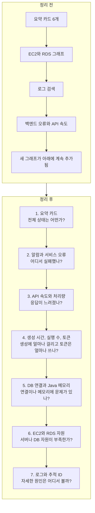

# ADR: CloudWatch 대시보드에서 서비스 문제를 먼저 보이게 한다

> 이 문서는 10월 22일 당시 기록입니다. 서버 전환은 [10월 29일 결정](2026-10-29_ec2-postgresql-monitoring.md), 현재 Dev 표시와 로그 수정은 [10월 30일 결정](2026-10-30_dev-dashboard-corrections.md)을 따릅니다.

- 상태: 결정하고 dev에 적용함
- 날짜: 2026-10-22
- 적용 범위: dev 대시보드

## 배경

dev 대시보드에는 현재 위젯 51개가 있다. 맨 위 카드 6개는 서버와 DB 상태를 보여준다. 그 아래에는 EC2와 RDS 그래프, 로그 검색, 백엔드 오류와 API 속도 그래프가 차례로 놓여 있다. 서비스 오류와 응답 시간을 보려면 화면을 많이 내려야 한다.

모니터링 운영 안내에는 API 응답과 오류, EC2와 RDS 자원을 함께 보도록 되어 있다. dev에는 부하 테스트 원인을 찾기 위한 GC와 Java 메모리 그래프도 있다.

현재 그래프 순서를 정한 ADR은 찾지 못했다. 10월 8일 기록과 대시보드 생성 코드를 보면, 새 그래프를 추가할 때 기존 그래프를 보존하고 아래에 붙였다. 지금의 긴 화면은 그래프가 차례로 추가된 결과일 수 있다. 처음부터 이 순서로 보도록 정했다는 기록은 없다.

## 배치 순서 그림

정리 전에는 서버와 DB 자원, 로그, 오류와 API 속도 그래프가 긴 화면에서 차례로 이어졌다. 새 그래프는 아래쪽에 추가됐다. 그래서 서비스 오류와 API 속도를 확인하려면 화면을 내려야 했다.

정리 후에는 요약을 본 다음 오류, 속도, 생성 작업, DB와 Java, 서버 자원, 로그 순서로 확인한다. 위에서 아래로 내려가며 문제 범위를 좁힐 수 있다.

## 확인 순서를 정한 이유

이 순서는 오류뿐 아니라 응답 지연이나 생성 작업 문제의 원인을 찾기 위한 기준이다. 먼저 서비스에 보이는 증상을 확인하고, 관련 작업과 자원을 살핀 뒤 로그에서 자세한 내용을 확인한다. 매번 모든 단계를 차례로 볼 필요는 없다. 알람이나 증상이 특정 구역을 가리키면 그곳부터 확인한다. 지표 변화는 원인 후보를 좁히는 데 쓰며, 그 자체로 원인을 확정하지는 않는다.

| 확인 구역 | 이 순서로 보는 이유 |
| --- | --- |
| 요약 카드 | 서비스와 서버, DB의 전체 상태를 먼저 보고 문제가 넓게 나타나는지 확인한다. |
| 알람과 서비스 오류 | 감지된 알람과 실패 응답을 보고 문제가 실제로 발생했는지, 어느 기능에서 보이는지 확인한다. |
| API 속도와 처리량 | 오류가 없어도 응답이 느려졌는지 확인한다. 요청 수와 처리 수를 함께 보면 사용량 변화도 살필 수 있다. |
| 생성 시간, 실행 수, 토큰 | 문제가 생성 기능에 집중되는지 확인한다. 생성 시간과 실행 수는 작업량을 보여준다. 토큰은 공급자 응답에서 관측한 합계이며 사용자 차감액이나 청구 비용은 아니다. |
| DB 연결과 Java 메모리 | 요청이 DB 연결을 기다리는지, 앱 메모리 사용이 늘었는지 확인한다. dev에서는 부하 테스트 때도 함께 보는 지표다. 평소 DB 연결과 메모리 문제를 살필 때도 사용한다. |
| EC2와 RDS 자원 | 앞에서 본 증상과 함께 서버나 DB의 자원 부족 징후가 있는지 살핀다. |
| 로그와 추적 ID | 확인할 시간대와 요청을 좁힌 뒤 로그에서 자세한 상황을 확인한다. 짧은 오류 요약과 추세는 한 행에 두 개씩 두어 비교하고, 오류 원문이나 추적 ID를 보여주는 긴 검색 결과는 한 행 전체 폭을 써서 읽기 쉽게 한다. |

## 결정

dev 대시보드를 아래 순서로 정리한다. 문제가 생기면 서비스 오류와 속도부터 확인하고, 앱과 DB 연결, 서버 자원, 상세 로그를 차례로 살핀다.

1. 맨 위 요약 카드 6개를 그대로 둔다.
2. 카드 바로 아래에 dev 알람과 일기 생성, HTTP 5xx, Gemini, S3 오류 그래프를 둔다.
3. 다음에 API 응답 시간, RPS, TPS 그래프를 둔다.
4. 생성 평균 시간, 실행 표본 수, Gemini 토큰 그래프를 한곳에 둔다.
5. DB 연결 대기와 획득 시간, Java 메모리 그래프를 모은다. 구역 제목에 `부하 테스트에서도 확인`을 표시해 dev 진단 지표임을 알아보기 쉽게 한다. 부하 테스트 전용으로 한정하지 않는다. 이 그래프는 평소 DB 연결과 메모리 문제를 살필 때도 사용한다. Java 힙 그래프에는 힙 사용량과 확보량을 표시한다. Java 힙 외 메모리 그래프에는 힙 외 사용량과 확보량만 표시한다. 같은 힙 사용량이 두 그래프에 반복되지 않게 한다. dev에서만 보는 GC와 힙 외 메모리 그래프도 이곳에 둔다.
6. EC2 그래프를 모은 뒤 RDS 그래프를 둔다.
7. 로그 검색과 추적 ID 그래프를 마지막에 둔다. 짧은 요약과 추세 위젯은 한 행에 두 개씩 배치하고, 오류 원문이나 추적 ID처럼 긴 결과를 보여주는 상세 로그 위젯은 한 행 전체 폭을 사용한다.

위젯의 위치를 바꾸고 서비스 오류 구역 제목을 알아보기 쉽게 고친다. API 속도와 DB 및 Java 구역 제목 위젯 2개를 추가한다. 기존 위젯 51개는 모두 남긴다. 그래프의 계산식과 수집 지표, 시간 간격, 기준선, 알람 이름과 알림 설정, 로그 검색 내용은 바꾸지 않는다. prod에는 이번 변경을 적용하지 않는다.

## 확인 방법

- `DASHBOARD-harudle-dev`에서 요약 카드와 알람, 오류 그래프가 화면 위쪽에 있는지 확인한다.
- 정리 전과 같은 6시간 범위에서 그래프가 모두 보이는지 확인한다.
- 기존 위젯 51개와 알람 19개가 남아 있는지 확인한다.
- 로그 요약과 추세 위젯은 한 행에 두 개씩, 상세 오류와 추적 ID 로그는 한 행 전체 폭으로 배치했는지 확인한다.
- DB와 Java 구역 제목에 부하 테스트에서도 확인한다는 표시가 있고, 이 지표들이 부하 테스트 전용으로 보이지 않는지 확인한다.
- Java 힙 그래프에는 힙 사용량과 확보량만, Java 힙 외 메모리 그래프에는 힙 외 사용량과 확보량만 있는지 확인한다.
- 지표 이름, 계산식, 집계 간격, 기준선, 로그 검색 내용과 알람 설정이 바뀌지 않았는지 확인한다.
- dev 화면을 팀과 확인한 뒤 prod 적용을 따로 결정한다.

## 결과

2026-10-22에 dev 대시보드에 적용했다. 요약 카드 아래에 알람과 서비스 오류가 보이고, 그 다음에 API 속도와 처리량이 온다. DB와 Java, EC2, RDS, 로그는 그 뒤에 모았다.

기존 위젯 51개와 알람 19개를 보존했다. 구역 제목 2개를 추가해 위젯은 모두 53개다. Java 메모리 그래프는 힙 사용량과 확보량, 힙 외 사용량과 확보량을 각각 나눠 표시한다. 네 지표는 모두 남아 있고, 중복으로 보이던 힙 사용량은 한 번만 표시한다. 저장된 대시보드 원본과 6시간 화면에서 순서와 그래프 범례를 확인했다. 지표 계산, 시간 간격, 기준선, 알람 연결, 로그 검색 내용은 바꾸지 않았다. DB 연결 대기 수가 두 그래프에 반복되는 점은 이번에 수정하지 않았다.

로그 요약과 추세 위젯은 두 개씩 한 행에 놓고, Nginx 오류 상세, 백엔드 추적 ID, CodeBuild 로그는 전체 폭으로 보이게 했다. dev 화면에서 이 배치를 확인했다.

DB와 Java 메모리 구역 제목에 `부하 테스트에서도 확인`을 표시했다. 이 지표는 부하 테스트에만 쓰는 것이 아니라 평소 DB 연결과 메모리 문제를 살필 때도 사용한다. 지표나 알람 설정은 바꾸지 않았다.

prod는 수정하지 않았다. 일부 로그 그래프에 데이터가 없는 점과 HTTP 완료 수에 헬스체크가 포함되는지 문서마다 설명이 다른 점은 별도 확인이 필요하다.

## 검토한 대안

- 기존 순서를 유지하고 새 그래프만 계속 아래에 추가한다. 기존 데이터는 보존하지만 오류와 속도 그래프를 찾기 어렵기 때문에 선택하지 않았다.
- 사용 빈도가 낮아 보이는 그래프를 삭제한다. 실제 사용 기록이 없고 dev 부하 테스트용 그래프도 있어 이번에는 선택하지 않았다.
- 기준선, 알람, 지표 계산식을 함께 조정한다. 화면 정리와 운영 기준 변경을 한 번에 검토하기 어려워 이번 범위에서 제외했다.

## 관련 문서

- [모니터링 운영 안내](../README.md)
- [대시보드 추가 관측 기록](../generation-observation.md)
