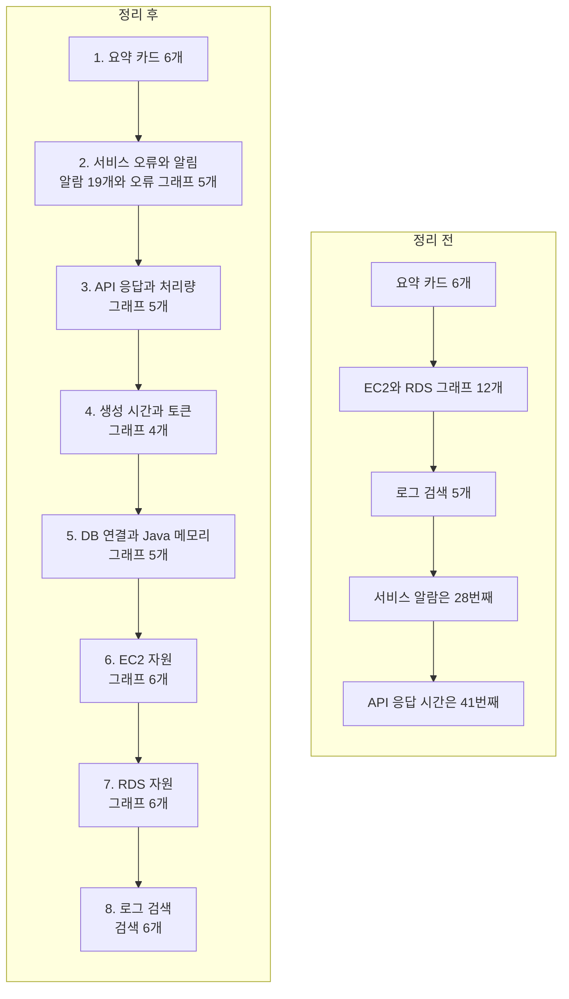

# ADR: prod 대시보드에서 서비스 문제를 먼저 확인한다

- 상태: 결정 완료, prod에 적용
- 날짜: 2026-10-22
- 적용 범위: DASHBOARD-harudle-prod

## 배경

정리 전 prod 대시보드에는 위젯이 49개 있었다. 지표 위젯 37개, 제목 위젯 5개, 로그 검색 위젯 6개, 알람 위젯 1개였다. 알람 위젯 하나에는 알람 19개가 연결돼 있었다.

맨 위 요약 카드 6개 다음에 EC2 그래프 6개와 RDS 그래프 6개가 나왔다. 그 뒤에 로그 검색 5개가 먼저 있었고, 서비스 오류와 알람은 그 다음에 나왔다. 알람 위젯은 전체 49개 중 28번째였다. API 응답 시간 그래프는 41번째였다. 알람 앞에 위젯 27개가 있었고, API 응답 시간 그래프 앞에는 40개가 있었다.

그래서 장애가 났을 때 서비스 오류와 API 속도를 찾기 전에 서버 자원 그래프와 로그 검색을 지나야 했다. 문제가 생긴 위치를 빨리 찾기 어렵다.

## 정리 전과 정리 후

| 확인 항목 | 정리 전 | 정리 후 |
| --- | --- | --- |
| 전체 위젯 | 49개 | 51개 |
| 알람 위젯 위치 | 28번째 | 8번째 |
| API 응답 시간 첫 그래프 | 41번째 | 15번째 |
| 알람 앞에 있는 위젯 | 27개 | 7개 |
| API 응답 시간 앞에 있는 위젯 | 40개 | 14개 |
| 지표 위젯 | 37개 | 37개 |
| 로그 검색 위젯 | 6개 | 6개 |
| 연결된 알람 | 19개 | 19개 |

알람은 20개 적은 위젯을 지나면 볼 수 있게 됐다. API 응답 시간은 26개 적은 위젯을 지나면 볼 수 있게 됐다. 두 제목을 추가해 전체 위젯은 49개에서 51개가 됐다. 기존 그래프, 로그 검색, 알람은 하나도 삭제하지 않았다.

## 결정

대시보드를 아래 순서로 배치한다.

1. 맨 위 요약 카드 6개는 유지한다.
2. 카드 바로 아래에 알람 19개와 생성, Gemini, S3, HTTP 오류 그래프를 둔다. 오류 그래프는 5개다.
3. API 응답 시간, RPS, TPS 그래프 5개를 둔다.
4. 생성 평균 시간, 실행 표본 수, 토큰, 정리 실패 그래프 4개를 둔다.
5. DB 연결과 Java 메모리 그래프 5개를 모은다.
6. EC2 그래프 6개를 모은다.
7. RDS 그래프 6개를 모은다.
8. 로그 검색 6개를 마지막에 둔다. 짧은 검색은 한 행에 2개씩, Nginx 오류와 백엔드 추적 ID 검색은 한 행 전체 폭으로 둔다.

먼저 알람과 오류를 보면 서비스에서 문제가 보이는지 확인할 수 있다. 다음에 API 응답 시간과 처리량을 보면 느려졌는지, 요청 수가 달라졌는지 확인할 수 있다. 생성 그래프는 문제가 생성 기능에 모였는지 보여준다. DB와 Java, EC2, RDS 그래프는 원인 후보를 좁히는 데 쓴다. 마지막 로그 검색에서 시간과 오류 내용을 자세히 확인한다.

## 바꾸지 않은 항목

- 지표의 이름, 계산식, 수집 간격, 경고 기준은 바꾸지 않았다.
- 로그 검색 내용은 바꾸지 않았다.
- 알람 19개와 알림 설정은 바꾸지 않았다.
- 기존 위젯 49개를 모두 남겼다. API 제목과 DB 제목 2개를 추가했다.
- API 완료 수와 5xx 수, 5xx 비율은 목적이 달라 둘 다 남겼다. 완료 수는 건수이고 비율은 전체 요청 중 오류가 차지하는 비율이다.
- hikaricp_connections_pending 값은 기존처럼 두 그래프에 남아 있다. 두 그래프는 DB 구역에 모았고, 이번 변경에서는 지표를 합치거나 삭제하지 않았다.

## 적용 확인

- prod 서버와 DB 선택값은 EC2 i-00944495cd72e61e8, RDS harudle-db였다.
- 대시보드를 저장한 뒤 새로고침해도 구역 순서가 유지되는 것을 확인했다.
- 요약 카드 6개 다음에 서비스 알람과 오류 그래프가 보이는 것을 확인했다.
- 알람 위젯에 알람 19개가 연결돼 있는 것을 확인했다.
- 선택한 6시간 동안 로그 검색 6개 중 5개는 데이터를 찾을 수 없다고 표시됐다. 검색 내용은 보존했다. 데이터가 없다는 것은 오류가 0건이라는 뜻이 아니다.
- 현재 로그 검색 결과가 없는 이유는 이번 배치 변경으로 확인하지 않았다.

## 관련 문서

- [모니터링 운영 안내](../README.md)
- [dev 대시보드 배치 ADR](2026-10-22_cloudwatch-dashboard-layout.md)
