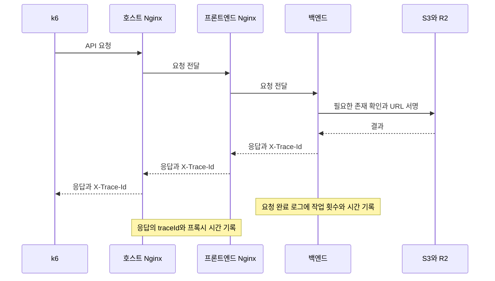

# 느린 요청의 처리 구간 확인

같은 `traceId`로 k6, 두 Nginx, 백엔드 로그를 찾는다. 백엔드 로그 한 건에는 피드 데이터 조회 시간과 S3, R2 작업 횟수도 함께 남는다. 이 변경은 저장소 선택 순서나 재시도 설정을 바꾸지 않는다.



백엔드가 만든 응답 ID를 두 프록시가 기록한다. 요청 헤더로 받은 ID를 로그 연결의 기준으로 사용하지 않는다. 백엔드 응답을 받지 못한 요청은 `traceId`가 빈 문자열이나 `-`일 수 있다. 이때 프록시의 `proxyRequestId`, 경로, 상태와 실행 시각으로 조사 범위를 좁힌다. 두 프록시의 `proxyRequestId`는 서로 다르다.

## 백엔드 로그 읽기

`event=api_request_completed`에 다음 숫자 필드를 추가한다. 기존 `durationMs`, `operation`, `apiGroup`, `httpStatus`는 유지한다. 시간 단위는 밀리초다.

| 필드 | 뜻 |
| --- | --- |
| `feedImageCount` | 피드 응답 조립을 끝낸 이미지 수. 프로필 이미지는 세지 않는다. 응답 전송 성공을 보장하는 값은 아니다. |
| `r2Enabled` | 실행 설정에서 R2가 활성화됐는지 나타내는 참 또는 거짓 값 |
| `feedQueryCount`, `feedQueryDurationMs`, `feedQueryMaxMs` | 피드 목록과 상세의 서비스 호출 횟수, 누적 시간, 가장 긴 시간 |
| `s3HeadCount`, `r2HeadCount` | 요청 안에서 실행한 저장소 존재 확인 횟수 |
| `s3HeadDurationMs`, `r2HeadDurationMs` | 존재 확인에 걸린 누적 시간 |
| `s3HeadMaxMs`, `r2HeadMaxMs` | 존재 확인 한 번에 걸린 가장 긴 시간 |
| `s3SignCount`, `r2SignCount` | 접근 URL 서명 횟수 |
| `s3SignDurationMs`, `r2SignDurationMs` | 접근 URL 서명에 걸린 누적 시간 |
| `s3SignMaxMs`, `r2SignMaxMs` | URL 서명 한 번에 걸린 가장 긴 시간 |

각 작업에는 같은 접두사의 `FailureCount`와 `MissingCount`도 있다. 이미지가 없어서 정상적으로 빈 결과를 받은 경우는 `MissingCount`다. 예외가 발생한 경우는 `FailureCount`다. `feedQuery`와 서명 작업의 `MissingCount`는 0이다. 실행하지 않은 작업은 횟수와 시간이 모두 0이다.

`feedQueryDurationMs`는 순수 SQL 실행 시간이 아니다. 서비스의 DB 연결 획득과 조회, 트랜잭션 종료, 서비스 안의 다른 처리도 포함한다. 서비스 안에서 서명을 실행했다면 그 시간은 두 필드에 함께 포함될 수 있다. 따라서 모든 작업 시간을 더해 전체 처리 시간과 같다고 해석하지 않는다.

존재 확인 횟수는 저장소를 감싼 코드의 호출 횟수다. SDK 내부 재시도나 버킷 확인 등 모든 HTTP 요청을 세는 값은 아니다. URL 서명 시간도 이미지 다운로드 시간이 아니다. 브라우저의 이미지 다운로드는 API 응답 뒤에 별도로 일어난다.

요청 정보는 해당 HTTP 요청에 보관한다. 요청 문맥이 없는 생성 작업과 백그라운드 작업은 이 요청별 합계에 포함하지 않는다. 별도의 전체 R2 지표 `harudle.r2.operation.calls`와 `harudle.r2.operation.duration`은 백그라운드 작업에도 기록한다. 현재 대상은 존재 확인과 접근 URL 서명이다. 이 R2 지표는 Prometheus에 노출하며, 이번 CloudWatch 그래프는 요청 완료 로그를 사용한다.

백엔드 로그 그룹에서 느린 피드 목록 요청을 찾는 예시다. 조회 시간을 테스트 실행 구간으로 제한한다.

```text
fields @timestamp, traceId, durationMs, feedImageCount, feedQueryDurationMs,
       s3HeadCount, s3HeadDurationMs, s3HeadMaxMs,
       r2Enabled, r2HeadCount, r2HeadDurationMs,
       s3SignCount, s3SignDurationMs, r2SignCount, r2SignDurationMs
| filter event = "api_request_completed" and operation = "feed_list"
| sort durationMs desc
| limit 20
```

한 요청을 찾을 때는 백엔드와 프론트엔드 로그 그룹을 함께 선택하고 다음처럼 조회한다. 예시 ID를 실제 응답 ID로 바꾼다. 호스트 로그도 CloudWatch에 별도 수집한 경우에만 함께 선택한다.

```text
fields @timestamp, @log, event, stage, traceId, durationMs, requestSeconds,
       upstreamConnectSeconds, upstreamHeaderSeconds, upstreamResponseSeconds
| filter traceId = "0123456789abcdef0123456789abcdef"
| sort @timestamp asc
| limit 100
```

이 조회는 [CloudWatch Logs Insights의 필드 조회와 필터 문법](https://docs.aws.amazon.com/AmazonCloudWatch/latest/logs/CWL_QuerySyntax.html)을 사용한다. 실제 AWS 조회는 배포 뒤에 진행한다.

## Nginx와 k6 로그 읽기

두 프록시는 `event=proxy_request_completed` JSON을 남긴다. `stage`로 `host_proxy`와 `frontend_proxy`를 구분한다.

| 필드 | 뜻 |
| --- | --- |
| `requestSeconds` | 해당 프록시가 요청을 처리한 전체 시간 |
| `upstreamConnectSeconds` | 다음 서버와 연결하는 데 걸린 시간 |
| `upstreamHeaderSeconds` | 다음 서버의 응답 헤더를 받기까지 걸린 시간 |
| `upstreamResponseSeconds` | 다음 서버의 응답을 받는 데 걸린 시간 |
| `requestCompleted` | 요청을 끝냈으면 `OK`, 끝내지 못했으면 빈 값 |

Nginx 시간 단위는 초다. `upstream` 시간은 문자열이다. 값이 없으면 `-`가 나오며, 여러 서버에 시도하면 여러 값이 들어갈 수 있다. 하나의 숫자로 가정해서 계산하지 않는다. 각 시간은 포함 범위가 겹치므로 단순 합산하지 않는다. 서로 다른 서버의 시각을 빼서 통신 시간을 계산하지 않는다.

k6는 1초 이상 걸린 API의 `durationMs`와 `blockedMs`, `connectingMs`, `tls_handshakingMs`, `sendingMs`, `waitingMs`, `receivingMs`를 남긴다. 순서대로 실행 대기, 연결, TLS 연결, 전송, 첫 응답 대기, 수신 구간이다. 값이 없거나 유효하지 않으면 `unavailable`이다. 연결과 TLS 시간은 전체 요청 시간과 별도로 확인한다. 서로 포함되는 구간이 있으므로 전부 더하지 않는다.

새 지표에는 이미지 Object Key, 서명된 URL, 토큰, 요청 본문을 넣지 않는다. Nginx의 `uri`는 쿼리 문자열을 제외한다. 경로 자체에 ID가 있다면 로그에는 남을 수 있으므로 로그 접근 권한은 기존대로 관리한다. `traceId`와 `proxyRequestId`는 로그에만 두며 지표 구분값으로 넣지 않는다.

## 적용과 확인

1. 백엔드와 프론트엔드 이미지를 배포한다. 프론트엔드 Nginx의 새 형식은 이미지에 포함된다.
2. 호스트의 실제 Nginx 설정을 보관한다. `deploy/nginx/harudle.conf.example`의 로그 형식을 `http` 문맥에 한 번만 정의한다. 실제 HTTPS 요청을 처리하는 443 서버에도 새 `access_log`를 지정한다. 예시 파일을 그대로 덮어쓰지 않는다.
3. 호스트에서 `sudo nginx -t`가 성공한 뒤 `sudo systemctl reload nginx`를 실행한다. 호스트 접근 로그는 이 예시만으로 CloudWatch에 수집되지 않는다. 우선 호스트의 실제 접근 로그에서 확인하거나 별도 수집 설정을 적용한다.
4. [기존 대시보드 준비 절차](README.md#2-내-컴퓨터에서-대시보드-파일을-만듭니다)를 따라 파일을 만든다. API 필터 6개에 요청별 작업 필터 10개가 추가되어 `metric-filter-1.json`부터 `metric-filter-16.json`, `dashboard.json`이 생성된다. 필터 16개와 대시보드를 적용한다. 기존 필터는 이름을 확인해 갱신한다.
5. 피드 목록과 상세를 각각 한 번 조회한다. 응답의 `X-Trace-Id`로 백엔드와 두 프록시 로그를 찾는다. `feedQueryCount=1`과 반환한 `feedImageCount`를 확인한다. R2 비활성 상태라면 `r2Enabled=false`, R2 호출 횟수 0인지 확인한다.
6. 요청별 저장소 작업 수, 저장소 누적 시간 P95, 피드 데이터 조회 시간 그래프에 새 값이 들어오는지 확인한다. 필터는 적용 이후 로그부터 집계한다. 호출이 없는 구간의 시간 그래프는 데이터가 없을 수 있다.
7. 새 실행 이름으로 부하테스트를 실행한다. 느린 요청의 k6 로그와 서버 로그를 함께 보관한다. 백엔드가 느리면 조회와 저장소 작업을 먼저 확인한다. 백엔드는 빠른데 프록시가 느리면 다음 서버의 연결과 응답 대기 시간을 확인한다. 두 프록시도 빠르면 클라이언트 연결과 수신 구간을 확인한다.

호스트 설정과 AWS 설정 적용은 코드 수정과 별도다. 이 변경을 작성하면서 실제 서버 배포나 AWS 지표 설정 변경은 실행하지 않았다.

CloudWatch 작업 횟수 그래프는 각 요청의 횟수를 `Sum`으로 더한다. 시간 필터는 해당 작업의 `Count > 0`인 요청만 받는다. 호출하지 않은 요청의 0ms를 넣어 P95가 낮아지는 것을 막는다. 저장소 P95는 요청별 누적 시간의 P95다. 개별 저장소 호출의 P95와 다르다. 기존 API 시간 지표의 집계 방식은 유지한다.

## 로컬 검증

저장소 루트에서 `node --test backend/load-test/test_members.mjs`를 실행한다. Python이 있는 환경에서는 `deploy/monitoring`에서 `python3 -m unittest test_prepare_dashboard test_monitoring_config`를 실행한다.

Docker가 실행 중이면 저장소 루트에서 `node --test deploy/scripts/test_proxy_latency.mjs`를 실행한다. Docker가 PATH에 없으면 `DOCKER_BIN`에 실행 파일 경로를 지정한다. 테스트는 로컬 임시 Nginx 세 개로 정상 응답과 백엔드 응답 실패를 확인한다. dev나 prod에는 접속하지 않는다. Java 테스트는 `RequestOperationTimingsTest`, `ApiRequestObservationHandlerTest`, `ObservedBackupObjectStorageTest`와 기존 S3, 피드 테스트를 함께 실행한다.
