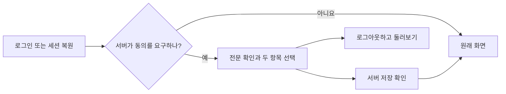
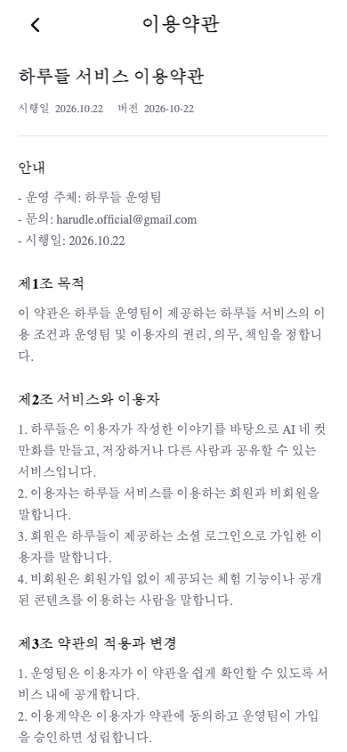
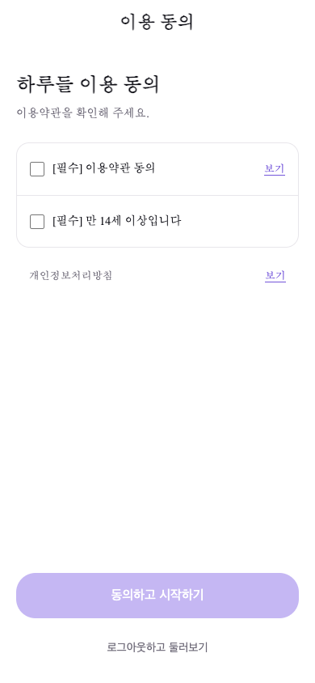
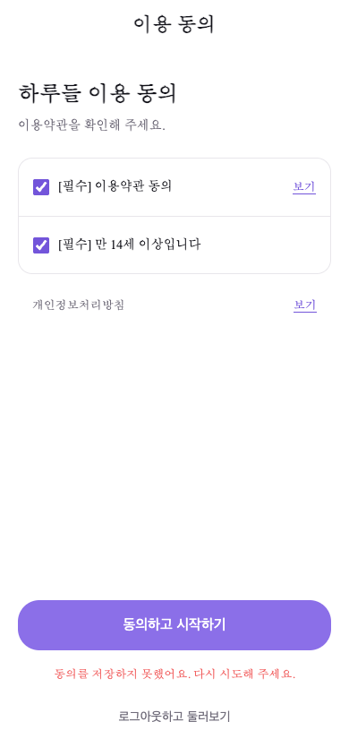
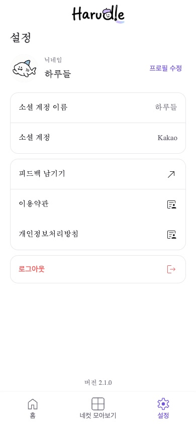

# 이용약관 열람과 동의 화면 (#428)

로그인·설정·소개 화면에서 이용약관과 개인정보처리방침 전문을 연다. 로그인 성공 자체를 동의로 간주하지 않고, 서버가 수락을 요구하면 첫 이용 전에 확인 화면으로 안내한다.

- **직접 확인:** 이용약관과 만 14세 이상 여부를 각각 기본 미선택으로 표시한다. 생년월일·실명 인증을 추가하지 않는다.
- **개인정보처리방침:** 별도 고지로 열람한다. 개인정보 처리 전체에 대한 일괄 동의 체크를 받지 않는다.
- **실패:** 선택을 유지해 다시 제출한다. 문서 버전이 바뀌면 최신 문서를 읽고 선택을 초기화한다.
- **거절:** 로그아웃한 뒤 소개 화면으로 이동한다. 토큰 갱신에 실패하는 계정도 쿠키·CSRF 기반 로그아웃을 사용할 수 있다.
- **기존 동작:** 약관 확인이 끝나기 전에 개인 일기 생성 상태를 조회하지 않는다. 세션이 끝나면 생성 상태·토스트 식별자를 함께 정리한다.

기존 PageHeader·ActionButton·LoadingSpinner와 ApiRequest 요청 상태를 재사용한다. 인증 요청은 기존 authFetch가 맡고, 공개 전문은 publicFetch를 사용한다. 분석 SDK 초기화 오류가 정상 로그아웃을 막지 않게 한다.

[백엔드 #476](https://github.com/woowacourse-teams/2026-Harudle/pull/476)의 문서·동의 API가 먼저 필요하다. 필수 적용은 기본 비활성 상태이며 정책 대조·기존 회원 안내와 양쪽 배포를 확인한 뒤 환경별로 켠다. 상세 경계는 [백엔드의 상황별 흐름](https://github.com/woowacourse-teams/2026-Harudle/blob/feat/428-terms-consent-backend/backend/docs/terms-consent-scenarios.md), [원문 정책 대조](https://github.com/woowacourse-teams/2026-Harudle/blob/feat/428-terms-consent-backend/backend/docs/terms-policy-review.md)를 참고한다.

390×844 로컬 실행 화면

실제 프론트와 MSW 테스트 응답을 사용한 화면이다.

확인할 사용자 흐름

- 직접 로그인과 기존 세션 복원 모두 동의 후 원래 내부 화면으로 돌아간다.
- 개발 모드 콜백 재실행에도 토큰 교환과 복귀 경로 소비는 한 번만 한다.
- 직접 URL 진입, 중복 클릭, 서버 오류와 문서 변경을 처리한다.
- 비로그인 전문·피드 열람과 기존 설정·일기 생성·피드 기능을 유지한다.
- 본인의 동의 상태는 서버에서 다시 확인하며 브라우저 저장소에 권한 근거로 저장하지 않는다.

