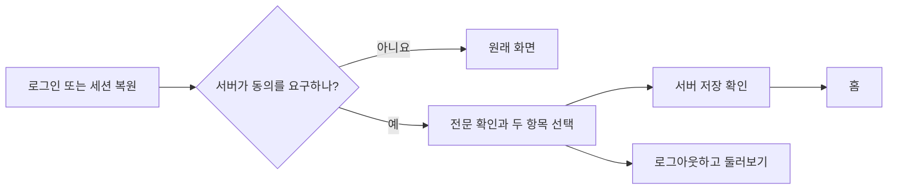

# 이용약관 열람과 동의 화면 (#428)

로그인·설정·소개 화면에서 이용약관과 개인정보처리방침 전문을 연다. 로그인 성공 자체를 동의로 간주하지 않고, 서버가 수락을 요구하면 첫 이용 전에 확인 화면으로 안내한다.

- **직접 확인:** 이용약관과 만 14세 이상 여부를 각각 기본 미선택으로 표시한다. `모두 확인하고 동의하기`로 두 항목을 함께 선택·해제할 수 있고 두 항목이 모두 선택됐을 때만 체크 표시한다. 생년월일·실명 인증을 추가하지 않는다.
- **개인정보처리방침:** 별도 고지로 열람한다. 개인정보 처리 전체에 대한 일괄 동의 체크를 받지 않는다.
- **실패:** 선택을 유지해 다시 제출한다. 문서 버전이 바뀌면 최신 문서를 읽고 선택을 초기화한다.
- **거절:** 보라색 시작 버튼 아래에 회색 로그아웃 아이콘과 테두리 없는 보조 버튼으로 구분한다. 기존 로그아웃 API를 호출하고, 성공하면 동의 화면에서 토큰·로그인 표시·생성 추적을 정리한다.
- **기존 동작:** 약관 확인이 끝나기 전에 개인 일기 생성 상태를 조회하지 않는다. 설정 로그아웃·세션 복원·OAuth 콜백은 기존 구현을 사용한다.

피드와 같은 로고 헤더·흰 바탕·얇은 구분선을 사용한다. 기존 ActionButton·LoadingSpinner와 ApiRequest 요청 상태를 재사용한다. 인증 요청은 기존 authFetch가 맡고, 공개 전문은 publicFetch를 사용한다. 분석 SDK 초기화 오류가 정상 로그아웃을 막지 않게 한다.

서비스 경로는 공통 부모에서 세션 복원 → 약관 동의 확인 순으로 진입한다. 로그인·콜백·랜딩·전문·동의 화면은 이 검사 밖에 둔다. 동의 상태는 화면 경로가 바뀔 때 확인한다. 피드의 필터·정렬·해시만 바뀌면 화면과 목록 상태를 유지한다. 공통 인증 코드에 약관 오류 감지나 이벤트를 추가하지 않는다. 동의 완료 후에는 홈으로 이동하며, OAuth 로그인도 기존 홈 이동을 유지한다.

[백엔드 #476](https://github.com/woowacourse-teams/2026-Harudle/pull/476)의 문서·동의 API가 먼저 필요하다. 필수 적용은 기본 비활성 상태이며 정책 대조·기존 회원 안내와 양쪽 배포를 확인한 뒤 환경별로 켠다. 상세 경계는 [백엔드의 상황별 흐름](https://github.com/woowacourse-teams/2026-Harudle/blob/feat/428-terms-consent-backend/backend/docs/terms-consent-scenarios.md), [원문 정책 대조](https://github.com/woowacourse-teams/2026-Harudle/blob/feat/428-terms-consent-backend/backend/docs/terms-policy-review.md)를 참고한다.

확인할 사용자 흐름

- 로그인 또는 세션 복원 뒤 회원 화면에 진입할 때 동의 상태를 확인한다.
- 동의 후에는 홈으로 이동하며 OAuth 콜백의 기존 동작은 변경하지 않는다.
- 직접 URL 진입, 중복 클릭, 서버 오류와 문서 변경을 처리한다.
- 비로그인 전문·피드 열람과 기존 설정·일기 생성·피드 기능을 유지한다.
- 본인의 동의 상태는 서버에서 다시 확인하며 브라우저 저장소에 권한 근거로 저장하지 않는다.

