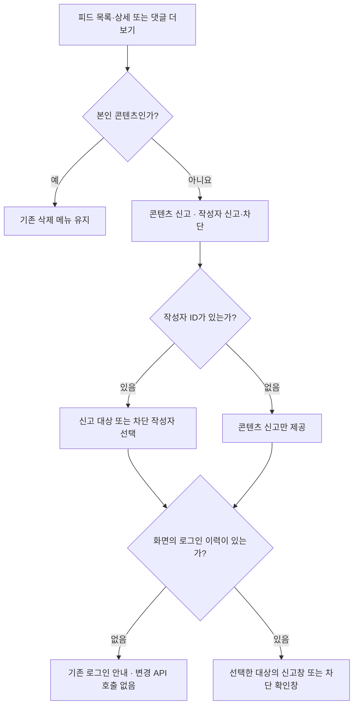
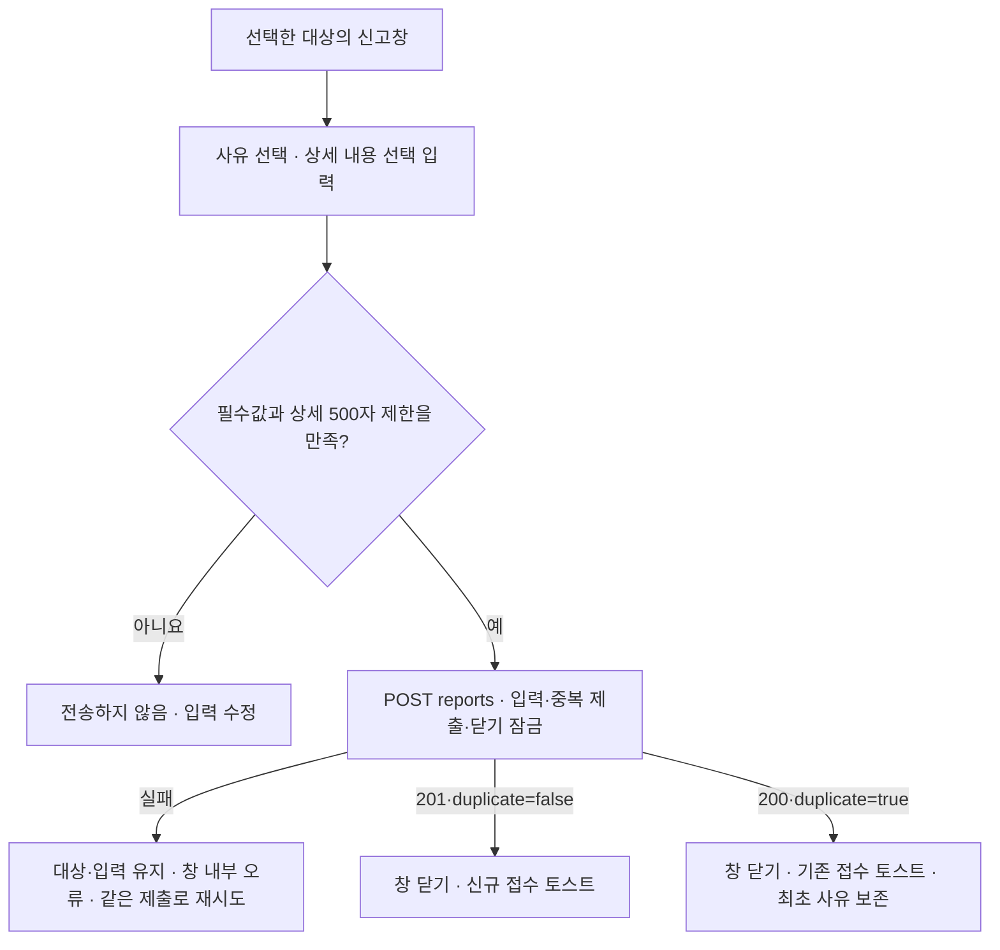
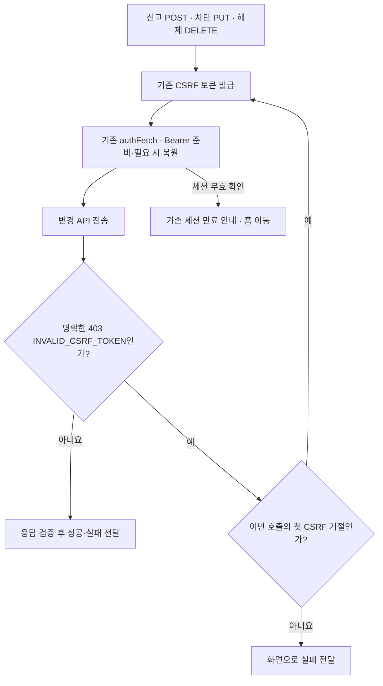
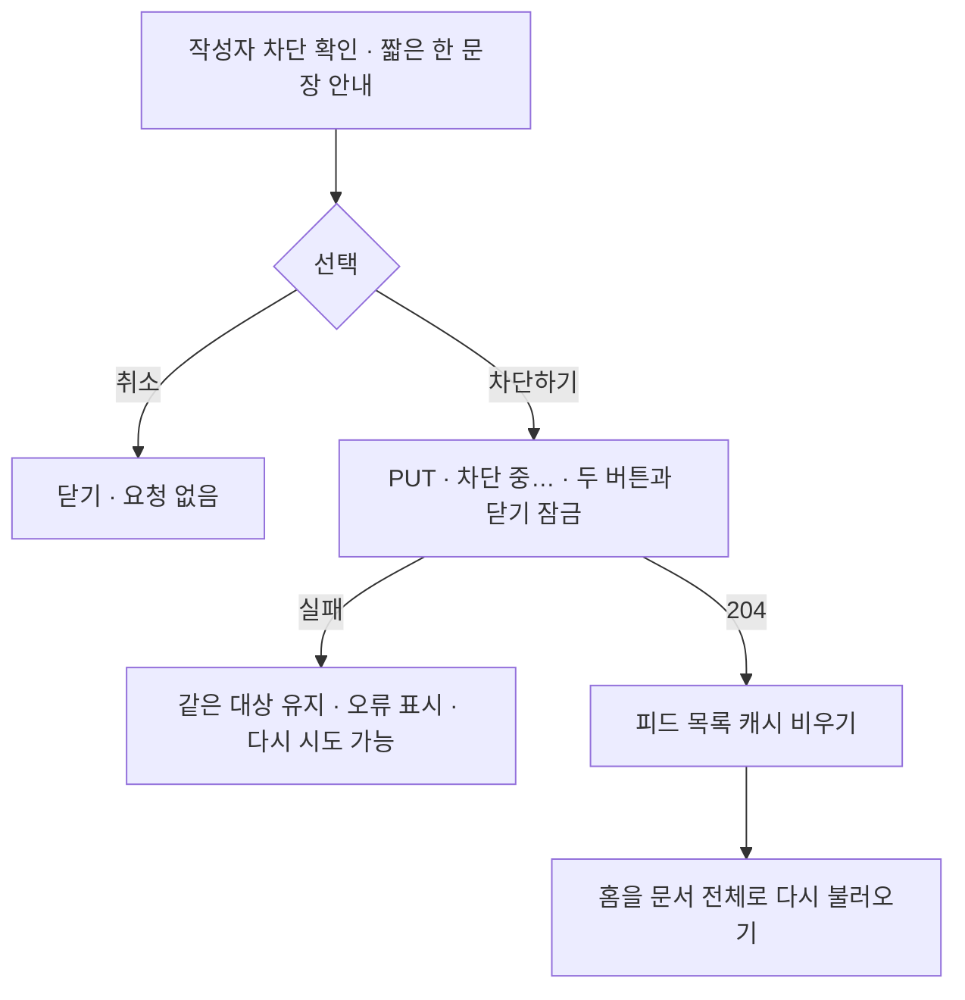
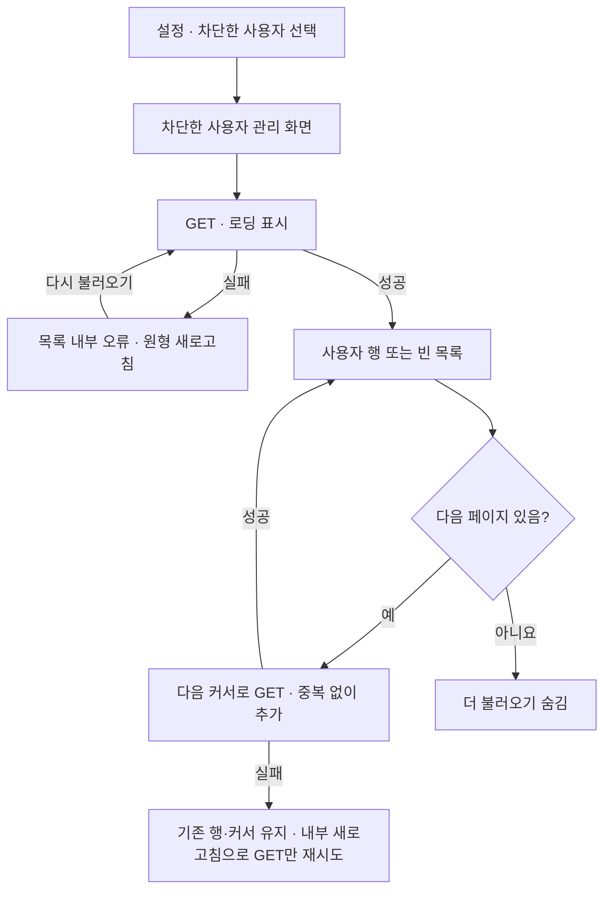
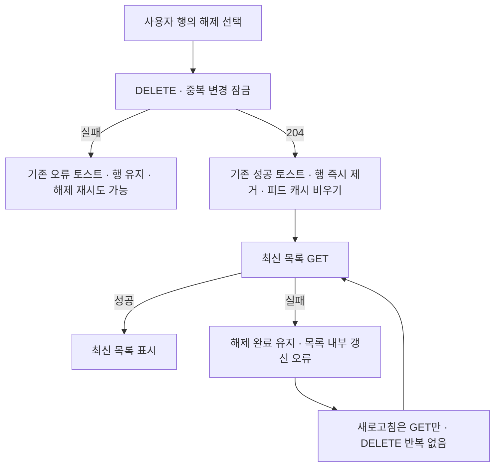

# 신고·차단: 프론트 상황별 동작 흐름

피드 목록·상세·댓글과 설정에서 동작하는 화면·요청·실패 처리를 정리합니다. 실제 서버의 차단 판정·동시 요청·알림 정책은 [백엔드 시나리오](https://github.com/woowacourse-teams/2026-Harudle/blob/feat/425-user-blocking-backend/backend/docs/user-blocking-scenarios.md)에서 별도로 리뷰합니다.

[이전 화면 PDF](https://github.com/user-attachments/files/33856076/harudle-pr463-frontend-review.pdf)는 리뷰 반영 전 참고 자료입니다. 현재는 차단 목록을 별도 관리 화면으로 옮기고 신고 완료를 토스트로 안내합니다. 아래 흐름은 이 변경을 반영하며, 백엔드 구현은 별도 PR에서 관리합니다.

## FE01. 메뉴 진입

- 신고는 사이렌, 차단은 금지 아이콘을 사용합니다. 본인 삭제의 기존 휴지통 아이콘과 흐름을 유지합니다.
- 탈퇴 댓글은 작성자 ID·이미지가 없을 수 있습니다. 목록 전체를 잘못된 응답으로 거절하지 않으며 작성자 신고·차단은 제공하지 않습니다.
- 로그인 이력은 화면 진입 판단에만 사용하고 실제 권한은 서버가 확인합니다.

참고: [타인 피드 메뉴](../src/shared/content/OtherFeedOptionsButton.tsx), [타인 댓글 메뉴](../src/pages/feed-detail/OtherFeedCommentOptionsButton.tsx), [댓글 응답 검사](../src/domain/feeds/feedComments.ts), [신고 진입 회귀](../src/shared/content/ReportEntryPoints.test.tsx).

## FE02. 신고 접수와 중복 안내

- 사유는 스팸·광고, 괴롭힘·욕설, 부적절한 콘텐츠, 기타입니다. 상세는 앞뒤 공백을 제거한 Unicode 코드 포인트 기준 최대 500자입니다.
- 요청에는 대상 종류·ID·사유·상세만 보냅니다. 신고자는 JWT의 회원을 서버가 사용합니다.
- 응답은 접수 ID·`RECEIVED` 상태·중복 여부와 HTTP 상태의 조합까지 검사합니다. 예상과 다른 성공 응답을 접수 완료로 표시하지 않습니다.
- 대기 중 Esc·배경 클릭·취소·입력·추가 제출을 막습니다. 다른 대상을 새로 열면 이전 입력과 결과를 초기화합니다. 신고 대상은 메뉴에서 선택해 props로 전달하고 신고창은 입력·제출만 담당합니다.

참고: [신고창](../src/shared/report/ReportDialog.tsx), [API 계약](../src/domain/reports/reportSubmission.ts), [상태별 테스트](../src/shared/report/ReportDialog.test.tsx).

## FE03. 인증과 CSRF 재시도

기존 `authFetch`의 401 후 토큰 복원·한 번 재요청을 그대로 사용합니다. 위 CSRF 재시도는 별도이며, 저장 전에 거절된 코드가 명확할 때만 한 번 수행합니다. 일반 403·5xx·네트워크 오류를 자동 재전송하지 않습니다. 네트워크 오류만으로 서버 저장이 롤백됐다고 단정하지 않습니다.

차단 목록 GET도 `authFetch`를 사용하고 응답 필드·날짜·hasNext와 nextCursor의 관계를 검사합니다. Access Token을 브라우저 저장소에 추가로 보관하거나 기존 인증 코드를 변경하지 않습니다.

참고: [차단 API](../src/domain/blocks/blocks.ts), [신고 API](../src/domain/reports/reportSubmission.ts), [차단 인증 회귀](../src/domain/blocks/blocks.auth.test.ts), [신고 인증 회귀](../src/domain/reports/reportSubmission.auth.test.ts).

## FE04. 차단 확인과 홈 갱신

`네오님이 작성한 피드와 댓글을 더 이상 볼 수 없어요.`처럼 안내합니다. 공통 `ConfirmModal`을 사용하며 전송 중 중복 제출과 대상 변경도 막습니다. 성공 시 이전 상세·댓글·알림의 메모리 상태를 함께 버립니다. 기존 토스트·생성 폴링 흐름은 유지합니다.

참고: [차단 요청 훅](../src/shared/block/useBlockUser.ts), [공통 확인창](../src/shared/ConfirmModal.tsx), [대기·실패·취소 테스트](../src/shared/content/BlockEntryPoints.test.tsx).

## FE05. 차단 목록 조회와 페이지 오류

- 제목 아래 부가 설명을 제거했습니다. 탈퇴한 대상도 서버의 익명 프로필을 그대로 표시해 해제할 수 있습니다.
- 목록 조회 실패는 기존 카테고리와 같은 회색 문구·원형 새로고침 아이콘을 박스 안에 표시합니다. 토스트로 바꾸지 않습니다.
- 다음 페이지 버튼은 댓글 목록과 같은 공통 `ActionButton`을 사용합니다.
- 설정에서는 차단 아이콘과 진입 항목만 표시합니다. 관리 화면의 뒤로가기는 설정으로 이동합니다.
- 화면을 떠나면 초기·재조회·다음 페이지·해제 후 갱신 GET을 취소하고, 취소된 응답은 목록이나 오류 안내에 반영하지 않습니다.

참고: [관리 화면](../src/pages/blocked-users/BlockedUsersPage.tsx), [조회·해제 훅](../src/pages/blocked-users/useBlockedUsers.ts), [화면 회귀](../src/pages/blocked-users/BlockedUsersPage.test.tsx).

## FE06. 차단 해제와 후속 갱신 실패

| 실패 지점            | 결과 안내                                  | 다시 누를 요청  |
| -------------------- | ------------------------------------------ | --------------- |
| 첫 목록 조회         | 박스 안 오류·새로고침                      | 첫 페이지 GET   |
| 다음 페이지 조회     | 기존 행 유지·박스 안 오류                  | 같은 커서 GET   |
| 해제 요청            | 오류 토스트·대상 행 유지                   | DELETE          |
| 해제204 뒤 목록 갱신 | 성공 토스트·행 제거 유지·박스 안 갱신 오류 | 첫 페이지 GET만 |

이미 보낸 DELETE는 화면을 떠나도 취소하지 않으며, 성공하면 피드 캐시를 비웁니다. 해제는 관리 화면의 목록과 피드 캐시를 정리하며 문서 전체를 다시 불러오지 않습니다. 반대 방향의 차단이 남아 있으면 서버의 숨김은 계속될 수 있지만 상대의 차단 여부를 추가로 조회·표시하지 않습니다.

참고: [조회·해제 훅](../src/pages/blocked-users/useBlockedUsers.ts), [기존 ToastProvider](../src/shared/ToastContext.tsx), [브라우저 회귀](../e2e/user-blocking.spec.ts).

## FE07. 연결할 API와 배포 순서

| API                                     | 완료 계약                                                                  |
| --------------------------------------- | -------------------------------------------------------------------------- |
| `POST /api/v1/reports`                  | 201 신규·200 기존. `{id,status:"RECEIVED",duplicate}`                      |
| `PUT /api/v1/blocks/{userId}`           | 204                                                                        |
| `DELETE /api/v1/blocks/{userId}`        | 204                                                                        |
| `GET /api/v1/blocks?size=20&cursor=...` | `{items:[{userId,nickname,profileImageUrl,blockedAt}],nextCursor,hasNext}` |

신고 API는 머지된 #455에 있습니다. 차단 API와 서버의 피드·댓글·알림 필터는 별도 백엔드 PR에서 추가하므로 **백엔드 반영·배포 후 프론트를 배포**합니다. MSW 검증이 실제 서버 통합 검증을 대신하지는 않습니다. 신고·차단 뒤 콘텐츠 노출과 동시 요청의 서버 정책은 [백엔드 시나리오](https://github.com/woowacourse-teams/2026-Harudle/blob/feat/425-user-blocking-backend/backend/docs/user-blocking-scenarios.md)에서 확인합니다.

개발 브랜치 통합 시 확인

두 개발 브랜치를 통합할 때 기존 신고 UI와 다음 부분이 겹칩니다.

- `FeedItem.tsx`, `FeedDetailContent.tsx`, `FeedCommentItem.tsx`: 본인 삭제와 타인 피드·댓글 메뉴, 작성자·탈퇴 처리를 유지합니다.
- `ReportEntryPoints.test.tsx`, `e2e/feed-detail.spec.ts`: 각 메뉴의 신고·차단·삭제 회귀를 유지합니다.
- 공통 메뉴로 대체된 미사용 `ReportOptionsButton.tsx`를 정리합니다.

최종 통합 시 최신 변경으로 병합 결과를 다시 검증하고, dev에 반영된 프로필 이미지·Nginx·Webpack 설정도 보존합니다.

